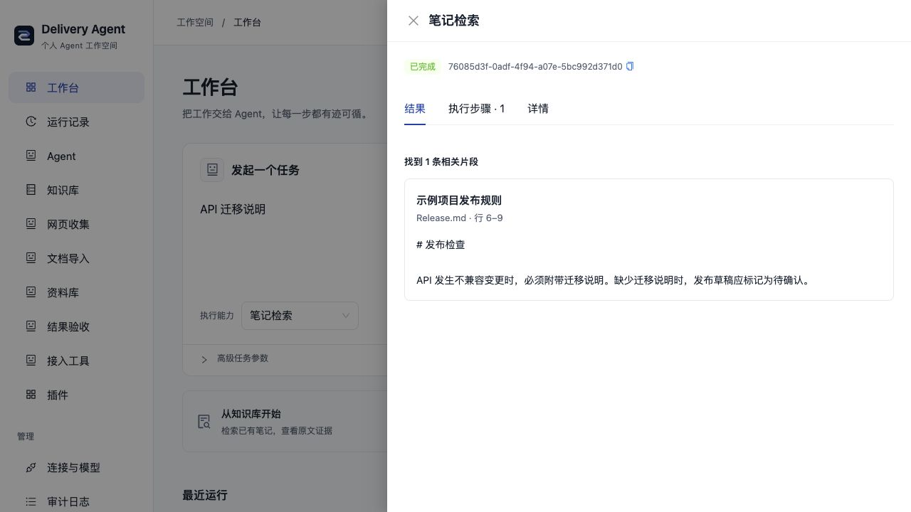

<div align="center">
  
  <h1>AI Delivery Ops Agent</h1>
  <p>用自己的知识和开源插件，完成有来源、可追踪、可复核的 Agent 任务。</p>
</div>

本地优先的 Agent 插件工作台，面向开发者和个人知识使用者。从 Markdown、
Obsidian、公开网页或本地文档开始，检索原文、生成带引用的回答、准备发布草稿，
并在同一个界面查看实际执行步骤与结果。飞书和 TAPD 是可选的团队集成。

当前为 `v0.1.0-alpha`。无需飞书、TAPD 或模型密钥即可启动并体验示例知识检索；
调用外部服务或生成回答时，再配置自己的连接。



## 三个值得试的流程

- **资料成为任务输入**：网页正文或 PDF/Office 转为带来源指纹的 Markdown，
  检查后明确收录到本地资料库；可将资料库选作后续检索和 RAG 的来源。
- **知识变化后复核旧结果**：回答保留实际引用与版本；来源变更后，独立检查记录
  标出变化、缺失或不可访问的引用，保留原回答与证据；可在「知识复核」按路径筛选，
  一次明确检查最多 20 份历史结果。
- **插件结果可检查**：插件声明版本化结果规则，用同一规则检查两次已完成运行，
  展示结构、步骤及执行版本的差异。它不自动重跑任务，也不判断回答的语义正确性。

## 能力与插件

| 能力 | 当前实现 |
| --- | --- |
| Agent 工作台 | 立即返回启动回执、运行进度、主动停止、历史产物及人工补充后继续 |
| 知识复核 | 集中查看实际引用和上次状态，按路径筛选并批量检查，原结果与证据保留 |
| 任务配方 | 核对成功运行的原参数与执行版本；审查后复用，保留新旧运行关联 |
| 模型插件 | 独立 OpenAI / Gemini / Ollama 提供者；本机 HTTP 接口无需 Key，模型由用户准备 |
| 个人研究助手 | 模型规划、受限子任务委派、人工继续与真实资料完成门槛；研究稿需复核 |
| 个人知识 | 只读 Markdown/Obsidian、公开 URL 及两源混合检索，关键词检索、版本、原文定位；可选模型生成引用回答 |
| 资料收集 | 单篇公开网页；微软 MarkItDown 0.1.9 转换 PDF、DOCX、PPTX、XLSX 等本地文件 |
| 本地资料库 | 明确收录、去重、来源凭证、检索与知识来源切换 |
| 开源能力接入 | 可选 GitHub SKILL.md 多份审查/合并配置导出/逐份文本运行；MCP 工具发现、明确授权与配置导出、通用运行器；stdio/HTTPS 与标准 SKILL.md，真实 Context7 示例 |
| 问答评测 | 可选六题虚构资料、实际 RAG、固定退化对照/当前模型、规则对比与 JSON/CLI 门槛；不验证语义 |
| 插件契约 | Manifest、依赖、权限、页面/API/动作、结果规则与 Cordis 资源释放 |
| 可靠执行 | Agent/Tool/Skill 预算、委派、Session/Checkpoint、Run/Artifact 与 Outbox |
| 可选团队能力 | GitHub 发布准备、飞书任务与报告、TAPD 同步、多机器人路由 |

默认 HTTP 工作台装配个人知识、研究、任务配方、资料收集、验收、MCP 接入助手及三个模型提供者。团队能力按需选择。普通 `AGENT_PLUGINS_FILE` 替换默认组合；显式声明 `base: personal` 可保留本机个人工作台并追加插件，见[组合规范](docs/PLUGIN_AUTHORING.md#在个人工作台上追加插件)。

| 组合 | 插件数 | Agent 数 |
| --- | --- | --- |
| 默认 HTTP 工作台 | 14 | 9 |
| 配置 GitHub 后 | 16 | 10 |
| 团队 SDK | 12 | 7 |

[插件规范与作者模板](docs/PLUGIN_AUTHORING.md)描述当前支持的接口。
默认「接入工具」可发现公开 HTTPS MCP、勾选读取工具并导出本地配置，可选择保留个人工作台；重启后直接运行，无需另写适配页面。详见 [MCP 接入流程](docs/MCP_TOOLS.md)。
第三方仓库需要明确适配与授权；当前没有任意仓库自动安装或在线插件市场。

## 本地快速开始

需要 Bun 1.3.x、Node.js 22 与 pnpm 10。不需要 Docker、服务器或外部账号。

```bash
git clone https://github.com/KlayPeter/AI-Delivery-Ops-Agent.git
cd AI-Delivery-Ops-Agent
bun run setup:local
```

首次命令会安装锁定依赖、生成 Prisma Client、安全同步 SQLite，并一起启动前后端。
只在缺少时创建后端 `.env`，已有配置保留。以后从仓库根目录运行：

```bash
bun run local
```

打开终端中 Vite 显示的工作台地址（默认 `http://127.0.0.1:15173/`），进入「知识库」
检索 **API 迁移说明**。结果来自仓库里的虚构示例笔记，无需模型。
前端会连接本次后端实际端口；默认后端为 `8090`，端口占用时明确报错，可在后端
`.env` 修改 `PORT`，或用 `PORT=0 bun run local` 自动分配。Ctrl+C 一起停止。

修改后端代码或连接配置后，停止并重新运行 `bun run local`；前端支持热更新。
独立开发启动、就绪检查及排障见[本地运行](docs/LOCAL_DEVELOPMENT.md)。
长任务启动后可离开页面，在「运行记录」找回或请求停止；已完成的操作不会撤销。
具体范围见[本机运行控制](docs/LOCAL_RUN_CONTROL.md)。

## 接入自己的资料与能力

- 「知识库 → 配置来源」选择 Markdown/Obsidian 目录、公开链接或应用资料库；
  也可选“笔记 + 公开网页”同时检索两类资料；[来源指南](docs/PERSONAL_KNOWLEDGE.md)说明范围、排除项和引用。
- 「任务配方」从成功运行保存原参数，审查后创建新运行；[使用范围](docs/TASK_RECIPES.md)。
- 「研究助手」使用自己的模型委派资料子任务，保留来源索引与运行链路；[使用与验证边界](docs/PERSONAL_RESEARCH.md)。
- 「网页收集」可直接使用；「文档导入」需先安装
  [MarkItDown 转换环境](docs/DOCUMENT_IMPORT.md)，未安装时页面显示状态。
- 「连接与模型」可填写自己的模型、飞书、TAPD 与 GitHub 设置，保存后重启后端。
  Ollama 本机接口无需 Key，见[本机模型配置](docs/LOCAL_DEVELOPMENT.md#使用本机-ollama)。
  设置保存在本机 `connections.json`，权限 0600，密钥不回显；本机文件未加密。
- 从[公开 GitHub 文件链接接入文本 Skill](docs/GITHUB_SKILLS.md)，审查固定指令与许可，
  可保留个人工作台、并列安装多份，选一份方法与确认后的历史知识片段完成任务；保留来源快照，不执行仓库脚本或自动授予工具。
- 体验 [Context7 与标准 Skill](docs/COMMUNITY_PLUGINS.md)，或按
  [MCP 指南](docs/MCP_TOOLS.md)连接经审查的本地工具。独立配置档需显式选择。
- 使用[问答评测](docs/RAG_EVALUATIONS.md)检查修改模型或检索后的规则退化；
  离线对照无需 Key，真实模型模式需明确确认。
- 配置 GitHub 后可使用[发布准备](docs/RELEASE_PREPARATION.md)，结合仓库事实与
  个人规则收集证据；生成草稿需要模型，不自动创建发布或发送消息。
- 团队功能先在后端用 `AGENT_PLUGINS_FILE=profiles/agents/team.yaml bun run dev` 选择现有组合，再按[第三方配置指南](docs/第三方平台接入配置指南.md)填写凭据。飞书 App ID 与
  Secret 均留空时不连接；只填一项会拒绝启动。

## 架构

```text
本地工作台 / CLI / 飞书 / 定时触发
                 │
      Cordis 插件装配与能力注册
                 │
     Agent Host → Agent / Tool / Skill
                 │
     Run → Step → Artifact → Outbox
                 │
      来源版本 / 检查记录 / 可选投递
```

- [后端](backend/README.md)：Bun、Elysia、Prisma、SQLite、Cordis 与 Agent Runtime。
- [前端](frontend/README.md)：React、TypeScript、Vite、Ant Design。
- 确定性状态由领域服务维护；Agent 和模型通过受治理工具调用业务能力。
- 插件可贡献业务入口，部分基础服务仍由宿主拥有；当前边界见
  [功能卡索引](docs/features/README.md)和[路线图](ROADMAP.md)。

## 开发与验证

后端全量测试包含真实文档转换，先在 `backend` 安装
[固定版本 Python 转换环境](docs/DOCUMENT_IMPORT.md)，再执行：

```bash
cd backend
bun install --frozen-lockfile
bunx prisma generate
bunx prisma validate
bun run typecheck
TEST_DATABASE_PATH="$(mktemp)"
DATABASE_URL="file:${TEST_DATABASE_PATH}" bunx prisma db push --skip-generate
DATABASE_URL="file:${TEST_DATABASE_PATH}" bun test
```

前端：

```bash
cd frontend
pnpm install --frozen-lockfile
pnpm lint
pnpm typecheck
bun test
pnpm build
```

行为变化与对应 `FEATURE.md` 同步提交，流程见 [CONTRIBUTING.md](CONTRIBUTING.md)。

## 使用边界

管理 API 没有登录或 RBAC，使用回环地址运行；当前 Host/Origin 检查不等于身份认证。
SQLite 与资料库要求同一数据目录只有一个后端写实例。不要提交 `.env`、凭据、
个人知识、数据库、日志或生成报告。文档转换不提供 OCR，也不是公开上传沙箱。

本轮以本地运行验证为准。现有部署模板见[部署文档](docs/项目部署与开发协作流程.md)，
不影响本地使用。安全问题见 [SECURITY.md](SECURITY.md)，产品后续计划见
[ROADMAP.md](ROADMAP.md)；独立用户采用与长期运行数据仍待验证。

## 文档与许可

[文档中心](docs/README.md)包含使用、插件开发与架构指南。
[项目演示与验证证据](docs/PROJECT_EVIDENCE.md)提供可复现流程、实际截图、简历描述和待完成事项。
项目采用 [Apache License 2.0](LICENSE)；外部服务、内容源和依赖见
[THIRD_PARTY_NOTICES.md](THIRD_PARTY_NOTICES.md)。

可选 [OpenAPI 接入](docs/OPENAPI_TOOLS.md)：从公开规范审查并导出固定 GET 工具，运行保留来源和响应指纹；不需要第三方提供 MCP。

可选 [笔记回写](docs/KNOWLEDGE_WRITEBACK.md)：编辑并审查 Agent 结果，确认时重验引用，再新建一份带来源的笔记；已有文件保持原样。
