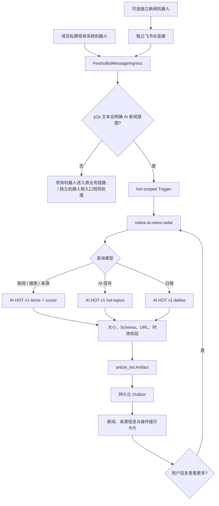

# AI 热点新闻助手

通过系统现有飞书机器人私聊查询最新 AI 资讯，以无需大模型的确定性 Agent 返回可追溯的新闻卡片；需要独立品牌入口时可选配第二个机器人。

## 功能定位

本功能位于飞书消息入口与外部资讯数据源之间。默认模式复用系统已有应用和 `bot-default`：入站层只把明确的 AI 新闻私聊意图前置分流给 `AI News Radar Agent`，其余消息保持原有业务链路。Agent 负责解释有限的时间窗、分类和关键词，外部 Provider 负责拉取并校验实时 JSON，统一投递层使用入站 BotInstance 的凭证发送卡片。若显式提供另一套飞书应用凭证，平台才创建独立 `bot-ai-news`。

当前实现吸收了 [liyoro/ai-news-radar](https://github.com/liyoro/ai-news-radar) 的“多源资讯雷达、时间窗过滤、来源可追溯”产品思路，但不复制其静态站点、GitHub Pages 和归档前端。运行时默认使用可配置的 AI HOT 公共 JSON Provider；后续自建兼容 Provider 时保持 Capability 和 Artifact 契约不变。

## 实现流程图

## 能力边界

### 目标

- 成员向现有飞书机器人发送明确的自然语言新闻查询即可获取当前 AI 新闻，无需第二套应用凭证。
- 新闻标题必须保留来源和可点击原文地址。
- 全链路不依赖大模型，不进入任务、站会或 TAPD 逻辑。
- Provider 可通过环境变量替换，不改变 Agent Capability 和机器人绑定。

### 非目标

- 不提供新闻全文转载、内容版权再授权或长期新闻仓库。
- 不在本功能中实现通用网页爬虫、静态新闻站点或新闻编辑后台。
- 不让新闻路由截获群聊、否定表达、功能咨询或“创建 AI 新闻助手”等业务请求。
- 可选的第二个机器人不处理群聊、任务命令或成员通讯录映射。

## 核心规则

1. Capability 固定为 `knowledge.ai.news.fetch`，Agent ID 固定为 `native.ai-news-radar`。
2. 默认查询最近 24 小时精选；用户明确说“全部/完整/所有/全量”才查询全量，明确说“日报”才使用日报端点。
3. 最近 N 天最多取 7 天；默认返回 15 条，“查看更多/下一页/再来点”沿用上一查询的官方不透明游标返回下一批最多 20 条。
4. Provider 只允许无凭证 HTTPS Base URL，请求不跟随跳转，默认 10 秒超时，响应最多 1 MiB。
5. 只接受 HTTP/HTTPS 原文链接；标题、摘要和来源按长度截断，非法条目直接丢弃。
6. 外部摘要只作为数据展示，不能进入系统 Prompt、Tool 参数或权限判断。
7. 默认机器人只在 p2p 文本同时包含 AI 主题和新闻主题时前置分流；否定、配置咨询和开发任务表达不命中，群消息不触发新闻 Agent。
8. 默认模式复用 `FEISHU_APP_ID` 与 `FEISHU_APP_SECRET`，不复制凭证、不新建长连接；只有显式提供不同的 `FEISHU_AI_NEWS_APP_ID` 时才创建独立机器人并通过 `env://FEISHU_AI_NEWS_APP_SECRET` 解析密钥。Secret 不进入配置数据库、API 返回、Artifact 或日志。
9. 入站幂等键包含 workspace、bot、trigger type 和 message ID；不同机器人出现相同 message ID 时互不影响。
10. Agent 成功只表示 Artifact 已生成；最终用户可见结果以 Outbox 的同 BotInstance 私聊投递成功为准。
11. 关键词查询使用 AI HOT 服务端 `q` 检索，不以本地前 100 条代替全池搜索；“AI信号”读取多源热点，展示来源数、信号数和代表来源。
12. “来源 X”最多串行扫描 3 页、每页 100 条的最近 7 天公开池并按来源名过滤，避免无界爬取；结果只代表该公开窗口，不宣称完整历史。
13. 续页状态按 BotInstance 与私聊会话隔离，仅在进程内保存 30 分钟，最多 500 个会话；游标不写日志、不展示给用户、不跨查询复用，失效时回到该查询首页。
14. 用户卡片尾部始终给出人话操作提示，不暴露 API 路径、参数名、游标或限流实现。

## 用户能力

- 发送“今天 AI 圈有什么热点”查看最近 24 小时精选。
- 发送“最近三天 OpenAI 的全部模型新闻”组合时间窗、全量、分类和关键词。
- 发送“昨天的 AI 日报”查看指定日报。
- 回复“查看更多”继续上一查询的下一批结果。
- 发送“搜索 Claude”按任意关键词检索；发送“来源 IT之家”按最近 7 天信源筛选。
- 发送“AI信号”查看当前多源热点、信号数量和代表来源。

## 入口与触发

| 入口 | 输入 | 输出 |
| --- | --- | --- |
| 现有系统机器人私聊 | 明确的 AI 新闻自然语言文本、发送者 OpenID | `article_list` 飞书卡片 |
| 可选独立新闻机器人私聊 | 自然语言文本、发送者 OpenID | `article_list` 飞书卡片 |
| Agent 手动触发 | `prompt`、可选 `limit` | Run、Artifact，可按显式目标投递 |
| `AI_NEWS_SOURCE_URL` | 无凭证 HTTPS Base URL | 可替换的新闻 JSON Provider |

## 运行逻辑

1. Host 默认将 `knowledge.ai.news.fetch` 绑定到 `bot-default`；功能未显式关闭时无需额外环境变量。
2. 入站层对默认机器人私聊执行确定性意图判断，命中后在成员映射和业务 Router 之前直接派发新闻 Capability，未命中则完整保留原链路。
3. 仅当配置了不同的 `FEISHU_AI_NEWS_APP_ID` 时，Host 才注册 `bot-ai-news`，连接管理器为它创建独立 WSClient，并使用固定 `entryCapability` 接收私聊。
4. Native Agent 解析首次查询或同会话“查看更多”；续页时复用原 Prompt 和不透明游标，并把单页上限提升到 20。
5. Provider 调用 AI HOT v1：一般新闻、关键词和来源使用 items，AI 信号使用 hot-topics，日报使用 dailies，并校验响应。
6. Runtime 保存 Run 和 `article_list` Artifact，Trigger Runtime 创建 private Outbox 目标。
7. Routed Feishu Adapter 解析该 BotInstance 的 Secret，发送带原文链接、信号来源信息和下一步操作提示的私聊互动卡片。

## Agent、Tool 与服务边界

| 对象 | 职责 | 禁止承担 |
| --- | --- | --- |
| `native.ai-news-radar` | 确定性编排查询并生成 Artifact | 调用模型、发送飞书消息 |
| `AiHotNewsProvider` | 构造受限请求、校验和规范化外部 JSON | 保存业务状态、解释 Prompt 权限 |
| `FeishuBotMessageIngress` | bot-scoped 私聊准入和错误降级 | 任务/站会成员识别 |
| Delivery Worker | 使用目标 Bot 凭证投递卡片 | 重新执行新闻查询 |

## 数据与状态

- 新闻内容不写入业务表，只随 Agent Artifact 保存。
- 续页只保存 Prompt、不透明游标和 30 分钟过期时间，按 BotInstance 与会话隔离；进程重启后不恢复。
- Trigger、Run、Artifact、Outbox 和审计事件携带 `botInstanceId`。
- Bot 定义和 Binding 持久化；运行时 Secret 始终来自环境变量。
- 入站审计只记录路由元数据，不记录私聊正文或原始事件。
- 成功投递记录 `bot_message_sent`，包含 BotInstance、渠道和飞书消息 ID，但不记录卡片正文。
- 进程内事件缓存最多保留 1000 条、只用于减少一小时内重复回调；持久化 Trigger Claim 才是最终幂等边界。

## 失败、安全与降级

- 数据源超时、5xx 和限流标记为可重试 Agent 错误；非法 JSON、超大响应和不安全 URL 是永久错误。续页游标被数据源拒绝时自动回到同查询首页。
- Agent 失败时使用当前入站 BotInstance 的 Adapter 发送简短私聊错误，不跨机器人降级。
- 群聊不会进入新闻 Agent；默认机器人的群聊和非新闻私聊保持原业务行为。
- 默认模式只依赖系统已有飞书凭证；独立模式缺少 App Secret 或环境变量名不合法时启动失败，避免表面就绪但机器人不可用。
- `/readyz` 要求所有 active 且允许入站的 BotInstance 都存在非失败连接；默认模式只要求 `bot-default`，独立模式还要求 `bot-ai-news`。

## 代码地图

### 主要实现

- `backend/src/agents/native/ai-news-radar/provider.ts`：查询解析、HTTPS 请求与数据校验。
- `backend/src/agents/native/ai-news-radar/aiNewsRadarAgent.ts`：Manifest、Native Handler 和 Artifact。
- `backend/src/agents/native/ai-news-radar/intent.ts`：默认机器人的确定性 AI 新闻意图准入。
- `backend/src/platform/bots/feishuBotConnectionManager.ts`：每 BotInstance 独立长连接与幂等隔离。
- `backend/src/platform/bots/feishuBotMessageIngress.ts`：p2p 准入和 Capability 派发。
- `backend/src/platform/bootstrap/agentHost.ts`：Agent、Bot 和 Binding 自动装配。
- `backend/src/platform/delivery/feishuAdapter.ts`：新闻列表渲染与私聊卡片投递。

### 主要测试

- `backend/test/aiNewsRadar.test.ts`：意图准入、查询语义、响应边界、URL 清洗和 Runtime Artifact。
- `backend/test/multiBotIngress.test.ts`：默认机器人新闻分流、非新闻回归、多连接、跨 Bot 幂等和失败回传。
- `backend/test/triggerRuntime.test.ts`：显式 private 投递目标。
- `backend/test/routedFeishuDelivery.test.ts`：同 Bot 私聊互动卡片和凭证路由。
- `backend/test/agentHost.test.ts`：自动 BotInstance 与 Binding 装配。

## 变更记录

| 日期 | 变更 | 验证 |
| --- | --- | --- |
| 2026-11-05 | 同步公开版外部 API 预算、幂等投递和报告降级基础设施，业务开关与能力入口保持原语义 | 后端全量回归、类型检查 |
| 2026-07-29 | 默认提升到 15 条，增加同会话 cursor 续页、任意关键词、来源筛选、多源 AI 信号和卡片尾部操作提示；Provider 迁移至 AI HOT v1 | `aiNewsRadar.test.ts`、`routedFeishuDelivery.test.ts`、`config.test.ts`、后端全量回归 |
| 2026-07-29 | 默认复用系统现有飞书机器人和凭证；增加确定性私聊意图分流，并保留独立机器人作为可选模式 | `config.test.ts`、`aiNewsRadar.test.ts`、`multiBotIngress.test.ts`、`agentHost.test.ts` |
| 2026-07-29 | 新增 AI News Radar Native Agent、可配置实时数据源、独立飞书机器人私聊入口和同 Bot 卡片投递 | `aiNewsRadar.test.ts`、`multiBotIngress.test.ts`、`triggerRuntime.test.ts`、`routedFeishuDelivery.test.ts`、`agentHost.test.ts` |
