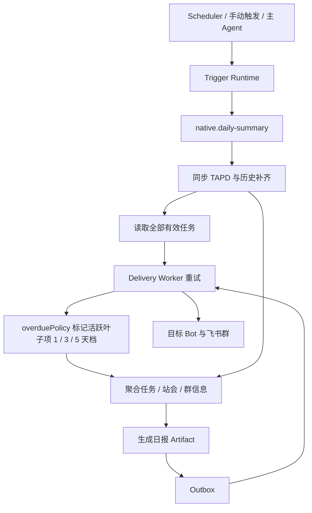

# 群聊日报

按群和业务日期汇总任务、站会与消息信息，生成可追溯的日报 Artifact，并可靠地投递到目标机器人会话。

## 功能定位

群聊日报是一个派生报告，不是新的业务真相源。它把指定日期内的任务变化、站会提交和有效群聊整理成管理者可阅读的结构，并保留生成依据与投递状态。

日报以 Native Agent 接入统一运行平台，是为了复用 Trigger、Run、Artifact 和 Outbox，而不是让模型自由决定业务数据。真正的取数范围、历史补全和失败口径仍由确定性 Job 与 Summary Service 控制。

## 实现流程图

## 能力边界

### 目标

- 支持定时、手动和 Agent 委派生成日报。
- 同一业务日期可补历史数据，并留下确定的生成与投递记录。

### 非目标

- 日报 Agent 不拥有任务或站会状态。
- 不把自由生成文本当作任务真相源回写业务数据。

## 核心规则

1. **每次生成必须指定群和业务日期。** “今天”先按配置时区解析为明确日期，再进入后续流程。
2. **先补齐消息历史，再生成日报。** 历史拉取失败时终止生成，避免把“没有拉到数据”写成“今天没有事项”。
3. **数据来源有明确优先级。** 任务和站会使用领域数据；群聊只补充讨论、决策、风险和计划，不能覆盖任务状态。
4. **过滤系统噪声。** 机器人消息、系统占位符、日报命令本身、已删除任务和无业务信息的闲聊不进入正文。
5. **模型负责归纳，不负责删改事实。** AI 可以合并相关话题和改写表达；代码需要补回被遗漏的重要消息，并保留日期、人员和链接等事实。
6. **生成状态与投递状态分离。** Artifact 生成成功后写入 Outbox；飞书发送失败只重试投递，不重新生成日报。
7. **定时执行保持幂等。** 同一群、业务日期和日报能力只能产生一个有效 Trigger，服务重启不能重复发送。
8. **降级结果必须诚实。** AI 失败时可以使用规则分类生成基础日报，但必须避免输出虚构总结。
9. **所有活跃叶子超期任务都进入日报。** 日报直接用截止日计算超期，不依赖定时扫描是否已经把状态写成 `overdue`；任务风险按超期 5 天以上、3–4 天、1–2 天从重到轻展示。
10. **完成项和父项不重复报风险。** `开发完成`、`已实现`和已完成父项的全部后代不进入超期或阻塞风险；有活跃子项的父项只作聚合展示，由叶子执行项承载风险。

## 用户能力

- 按计划自动接收群聊日报。
- 手动生成指定日期日报并补齐历史日报。
- 查看或重新投递已经生成的日报结果。

## 入口与触发

| 入口 | 输入 | 输出 |
| --- | --- | --- |
| Scheduler | 群、业务日期、模块配置 | 日报 Artifact 与投递任务 |
| Debug/API 手动触发 | 日期、群、触发来源 | Agent Run 与日报结果 |
| 主 Agent 委派 | `summary.daily.generate` | 结构化执行结果 |

## 运行逻辑

1. Scheduler、API 或主 Agent 创建受作用域约束的触发请求。
2. `native.daily-summary` 进入统一 Trigger/Run Runtime。
3. Job 同步必要的 TAPD 数据并按规则补齐历史日期。
4. Summary Service 先用任务域投影父子完成继承和活跃叶子项，再对执行项应用统一超期策略，聚合任务、站会和群信息并生成带超期档位的文本或图片 Artifact。
5. Outbox 保存待投递消息，Delivery Worker 按 Bot/群路由发送并重试。

## Agent、Tool 与服务边界

| 对象 | 职责 | 禁止承担 |
| --- | --- | --- |
| Daily Summary Agent | 封装确定性日报能力并接受平台调度 | 自主修改任务和站会 |
| Summary Service/Jobs | 数据聚合、时间窗口和生成规则 | 选择任意 Bot 或越群投递 |
| Outbox/Delivery | 持久化投递、重试和路由 | 重新生成日报内容 |

## 数据与状态

- 业务日期必须显式传递，不能用服务器当前时间隐式替代。
- 日报 Artifact、Agent Run 和 Outbox Message 分开保存；生成成功不等于投递成功。
- 历史补齐和定时执行需使用群、业务日期、功能作为幂等维度。

## 失败、安全与降级

- TAPD 或 LLM 失败时应记录部分失败，不得把空数据描述成“今日无事项”。
- 图片生成失败可降级为文本；投递失败进入 Outbox 重试，不能重复生成内容。
- 群与 Bot 绑定由服务端配置决定，不接受模型生成的任意目标地址。

## 代码地图

### 主要实现

- `backend/src/agents/native/dailySummaryAgent.ts`：日报 Native Agent。
- `backend/src/services/jobs.ts`：定时生成、同步和历史补齐。
- `backend/src/services/summaries.ts`：日报数据聚合。
- `backend/src/domains/task/overduePolicy.ts`：日报使用的超期分档规则。
- `backend/src/domains/task/tapdHierarchy.ts`：日报使用的父子完成继承与活跃叶子项规则。
- `backend/src/services/messageHandler/handlers/SummaryHandler.ts`：消息入口。
- `backend/src/platform/bootstrap/scheduledAgentDispatcher.ts`：定时 Agent 分发。
- `backend/src/platform/delivery/outbox.ts`：可靠投递入口。

### 主要测试

- `backend/test/nativeDailySummary.test.ts`：Native Agent 契约。
- `backend/test/summaries.test.ts`：日报聚合。
- `backend/test/overduePolicy.test.ts`：未写入超期状态时仍纳入日报及分档展示。
- `backend/test/jobs.test.ts`、`scheduler.test.ts`：定时与补齐。
- `backend/test/deliveryOutbox.test.ts`：可靠投递。

## 变更记录

| 日期 | 变更 | 验证 |
| --- | --- | --- |
| 2026-07-27 | 修正文档中的日报 capability，使其与当前 Manifest 的 `summary.daily.generate` 一致 | Agent Host 类型检查 |
| 2026-07-23 | 日报风险只纳入活跃未完成叶子项，开发完成、已实现、父项和完成父项子树不再被误报为超期或阻塞 | `tapdHierarchy.test.ts`、`overduePolicy.test.ts`、`summaries.test.ts`、类型检查 |
| 2026-07-22 | 日报纳入所有按截止日判断的超期任务，并展示 1 / 3 / 5 天档位 | `overduePolicy.test.ts`、`summaries.test.ts`、类型检查 |
| 2026-07-22 | 补充历史补全、数据过滤、模型边界和投递幂等规则，精简文档结构 | CodeGraph 与日报测试 |
| 2026-07-22 | 建立日报功能卡并区分生成与投递状态 | CodeGraph 架构审查 |
