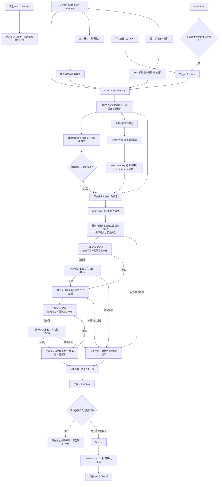

# 群聊日报

按群和业务日期汇总任务、站会与消息信息，生成可追溯的日报 Artifact，并可靠地投递到目标机器人会话。

## 功能定位

群聊日报是一个派生报告，不是新的业务真相源。它把指定日期内的任务变化、站会提交和有效群聊整理成管理者可阅读的结构，并保留生成依据与投递状态。

任务型站会事项沿用任务与任务更新事实：到点未回复保存为“未完成（未汇报）”，负责人回复后保存完成、进行中、阻塞或延期。日报对同一事项只保留统计周期内最新一次任务型站会更新，避免同时展示旧的“未完成（未汇报）”和新的完成结果。

日报以 Native Agent 接入统一运行平台，是为了复用 Trigger、Run、Artifact 和 Outbox，而不是让模型自由决定业务数据。真正的取数范围、历史补全和失败口径仍由确定性 Job 与 Summary Service 控制。

## 实现流程图

## 能力边界

### 目标

- 支持定时、手动和 Agent 委派生成日报。
- 同一业务日期可补历史数据，并留下确定的生成与投递记录。

### 非目标

- 日报 Agent 不拥有任务或站会状态。
- 不把自由生成文本当作任务真相源回写业务数据。

## 宿主连接配置

本地工作台可填写飞书、模型与 TAPD 连接，重启后生效。模型供应商/地址/名称及 TAPD 项目/地址/工作项环境值优先于旧 config.json；工作台保存值在启动时覆盖同名环境设置。既有领域规则与消息/定时执行链路保持，详情见 docs/LOCAL_DEVELOPMENT.md。

## 核心规则

运行时装配由 `builtin.daily-summary` 插件负责，拥有 日报 Native Agent、群消息与日报计划的装配和清理。移除插件关闭对应消息和群业务调度，历史数据保留；页面、业务 API、全局维护/成员同步与基础服务尚未全部迁为插件贡献。

日报插件拥有日期、时刻和模块开关判定；提供 Dispatcher 时由原 Agent Trigger Store 负责幂等，不额外领取 Scheduler 键。移除插件后不再触发日报计划。

自动调度统一通过 `backend/src/core/scheduleCalendar.ts` 判断群级 `schedule.calendar`。指定日期的触发/暂停优先于基础策略；`workdays` 使用中国工作日（含调休），`every_day` 不限制节假日，`selected_dates` 仅执行指定触发日。日期放行不绕过模块开关、任务开关或原定时刻，手动触发不受该日历限制。未配置或 `legacy` 保留原有 `workdays_only` 规则及周报、承诺到期提醒的例外；无效日期与非布尔覆盖值在读取配置时丢弃。

1. **每次生成必须指定群和业务日期。** “今天”先按配置时区解析为明确日期，再进入后续流程。
2. **先补齐消息历史，再生成日报。** 历史拉取失败时终止生成，避免把“没有拉到数据”写成“今天没有事项”。
3. **数据来源有明确优先级。** 任务和站会使用领域数据；群聊只补充讨论、决策、风险和计划，不能覆盖任务状态。
4. **系统噪声先确定性过滤，人类消息交给模型判断。** 系统占位符、日报机器人命令和任务创建命令不进入模型；其余当天人类消息按时间线逐条进入语义分析，纯确认、闲聊和日报运行排障由模型标为 `noise`，不进入正文。
5. **先逐条理解，再按全日主题归纳。** 第一步在有限批次中携带前文、`parent_id` 和 `root_id`，为每条目标消息生成第三人称语义笔记；第二步只基于这些笔记还原背景、追问、补充、结论和下一步，同一讨论链只生成一个主题。
6. **正文禁止展示 AI 路径中的聊天原句。** 原文只保存在 `raw_text` 和 Trace 中用于追溯；正文使用二次归纳的主题名、讨论摘要、状态、参与人、结论、下一步和待确认项。若总结合成漏掉已判定为业务信息的消息，代码使用第一步的 AI 语义笔记补回，不用规则原文补回。
7. **生成状态与投递状态分离。** Artifact 生成成功后写入 Outbox；飞书发送失败只重试投递，不重新生成日报。手动触发的 `sendToGroup=false` 只保存生成结果和审计，不创建群 Outbox；定时触发仍照常投递。
8. **定时执行保持幂等。** 同一群、业务日期和日报能力只能产生一个有效 Trigger，服务重启不能重复发送。
9. **格式错误先修复，再降级。** 两个 AI 阶段都先用标准 JSON 解析；仅当能从括号栈证明缺少尾部 `]` 或 `}` 时确定性补齐，不改写任何业务字段。仍然非法时对同一输入重发一次完整 JSON；修复或重试成功记录 `ai_daily_summary_recovered`。只有再次失败才使用规则分类，并记录失败阶段、失败分类、是否已重试和 `deterministic_rule` 兜底方式；投递正文顶部明确标为“规则归纳（AI 降级）”并说明内容未经过 AI 归纳，不能继续显示成“AI 总结”。
10. **任务型站会未回复明确标记未完成。** `standup_unreported` 更新在日报的任务进度区显示为“未完成（未汇报）”；负责人后续引用回复后，周期内只保留最新任务型站会状态。所有活跃叶子超期任务也进入日报，日报直接用截止日计算超期，不依赖定时扫描是否已经把状态写成 `overdue`。
11. **完成项和父项不重复报风险。** `开发完成`、`已实现`和已完成父项的全部后代不进入超期或阻塞风险；有活跃子项的父项只作聚合展示，由叶子执行项承载风险。
12. **历史补齐必须增量、可复用且有硬预算。** Job 先查询该群、该时间段内本地最新 `sent_at`，从该水位前 2 秒开始重叠拉取以覆盖同秒消息；成功后写 `history-sync:` 完成键，同一群和同一完整时间段的重试不再请求飞书。首次无本地水位时仍完整补齐，但单次最多拉取 100 页（每页 50 条）、总预算 30 秒；缺失或重复 `page_token`、分页超限及请求超时立即以不可重试错误终止，避免整份日报再次拉取同一历史区间。
13. **TAPD 前置同步同样受硬预算控制。** 项目刷新最多 50 页、30 秒；页数或时间预算耗尽时错误码和不可重试属性必须穿透 Native Agent 与 Scheduler，不能再生成第二次全量请求。
14. **日报长耗时不能让投递租约提前过期。** 日报生成完成后的主动 flush 使用实际当前时间领取 Outbox；它与后台 Delivery Worker 共用单进程运行锁。即使历史同步和模型生成超过 30 秒，同一 Artifact 也不能被两个 Worker 同时发送。

## 手动任务所有权

builtin.daily-summary 显式声明 daily-summary 的手动入口。Debug 页面和 /api/jobs 都按实际装配过滤；移除插件时请求返回 404，不创建执行器。原有生成、更新、预览与投递开关语义保持。此项只迁移手动任务授权，其他尚未迁移的页面/API 仍见路线图边界。

## 用户能力

- 按计划自动接收群聊日报。
- 手动生成指定日期日报并补齐历史日报。
- 查看或重新投递已经生成的日报结果。

## 入口与触发

| 入口 | 输入 | 输出 |
| --- | --- | --- |
| Scheduler | 群、业务日期、模块配置 | 日报 Artifact 与投递任务 |
| Debug/API 手动触发 | 日期、群、触发来源 | Agent Run 与日报结果 |
| 主 Agent 委派 | `summary.daily.generate` | 结构化执行结果 |

## 运行逻辑

1. Scheduler、API 或主 Agent 创建受作用域约束的触发请求。
2. `native.daily-summary` 进入统一 Trigger/Run Runtime。
3. Job 通过任务域短缓存同步必要的 TAPD 数据；群历史优先命中完成键，否则从本地消息水位前 2 秒增量补齐。
4. Summary Service 先用任务域投影父子完成继承和活跃叶子项，再对执行项应用统一超期策略。
5. 当天群消息按时间排序并分批处理；每批最多 60 条或 24,000 字，并携带前 8 条消息作为上下文。模型逐条输出语义笔记，保留回复链、参与人、时间、字段名、链接和业务限制。返回内容先严格解析；缺少可确定的闭合符时本地补齐，其他语法错误让模型对同一输入重发一次完整 JSON。
6. 第二次模型调用基于全日语义笔记合并主题，输出全日摘要、讨论状态、结论、下一步和未决问题，并应用相同的“闭合符修复 + 单次重发”策略；覆盖校验用已生成的 AI 笔记补回遗漏业务消息。
7. Renderer 把任务事实和群聊归纳渲染成文本或图片 Artifact；AI 正常时群聊正文不读取 Trace 中的聊天原文，AI 失败时规则基础版继续投递但必须带显式降级说明。
8. Outbox 保存待投递消息；主动 flush 与后台轮询串行领取，按实际领取时刻建立租约，再由 Delivery Worker 按 Bot/群路由发送并重试。手动 `sendToGroup=false` 时在生成 Artifact 后结束，不创建群投递记录。

## Agent、Tool 与服务边界

| 对象 | 职责 | 禁止承担 |
| --- | --- | --- |
| Daily Summary Agent | 封装确定性日报能力并接受平台调度 | 自主修改任务和站会 |
| Summary Service/Jobs | 数据聚合、时间窗口和生成规则 | 选择任意 Bot 或越群投递 |
| Outbox/Delivery | 持久化投递、重试和路由 | 重新生成日报内容 |

## 数据与状态

- 业务日期必须显式传递，不能用服务器当前时间隐式替代。
- 日报 Artifact、Agent Run 和 Outbox Message 分开保存；生成成功不等于投递成功。
- 历史补齐以群和精确起止时间生成 `history-sync:` 完成键，默认保留 90 天；消息主键 Upsert 与 2 秒重叠窗口共同保证增量重取不重复。

## 失败、安全与降级

- TAPD 或 LLM 失败时应记录部分失败，不得把空数据描述成“今日无事项”；AI 审计需区分 `message_analysis`、`synthesis` 与 `synthesis_recovered` 阶段。JSON 自动补齐或模型重发成功写 `ai_daily_summary_recovered` 及恢复方式；最终失败记录 `rate_limited`、`timeout`、`invalid_response` 或 `unavailable` 分类和 `retry_attempted`。
- AI 失败不阻断已取得事实数据的日报投递；规则降级版必须在群消息中公开说明，不得让接收者误判为模型归纳结果。
- 图片生成失败可降级为文本；投递失败进入 Outbox 重试，不能重复生成内容。
- 历史分页达到页数或时间预算、缺少下一页游标或游标不前进时立即失败并记录不可重试错误；不能继续循环消耗飞书额度。
- 群与 Bot 绑定由服务端配置决定，不接受模型生成的任意目标地址。

## 代码地图

### 主要实现

- `backend/src/agents/plugins/dailySummary.ts`：Agent 与功能消息贡献的独立装配。

- `backend/src/agents/native/dailySummaryAgent.ts`：日报 Native Agent。
- `backend/src/services/jobs.ts`：定时生成、同步和历史补齐。
- `backend/src/core/storage.ts`：按群和时间段读取本地最新消息水位。
- `backend/src/services/summaries.ts`：日报数据聚合。
- `backend/src/domains/task/overduePolicy.ts`：日报使用的超期分档规则。
- `backend/src/domains/task/tapdHierarchy.ts`：日报使用的父子完成继承与活跃叶子项规则。
- `backend/src/services/messageHandler/handlers/SummaryHandler.ts`：消息入口。
- `backend/src/platform/bootstrap/scheduledAgentDispatcher.ts`：定时 Agent 分发。
- `backend/src/platform/delivery/outbox.ts`：可靠投递入口。

### 主要测试

- `backend/test/pluginWeb.test.ts`：默认九项手动任务、空组合拒绝、原有预览/投递与在途停止。

- `backend/test/schedulePlugins.test.ts`：移除插件后的群任务关闭、跨午夜日期、第三方调度和停机收敛。

- `backend/test/messagePlugins.test.ts`：插件禁用、历史引用、帮助与生命周期；原业务 Handler 测试继续验证默认行为。

- `backend/test/nativeDailySummary.test.ts`：Native Agent 契约。
- `backend/test/summaries.test.ts`：日报聚合。
- `backend/test/overduePolicy.test.ts`：未写入超期状态时仍纳入日报及分档展示。
- `backend/test/jobs.test.ts`、`scheduler.test.ts`：定时与补齐。
- `backend/test/deliveryOutbox.test.ts`：可靠投递。

## 变更记录

| 日期 | 变更 | 验证 |
| --- | --- | --- |
| 2026-11-05 | 手动任务由所属插件声明，移除插件后旧 API 不再执行 | 插件 Web/站会 API 专项、后端回归、前端检查及默认/空配置/MCP 浏览器验收 |
| 2026-11-05 | 同步本地连接表单与宿主环境配置优先级 | 工作台专项、后端回归、前端检查与本地浏览器验收 |
| 2026-11-05 | 日报计划改为插件贡献，业务日期、幂等、重试和持久化契约保留 | 原调度与插件回归、后端 428 通过 / 1 TAPD 跳过、类型检查 |
| 2026-11-05 | 将群聊日报指令和能力提示归属 `builtin.daily-summary`，移除后同步关闭消息入口；业务服务契约保留 | 消息插件及原业务回归、后端 422 通过 / 1 TAPD 跳过、类型检查 |
| 2026-11-05 | 将日报 Native Agent装配移入 `builtin.daily-summary`，保留业务与持久化契约 | 插件/Host 测试、后端全量回归 |
| 2026-10-05 | 自动调度增加群级节假日策略与日历日期覆盖，保留旧配置兼容 | `scheduleCalendar.test.ts`、`scheduler.test.ts`、`config.test.ts`、前后端类型检查 |
| 2026-08-13 | 任务型站会到点未引用回复时，日报将 `standup_unreported` 显示为“未完成（未汇报）”，后续负责人回复覆盖旧记录 | `summaries.test.ts`、`jobs.test.ts` |
| 2026-08-12 | 日报消费任务型站会的结构化任务更新，并按事项只保留周期内最新一次汇报或待汇报状态 | `summaries.test.ts`、`jobs.test.ts`、后端类型检查 |
| 2026-08-13 | 手动日报增加“发送到群聊”开关，关闭时仍生成并保存日报结果，只跳过群投递；定时日报保持原有发送行为 | `jobs.test.ts`、`jobExecution.test.ts`、前端 `typecheck` / `lint` / `build` |
| 2026-08-05 | 日报两阶段 AI 返回先确定性补齐缺失的 JSON 闭合符，无法安全修复时对同一输入重发一次；仅在重试仍失败后规则降级，并记录恢复方式与重试状态 | `summaries.test.ts`、后端类型检查 |
| 2026-08-04 | 修复日报生成超过租约窗口后主动 flush 与后台 Worker 并发重领导致的群消息双发；投递使用真实领取时间并串行 drain | `deliveryOutbox.test.ts`、`scheduler.test.ts` |
| 2026-08-03 | 日报前置 TAPD 同步限制为 50 页/30 秒，预算错误经 Native Agent 调度保持不可重试 | `dashboardData.test.ts`、`scheduler.test.ts`、`jobs.test.ts` |
| 2026-08-03 | 为飞书历史消息补齐增加 100 页、30 秒硬预算，以及缺失/重复分页游标熔断；保护错误保持不可重试，避免日报 Job 再次全量拉取 | `adapters.test.ts`、`jobs.test.ts`、后端类型检查 |
| 2026-08-03 | 日报历史补齐改为本地消息水位后增量拉取，并为成功的群/时间段保存持久化完成缓存；重试不再重复全时段分页 | `jobs.test.ts`、`storage.test.ts`、`dataRetention.test.ts` |
| 2026-07-31 | 日报 AI 限流、超时或非法响应时继续生成规则基础版，但正文显式标记“AI 降级”、不再把规则摘要冒充为 AI 总结；审计补充失败分类与兜底方式 | `summaries.test.ts`、后端类型检查 |
| 2026-07-30 | 日报改为“逐条上下文语义分析 + 全日主题合成”两阶段 AI 链路；人类消息逐条判定，回复链按主题合并，正文只展示改写后的讨论背景、结论、下一步和待确认项，合成遗漏由 AI 语义笔记补回 | `summaries.test.ts`、类型检查 |
| 2026-07-27 | 修正文档中的日报 capability，使其与当前 Manifest 的 `summary.daily.generate` 一致 | Agent Host 类型检查 |
| 2026-07-23 | 日报风险只纳入活跃未完成叶子项，开发完成、已实现、父项和完成父项子树不再被误报为超期或阻塞 | `tapdHierarchy.test.ts`、`overduePolicy.test.ts`、`summaries.test.ts`、类型检查 |
| 2026-07-22 | 日报纳入所有按截止日判断的超期任务，并展示 1 / 3 / 5 天档位 | `overduePolicy.test.ts`、`summaries.test.ts`、类型检查 |
| 2026-07-22 | 补充历史补全、数据过滤、模型边界和投递幂等规则，精简文档结构 | CodeGraph 与日报测试 |
| 2026-07-22 | 建立日报功能卡并区分生成与投递状态 | CodeGraph 架构审查 |

通讯录依赖（2026-11-06）：成员自动刷新与 /api/feishu 现由 builtin.directory 拥有，团队默认包含；自定义组合需要时显式选择。未装配则继续读取已配置成员，不隐式查询飞书或删除历史。领域服务的成员筛选和业务统计规则保持。来源、失败保护与验证见 [配置与调度功能卡](../../../core/configuration-scheduling/FEATURE.md)；专项为 backend/test/directoryPlugin.test.ts 与原领域回归。

## 应用装配代码地图更新（2026-11-06）

agents/context.ts 按需提供 TAPD、意图解析、看板、项目看板和已启用邮件 Adapter；index 不再直接创建，显式配置重载后创建新 Context。agents/jobsApi.ts 拥有原团队手动 Job HTTP 实现，平台旧路径仅兼容转出；agents/plugins/jobs.ts 复用原 ScheduledJobOptions（services/jobs.ts 仅导出该既有类型）透传 sendToGroup，不改变生成、发送、幂等、统计或领域状态归属。移除插件仍在创建 Job 前拒绝。MessageHandler 删除的邮件字段从未用于发送，纪要继续使用 Context 的邮件端口且维持 dormant 生成开关。

验证：applicationContext.test.ts 确认空/个人/Echo 启动不构造团队服务、单 Context 复用及重载配置隔离；原 pluginWeb、schedulePlugins、jobExecution、messageHandler 与全量业务回归。实际临时 SQLite/HTTP 组合切换保留原 Echo 历史，不对真实飞书、TAPD、模型或邮箱发起业务验证。

## 飞书通道装配收尾（2026-11-06）

channel.feishu 拥有原入站 Manager/Ingress、路由投递 Adapter 及连接健康信息；Host 只依赖通用 TransportRegistry，index 不再构造这些对象或 FeishuAdapter。应用 Context 的默认飞书 Adapter 按需创建，每次访问都检查通道是否安装（已缓存也不绕过停用），仍保留群成员姓名与审计回调；传入 SDK Adapter 的旧用法兼容。团队 SDK/team.yaml 为十六插件/七 Agent；个人默认仍十六插件/九 Agent，不装配通道。个人或独立文件如需通信，应显式安装 channel.feishu 并配置对应 Bot 与能力，不会因为填写凭据就启动未装配的通道。

initialize 只注册传输，start 在所有 Catalog/Binding 恢复后启动连接，再启动 Worker；停止立即拒绝新消息/调度/Run，先关闭入站，再等待已接受工作和 Worker，最后关闭传输并释放贡献。并发 start 共用启动，stop 共用收尾；启动失败关闭全部已创建客户端，包括启动失败的客户端，停止中的启动不继续打开后续 Bot。默认/专用 Bot、持久化去重、secretRef、群/私聊路由与真实投递回执不变。

移除通道不领取 Outbox、消耗重试或删除队列；重装后可继续原消息，成功后仍沿用原幂等/租约/回执。TransportRegistry 当前限定一个组合一个提供者，BotPlatform 仍仅飞书；不提供多协议并发或热替换。原生插件继续是可信代码。readiness 和 /api/agent-host/health 从实际传输读取连接信息，缺少插件为零必需连接，不代表历史消息已投递。

代码地图：platform/transports/registry.ts；platform/bots/feishuPlugin.ts / feishuBotConnectionManager.ts；platform/plugins/contracts.ts / runtime.ts；platform/bootstrap/agentHost.ts；platform/delivery/worker.ts；agents/context.ts / plugins/builtins.ts、profiles/agents/team.yaml、index.ts。验证：transportPlugins.test.ts 六项、原 multiBotIngress/routedFeishuDelivery/deliveryOutbox/agentHost、组合与前后端门禁；全新 SQLite 证明缺通道零尝试、重装仅投递一次、移除后回执及 Run/Step/Artifact 不变；真实本机 HTTP 以虚构完整飞书配置验证无通道也不连接，并验证无凭据通道就绪，未向真实飞书发送消息。
