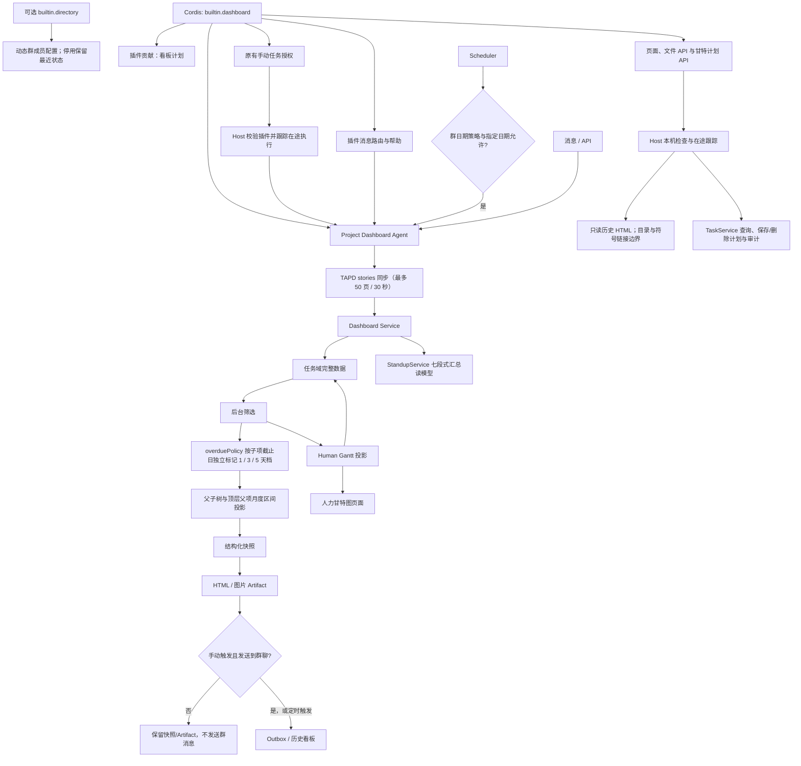

# 项目看板与人力甘特图

将任务域数据转换为项目看板、历史快照、图片和人力甘特图；生成看板是 Agent 能力，交互式甘特图是确定性查询功能。

## 功能定位

项目可视化把任务事实转换成两个不同的读模型：项目看板回答“项目整体进展如何”，人力甘特图回答“每个人在什么时间承担什么工作”。两者共享任务数据，但服务于不同决策，不应混成一个复杂页面或一套状态。

项目看板使用 Native Agent 接入调度与投递；人力甘特图保持普通领域查询。这个差异来自运行需求：看板需要定时生成、保存 Artifact 和发群，人力甘特图只需要按筛选条件即时读取。

## 实现流程图

## 能力边界

### 目标

- 提供项目进度快照、历史看板和按人员观察任务负载的视图。
- 看板 Agent 复用确定性 Dashboard Service，保证手动与定时结果一致。

### 非目标

- 展示层不直接修改任务状态。
- 人力甘特图当前不是独立 Agent；除非未来需要自治分析或跨系统执行，否则无需 Agent 化。

## 工作台导航

项目看板移入团队交付入口 /dashboard；首页成为 Agent 工作台。旧根路径的 groupId/dashboardId 查询及根目录 HTML 长链接仅在插件已装配时展示看板；HTML 链接精确选择对应文件，不回退到最新快照。页面使用统一页头、历史抽屉、筛选与可恢复空态。甘特页使用浅色表面和高对比文字，筛选栏按窗口重排；移动端只在表格内部横向滚动，页面本身不被固定列撑宽。宿主模型与 TAPD 连接可在本地「连接与模型」保存，重启后加载；管理 API 采用本机 Host/Origin 边界。

## 核心规则

运行时装配由 `builtin.dashboard` 插件负责，拥有 项目看板 Native Agent、群消息与看板计划的装配和清理。移除插件同时关闭消息、群调度、手动任务、看板/甘特页面与业务 API，历史数据保留。全局维护/成员同步与基础服务仍按后续路线图迁移。

看板插件拥有日期、时刻和模块开关判定；提供 Dispatcher 时继续通过 Agent Runtime 生成和投递。移除后不再触发看板计划或访问看板/甘特 API，包括计划保存和删除。甘特任务真相源继续归 TaskService，不要求同时装配 Task Agent。

自动调度统一通过 `backend/src/core/scheduleCalendar.ts` 判断群级 `schedule.calendar`。指定日期的触发/暂停优先于基础策略；`workdays` 使用中国工作日（含调休），`every_day` 不限制节假日，`selected_dates` 仅执行指定触发日。日期放行不绕过模块开关、任务开关或原定时刻，手动触发不受该日历限制。未配置或 `legacy` 保留原有 `workdays_only` 规则及周报、承诺到期提醒的例外；无效日期与非布尔覆盖值在读取配置时丢弃。

1. **当前看板和历史看板走不同路径。** 当前请求先同步外部数据并生成新快照；历史请求直接读取已保存快照，禁止用今天的数据重新计算过去。
2. **外部同步失败时关闭生成。** TAPD 页面拉取不完整时不修改本地任务，也不产生看似完整的新快照；达到 50 页或 30 秒预算时立即熔断并标记不可重试，定时看板不得整轮再跑一次。
3. **快照创建后保持不可变。** 结构化数据、HTML 和图片都关联同一生成时间与 Run，历史展示不受后续任务变化影响。
4. **群范围必须明确。** 看板只包含与请求群相关的创建者、负责人或项目任务，不能把其他群数据混入结果。
5. **图片只是展示产物。** 图片失败时保留结构化快照，并可降级为 HTML 或链接；不能因截图失败丢失整个运行结果。手动 `sendToGroup=false` 时仍生成并保存快照/Artifact，但不上传或发送群消息。
6. **甘特图从任务工作流投影。** 人员行、阶段、起止时间和进度来自任务域及个人计划，不维护独立任务状态。
   历史范围查询按请求起止日期投影，不因任务距当前时间超过三个月而丢弃；未完成的长期任务继续保留。
7. **编辑个人计划需要参与者身份。** 只有任务参与者可以修改自己的计划片段，修改动作写入任务域审计。
8. **已完成任务默认收起。** 用户可以显式查询历史完成项，但默认视图优先展示仍需关注的工作。
9. **超期按截止日实时投影。** 看板不依赖任务是否已被扫描写成 `overdue`，直接将未完成且截止日早于快照日的任务标为超期；同时统计并标记超期 1–2 天、3–4 天和 5 天以上三档，支持按档位筛选。
10. **每次生成先在预算内完整同步 TAPD。** 当前看板分页拉取 `/stories` 到最后一页，并以 TAPD 当前状态覆盖本地投影状态；单次最多 50 页、30 秒，任一页失败或预算耗尽均不生成；不再使用三个月时间窗截断活跃任务。Bug 来自独立 `/bugs` 实体，不进入 Story/Develop 工作项看板。
11. **父子任务分层展示和统计。** 任务列表保留父项和子项并分别标识；人员负载按当前责任阶段拆分为需求、开发、测试三类，父项和子项分别计数；超期指标、催办和阻塞/风险面板仍只统计活跃叶子项，避免汇总项产生错误告警。近 7 天图展示“未完成叶子任务趋势”，按创建/完成时间回放，任务新增或范围变化时允许上升，不伪造固定范围的理想燃尽线。
12. **完成状态与 TAPD 一致。** `开发完成`、`已实现`以及已完成父项的全部后代都按完成处理，不进入负载、风险和超期；完成行使用灰化样式，负责人不计入负载。
13. **父项转测状态按层级只读投影。** TAPD 不会自动把父 Story 的“转测试/测试中”同步给子 Story；看板沿用任务域层级投影，将父项阶段传给未完成后代用于状态和责任阶段展示，但不覆盖子项的 TAPD 原始状态。子项自身的截止日期和超期风险仍独立计算，因此“转测试”与“超期”可以同时出现。
14. **人员负载按当前责任阶段归属。** 流程角色存在时，需求任务计给产品负责人、开发任务计给开发负责人、待测试或测试中任务计给测试负责人；产品验收阶段回到需求任务。开发与测试为同一人时，转测试后从开发数移入测试数，不继续表现为开发未完成。外部 TAPD 工作项缺少流程角色时回退到当前处理人：`DEVELOP`、`ARTS` 默认归开发，其余类型默认归需求；同一任务同一成员只计一次。`开发完成`、`已实现`以及完成父项覆盖的子树不计。
15. **任务列表按父子树展示。** 父项在前、子项缩进，并分别标识父项、子项和独立项；筛选命中子项时自动保留其父项上下文，命中父项时保留其后代。
16. **任务日历使用标准月历区间且只显示顶层父项。** 页面固定按周一到周日七列、六个自然周展示；月初前和月末后的相邻月份日期必须补齐并暗色弱化，日期数字与星期表头按同一列居中对齐。任务区间跨周时拆成连续横条，同一周的并行区间分配到独立行，超过可见行数时只提示“另有 N 项任务”，不把隐藏项描述为重叠。每棵任务树只绘制最上层父项，全部后代不再重复成条；父项区间取自身日期与全部后代区间的并集，父项无自身日期时完全由子项聚合，有自身截止日时另外标记。父项日历项同时汇总整棵子树的所有 TAPD 处理人，并在区间条上直接显示“父任务名称 · 汇总人员”；没有父级的独立任务作为自身根项显示。
17. **未分配负责人使用明确话术。** 活跃叶子项因缺少主负责人进入关注列表时，影响原因显示“未分配负责人”，建议动作显示“请尽快分配主负责人”，不使用笼统的“风险高”描述。
18. **未完成任务始终优先展示。** 任务树先按有效完成状态分组，未完成根任务组在前、已完成根任务组在后；同一父项下也先排未完成子项，再排已完成子项，不拆散父子上下文。
19. **看板站会与正式汇总共用口径。** `StandupService` 统一产出团队重点、昨日完成、当日计划、阻塞/需要帮助、风险/可能延期、需要决策和未提交七个维度；看板按卡片布局渲染，但不丢失人名和原始条目。
20. **TAPD 处理人按外部姓名归属。** `/stories` 仅提供处理人姓名时，以 `trace.tapd.people_source=tapd_names` 区分该外部来源；即使曾补全的飞书 `open_id` 已过期或来自其他群，看板仍按 TAPD 姓名与当前群成员匹配。没有该来源标记的普通任务保持 `open_id` 优先，避免同名误归属。
21. **甘特以在职公司目录解析处理人。** 甘特同时展示有效 TAPD 父项和子项；处理人优先按在职 `open_id` 归属，TAPD 仅返回姓名或旧 `open_id` 时回退到在职公司通讯录的精确姓名匹配。已离职成员不因旧群配置重新进入甘特行。工作项类别在甘特任务名旁显示为 `STORY`、`DEVELOP` 或 `ARTS`。
22. **甘特人员任务默认展开并支持本地折叠。** 员工姓名是折叠开关，默认展示其全部任务；展开时按当前员工可见的父子关系组成任务树，父项在前、子项缩进，父项不在该员工可见范围时子项作为根项展示。折叠后保留员工摘要行和任务数量，再次点击恢复。折叠状态只属于当前页面，不写回任务域。任务详情中的流转轨迹高亮已完成阶段与当前阶段，后续阶段保持低亮。

## 手动任务所有权

builtin.dashboard 显式声明 dashboard 的手动入口。Debug 页面和 /api/jobs 都按实际装配过滤；移除插件时请求返回 404，不创建执行器。原有生成、更新、预览与投递开关语义保持。同一插件同时声明 /dashboard、/human-gantt 和两个 API 命名空间；关闭插件不能通过旧请求绕过。

## 用户能力

- 在机器人中生成项目看板图片或链接。
- 在后台查看当前与历史看板。
- 按人员、项目和时间范围查看任务甘特图。

## 入口与触发

| 入口 | 输入 | 输出 |
| --- | --- | --- |
| 飞书看板命令/主 Agent | 群、项目、业务日期 | 看板 Artifact 与回复 |
| Scheduler/API | 项目和执行上下文 | 持久化快照 |
| Debug/API 手动触发 | 群、日期、`sendToGroup` | 看板快照与生成结果；按开关决定是否群投递 |
| `/dashboard`、旧根查询与根 HTML 链接 | 群组、快照、月份 | 已安装插件提供的历史快照；缺失文件明确提示 |
| `/human-gantt`、`/api/human-gantt` | 人员、日期、计划 | TaskService 投影及个人计划审计 |
| `/api/dashboards`、`/api/dashboards/:filename` | 根目录 HTML 文件名 | 普通文件列表/正文；禁止路径越界与符号链接 |

## 运行逻辑

1. 消息、定时器或 API 调用看板 Agent/Service。
2. `ProjectDashboardService` 逐页同步全部 TAPD Story/Develop 工作项，完整同步失败时关闭生成。
3. Dashboard Service 读取完整任务域数据，先投影父子完成继承与父项转测阶段继承；人员负载按流程角色和当前有效阶段聚合为需求、开发、测试三类，超期、催办和风险按活跃叶子项聚合；任务列表按父子前序展示，月历则只绘制顶层父项并汇总整棵子树的日期与人员，站会区域直接使用 `StandupService` 的七段式汇总读模型。
4. 快照保存为结构化数据并渲染 HTML/图片 Artifact。
5. Artifact 默认通过 Outbox 投递，后台读取当前和历史版本；手动 `sendToGroup=false` 时保留快照与 Artifact，跳过群投递。
6. 人力甘特图直接从任务域投影人员、时间和进度，不经过模型。

## Agent、Tool 与服务边界

| 对象 | 职责 | 禁止承担 |
| --- | --- | --- |
| Project Dashboard Agent | 接受统一平台触发、生成看板 | 修改任务真相源 |
| Dashboard Service | 取数、快照、渲染规则 | 消息路由和 Bot 鉴权 |
| Human Gantt domain/page | 确定性投影和交互展示 | 维护第二份任务状态 |

## 数据与状态

- Dashboard Snapshot 是某一时点的派生数据，不是任务真相源。
- 图片、HTML 和结构化快照应关联同一 Artifact/Run，便于追溯。
- 甘特图的日期、进度和人员来自任务域；展示筛选不回写任务。

## 失败、安全与降级

- 图片渲染失败时保留结构化快照并可降级为 HTML 或文本链接。
- 外部 TAPD 不可用时必须标注数据时间，避免展示为实时真相。
- 后台文件读取仅接受单段 HTML 文件名，参数不做二次解码；列表排除目录和符号链接，由共享 readWorkspaceArtifact 校验真实目录、lstat、O_NOFOLLOW 和打开后的普通文件类型；拒绝跨目录链接。
- 甘特查询拒绝非法日期、反向区间和非布尔开关；计划正文先校验形状，再复用 TaskService 的参与者/角色/半天范围与审计规则。内部错误不返回数据库路径。
- 这是本机可信工作区，employee_open_id 表示被编辑的计划参与者，不代表已经实现用户登录或多人权限认证。

## 代码地图

### 主要实现

- `backend/src/agents/plugins/dashboard.ts`：Agent、消息、调度、页面和两个 API 命名空间的独立装配。
- `backend/src/agents/native/project-dashboard/api.ts`：历史文件读取与甘特 API，任务状态仍由 TaskService 拥有。
- `backend/src/platform/workspace/artifactFiles.ts`：看板、周报与纪要共用的受限文件读取。

- `backend/src/agents/native/dashboardAgent.ts`：Project Dashboard Agent。
- `backend/src/services/projectDashboard.ts`：项目快照与历史。
- `backend/src/services/dashboard.ts`：看板数据和展示结构。
- `backend/src/services/dashboardImage.ts`：图片渲染。
- `backend/src/domains/task/humanGantt.ts`：人力甘特投影、在职人员解析和工作项类别。
- `backend/src/domains/task/overduePolicy.ts`：看板超期天数和档位投影。
- `backend/src/domains/task/tapdHierarchy.ts`：父子完成继承与活跃叶子项投影。
- `frontend/src/pages/DashboardPage.tsx`、`HumanGanttPage.tsx`、`HumanGanttPage.css`、`humanGanttView.ts`：后台页面、甘特人员折叠、流转状态和工作项类别标签。

### 主要测试

- `backend/test/projectVisibilityApi.test.ts`：看板/甘特路由所有权、移除后拒绝读写、OpenAPI、文件越界/链接拒绝、计划校验与审计。
- `frontend/src/pages/workspace/pages.test.mjs`：普通页面与旧看板链接共享插件装配检查。

- `backend/test/pluginWeb.test.ts`：默认九项手动任务、空组合拒绝、原有预览/投递与在途停止。

- `backend/test/schedulePlugins.test.ts`：移除插件后的群任务关闭、跨午夜日期、第三方调度和停机收敛。

- `backend/test/messagePlugins.test.ts`：插件禁用、历史引用、帮助与生命周期；原业务 Handler 测试继续验证默认行为。

- `backend/test/projectDashboard.test.ts`：快照生成。
- `backend/test/tapdHierarchy.test.ts`：层级完成继承和执行项口径。
- `backend/test/dashboardData.test.ts`、`dashboardHtml.test.ts`、`dashboardImage.test.ts`：数据和渲染。
- `backend/test/dashboardFiles.test.ts`：产物文件约束。
- `backend/test/humanGantt.test.ts`：人力甘特投影。
- `backend/test/overduePolicy.test.ts`：看板超期状态、档位标签和筛选数据。
- `backend/test/humanGantt.test.ts`：姓名处理人映射、父子工作项与类别标签数据。
- `frontend/src/pages/humanGanttView.test.mjs`：人员折叠状态、真实任务计数、父子树和流转节点状态。

## 变更记录

| 日期 | 变更 | 验证 |
| --- | --- | --- |
| 2026-11-05 | 看板与甘特页面/API 归属插件；旧 HTML 精确打开快照，统一历史页界面并收紧文件边界 | projectVisibilityApi、dashboardFiles、pluginWeb、前端别名测试与本地浏览器验收 |
| 2026-11-05 | 修复历史甘特图被当前日期截断的问题；迁移通用调度、API 预算和投递修复，保留公开版地址默认值 | `humanGantt.test.ts`、后端全量回归、前端门禁 |
| 2026-11-05 | 手动任务由所属插件声明，移除插件后旧 API 不再执行 | 插件 Web/站会 API 专项、后端回归、前端检查及默认/空配置/MCP 浏览器验收 |
| 2026-11-05 | 看板移入团队导航，保留旧根查询和 HTML 长链接 | 工作台专项、后端回归、前端检查与本地浏览器验收 |
| 2026-11-05 | 看板计划改为插件贡献，业务日期、幂等、重试和持久化契约保留 | 原调度与插件回归、后端 428 通过 / 1 TAPD 跳过、类型检查 |
| 2026-11-05 | 将群聊看板指令和能力提示归属 `builtin.dashboard`，移除后同步关闭消息入口；业务服务契约保留 | 消息插件及原业务回归、后端 422 通过 / 1 TAPD 跳过、类型检查 |
| 2026-11-05 | 将项目看板 Native Agent装配移入 `builtin.dashboard`，保留业务与持久化契约 | 插件/Host 测试、后端全量回归 |
| 2026-07-29 | 公开版移除内网看板地址，未配置 `PUBLIC_BASE_URL` 时只回退到本机 `http://localhost:8080/` | `messageHandler.test.ts` |
| 2026-10-05 | 自动调度增加群级节假日策略与日历日期覆盖，保留旧配置兼容 | `scheduleCalendar.test.ts`、`scheduler.test.ts`、`config.test.ts`、前后端类型检查 |
| 2026-08-13 | TAPD 父项转测试/测试中时，子项通过只读层级投影继承责任阶段；保留子项原始 TAPD 状态并独立保留超期风险，避免父子状态展示矛盾 | `tapdHierarchy.test.ts`、`projectDashboard.test.ts`、后端类型检查 |
| 2026-08-13 | 人员负载按当前责任阶段拆分需求、开发、测试；转测试后任务从开发负责人负载转入测试负责人负载，同一人自测也明确显示为测试任务 | `projectDashboard.test.ts`、`dashboardHtml.test.ts`、类型检查 |
| 2026-08-13 | 手动看板增加“发送到群聊”开关，关闭时仍生成并保存看板快照，只跳过群消息投递；定时看板保持原有发送行为 | `jobs.test.ts`、前端 `typecheck` / `lint` / `build` |
| 2026-08-03 | 看板前置 TAPD 同步增加 50 页/30 秒预算，预算耗尽保持不可重试并停止生成快照 | `dashboardData.test.ts`、`projectDashboard.test.ts`、`scheduler.test.ts` |
| 2026-07-28 | 人力甘特图增强任务流转节点亮度，区分已完成、当前和后续阶段；员工姓名支持默认展开、点击折叠并保留摘要行，展开任务按可见父子关系显示为树状层级 | `humanGantt.test.ts`、`humanGanttView.test.mjs`、前端类型检查、目标文件 Lint、构建与页面验收 |
| 2026-07-28 | 月度任务区间固定为六周网格，使用暗色相邻月份日期补齐月末，统一日期与任务文字对齐，并将隐藏任务提示从“重叠区间”改为明确的任务数量 | `dashboardHtml.test.ts`、类型检查、HTML 页面验收 |
| 2026-07-27 | 站会摘要去除姓名首字图标并提升可读字号；近 7 天图改为未完成叶子任务趋势，不再显示无迭代依据的理想线；甘特展示有效父子工作项，按在职通讯录补全 TAPD 姓名处理人并显示 STORY / DEVELOP / ARTS | `projectDashboard.test.ts`、`humanGantt.test.ts`、前后端类型检查 |
| 2026-07-23 | 月历父任务区间条直接显示子树汇总人员，不再只把人员藏在悬浮提示中 | `dashboardHtml.test.ts`、全量回归、测试群图片验收 |
| 2026-07-23 | 修正站会空态逐字竖排；月历改为每棵树只显示顶层父项，子任务日期和全部处理人汇总到父项，独立任务保持单独显示 | `projectDashboard.test.ts`、`dashboardHtml.test.ts`、全量回归、测试群图片验收 |
| 2026-07-23 | 修正群成员负载遗漏父级 STORY 及历史 open_id 导致 TAPD 任务漏入群范围的问题：需求、开发、美术工作项及草案/需求等未完成状态全部纳入，父项与子项分别计数；完成子树继续排除 | `projectDashboard.test.ts`、`dashboardData.test.ts`、全量回归、测试群看板验收 |
| 2026-07-23 | 看板站会摘要改为与正式站会汇总一致的七段式口径，使用团队重点、昨日/今日双栏和阻塞/风险/决策三栏卡片布局 | `projectDashboard.test.ts`、`dashboardHtml.test.ts`、`jobs.test.ts`、全量回归、测试群图片验收 |
| 2026-07-23 | 任务树排序增加完成状态最高优先级，活跃未完成任务组在前，已完成任务组统一置后 | `projectDashboard.test.ts`、全量回归、类型检查 |
| 2026-07-23 | 未分配主负责人的关注项改用明确原因和分配动作，不再显示为笼统的高风险 | `projectDashboard.test.ts`、全量回归、类型检查 |
| 2026-07-23 | 任务列表改为父子树展示；周日历改为月度区间，父项合并自身与子项日期并标记自身截止日；手工创建的 TAPD 任务按外部当前状态展示 | `projectDashboard.test.ts`、`dashboardHtml.test.ts`、`taskTapdPolicy.test.ts`、类型检查、测试群图片验收 |
| 2026-07-23 | 看板每次生成使用完整 TAPD Story 分页结果且不再截断三个月前活跃项；开发完成/已实现及完成父项子树灰化并退出负载，父项与活跃叶子项分开统计 | `tapdHierarchy.test.ts`、`projectDashboard.test.ts`、`dashboardHtml.test.ts`、类型检查 |
| 2026-07-22 | 看板新增超期 1 / 3 / 5 天统计、任务标签与分层筛选，所有日期超期任务均进入风险视图 | `overduePolicy.test.ts`、看板回归测试、类型检查 |
| 2026-07-22 | 补充当前/历史快照、同步失败和甘特图投影规则，精简文档结构 | CodeGraph 与看板测试 |
| 2026-07-22 | 建立项目可视化功能卡，明确甘特图不必 Agent 化 | CodeGraph 架构审查 |

通讯录依赖（2026-11-06）：成员自动刷新与 /api/feishu 现由 builtin.directory 拥有，团队默认包含；自定义组合需要时显式选择。未装配则继续读取已配置成员，不隐式查询飞书或删除历史。领域服务的成员筛选和业务统计规则保持。来源、失败保护与验证见 [配置与调度功能卡](../../../core/configuration-scheduling/FEATURE.md)；专项为 backend/test/directoryPlugin.test.ts 与原领域回归。
