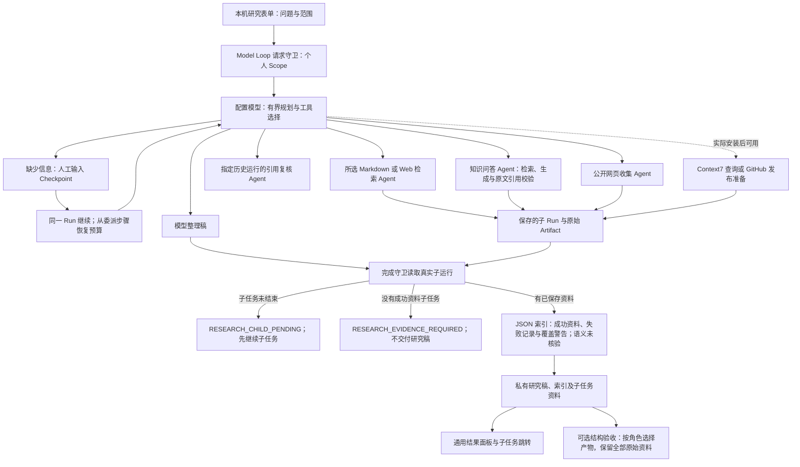

# 个人研究助手

让个人用户从一个问题出发，由模型选择已装配的资料子任务，保留原文与父子运行关系，交付需复核的研究稿。

## 功能定位

personal.research 是独立 Model Loop 插件，复用既有 Agent Runtime、模型网关、委派、人工继续与结果面板。默认个人组合提供入口；不把缺少模型时的确定性检索冒充模型研究。研究稿与子任务证据分开保存，完成门槛只核对真实的成功资料查询/回答，不证明语义正确或资料充分。

## 实现流程图

## 能力边界

### 目标

- 一个问题可以通过多个专业子任务完成，保留真实父子运行链路。
- 资料只能来自所选知识范围、显式公开 URL 或已装配的可选读取能力。
- 缺少模型、输入范围不合法、取证失败、预算耗尽和引用错误均有明确结果。

### 非目标

- 不证明模型真正理解、使用或正确推导了资料；父研究稿的 summaryVerification 始终为 not_verified。
- 不修改用户 Vault、创建远端发布或发送消息；引用复核只记录本地评估。
- 不完整重放历史工具消息或执行环境；真实模型质量、成本与用户采用仍需独立验证。

## 核心规则

1. 父 Agent 只允许 personal.research，接受非空 prompt（最多 4000 字符）及兼容现有人工回复的 text。个人 Scope 在创建会话和联系模型之前校验；chat/conversation 拒绝。
2. 父 Agent 没有直接 Tool、文件路径或 Secret 权限。必需委派：当前来源检索、knowledge.answer、knowledge.page.capture、knowledge.impact.check。可选委派仅 docs.context7.lookup、release.prepare，缺少实际绑定时不暴露给模型。
3. 通过工厂绑定 markdown/web 来源，requires 与检索 Capability 一起切换；sample/library 复用 Markdown 来源。不可通过任务输入换根目录或增加能力。
4. 单次模型循环最多八步，父 Run 最多四次已记录委派，深度最多二，父执行最长 180 秒；子任务仍有自身 Scope、预算和受父约束的截止时间。人工继续根据 delegate: Agent Step 恢复已用次数，失败与继续同样计数。裸 Adapter 未提供 RunStore 时不具备跨继续的持久预算。
5. 人工提问不执行完成门槛；继续沿用同一 Run/Checkpoint。会话保留问题和回复，工具消息不保证跨调用完整重放，必要时需在剩余预算内重新取证。
6. 完成守卫读取实际 listChildren 和子 Artifact，核对 parentRunId、workspace/bot、成功状态及允许的资料能力，至少一个非空 JSON/Markdown 产物才交付。模型文本、引用复核状态和失败子任务不能伪装成资料来源。
7. 空检索和 insufficient_evidence 回答可留下真实查询记录；索引证明过程与产物存在，不证明命中、充分性、语义质量或模型总结正确。UI 和元数据明确待复核。
8. 未结束的子任务阻止完成（RESEARCH_CHILD_PENDING）。失败/取消子任务不计资料；若仍有成功资料，可交付带 partial 覆盖警告的研究稿，failures 记录真实失败状态与错误码。没有失败只表示 recorded，不表示资料充分。守卫返回 research-evidence/1.0 索引，由 Runtime 和模型稿一起按现有产物/字节约束保存；包含检查时间、子 Run/Artifact ID，不复制未选笔记。父 Markdown 和提问标记 privateKnowledge，语义未验证。
9. 子 JSON 仍提升到父结果，Markdown 保留在子运行；源 Artifact 不改写。索引提供真实子运行跳转。研究稿为空也不能成功交付。
10. personal.research.evidence 规则通过 JSON Schema selector 按 artifactRole 选择最终稿和索引，再检查 Schema；缺少、重复、坏结构均失败。选择器不删资料，不把提问当最终稿，不执行代码或远端 Schema。人工完成后的结果页隐藏旧提问，详情仍保留历史；引用锚点以 Artifact ID 区分多份资料。

## 用户能力

- 在研究助手说明问题，配置自己的模型后发起研究。
- 对缺失目标或范围补充回复，继续同一运行。
- 查看研究稿、资料索引、真实子任务、引用检查与可选结构验收。

## 入口与触发

| 入口 | 输入 | 输出 |
| --- | --- | --- |
| /research | prompt 与资料范围 | 真实 Model Loop Run 或模型配置提示 |
| personal.research | prompt、可选 private source；继续兼容 text | text 研究稿、JSON 索引与子运行 |
| personal.research.evidence | 已结束父 Run | 结构验收，不判断研究结论 |

## 运行逻辑

1. 插件按明确来源装配，注册页面、模型定义和结果规则。
2. 请求守卫后进入模型循环，由已授权委派工具执行专业子任务。
3. 信息不全暂停；继续恢复同一执行及委派配额。
4. 完成时检查真实子资料并生成索引；失败不发布父研究稿，已持久化子事实保留。
5. 页面复用普通 Run 结果、步骤与子任务详情；用户核对原始证据。

## Agent、Tool 与服务边界

| 对象 | 职责 | 禁止承担 |
| --- | --- | --- |
| 研究 Model Loop | 规划、委派和归纳 | 直接取得未授予工具、写 Vault 或伪造资料索引 |
| 专业子 Agent | 固定来源检索、引用回答、网页或版本检查 | 从资料正文取得授权 |
| 完成守卫 | 核对真实子运行并提供额外 Artifact | 自动证明语义正确 |
| Runtime / Adapter | 预算、暂停恢复、回调顺序与产物持久化 | 将可信 JS 回调当作沙箱 |

## 数据与状态

- 沿用 Session、Checkpoint、Run/Step/Artifact，不新增数据库。
- 问题与已取回资料/来源元数据发送给配置模型；子 RAG 可能增加模型调用。没有虚构免费推理或自动采用人数。
- 同一 Run 的历史提问和子资料保留；UI 只在 waiting_human 时把提问作为当前结果显示。

## 失败、安全与降级

缺少依赖拒绝装配。未配置模型时页面禁用发起，原文检索仍可使用。个人范围失败先于模型请求；无成功资料或空稿不能发布成功研究稿；引用失败的子任务不计资料，部分恢复须显示失败事实和覆盖警告。等待回复的子任务必须先完成。资料正文是未受信输入；原生插件和模型服务仍须由用户选择，协议权限不提供 OS 沙箱。取消与截止时间沿用 Runtime，回调完成后再次检查信号。

## 代码地图

### 主要实现

- `backend/src/agents/personal-research/plugin.ts`、`webPlugin.ts`：来源绑定、Model Loop、完成门槛、资料索引和规则。
- `backend/src/platform/agents/modelLoopAdapter.ts`：可信请求/完成守卫、额外产物、私有元数据及委派预算恢复。
- `backend/src/platform/workspace/knowledge.ts`：默认个人组合。
- `backend/src/platform/plugins/checks.ts`、`backend/src/quality/service.ts`：可选 selector 的有界声明与校验。
- `frontend/src/pages/workspace/ResearchPage.tsx`、`PluginPage.tsx`、`RunDrawer.tsx`：研究表单、已打包入口、多资料与阶段结果。
- `docs/PERSONAL_RESEARCH.md`：使用与验证边界。

### 主要测试

- `backend/test/personalResearch.test.ts`：真实 SDK 对本机模拟模型，委派检索/RAG/复合任务、原文引用、门槛拒绝、部分失败恢复、未结束子任务、Scope、空稿、人工继续、持久预算及角色选择器；不验证真实模型研究质量。
- `backend/test/modelLoopAgent.test.ts`、`agentDelegation.test.ts`：旧模型定义、Tool 预算、子运行、超时与取消回归。
- `backend/test/pluginChecks.test.ts`、`workspaceComposition.test.ts`、`featureIndex.test.ts`：旧规则兼容、默认组合和文档数量。

## 变更记录

| 日期 | 变更 | 验证 |
| --- | --- | --- |
| 2026-11-05 | 增加个人研究插件、资料完成门槛与角色验收；修复人工继续重置委派额度 | 本机模拟模型与真实 SDK/子任务专项、类型/前端检查、全量回归及浏览器验收；真实模型未联调 |
