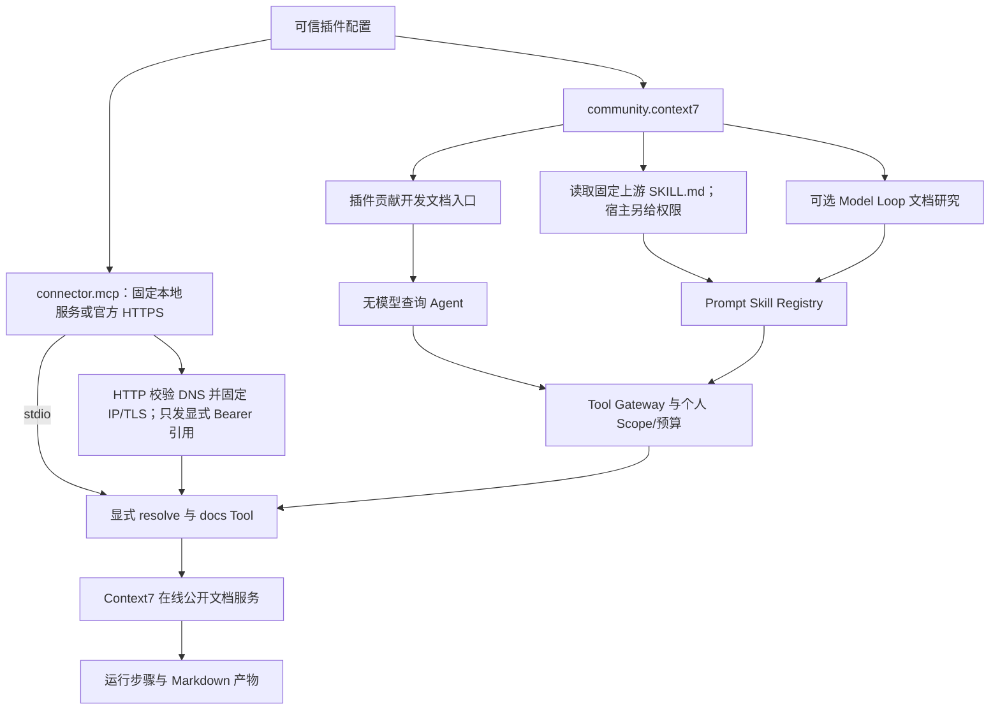
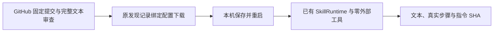

# Context7 社区开发文档插件

接入 Upstash 的 Context7 MCP 服务和标准 SKILL.md，提供无需模型的文档查询及可选的模型研究助手；只在显式选择该插件的组合中启用。

## 功能定位

这是外部 GitHub 项目的真实适配例子，不复制文档搜索实现。connector.mcp 管理已安装的上游进程或官方 HTTPS 连接；community.context7 拥有任务入口、两个 Agent 和显式授权的外部 Skill。默认团队和个人知识组合保持原有数量。

## 实现流程图

## 能力边界

### 目标

- 实际复用 Context7 的库搜索与文档查询，不要求本地模型或服务器部署。
- 证明标准 Agent Skills 文件可进入原 Skill Runtime，而工具授权、预算与兼容 Agent 继续由宿主确定。
- 新插件只贡献页面元数据，不修改前端导航或业务组件表。

### 非目标

- 不声称任意 GitHub 项目可以直接当作原生插件执行；入口适配见 docs/COMMUNITY_PLUGINS.md。
- 不运行上游 ctx7 setup、不改编辑器全局配置，不自动执行 Skill 的脚本或加载引用资源。
- 查询结果是文档证据，不能保证覆盖完整或证明代码已经正确；模型研究需要用户配置宿主模型。

## 核心规则

1. requires=connector.mcp；工具 ID 固定 mcp.context7.resolve 与 mcp.context7.docs。只用于无 chat/conversation 的个人 manual/agent Scope。
2. 默认文档库为经实际搜索确认的 /reactjs/react.dev；查询可在高级参数覆盖 libraryId，search 操作必须提供 libraryName。
3. 无模型查询每次只执行一个工具并保留原文；空正文失败，不伪造答案。模型助手使用同一受治理工具与导入的 Prompt Skill，不获得 shell/文件写入权限。
4. 上游 Skill 来自 upstash/context7，固定提交和 SHA-256 见 upstream/NOTICE.md，原文与 MIT 许可保留。导入 name/description 与正文；allowed-tools、执行方式和兼容 Agent 不从外部元数据继承。
5. readAgentSkill 要求目录名匹配 name、有效 frontmatter、非空正文和至多 128 KiB 普通文件；限制 frontmatter 为 8 KiB。引用文件与脚本不自动执行或展开。
6. 查询会发往 Context7 在线服务，匿名可用性、限额和授权由上游决定。认证、限流、连接失败或超时不自动重发工具调用；stdio API key 通过 envRefs，HTTP 通过 tokenRef 引用并作为 Bearer 发送，不放在 YAML 明文参数中。HTTP 服务版本不由本地包锁定，Skill 仍保留固定来源。
7. Cordis 作用域统一释放页面、Agent、Skill、Tool 与进程/HTTP 流；HTTP 会话终止为有界尝试，历史 Run/Artifact 保留。当前不提供 OS 沙箱或完整的上游插件生态兼容。

## 用户能力

- 在开发文档入口输入问题，查看真实检索正文、来源、Tool Step 与运行结果。
- 用 operation=search、libraryName 查文档库 ID，再按选定 libraryId 查询。
- 配置宿主模型后使用 docs.context7.research，调用导入的 Context7 Skill 组织文档研究。

## 入口与触发

| 入口 | 输入 | 输出 |
| --- | --- | --- |
| examples/plugins.context7.yaml | 已安装的上游 MCP 命令与两个显式读取工具 | 两个 Agent、一个 Skill、开发文档入口 |
| examples/plugins.context7-http.yaml | 官方公开 HTTPS MCP 与可选 tokenRef | 相同任务/Skill/入口，不启动上游进程 |
| docs.context7.lookup | prompt；可选 operation/libraryId/libraryName | 不调用模型的文档或文档库搜索产物 |
| docs.context7.research | prompt | 需要模型的引用回答及 Skill/Tool 过程 |

## 运行逻辑

1. 显式选择 HTTP 示例，或安装固定版本 MCP 包后选择 stdio 示例。
2. 握手、校验两个工具的真实 Schema，读取固定版本 Skill。
3. 原生查询经 Tool Gateway 调用上游；模型研究经原 Prompt Skill Runtime 使用授权工具。
4. 返回真实结果并记录 Run/Step/Artifact，停止等待在途执行后关闭进程或 HTTP 流，并尝试终止本客户端会话。

## Agent、Tool 与服务边界

| 对象 | 职责 | 禁止承担 |
| --- | --- | --- |
| Context7 插件 | 查询/研究任务、Skill、导航贡献 | 自动执行其他仓库代码或改全局设置 |
| readAgentSkill | 解析标准指令文件，结合宿主权限形成 Manifest | 从上游 allowed-tools 自动授予权限 |
| connector.mcp | 固定进程、工具发现和生命周期 | 证明第三方进程被隔离或只读 |
| 上游服务 | 文档库搜索与检索 | 决定本地 Agent 的额外授权 |

## 数据与状态

- 使用原 Run/Step/Artifact 和会话存储，不新增业务表。
- 文档查询与返回正文会进入本地运行记录；问题同时发送给 Context7。
- Skill 来源与许可固定保留，默认不拉取最新代码或覆盖用户 Skill。

## 失败、安全与降级

缺少依赖、无效 Skill 或 MCP 初始化失败阻止装配；工具错误、超时与空正文不发布成功产物。模型调用由用户自己的宿主配置提供，当前真实在线验收覆盖 MCP 文档搜索/查询及原生 Agent；模型 Skill 执行链使用受控替身模型测试，未调用真实付费模型。

## 代码地图

### 主要实现

- backend/src/connectors/context7/plugin.ts：两个 Agent、Skill 和页面贡献。
- backend/src/connectors/context7/upstream/context7-mcp/SKILL.md：上游原文。
- backend/src/connectors/context7/upstream/NOTICE.md、LICENSE：来源、固定提交、校验与许可。
- backend/src/platform/skills/packageLoader.ts：标准 SKILL.md 显式导入。
- backend/examples/plugins.context7.yaml：可复制配置。
- backend/examples/plugins.context7-http.yaml：在线 MCP 组合，固定官方端点。

### 主要测试

- backend/test/context7Plugin.test.ts：标准格式、权限不继承、文件边界、上游 Skill 的受治理执行、原生查询与失败。
- backend/test/toolSkillRuntime.test.ts：原 Skill 兼容、预算与 Tool 执行。
- 在线验收：固定版本上游 MCP 4.5.0，实际 React 文档库搜索、文档正文与工作台运行记录；详见 docs/COMMUNITY_PLUGINS.md。
- HTTP 在线验收：官方 mcp.context7.com/mcp 实际 React 文档读取，1 次 Tool/0 次模型与真实 Run/Artifact；不声称远端后端版本已锁定。

## 变更记录

| 日期 | 变更 | 验证 |
| --- | --- | --- |
| 2026-11-05 | 接入上游 Context7 MCP 与原样标准 Skill，增加独立查询/研究能力及插件页面 | 专项/全量测试、固定包在线查询与工作台验收；真实模型未调用 |

## GitHub Skill 审查与文本运行

标准文件入口 readAgentSkill 改为复用 parseAgentSkill 纯文本解析，原普通文件/符号链接/大小、名称/目录、描述和正文校验保持，权限仍来自宿主。共用 SkillRuntime 补强取消/超时边界并保存执行指令 SHA，Context7 现有工具与查询/研究行为通过原专项回归。

实现与限制见[Skill 工作台功能卡](../skill-workbench/FEATURE.md)。代码：backend/src/connectors/skill-workbench/、platform/skills/packageLoader.ts、runtime.ts；前端 SkillSetupPage.tsx / SkillRunnerPage.tsx。验证：backend/test/skillWorkbench.test.ts、toolSkillRuntime.test.ts、context7Plugin.test.ts 与既有 Host/Plugin/模型回归，前端检查及桌面/375px 验收。仅支持指令文本，无脚本/引用资源自动执行或完整上游能力兼容；模型协议样例不证明真实质量。
