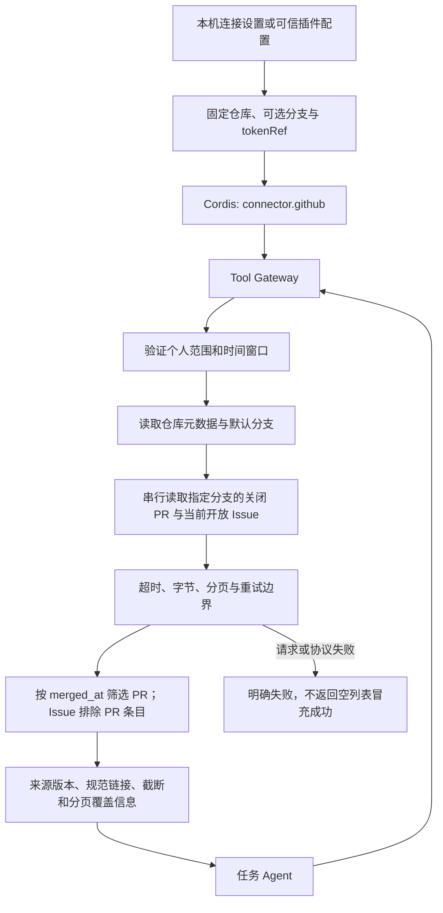

# GitHub 项目事实连接

读取用户配置的单个 GitHub 仓库，为发布准备等任务提供可定位、版本化的 PR 和 Issue 事实。

## 功能定位

`connector.github` 是独立来源插件，贡献 `github.repository.snapshot` 只读 Tool。确定性读取不单独实现 Agent；由使用它的任务 Agent 持有 Run、Scope 和预算。默认团队组合不安装此插件。

## 实现流程图

## 能力边界

### 目标

- 获取指定分支在 `[since, until)` 内合并的 PR，以及读取时当前未关闭 Issue。
- 保留来源、版本与不完整标记，供后续生成和验收使用。
- 使用可选显式环境变量 Secret 引用，不复制宿主凭据。

### 非目标

- 不创建 Release、Issue、评论或 PR；不读取代码 Diff、提交内容、评论、CI 或审核状态。
- 不保证历史 Issue 状态或分页数据的原子一致性；不将“PR 已合并”解释为“已经部署”。
- 不提供共享 Web、多人授权、GitHub Enterprise 或任意 API 地址配置。

## 核心规则

1. 仓库来自插件配置的 owner/repo，调用输入仅允许 since/until。所有请求固定到 HTTPS api.github.com，GET，禁止自动重定向。仓库改名/迁移导致重定向时需更新配置；不会把认证转发到另一个目标。
2. 工作台可保存 RELEASE_GITHUB_REPOSITORY、RELEASE_GITHUB_BRANCH 与可选 RELEASE_GITHUB_TOKEN；密钥仅返回已配置布尔值，0600 文件保存、重启生效。只有明确仓库时默认 HTTP 组合装配本插件及匹配知识源的发布插件，清空仓库并重启会停用；显式插件文件优先。普通请求不能改仓库。tokenRef 仅支持 env:// 引用，复用 EnvironmentSecretResolver；未配置时匿名读取。返回与错误不包含 token，也不自动读取 Git Credential。私有仓库需要调用者授予相应读取权限。
3. 先读取元数据并核对仓库身份；未指定分支时使用 default_branch。PR 请求按 base 过滤并再次检查结果分支，只有 merged_at 位于半开窗口的记录进入结果。关闭但未合并的 PR 排除。
4. API 的关闭 PR 列表按更新时间获取，不根据遇到的旧记录提前停止；最多每端点五页，配置最多二十页，每页三十项。只利用 Link 是否有 next 来判断结束，不跟随服务器提供的 next URL；下一页仍在固定端点构造。
5. 分页不足、重复条目和输出截断分别保留。每类最多输出 100 条，正文最多 3000 字符、标题 256 字符、标签 30 项/每项 64 字符；截断可见。记录版本绑定投影前实际读取的数据，未展示正文末尾变化仍会改变版本。
6. 默认整轮 20 秒，配置最多 30 秒；单响应最多 4 MiB、整轮最多 16 MiB。取消、超时、HTTP 或 Schema 错误使调用失败，不返回旧快照。
7. 明确信号的限流和 502/503/504 最多重试一次。尊重 Retry-After 与主限流 reset；等待超过两秒则返回错误和 retryAfterMs，不提前重试。Tool/Run 的标准错误仅保留 code/message/retryable，因此 message 也显示最短重试秒数，避免归一化后丢失等待提示。没有重试时间的限流按至少一分钟处理，不在当前调用里长时间阻塞。403 无限流信号时按访问失败处理。
8. 开放 Issue 是读取时当前状态，包含该端点的 PR 条目会排除。不是 until 时点的历史 Issue 清单。分页跨多个请求，可能因并发变化出现未被检测的遗漏；consistency 明确为 live_paginated_not_atomic，exhausted 仅说明分页读完。
9. 调用只允许无 chatId/conversationId 的手动或 Agent Scope；不构成身份认证。可信本机或 SDK 才是当前入口。API 文本是不可信资料，不能授予工具权限。

## 用户能力

- 为一个仓库配置只读连接，在任务中选择合并时间段。
- 查看事实、来源链接、正文/分页截断和版本，不将读取失败解释为没有事项。

## 入口与触发

| 入口 | 输入 | 输出 |
| --- | --- | --- |
| connector.github Config | repository、可选 baseBranch/tokenRef/maxPages/timeoutMs | 一个固定来源的只读 Tool |
| github.repository.snapshot | since、可选 until，必须 since < until <= now | PR/Issue、版本、窗口、读取时间与 coverage |

## 运行逻辑

1. 配置、Scope 与输入校验。
2. 解析凭据引用，读取仓库和分支。
3. 串行分页获取事实并校验，计算版本和覆盖情况。
4. Tool Gateway 保存调用状态；上层任务保存实际采用的证据。

## Agent、Tool 与服务边界

| 对象 | 职责 | 禁止承担 |
| --- | --- | --- |
| 连接插件 | 来源配置、只读 Tool 注册和生命周期 | 选择模型或执行发布 |
| GitHubRepositorySource | REST 读取、过滤、预算、版本 | 生成发布结论或证明仓库健康 |
| 上层任务 | 使用来源，表达不足，保存产物 | 静默忽略覆盖不足 |

## 数据与状态

- 当前调用不持久化原始 API 响应，也不缓存旧快照。重复 Run 的 Tool 幂等由 Tool Gateway 管理。
- snapshot 版本不包含 collectedAt；记录内容、覆盖信息和时间窗口变化会改变版本。
- PR/Issue 文本可能涉及私有资料；其上层产物和模型输入必须遵守任务的数据去向与留存要求。

## 失败、安全与降级

401/403/404 不解释成仓库不存在或没有 PR。缺 Secret、错误范围、Schema 变化、预算耗尽和取消明确失败；不静默换仓库、换分支或省略失败端点。原生插件是可信宿主代码，固定网络边界由本实现执行。

## 代码地图

### 主要实现

- `backend/src/connectors/github/source.ts`：配置、REST 读取、分页、版本和输出协议。
- `backend/src/connectors/github/plugin.ts`：独立插件和只读 Tool。
- `backend/src/platform/secrets/resolver.ts`：复用环境变量 Secret 引用解析。

### 主要测试

- `backend/test/workspace.test.ts`：本地连接校验、Token 脱敏与重启生效、来源匹配装配、HTTP 只读采集及停用。
- `backend/test/githubConnector.test.ts`：窗口、范围、分页、重试、凭据、版本、截断和预算。
- `backend/test/helpers/github.ts`：虚构仓库和受控 REST 响应。

## 变更记录

| 日期 | 变更 | 验证 |
| --- | --- | --- |
| 2026-11-05 | 新增只读 GitHub 项目事实插件 | 类型检查与八项受控 REST 专项（含整轮字节与响应取消）；未执行 GitHub 写入 |

依据：[PR REST API](https://docs.github.com/en/rest/pulls/pulls)、[Issue REST API](https://docs.github.com/en/rest/issues/issues)、[REST 最佳实践](https://docs.github.com/en/rest/using-the-rest-api/best-practices-for-using-the-rest-api)。API 版本固定 2022-11-28，已通过官方 versions 端点核实仍受支持。

共享 Scope 回归（2026-11-06）：requirePersonalScope 本体和本功能的原 manual/agent 限制不变。仅引用复核 Agent 及来源 versions Tool 改用独立 requirePersonalVersionScope 接受无群聊 schedule；本功能不因此获得定时执行或新写入权限。验证：backend/test/localSchedules.test.ts 和本功能既有回归。
