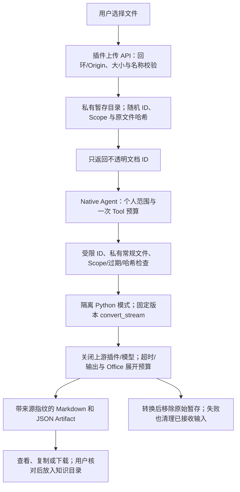

# MarkItDown 本地文档导入

将用户明确选择的 PDF、DOCX、PPTX、XLSX、TXT 或 Markdown 文件在本机转为可复制/下载的 Markdown 资料，并保留原文件指纹。

## 功能定位

community.markitdown 封装微软开源 MarkItDown 0.1.9，独立拥有上传/状态 API、文档页面、Native Agent 与转换 Tool。复用既有 Run、Tool Gateway 和私有 Artifact，不调用模型、Azure 或第三方 OCR，也不自动写入 Vault。

## 实现流程图

## 能力边界

### 目标

- 接入真实上游转换器，支持常用文字型 PDF 和 Office 文档。
- 本机上传、转换、状态与产物可追踪，无需模型密钥。
- 输入不接受文件路径、远程 URI、命令参数或云转换配置。

### 非目标

- 不做扫描件 OCR、图像描述、格式保真排版或自动写回知识库。
- 不启用 MarkItDown 第三方插件、不继承模型/Azure 凭据，不提供公网或多人上传服务。
- 子进程属于可信本机依赖，不宣称是敌对文件的操作系统沙箱。

## 核心规则

1. 显式安装固定 MarkItDown 0.1.9；默认 Python 在 backend/.data/markitdown/bin/python，可在可信插件配置中指定 python。版本不符时失败，不临时联网安装。
2. 上传 API 仅接受本机请求和原始文件字节；限制 10 MiB 和 30 秒，名称最多 200 字符、禁止目录/控制符、扩展名限六类。仅返回随机文档 ID、名称、字节数与哈希。
3. 暂存目录必须为私有常规目录，文件独占创建为 0600。读取拒绝符号链接、硬链接、公开权限、超限文件，验证 Scope、24 小时有效期与内容哈希；请求不能指定任意主机文件。
4. 上传串行落盘、最多 40 个暂存条目；超过 24 小时的自有暂存文件在下次上传时清理。没有后台删除任务。转换成功或失败后移除已载入的原始文件；未完成上传产生的原文件可按过期规则清理。
5. Python 以 -I 模式运行，仅显式传 PATH/PYTHONUTF8；输入经 stdin，调用 convert_stream，关闭上游插件，不提供 LLM/Azure 客户端、目标 URL 或路径。原文件不作为命令参数。
6. Office ZIP 元数据最多 10000 项、展开总大小 64 MiB；转换 45 秒，正文 JSON 最多 512 KiB，Native Run 60 秒。超限、取消与无正文失败，不静默截断；中止等待自有子进程退出。
7. 输出带来源文件名、原始 SHA-256、转换时间、引擎版本与实际 Markdown；这些是来源凭证，不证明排版或文字无遗漏。
8. Tool 具有临时文件消费副作用，使用同 Run/Scope、一次预算和固定幂等键。重复 Trigger 复用原结果；新失败重试应重新选择上传文件。
9. 插件独立释放 Agent、Tool、页面和 API，历史 Artifact 保留。Markdown 沿用现有安全展示，不执行 HTML或加载远端图片。

## 用户能力

- 选择本地文档，查看真实转换过程和结果，复制/下载 Markdown。
- 核对原文件指纹，决定是否纳入自己的笔记目录。

## 入口与触发

| 入口 | 输入 | 输出 |
| --- | --- | --- |
| /documents | 本地文件 | 上传、转换与真实运行详情 |
| GET /api/documents/status | 本机请求 | 引擎是否就绪、版本、格式 |
| POST /api/documents/uploads | 原始字节与编码文件名 | 私有暂存 ID，201 |
| knowledge.document.convert | documentId | 私有 JSON 与 Markdown |

## 运行逻辑

1. 页面检查本地环境；上传文件得到 ID。
2. Native Agent 经 Tool Gateway 验证并载入暂存，调用真实 Python 引擎。
3. 解析实际输出，清理输入并保存来源产物；失败明确保留 Run 错误。

## Agent、Tool 与服务边界

| 对象 | 职责 | 禁止承担 |
| --- | --- | --- |
| 上传服务 | 私有暂存、Scope、版本与过期边界 | 接受主机路径或覆盖用户文件 |
| 转换 Tool / Python 桥 | 流式输入、固定引擎、预算与取消 | 自动启用云服务、执行文档脚本 |
| Native Agent / 页面 | 运行追踪、来源凭证与下载 | 伪造 OCR、语义正确或已写入 Vault |

## 数据与状态

原始文件短期保存于 DATA_DIR/document-uploads；转换结果依宿主 Run/Artifact 留存。暂存和数据库为本机明文，继承运行账户的访问控制。上传阶段尚未创建 Run，转换阶段记录 Tool Step。

## 失败、安全与降级

缺少环境显示安装说明与重新检查；损坏、加密、扫描件无正文或预算耗尽失败。上游 stderr 不返回文档内容；不将子进程退出当作成功，输出还需解析协议与非空正文。用户应核对转换结果；复杂版式、图片与公式不保证完整。

## 代码地图

### 主要实现

- `backend/src/connectors/markitdown/plugin.ts`：API、页面、Tool 与 Native Agent。
- `backend/src/connectors/markitdown/uploads.ts`：私有、受限且有界的暂存。
- `backend/src/connectors/markitdown/process.ts`、`convert.py`：固定版本子进程与流式 API。
- `backend/src/connectors/markitdown/requirements.txt`：上游版本与可选格式依赖。
- `frontend/src/pages/workspace/DocumentsPage.tsx`：选择文件、进度与结果。

### 主要测试

- `backend/test/markitdown.test.ts`：真实 PDF/DOCX/PPTX/XLSX 转换、上传/Tool/Run、来源指纹、消费与幂等、Scope/路径/符号链接/改写、取消和输出预算。
- `.github/workflows/ci.yml`：安装 Python 3.13 与固定上游版本，执行真实格式回归。

## 变更记录

| 日期 | 变更 | 验证 |
| --- | --- | --- |
| 2026-11-05 | 接入 MarkItDown 0.1.9，提供本地文档导入、来源凭证与可下载 Markdown | 六项真实引擎/边界专项、全量与前端检查、本地文件浏览器验收 |

上游：[Microsoft MarkItDown](https://github.com/microsoft/markitdown)，[PyPI 0.1.9](https://pypi.org/project/markitdown/0.1.9/)，MIT；本仓库仅封装其依赖和接口，不包含微软商标资源。未接入付费转换、LLM 或 OCR。
