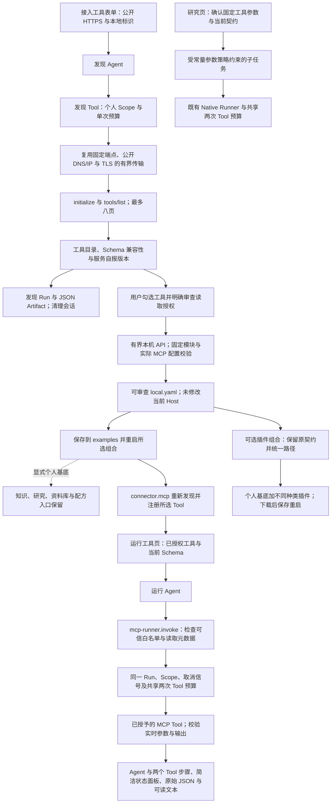

# MCP 接入与通用运行

让本地用户从一个公开 HTTPS MCP 地址出发，发现工具、审查读取授权、导出可运行配置，并在同一工作台执行工具和查看证据。

## 功能定位

`mcp.setup` 拥有接入表单、目录发现 Agent/Tool 和配置导出 API；不依赖连接插件，不在发现阶段调用上游工具。HTTP 默认装配接入助手。`mcp.runner` 是显式选择的通用 Native Agent，依赖 `connector.mcp`，经授权路由 Tool 调用配置白名单；不需要为新服务编写专用 Agent 或界面。

两者使用既有 Cordis 生命周期、本机页面、Tool Gateway、Run/Step/Artifact；不增加数据库或在线安装机制。

## 实现流程图

## 能力边界

### 目标

- 发现与执行分开；上游说明和 readOnlyHint 不成为授权来源。
- 导出配置能被真实插件加载器读取并通过通用运行器执行，不要求用户另写 TypeScript。
- 所选工具、实时参数校验、共享预算、取消和失败可追溯。

### 非目标

- 不自动执行仓库代码、自动安装依赖、热启停或合并任意自定义组合；个人预设仅通过显式 base: personal 继承。
- 发现助手暂不支持认证服务、OAuth、私网 HTTP、stdio 启动或运行输入指定 Secret 引用。可信 YAML 仍可手工配置既有 stdio/Bearer 连接。
- 读取声明不证明第三方服务无副作用；原生代码不处于 OS 沙箱中。

## 核心规则

1. 发现输入仅含 url/serverId，拒绝额外 token/tokenRef 等字段。网络复用现有 HTTPS 检查；不读取本机 Secret，不发送 tools/call。
2. 发现总等待 10 秒，传输单响应最多 2 MiB；目录最多八页、200 项和 512 KiB，超限/重名失败，不假装完整。Schema 超过 16 KiB、无效引用、不支持的名字或 task-only 项标记不可选择。别名确定生成并消除碰撞。
3. 服务名称/版本是有界自报元数据，不是锁定版本或真实性凭证。原始说明保留为数据，界面转义显示；导出使用宿主生成的中性说明，不把上游文本写为授权指令。
4. 导出最多 50 个唯一工具，必须有 reviewedReadOnly=true；API 正文最多 16 KiB、5 秒。使用实际 mcpConfig 验证，独立模式固定三个本地模块，个人模式固定两个追加模块并声明 base: personal；不接受客户端模块路径、命令或 Secret。导出不证明用户实际完成审查。
5. includePersonalWorkspace 缺省/false 保持 backend/examples/mcp-<id>.local.yaml，三个插件两 Agent 的独立组合。true 输出 mcp-<id>.personal.local.yaml，声明 base: personal，只追加 connector.mcp/mcp.runner，避免与基底内 mcp.setup 重复；标准个人基底为十六插件十 Agent，保留当前来源设置与个人入口。路径仍依赖 examples；已有 Run 保留，不合并其他自定义附加插件或团队组合。
6. runnerConfig 的 allowedTools 是可信装配授权；只接受 mcp.server.alias 形状且唯一、最多 50 项。启动及调用前检查实际工具存在且 sideEffect=read；授权元数据最多 1 MiB。运行输入不能扩大授权。
7. Agent 仅授予固定路由 Tool；路由用可信配置授予上游 Tool，传同一身份、Scope、信号及 ToolExecutionContext.budget。两层共用预算，合计两次调用；缺少预算拒绝执行，不另开额度。
8. Gateway 校验当前注册的 inputSchema，连接器按固定上游定义核验 outputSchema；未选工具、类型错误、预算/Scope 拒绝均不能产生上游调用或成功产物。
9. 发现结束、失败或取消都关闭客户端与本地流，尝试终止远端会话；远端终止失败不证明服务已经停止。Host 停止按既有在途收敛与 Cordis 释放贡献。

## 用户能力

- 在「接入工具」发现 Context7 等匿名 HTTPS MCP 服务，展开参数契约并勾选读取工具。
- 审查后生成、查看和下载本地配置，按页面命令重启。
- 在「运行工具」选择已授权工具，提交 JSON 对象，查看结果与执行步骤；无需模型。

## 入口与触发

| 入口 | 输入 | 输出 |
| --- | --- | --- |
| /mcp-setup；mcp.server.inspect | url、serverId | 工具目录 Run、服务自报信息与兼容性 |
| POST /api/mcp-setup/profile | 地址、工具 name/alias、显式读取审查；可选 includePersonalWorkspace | filename/yaml，不写当前配置 |
| /mcp-runner；GET /api/mcp-runner/tools | 已启用配置 | 所选 Tool 的当前参数契约 |
| mcp.tools.run | toolId、arguments 对象 | Run、原始结果与文本 Artifact |

## 运行逻辑

1. 发现 Agent 经 Tool Gateway 获取匿名目录并保存结果；不注册目录内工具。
2. 用户审查选择；导出固定模块配置，保存并重启。
3. 连接器重新发现实际工具；Runner 校验授予的 Tool 元数据，贡献页面和描述 API。
4. 运行 Agent 调用路由，路由调用白名单 Tool；共享预算与信号，结果沿用既有持久化链路。

## Agent、Tool 与服务边界

| 对象 | 职责 | 禁止承担 |
| --- | --- | --- |
| 发现 Agent/Tool | 有界协议发现、保存目录 | 凭据读取、工具调用或自动授权 |
| 配置导出 | 固定模块、字段与明确读取授权 | 安装、执行任意模块或修改当前 Host |
| 运行 Agent/路由 Tool | 可信配置授权、共享预算与产物 | 从用户输入继承新权限 |
| connector.mcp | 实际连接、当前 Schema 与协议执行 | 证明上游只读或沙箱隔离 |

## 数据与状态

- 目录保存为普通私有 JSON Artifact，带检查时间；不持久化 Secret。HTTP 工具调用不消耗模型额度。
- 导出内容只由浏览器持有并按用户动作下载，未自动写入项目；local.yaml 均被 Git 忽略。
- 运行保留 Agent、路由 Tool、上游 Tool 三个步骤，metrics.toolCalls=2/modelCalls=0；非文本 MCP 内容保留在原始 JSON，不下载或执行资源链接。

## 失败、安全与降级

地址/网络/协议不兼容、Schema 错误、目录超限、缺少授权和当前工具失效都明确失败；不静默扩大或截断授权。发现不提供凭据输入，避免通过任意地址将宿主 Secret 发往第三方。API 复用 PluginWebRegistry 的本机 Host/Origin 检查，当前不提供多人认证。

## 代码地图

### 主要实现

- `backend/src/connectors/mcp-workbench/catalog.ts`：发现、兼容性与别名、配置导出和有界请求读取。
- `backend/src/connectors/mcp-workbench/plugin.ts`：接入 Agent/Tool、页面与 API。
- `backend/src/connectors/mcp-workbench/runner.ts`：可信授权、通用运行 Agent/Tool、实时描述 API。
- `backend/src/connectors/mcp/http.ts`、`plugin.ts`：既有网络与协议连接；无业务复制。
- `backend/src/platform/plugins/contracts.ts`、`runtime.ts`：只读 tools.list 元数据，不暴露 Handler。
- `backend/src/platform/tools/contracts.ts`、`gateway.ts`：共享预算传入 Handler；既有调用者不变。
- `frontend/src/pages/workspace/McpSetupPage.tsx`、`McpRunnerPage.tsx`、`mcpInput.ts`：已打包表单、契约展示与 JSON 参数校验。
- `frontend/src/pages/workspace/PluginPage.tsx`、`frontend/src/api.ts`、`frontend/src/index.css`：按插件启用的懒加载视图与样式。
- `backend/src/platform/workspace/knowledge.ts`：HTTP 默认只加入接入助手，Runner 仍显式选择。
- `docs/MCP_TOOLS.md`：用户操作与限制。

### 主要测试

- `backend/test/mcpWorkbench.test.ts`：个人配置真实重载、MCP setup 唯一、同 Host 知识与工具运行、旧请求保持；真实 TCP/SDK 发现不调用、Session 清理、别名与 Schema/目录边界、无凭据输入、取消与实际连接释放、生成配置经真实加载器执行、权限/参数/Scope/共享预算拒绝、失败回滚与本机 API。
- `backend/test/mcpHttp.test.ts`、`pluginRuntime.test.ts`、`toolSkillRuntime.test.ts`：现有传输、生命周期和预算回归。
- `frontend/src/pages/workspace/mcpInput.test.mjs`：嵌套对象、非法 JSON、非对象与 UTF-8 字节上限。
- `backend/test/featureIndex.test.ts`：功能索引、默认/仓库/SDK 组合真实数量与本地文件忽略。

## 变更记录

| 日期 | 变更 | 验证 |
| --- | --- | --- |
| 2026-11-06 | 导出可选保留个人工作台；页面默认勾选，旧请求保留独立模式 | 实际基底重载与 TCP/SDK 执行、回归、前端与浏览器验证 |
| 2026-11-05 | 新增独立接入助手与通用运行插件；明确读取授权与可执行本地配置 | TCP/SDK 专项、类型/前端检查、全量回归与在线浏览器验收，结果见提交说明 |

## 共用有界输入读取

profileRequest 委托 backend/src/platform/workspace/request.ts 的 readSmallJsonBody，保留 16 KiB、5 秒、AbortSignal 和流取消；前端 mcpInput.ts 兼容导出 toolInput.ts 的原 JSON 对象/32 KiB 校验。无 MCP 协议或导出字段变化。验证：mcpWorkbench.test.ts、openApiConnector.test.ts、mcpInput.test.mjs。

## 与其他已审查插件组合

个人默认 plugins.compose 可把本功能导出文件与不同种类的 Skill/MCP/OpenAPI 导出文件一起校验、预览并生成 backend 根目录的个人基底配置。每种各一份，拒绝重复或未知模块；原始 Skill 形态/ID、内容/许可与工具授权/来源契约保留。不会合并当前自定义配置或重新审查来源，下载后手动保存重启。当前基底十五插件、九 Agent，历史验证批次的数量以当时提交为准。流程与验证见[组合功能卡](../profile-workbench/FEATURE.md)，代码：connectors/profile-workbench/compose.ts、plugin.ts；测试：backend/test/profileComposer.test.ts 及本功能既有回归。

## 研究任务调用（2026-11-06）

读取工具现在带公开目的地址与配置/契约 SHA 的 binding；不包含 token、Secret 值或任意本地路径，MCP stdio 不发布该 HTTP binding。MCP 连接插件为 1.2.0，mcp.runner / connector.openapi 为 1.1.0；实际读取和路由 Tool 为 1.1.0，原 Native Agent 的输入和两次共享预算不变。路由 Schema 枚举可信配置的授权工具，保留 handler 白名单检查。研究只能通过原 Runner 委派人工确认的完整固定请求，不能从模型生成新参数或扩展服务。确认会绑定目的地址与契约，配置变化必须新建研究；实际服务行为仍须审查。

完整流程见[研究功能卡](../../agents/personal-research/FEATURE.md)。实现：backend/src/agents/personal-research/externalRequests.ts、platform/agents/modelLoopAdapter.ts、platform/tools/contracts.ts；验证：backend/test/researchRequests.test.ts 与原 MCP/OpenAPI/研究/委派回归。新增目录元数据不替代真实成功 Run/Step/Artifact，原导出及运行输入保持。
