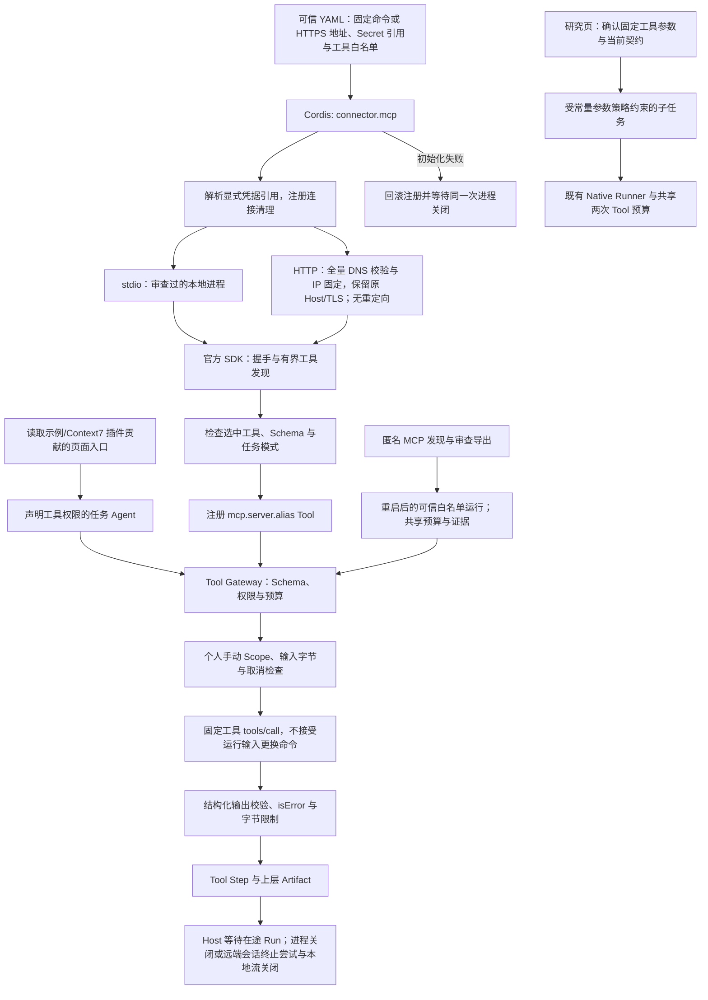

# MCP 工具接入

把经审查的本地 stdio 或公开 HTTPS MCP 服务接入现有 Tool Gateway，按配置选择工具，保留参数契约、调用预算、取消与运行证据。

## 功能定位

`connector.mcp` 是连接插件，不拥有业务目标或独立 Agent。它使用官方 TypeScript Client SDK 2.4.0，通过 stdio 启动本地服务，或通过 Streamable HTTP 连接固定公开 HTTPS 地址；发现工具后只注册用户明确选择的项。任务 Agent 仍通过自己的 Manifest 和 Tool Gateway 使用这些工具。插件 1.1.0 保留旧命令配置，未声明 transport 时仍为 stdio。

`example.mcp-reader` 是可选的确定性示例 Agent，读取一份文件，证明外部服务可以进入真实 Run/Step/Artifact；它不调用模型，也不进入默认团队或 HTTP 组合。

## 实现流程图

## 能力边界

### 目标

- 直接接入标准 MCP 本地或公开 HTTPS 服务，复用上游工具和完整 JSON Schema，不复制业务实现。
- 工具名称与描述由安装者明确选择，原始服务描述和 readOnlyHint 不决定授权。
- 工具错误、结构错误、超时、取消、进程退出和清理均可验证。

### 非目标

- 当前仅接入已审查的读取工具；不支持写工具、私网 HTTP、旧 HTTP+SSE 端点、OAuth、MCP 资源/提示词或任务型工具。
- 不安装依赖、不分析任意仓库、不提供 UI 安装器、热卸载或操作系统沙箱。
- 子进程具备本机账户权限；工具白名单与 readOnly 声明不能限制恶意进程的文件和网络访问。

## 核心规则

1. 配置最多十个服务，每个最多五十个工具；服务 ID 和本地 alias 唯一。工具 ID 为 mcp.<server>.<alias>，命令、地址与参数只来自可信配置。transport 默认为 stdio；http 使用独立严格字段，不接受命令或 envRefs 混入。
2. 每项工具必须显式声明 readOnly: true。它代表安装者已审查的授权意图，不是根据 MCP 注解推断的保证；需要写入的功能必须在后续具体动作确认与结果核验链路中接入。
3. 不转发整个宿主环境。stdio 仅继承 SDK 基础环境（PATH/HOME 等）与 envRefs 指定的 env:// Secret；HTTP 仅把可选 tokenRef 作为 Authorization: Bearer 发送到固定地址，不提供自动 OAuth 或任意请求头。不记录 Secret、原始服务错误正文或 stderr。进程仍可自行访问本机资源，此处不是秘密沙箱。
4. 初始化与发现共享超时；默认十秒，范围 100–30000ms。SDK 最多聚合八页、总共最多二百个工具，单条协议缓冲最多 2MiB。未选择工具不注册；缺工具、重复名称、非法 Schema 或 taskSupport=required 使装配失败。
5. 使用默认兼容握手，测试覆盖 MCP 2025-11-25；不声称已实现全部 MCP 2026 能力。SDK 负责协议序列化、响应校验和取消通知。
6. Tool Gateway 统一检查 Agent allowedTools、Schema 与预算；调用仅允许没有 chat/conversation 的 manual/agent Scope。Schema 支持标准联合类型、引用、额外字段和数值/长度约束，不自动下载远端引用。具有相同 $id 的不同契约隔离校验。
7. 运行输入不能选择服务命令、环境或未注册工具。输入最多 32KiB，输出默认 256KiB，配置范围 1KiB–1MiB；所选原始 outputSchema 交给 SDK 校验，不接受 isError=true 为成功。
8. 取消传入 SDK；超时不自动重试，不重新启动进程。取消通知不证明服务内部操作已经停止。连接断开后调用明确失败，需重启 Host 恢复连接。
9. Cordis 失败回滚与停止释放工具和子进程；SDK 握手失败可能先发起异步 close，插件复用同一次关闭 Promise，确保停止实际等待清理。Host 先等待在途 Run，再关闭进程。历史产物不随卸载删除。
10. HTTP 仅接受公开 HTTPS 标准端口、无用户名/密码/查询参数/片段的固定地址。每次请求验证所有 DNS 结果均公开，实际连接 IP 固定并保留原 Host、TLS 域名及证书验证；拒绝重定向，不给运行参数换地址。协议请求正文最多 64 KiB，每 HTTP 响应（含 SSE 累计）最多 2 MiB，头部最多 16 KiB；DNS、响应和流均使用配置超时，取消关闭实际请求。
11. HTTP 使用官方 SDK 的 JSON/SSE、会话与协议取消，既有工具白名单/Scope/预算不变。停止尝试 DELETE 终止本客户端会话，再关闭本地流；远端清理失败仍释放本地资源，不声称远端操作已经回滚。SDK 可恢复接收流，插件不重发 tools/call。在线服务版本和匿名限额由上游维护，本地适配与 Skill 版本独立记录。

## 示例页面入口

example.mcp-reader 通过 ctx.delivery.web.register 贡献 /mcp-reader 导航，跳到指定 Capability 的工作台，不修改前端业务列表。移除读取示例插件后该入口消失；连接插件自身仍只提供 Tool。界面不加载上游 UI 代码，读取流程仍由同一 Manifest、Tool Gateway 和来源范围约束。

## 社区 Skill 与 Context7 验证

标准 SKILL.md 可经 readAgentSkill 显式导入现有 Prompt Skill Runtime；元数据不能自动取得工具或 Agent 授权，不执行目录脚本。community.context7 是真实使用者：接入上游 MCP 两个读取工具，提供无模型查询和需模型的研究助手；页面按插件贡献，未知能力标签使用作者声明的 Agent 名称。默认组合不自动安装它。来源、许可、运行命令和验收边界见 [社区接入说明](../../../../docs/COMMUNITY_PLUGINS.md)。

验证：backend/test/context7Plugin.test.ts 覆盖格式/边界、权限不继承、受控 Prompt Skill 执行及插件装配；本地实际 MCP 与工作台验收覆盖公开文档检索。真实付费模型未调用。

## MCP 接入与通用运行

HTTP 默认加入独立 mcp.setup 接入助手，公开 HTTPS 匿名发现、审查勾选与 local.yaml 导出；不调用目录内工具或读取 Secret。保存并重启明确组合后，mcp.runner 按可信 allowedTools 转调已注册读取工具，实时 Schema 校验、同一 Scope/信号与共享两次 Tool 预算，记录 Agent/路由/上游三步。ctx.delivery.tools.list 只返回契约副本，ToolExecutionContext.budget 沿用既有预算，不给旧调用新增额度。移除插件释放页面/API/Agent/Tool，历史保留；无在线安装或 OS 沙箱。实现与测试见 [接入功能卡](../mcp-workbench/FEATURE.md)。

## 用户能力

- 使用可信 YAML 选择一个已安装 MCP 服务的读取工具。
- 在自定义 Agent 中声明导入的 Tool ID，沿用原执行预算与记录。
- 使用文件读取示例从本机工作台发起一次真实外部工具任务，无需模型、飞书或服务器。

## 入口与触发

| 入口 | 输入 | 输出 |
| --- | --- | --- |
| connector.mcp Config | servers：公共 id/tools/timeoutMs/maxOutputBytes；stdio command/args/cwd/envRefs；http url/tokenRef | 显式选择的 Tool 注册 |
| examples/plugins.context7-http.yaml | 官方 Context7 HTTPS 与两个读取工具 | 无上游本地进程的开发文档入口 |
| mcp.server.alias | 上游 inputSchema 定义的参数 | 经校验的 MCP CallToolResult |
| example.mcp.read | prompt 为文件路径 | 纯文本 Artifact、Agent/Tool Step，不调用模型 |
| AGENT_PLUGINS_FILE | 可信本地配置档 | 重启时选择插件组合 |

## 运行逻辑

1. 配置校验与凭据引用解析。
2. 注册清理后启动进程或连接固定 HTTPS，完成握手和有界工具发现。
3. 检查选择和 Schema，只注册白名单。
4. 任务通过 Tool Gateway 执行固定工具，验证输出并记录步骤。
5. 上层任务形成产物；失败不发布成功产物；停止等待并清理。

## Agent、Tool 与服务边界

| 对象 | 职责 | 禁止承担 |
| --- | --- | --- |
| MCP 插件 | 配置、连接、显式工具注册与清理 | 从模型输入执行命令、自动授予工具权限 |
| Tool Gateway | Manifest 权限、Schema、预算与步骤 | 证明第三方进程只读或被沙箱隔离 |
| 上游 MCP 服务 | 实际工具实现、文件/网络范围 | 从工具描述取得宿主额外授权 |
| 示例 Agent | 调用一个已声明工具并保存产物 | 自行扩大目录权限或假装模型生成 |

## 数据与状态

- 服务连接、工具目录与配置驻留内存，重启重新发现；没有新增业务数据库。
- Run/Step/Artifact 沿用宿主 Store，内容可能包含个人文件；第三方返回文本作为数据处理。
- Secret 只传给明确配置的进程或固定 HTTPS 端点；本地 .local.yaml 配置被 Git 忽略。

## 失败、安全与降级

缺工具、无效 Schema、Secret 缺失与初始化失败阻止就绪并释放已创建资源。isError、格式不匹配、超限、退出和超时明确使调用失败；不把空结果解释成读取成功。原生配置与子进程必须受信任，白名单和 SDK 不构成 OS 权限隔离；写工具、OAuth 与隔离执行仍未完成。

## 代码地图

### 主要实现

- `backend/src/connectors/mcp/plugin.ts`：兼容配置、stdio/HTTP 连接、工具注册与清理。
- `backend/src/connectors/mcp/http.ts`：固定 HTTPS、公开 IP/TLS 路由、流预算与取消；复用知识网络的公开地址判定。
- `backend/src/platform/agents/schema.ts`、`contracts.ts`：标准 JSON Schema 校验与类型。
- `backend/examples/plugins/mcp-reader.ts`：单工具 Native Agent 示例。
- `backend/profiles/agents/mcp-filesystem.example.yaml`：可信组合模板。
- `backend/examples/plugins.context7-http.yaml`：不安装上游进程的在线组合。
- `docs/MCP_TOOLS.md`：安装、授权、使用与验收范围。

### 主要测试

- `backend/test/pluginWeb.test.ts`、`frontend/src/pages/workspace/pages.test.mjs`：第三方页面声明、内部跳转与生命周期。
- 浏览器验收：官方文件服务与虚构资料，通过动态导航发起读取、查看成功产物与两个执行步骤；桌面与 375px 导航。

- `backend/test/mcpConnector.test.ts`、`backend/test/helpers/mcpServer.ts`：真实 stdio 子进程、分页、白名单、错误、超限、取消、停止与环境隔离。
- `backend/test/mcpHttp.test.ts`：真实 TCP JSON/SSE、会话/Bearer、固定 IP/Host/TLS 参数、配置与 DNS 拒绝、取消/超时、已声明或流式超限和清理。TCP 测试映射到本地 HTTP，真实 HTTPS 由官方 Context7 在线验收覆盖。
- `backend/test/featureIndex.test.ts`：用实际 Git 验证任意目录的 .local.yaml 均忽略，公开配置示例仍可跟踪；复制到 examples 的本机配置不会漏出保护范围。
- `backend/test/jsonSchema.test.ts`：标准约束、引用、联合类型、同 ID 契约隔离与失败关闭。
- `backend/test/toolSkillRuntime.test.ts`：现有 Tool/Skill 权限、幂等与预算回归。
- 人工专项：官方 @modelcontextprotocol/server-filesystem 2.2.0，Bun 运行，读取虚构目录内文件成功、目录外文件失败，产生真实 Agent/Tool Step；不调用模型或外部写入。

## 变更记录

| 日期 | 变更 | 验证 |
| --- | --- | --- |
| 2026-11-05 | 插件 1.1.0 增加受限公开 HTTPS Streamable HTTP，保留 stdio；固定地址和流预算，独立 Context7 HTTP 配置 | HTTP/stdio 专项与类型、后端回归、官方 Context7 实际读取及工作台验收；零模型调用 |
| 2026-11-05 | 读取示例插件自行贡献导航，复用现有工作台渲染与任务执行 | 插件 Web/站会 API 专项、后端回归、前端检查及默认/空配置/MCP 浏览器验收 |
| 2026-11-05 | 新增独立本地 MCP 连接插件、标准 Schema 校验与文件读取示例 | stdio 专项、后端回归、官方文件服务真实调用与越界拒绝 |

## 研究任务调用（2026-11-06）

读取工具现在带公开目的地址与配置/契约 SHA 的 binding；不包含 token、Secret 值或任意本地路径，MCP stdio 不发布该 HTTP binding。MCP 连接插件为 1.2.0，mcp.runner / connector.openapi 为 1.1.0；实际读取和路由 Tool 为 1.1.0，原 Native Agent 的输入和两次共享预算不变。路由 Schema 枚举可信配置的授权工具，保留 handler 白名单检查。研究只能通过原 Runner 委派人工确认的完整固定请求，不能从模型生成新参数或扩展服务。确认会绑定目的地址与契约，配置变化必须新建研究；实际服务行为仍须审查。

完整流程见[研究功能卡](../../agents/personal-research/FEATURE.md)。实现：backend/src/agents/personal-research/externalRequests.ts、platform/agents/modelLoopAdapter.ts、platform/tools/contracts.ts；验证：backend/test/researchRequests.test.ts 与原 MCP/OpenAPI/研究/委派回归。新增目录元数据不替代真实成功 Run/Step/Artifact，原导出及运行输入保持。
