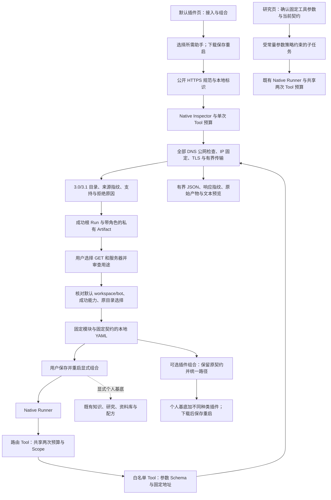

# OpenAPI 接入与固定契约读取

让没有 MCP 的公开 API 通过标准规范接入本地工作台，先审查接口与服务器，再运行被明确授权的 GET。

## 功能定位

`openapi.setup` 拥有发现 Agent/Tool、页面与配置导出 API；`connector.openapi` 拥有实际 GET Tool、通用 Native 运行 Agent、页面与描述 API。两者都是显式组合，默认个人工作台为十五插件、九 Agent。使用既有 Cordis、Host、Tool Gateway、Run/Step/Artifact，不执行第三方仓库代码，不新增数据库或模型调用。

## 实现流程图

## 能力边界

### 目标

- 读取 OpenAPI 3.0/3.1 JSON/YAML，列出不支持接口的原因；发现阶段不调用接口。
- 从成功发现记录导出选择的固定服务器、GET 路径与参数契约；运行时不重新加载规范扩权。
- 对真实请求保存来源 SHA-256、请求地址、接收时间、响应字节与 SHA-256、完整 JSON 和有界预览。

### 非目标

OAuth/Bearer、私网/本机 API、Swagger 2、写入方法、任意 Header/Cookie、远程引用、服务器变量、在线安装和热替换均不支持。只验证成功 HTTP、UTF-8 JSON 与输入契约，不完整验证响应输出 Schema，也不证明 GET 无副作用或数据正确。

## 核心规则

1. 规范与服务器为公开 HTTPS 默认端口，无凭据、查询或片段。实际请求仅由固定参数构造查询；全部 DNS 答案必须公网，固定选定 IP，保留 Host/TLS，禁止重定向；15 秒、1 MiB，禁止压缩响应。
2. YAML 禁止别名；最多 200 路径/接口、512 KiB 目录、每接口 40 参数与 8 服务器；只解析当前文档 components 的 schemas/parameters/responses，引用链最多 16 跳。
3. path/simple 支持必填标量和安全标识符；query/form 支持标量与一层基础数组，最多 100 项。字符串、布尔、数值、安全整数、枚举、基础范围与已支持字符串格式经既有 AJV 校验；int32 保留范围。额外输入拒绝，不隐式类型转换。
4. 对象、可空、正则/组合 Schema、嵌套数组、Header/Cookie、正文、回调和必填凭据拒绝；可选的常见凭据参数省略并显示警告。其他不支持的参数使该接口不可选；不静默放宽契约。
5. 导出仅接收 inspectionRunId、reviewedReadOnly=true、接口 key 与服务器选择及可选 includePersonalWorkspace 布尔值。读取 Artifact 前核对默认 workspace/bot、成功根 Run 与 openapi.spec.inspect；所选服务器和可用接口必须在该次目录中。客户端不能提供 Schema、插件模块或新权限。
6. includePersonalWorkspace 缺省/false 保持独立两插件两 Agent 与 openapi-<id>.local.yaml。true 输出 openapi-<id>.personal.local.yaml，声明 base: personal，追加 connector.openapi/openapi.setup；标准基底下十六插件十一 Agent，沿用重启时本机来源/仓库设置。文件仍须保存到 backend/examples；不合并其他自定义附加插件，不覆盖基底 ID。
7. 运行 Agent → 路由 Tool → 实际 Tool 共用两次预算和取消信号。个人 manual/agent Scope，不允许聊天；插件停止释放 Agent/Tool/API/页面，历史保留。

## 用户能力

读取目录、查看不支持原因和参数、明确选择服务器及接口、下载配置、运行授权接口、查看来源与完整结果。

## 入口与触发

| 入口 | 输入 | 输出 |
| --- | --- | --- |
| /openapi-setup / openapi.spec.inspect | url、serviceId | 目录 Run/Artifact |
| POST /api/openapi-setup/profile | inspectionRunId、reviewedReadOnly、selections、可选 includePersonalWorkspace | 文件名与固定 YAML |
| /openapi-runner / GET /api/openapi-runner/tools | 已启用配置 | 当前授权的接口与输入契约 |
| openapi.tools.run | toolId、arguments（path/query） | 原始 JSON、预览和三步骤记录 |

## 运行逻辑

先启动 backend/examples/plugins.openapi.yaml，发现并审查后保存导出的 *.local.yaml，再通过仓库根目录 bun run local 启动。配置可选择独立组合或个人基底，页面默认保留个人工作台；切换选项清除已生成配置并要求重新生成，当前 Host 不自动改变。每次请求生成普通 Run，失败不伪造成功 Artifact。

## Agent、Tool 与服务边界

| 对象 | 职责 | 禁止承担 |
| --- | --- | --- |
| Inspector | 受预算治理的文档读取与记录 | 调用发现的接口或自动授权 |
| 配置导出 | 原记录归属与选择核验 | 接受客户端 Schema 或模块 |
| Runner/路由 | 固定授权、共享预算与产物 | 自行增加服务器、方法或工具 |
| GET Tool/传输 | 输入验证、固定地址与网络边界 | 模型判断、隐式认证或本机资源访问 |

## 数据与状态

目录与响应由现有 RunStore 保存为私有 Artifact；来源 SHA 固定规范内容而非整个远端服务。响应/查询参数会保存在本机历史中。下载的配置由用户保存，*.local.yaml 被 Git 忽略；不改写原规范、原记录或其他配置。

## 失败、安全与降级

不兼容规范、非法参数、超限、DNS 非公网、重定向、超时、错误 HTTP/MIME/JSON 明确失败；没有自动宽松重试。API 复用本机 Host/Origin 检查。GET 元数据不是无副作用证明，必须审查实际用途；原生插件仍是可信宿主代码。

## 代码地图

### 主要实现

- `backend/src/connectors/openapi/contracts.ts`：规范子集、固定配置和 URL 构造。
- `backend/src/connectors/openapi/catalog.ts`：有界发现、引用解析与支持原因。
- `backend/src/connectors/openapi/setup.ts`：发现 Agent/Tool、记录绑定导出和页面/API 贡献。
- `backend/src/connectors/openapi/plugin.ts`：实际接口 Tool、通用 Runner 和结果产物。
- `backend/src/knowledge/web/network.ts`：复用公网 DNS/IP/TLS 传输；可选 Accept 保持网页默认。
- `backend/src/platform/workspace/request.ts`：与 MCP 共用 16 KiB/5 秒 JSON 请求读取。
- `frontend/src/pages/workspace/OpenApiSetupPage.tsx`、`OpenApiRunnerPage.tsx`、`toolInput.ts`：已打包懒加载视图与共用参数解析。
- `backend/examples/plugins.openapi.yaml`、`docs/OPENAPI_TOOLS.md`：显式组合与上手步骤。

### 主要测试

- `backend/test/openApiConnector.test.ts`：个人组合实际导出/重载、同 Host 原文检索和固定 GET、入口/数量与旧参数保持；目录/引用/Schema 边界、公网限制、原记录归属、导出后真实加载、Tool 预算/Scope/参数拒绝、JSON/预览、插件卸载与历史保留。
- `backend/test/mcpWorkbench.test.ts`、`knowledgeWeb.test.ts`：共用请求读取和网络默认行为回归。
- `frontend/src/pages/workspace/mcpInput.test.mjs`：经兼容导出验证共用 JSON 输入解析。
- `backend/test/featureIndex.test.ts`：Owner、索引及默认组合数量。

## 变更记录

| 日期 | 变更 | 验证 |
| --- | --- | --- |
| 2026-11-06 | 导出可选保留个人工作台与本机来源；旧独立请求保持 | 实际基底重载、固定 GET 与知识检索、回归及浏览器验证 |
| 2026-11-06 | 新增显式 OpenAPI 发现、记录绑定授权与固定契约读取插件 | 专项、类型/前端门禁、后端回归及 Open-Meteo 本地端到端验收；见用户指南与提交证据 |

## 与其他已审查插件组合

个人默认 plugins.compose 可把本功能导出文件与不同种类的 Skill/MCP/OpenAPI 导出文件一起校验、预览并生成 backend 根目录的个人基底配置。每种各一份，拒绝重复或未知模块；原始 Skill 形态/ID、内容/许可与工具授权/来源契约保留。不会合并当前自定义配置或重新审查来源，下载后手动保存重启。当前基底十五插件、九 Agent，历史验证批次的数量以当时提交为准。流程与验证见[组合功能卡](../profile-workbench/FEATURE.md)，代码：connectors/profile-workbench/compose.ts、plugin.ts；测试：backend/test/profileComposer.test.ts 及本功能既有回归。

## 研究任务调用（2026-11-06）

读取工具现在带公开目的地址与配置/契约 SHA 的 binding；不包含 token、Secret 值或任意本地路径，MCP stdio 不发布该 HTTP binding。MCP 连接插件为 1.2.0，mcp.runner / connector.openapi 为 1.1.0；实际读取和路由 Tool 为 1.1.0，原 Native Agent 的输入和两次共享预算不变。路由 Schema 枚举可信配置的授权工具，保留 handler 白名单检查。研究只能通过原 Runner 委派人工确认的完整固定请求，不能从模型生成新参数或扩展服务。确认会绑定目的地址与契约，配置变化必须新建研究；实际服务行为仍须审查。

完整流程见[研究功能卡](../../agents/personal-research/FEATURE.md)。实现：backend/src/agents/personal-research/externalRequests.ts、platform/agents/modelLoopAdapter.ts、platform/tools/contracts.ts；验证：backend/test/researchRequests.test.ts 与原 MCP/OpenAPI/研究/委派回归。新增目录元数据不替代真实成功 Run/Step/Artifact，原导出及运行输入保持。

## 从默认工作台启用发现助手

默认插件页的“接入与组合 → 启用接入助手”可选择本功能发现助手，由 plugins.compose 1.1.0 输出固定内置模块的个人基底 YAML。保存重启后出现接入页；实际能力仍经过本功能原来的规范、接口与读取用途审查后单独导出，再组合使用。不执行任意仓库代码，也不自动并入当前自定义附加插件。原独立 CLI 组合继续可用。代码与验证见[配置组合功能卡](../profile-workbench/FEATURE.md)及 backend/test/profileComposer.test.ts；本功能契约与测试保持。
