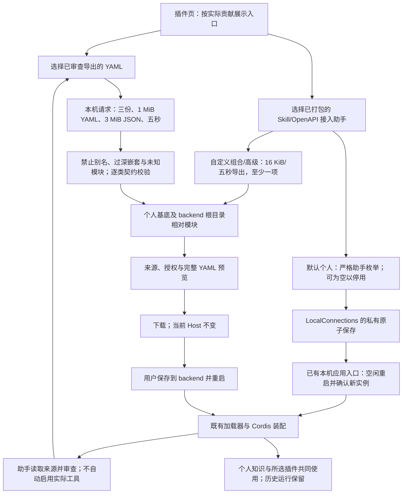

# 插件接入助手与配置组合

个人用户在默认插件页勾选 Skill/OpenAPI 接入助手，保存并应用后直接进入；完成来源审查后，再组合导出的能力文件。自定义组合保留导出入口。

## 功能定位

`plugins.compose` 是可独立装配/移除的 FeaturePlugin，拥有隐藏侧栏页面和本机 API。转换是确定性的，不需要模型循环、独立会话或 Agent；实际执行仍交给原来的插件与 Host。

## 实现流程图

## 能力边界

### 目标

- 首次使用可选择已打包的 Skill/OpenAPI 接入助手并保存应用，无需下载启用 YAML；取消勾选可停用。助手与实际工具/Skill 的启用分开。
- 接受本应用既有独立/个人基底导出的 Skill、匿名 HTTPS MCP、固定 GET OpenAPI 配置，各一份。
- 保留原 Skill 形态/ID、完整原始指令、许可、来源指纹和审查确认；MCP 运行器授权必须与连接白名单完全一致；OpenAPI 使用原固定契约。
- 统一为 `base: personal`，固定模块改为 `./src/` 路径，文件保存到 backend 根目录。

### 非目标

- 不读取或覆盖当前自定义文件，不合并任意原生插件、多个同类配置或团队组合；不安装仓库、联网、执行原模块或热更新。实际能力文件仍需原审查、导出和显式启动。
- 结构校验不是来源真实性、许可适用性、模型质量或第三方服务行为的证明。知识基底随重启时本机配置生成，不是环境快照。

## 核心规则

1. 组合输入严格限定为 `{files:[{name,yaml}]}`，1–3 份、UTF-8 内容合计最多 1 MiB。文件名只能是无目录/控制符的 YAML 名称，不作为文件路径读取。
2. YAML 必须是单文档，无重复键、别名、未知标签警告或超过 40 层嵌套。只识别固定模块的 `./src/` 与 `../src/` 两种导出拼写，不解析任意路径或动态导入。
3. 每份文件必须是一个完整种类。模型提供者和接入助手仅允许空配置；去除个人基底已有的模型模块/MCP setup，保留所选功能模块。重复种类或模块一律拒绝，不覆盖。
4. 复用 `promptConfig/preparePromptSkills`、`mcpConfig/runnerConfig`、`connectorConfig` 校验；MCP stdio、Secret 引用、授权不一致、OpenAPI 非 GET 或私网地址均拒绝。
5. 默认个人组合为十五插件、九 Agent；全部三类追加后为二十一插件、十四 Agent。GitHub、混合知识等额外配置会改变数量。没有新 Agent。
6. 助手导出独立接收 `{assistants:["skills","openapi"]}` 的非空唯一子集，只生成固定内置模块和 base personal；最多两项、16 KiB/五秒。输出 plugins.setup.personal.local.yaml，保存到 backend 根目录。两项助手在标准示例基底为十七插件、十一 Agent；导出不改变当前装配，不授予实际第三方工具/Skill。已有自定义附加插件不自动加入，助手文件不作为能力文件输入组合器。
7. 默认个人助手选择经已有 PUT /api/workspace/connections 保存为 PLUGIN_SETUP_ASSISTANTS（每行 skills/openapi；最多两个、不得重复，空值停用）。保存只改 0600 私有设置；原 Host 不变，新实例确认后才显示已应用。workspaceKnowledge 只追加静态导入的两种 Inspector，不添加 Prompt/API/MCP Runner。独立启动保留手动重启提示。显式 AGENT_PLUGINS_FILE 下 API 拒绝写此字段，个人基底也忽略已保存助手开关，防止重复模块和覆盖文件所有权。
8. 本机 Host/Origin 检查和 Cordis 注册清理由公共平台负责。解析/Schema 错误返回通用说明，不回显输入配置或 Secret；可控冲突错误只含固定种类名。

## 用户能力

默认个人组合选择助手并保存应用，从真实装配提供的链接进入；重新打开页面恢复已保存勾选，取消并应用可移除。自定义组合与高级导出继续核对摘要/完整 YAML。能力文件仍校验、预览、下载和显式启动；选项、文件或页签改变会清除旧预览，处理中禁止更换。

## 入口与触发

| 入口 | 输入 | 输出 |
| --- | --- | --- |
| 插件页 → `/plugin-profiles` | 助手选择或本机文件 | 校验反馈、预览和下载 |
| `PUT /api/workspace/connections` | 严格 PLUGIN_SETUP_ASSISTANTS 字符串；仅默认个人组合 | 已保存选择与重启状态，沿用本机应用入口 |
| `POST /api/plugin-profiles/setup` | 严格助手枚举数组 | 固定内置助手 YAML 与用途摘要 |
| `POST /api/plugin-profiles/compose` | 严格文件数组 | 固定文件名、YAML、逐类来源/授权摘要 |

## 运行逻辑

默认助手：勾选 → 私有配置校验/保存 → 既有应用流程 → 新实例静态装配 → 入口和实际 Agent 反映状态。高级导出：读取有界请求 → 固定能力文件契约校验 → 规范化路径/个人基底 → 预览 → 显式下载；转换本身不写文件、不创建 Run、不改变装配。

## Agent、Tool 与服务边界

| 对象 | 职责 | 禁止承担 |
| --- | --- | --- |
| 配置组合插件 | 结构校验、规范化和预览导出 | 动态导入未知代码、网络发现、任务执行 |
| 原 Skill/MCP/OpenAPI 插件 | 重启后的实际执行与运行证据 | 从组合请求扩展权限 |

## 数据与状态

能力文件与预览仅保留在当前页面内存，转换接口不持久化输入。默认助手偏好仅由 LocalConnections 保存在既有私有文件中；不保存来源正文或新授权。用户下载的 `.local.yaml` 含 Skill 指令和来源，按既有忽略规则不提交；历史 Run/Artifact 仍由原 Store 拥有。

## 失败、安全与降级

超量、损坏、不完整、重复或未知模块均阻止导出；不尝试部分成功。五秒超时或调用方取消时释放请求流。卸载插件后页面贡献与 API 消失；其他个人能力不依赖它。

## 代码地图

### 主要实现

- `backend/src/connectors/profile-workbench/compose.ts`：固定助手配置导出、能力模块解析、契约校验与组合摘要。
- `backend/src/connectors/profile-workbench/plugin.ts`：页面/API 及有界本机入口。
- `backend/src/platform/workspace/knowledge.ts`、`composition.ts`、`connections.ts`：默认助手静态装配、显式文件所有权、私有偏好与校验；request.ts 保持原请求预算。
- `frontend/src/pages/workspace/ProfileComposerPage.tsx`、`CatalogPage.tsx`、`PluginPage.tsx`、`frontend/src/api.ts`、`frontend/src/index.css`：入口、文件选择、异步反馈、预览和下载。
- `docs/PLUGIN_PROFILES.md`：用户流程与限制。

### 主要测试

- `backend/test/profileComposer.test.ts`：助手选择边界、真实启用文件加载/历史保留、未审查运行器不启用，三类组合、旧单份 ID、路径白名单/不完整/重复/授权/来源/许可/YAML 边界、本机 API 与卸载、请求预算、真实加载器与知识/Skill 目录共存。
- `backend/test/workspaceComposition.test.ts`、`workspace.test.ts`、`featureIndex.test.ts`：助手设置边界、重载/停用/历史保留、显式文件优先、默认数量与实际 Owner 索引。
- `backend/test/mcpWorkbench.test.ts`、`openApiConnector.test.ts`、`skillKnowledgeContext.test.ts`：旧导出契约与个人基底回归。
- 前端类型/lint/build、现有交互辅助测试；浏览器桌面/375px 文件选择、预览、错误恢复、下载与重启后真实工具运行。

## 变更记录

| 日期 | 变更 | 验证 |
| --- | --- | --- |
| 2026-11-06 | 1.2.0：默认个人在页面保存应用/停用助手；高级导出与显式文件所有权保持 | 三十一项专项、全量与实际浏览器开关/导航/API 移除验证 |
| 2026-11-06 | 1.1.0：默认插件页生成 Skill/OpenAPI 助手启用配置，双页签与实际装配标签；原组合接口保持 | 严格输入、真实重载/历史保留、全量及无模型浏览器完整接入 |
| 2026-11-06 | 新增独立配置组合插件与简洁预览/下载界面；原授权与 Skill 身份保留 | 专项、全量回归、前端门禁和本地浏览器；见项目证据 |
