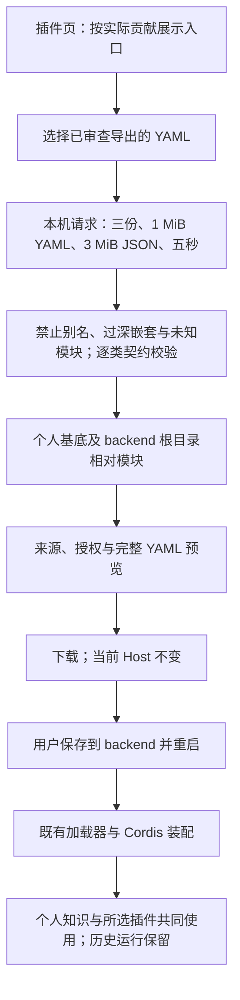

# 已审查插件配置组合

个人用户在插件页选择已有 Skill、MCP、OpenAPI 导出文件，校验并预览后下载一个保留个人工作台的配置，减少手写 YAML。

## 功能定位

`plugins.compose` 是可独立装配/移除的 FeaturePlugin，拥有隐藏侧栏页面和本机 API。转换是确定性的，不需要模型循环、独立会话或 Agent；实际执行仍交给原来的插件与 Host。

## 实现流程图

## 能力边界

### 目标

- 接受本应用既有独立/个人基底导出的 Skill、匿名 HTTPS MCP、固定 GET OpenAPI 配置，各一份。
- 保留原 Skill 形态/ID、完整原始指令、许可、来源指纹和审查确认；MCP 运行器授权必须与连接白名单完全一致；OpenAPI 使用原固定契约。
- 统一为 `base: personal`，固定模块改为 `./src/` 路径，文件保存到 backend 根目录。

### 非目标

- 不读取当前自定义文件，不合并任意原生插件、多个同类配置或团队组合；不安装仓库、联网、执行原模块或热更新。
- 结构校验不是来源真实性、许可适用性、模型质量或第三方服务行为的证明。知识基底随重启时本机配置生成，不是环境快照。

## 核心规则

1. 输入严格限定为 `{files:[{name,yaml}]}`，1–3 份、UTF-8 内容合计最多 1 MiB。文件名只能是无目录/控制符的 YAML 名称，不作为文件路径读取。
2. YAML 必须是单文档，无重复键、别名、未知标签警告或超过 40 层嵌套。只识别固定模块的 `./src/` 与 `../src/` 两种导出拼写，不解析任意路径或动态导入。
3. 每份文件必须是一个完整种类。模型提供者和接入助手仅允许空配置；去除个人基底已有的模型模块/MCP setup，保留所选功能模块。重复种类或模块一律拒绝，不覆盖。
4. 复用 `promptConfig/preparePromptSkills`、`mcpConfig/runnerConfig`、`connectorConfig` 校验；MCP stdio、Secret 引用、授权不一致、OpenAPI 非 GET 或私网地址均拒绝。
5. 默认个人组合为十五插件、九 Agent；全部三类追加后为二十一插件、十四 Agent。GitHub、混合知识等额外配置会改变数量。没有新 Agent。
6. 本机 Host/Origin 检查和 Cordis 注册清理由公共平台负责。解析/Schema 错误返回通用说明，不回显输入配置或 Secret；可控冲突错误只含固定种类名。

## 用户能力

选择文件、校验、核对摘要/完整 YAML、下载、按命令保存重启；更换文件立即清除旧预览，处理中禁止更换，避免下载过期结果。

## 入口与触发

| 入口 | 输入 | 输出 |
| --- | --- | --- |
| 插件页 → `/plugin-profiles` | 本机文件选择 | 校验反馈、预览和下载 |
| `POST /api/plugin-profiles/compose` | 严格文件数组 | 固定文件名、YAML、逐类来源/授权摘要 |

## 运行逻辑

读取有界请求 → 解析和校验固定导出契约 → 规范化路径/个人基底 → 预览 → 显式下载。保存与重启由用户执行；转换不写文件、不创建 Run、不改变装配。

## Agent、Tool 与服务边界

| 对象 | 职责 | 禁止承担 |
| --- | --- | --- |
| 配置组合插件 | 结构校验、规范化和预览导出 | 动态导入未知代码、网络发现、任务执行 |
| 原 Skill/MCP/OpenAPI 插件 | 重启后的实际执行与运行证据 | 从组合请求扩展权限 |

## 数据与状态

文件与预览仅保留在当前页面内存；服务器不持久化输入，不写日志或保存配置。用户下载的 `.local.yaml` 含 Skill 指令和来源，按既有忽略规则不提交；历史 Run/Artifact 仍由原 Store 拥有。

## 失败、安全与降级

超量、损坏、不完整、重复或未知模块均阻止导出；不尝试部分成功。五秒超时或调用方取消时释放请求流。卸载插件后页面贡献与 API 消失；其他个人能力不依赖它。

## 代码地图

### 主要实现

- `backend/src/connectors/profile-workbench/compose.ts`：固定模块解析、契约校验、组合与摘要。
- `backend/src/connectors/profile-workbench/plugin.ts`：页面/API 及有界本机入口。
- `backend/src/platform/workspace/knowledge.ts`、`request.ts`：默认个人装配与宿主指定的请求预算。
- `frontend/src/pages/workspace/ProfileComposerPage.tsx`、`CatalogPage.tsx`、`PluginPage.tsx`、`frontend/src/api.ts`、`frontend/src/index.css`：入口、文件选择、异步反馈、预览和下载。
- `docs/PLUGIN_PROFILES.md`：用户流程与限制。

### 主要测试

- `backend/test/profileComposer.test.ts`：三类组合、旧单份 ID、路径白名单/不完整/重复/授权/来源/许可/YAML 边界、本机 API 与卸载、请求预算、真实加载器与知识/Skill 目录共存。
- `backend/test/workspaceComposition.test.ts`、`featureIndex.test.ts`：默认/混合/个人组合数量与实际 Owner 索引。
- `backend/test/mcpWorkbench.test.ts`、`openApiConnector.test.ts`、`skillKnowledgeContext.test.ts`：旧导出契约与个人基底回归。
- 前端类型/lint/build、现有交互辅助测试；浏览器桌面/375px 文件选择、预览、错误恢复、下载与重启后真实工具运行。

## 变更记录

| 日期 | 变更 | 验证 |
| --- | --- | --- |
| 2026-11-06 | 新增独立配置组合插件与简洁预览/下载界面；原授权与 Skill 身份保留 | 专项、全量回归、前端门禁和本地浏览器；见项目证据 |
