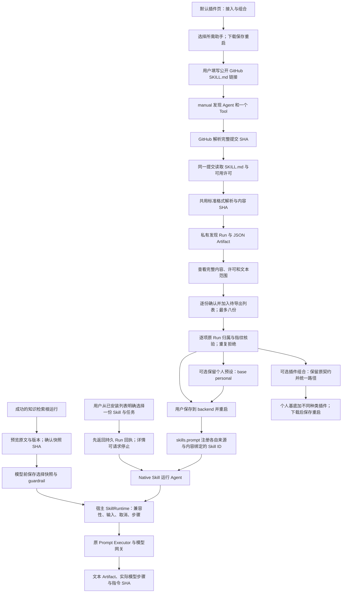

# GitHub Skill 接入与文本运行

让个人用户从公开 GitHub 文件链接审查标准 SKILL.md，保存固定版本与许可后，在本地通过既有 Prompt Skill Runtime 生成文本，无需为每个仓库编写适配代码。

## 功能定位

两个独立 FeaturePlugin：skills.setup 负责发现、审查与配置导出，skills.prompt 装配最多八份逐项审查的固定文本 Skill，由同一个 Native Agent 按明确选择运行。默认十五插件九 Agent；本机独立组合显式启用。Native Agent 提供独立任务、时限与可观测结果，模型生成由已有 Prompt Skill Runtime 承担，没有复制模型或工具运行时。

## 实现流程图

## 能力边界

### 目标

- 支持公开 github.com 的 blob 文件链接，分支或完整提交，固定实际提交及原始文件 SHA-256。
- 保留上游 name/description、许可/环境/工具声明供审查；上游声明不授予工具。
- 导出固定指令、来源和已取得的许可正文；重启后使用当前已启用模型生成文本，保存真实 Skill/Model Step。

### 非目标

不克隆/安装仓库，不运行脚本、读取文件、执行 shell、浏览网页或加载 references/assets；不保证所有 Skill 完整可用。不支持私有仓库、GitHub Enterprise、认证、编码/非 ASCII 路径、含斜杠分支、自动更新、热安装、执行沙箱或 Skill 内的人工暂停恢复。

## 核心规则

1. 只接收 https://github.com/owner/repo/blob/ref/目录/SKILL.md，无凭据、查询、片段、非默认 HTTPS 端口、转义路径或上级目录。完整 SHA 直接使用，分支用 GitHub SHA 媒体类型解析；只允许 GitHub API/raw 主机的固定 HTTPS URL。
2. 复用 fetchPublicPage：公网 DNS 全检查、固定 IP/TLS、有界响应与取消。额外拒绝重定向目标变化，不使用 GitHub Token、Cookie 或环境密钥，不自动重试。最多一次提交查询、一次 Skill 和一次许可请求；单请求 10 秒，发现 Tool 35 秒、Agent 40 秒。
3. SKILL.md 至多 128 KiB，frontmatter 至多 8 KiB，目录名等于 name，描述与正文有效；共用 parseAgentSkill，原本地 readAgentSkill 的文件/符号链接检查保持。许可文件至多 64 KiB，优先读取声明中的常见 LICENSE 文件，否则尝试仓库根 LICENSE；缺失显示 null，不假造许可或自动判断使用权。
4. 导出只接受成功发现根 Run、当前 workspace/bot、角色为 skill.github.inspection 的唯一 JSON；先核验归属再读产物，复算源 URL/内容/许可 SHA。客户端仅提交每项原 Run ID、审查指纹和两个明确确认，不能注入正文、工具或模块。旧单项请求保持；集合请求接受 skills 数组，一至八项，每项均重新读取原记录核验，任何一项无效则整份导出失败。
5. 生成配置的模块路径相对 backend。includePersonalWorkspace=true 时输出 plugins.skills-personal.local.yaml，声明 base: personal，只追加发现与运行插件；默认基底加 Skill 为十六插件十一 Agent，按本机设置重启解析，来源页面仍可编辑。未提供或为 false 时保持原独立组合（三项模型提供者、发现与运行，共五插件两 Agent），集合文件 plugins.skills-reviewed.local.yaml、旧单份文件名不变。基底插件 ID 不允许追加覆盖；不合并团队或任意自定义组合。配置内保留完整指令与可用许可，不含模型密钥；下载不自动安装或启用。重新装配校验内容指纹，不联网拉最新版本。
6. 旧单份配置仍使用 community.imported-prompt；新集合按仓库 owner/repo 小写归一后的固定 skillUrl 与原文 SHA 的 JSON 数组计算 SHA-256，得到 community.imported-prompt.<SHA>，与顺序无关，同名来源/路径/提交可并存，重复同一来源版本拒绝。集合一至八份，Skill 配置 JSON 序列化 UTF-8 总量最多 512 KiB，YAML 文件大小可能不同。全部校验后才注册；兼容 Agent 仅 native.imported-skill，allowedTools=[]、maxToolCalls=0，45 秒。原始文件 SHA 与实际注册的 Skill 指令 SHA 分开；注册指令为正文加宿主边界，Skill Step 保存后者的 SHA（不含执行器的输出约束附加语，不代表完整模型请求），成功 Markdown/JSON Artifact 同样保留，失败步骤仍有执行版本凭证。
7. 运行插件要求当前模型提供者已启用且已配置，不旁路空注册表。Native Agent 经宿主 skills.execute 使用原 SkillRuntime、Prompt Executor 和 Run Store，Native Runner 以自身已验证目录限制 skillId，不依赖 Model Loop 的自动 Skill 发现或把全部指令送给模型。只有一份时兼容省略 skillId；多份必须明确选取，未知或已移除版本在模型调用前失败，不按名称/顺序兜底。最多两个 SDK 模型步骤；SDK 网络重试沿既有提供者行为，模型费用不是固定一次请求。无外部工具，输出至多 256 KiB，需要人工核对，不能把代码文本称为执行或渲染结果。
8. SkillRuntime 在入口和持久化步骤后的取消边界拒绝进入处理器，取消后返回的文本不能发布成功；超时先确定 SKILL_TIMEOUT 再通知处理器清理，避免清理结果抢成成功。停止仍无法强杀忽略取消的原生代码，不宣称进程沙箱。

9. skills.prompt 1.2.0 可在手动任务中绑定已预览并确认的成功知识检索根运行。先验 workspace/bot/根运行/Capability/成功状态，再读取唯一私有 JSON，复用 retrievalEvidence / selectEvidence 的十条、12000 字符预算；请求仅含原 Run ID、快照 SHA 和 confirmed=true，不接受客户端片段。模型只收到历史标记、partial 与片段 ID/标题/小标题/原文，不额外提供路径、URI 或版本字段；文字自身可能含这些信息。模型调用前保存私有 skill.knowledge.context Artifact 和 guardrail Step，失败/取消也保留“选入”记录，不能视作接收/采用/引文核验或当前来源证明。成功文本与来源产物关联源 Run/Artifact、快照 SHA 和选择产物；纯文本旧任务保持两个产物。
10. 历史检索 JSON 至多 128 KiB，必须有命中片段；不重读原目录或网页。快照哈希绑定源 Run/Artifact、版本、选中片段和检索覆盖，确认只对该快照有效。选择 Artifact 序列化至多 256 KiB，verification 明确 modelReceived/sourceUsage/answerCitations=not_verified、sourceCurrentness=not_checked；自由文本不经过 RAG 的 verifyCitations。

## 用户能力与入口

| 入口 | 输入 | 输出 |
| --- | --- | --- |
| /skills | GitHub 文件链接，或最近成功发现记录 | 完整指令、来源、许可与本地配置下载 |
| skills.github.inspect | url | native.skill-inspector 的 Tool Step 和私有 JSON |
| GET /api/skill-setup/inspection?runId=… | 当前成功发现根 Run | 经核验的 bundle 与解析声明 |
| POST /api/skill-setup/profile | 单项审查参数或 skills 数组，每项均有 ID/指纹/双确认；可选 includePersonalWorkspace | 配置文件名和 YAML，不写文件或新建 Run |
| /skill-runner | 已装配列表中选择一份 Skill，再填写文本任务 | 运行记录、文本产物及固定来源 |
| GET /api/skill-runner/skills | 无查询 | 已装配目录的 ID、名称、仓库/路径、版本、范围，不调用模型 |
| GET /api/skill-runner/skill | 无查询 | 单份保持原描述；多份返回 409 要求明确选择 |
| GET /api/skill-runner/context?runId=… | 当前范围成功且命中资料的检索根运行 | 确定性选择的历史快照和 SHA，不读取当前来源 |
| skills.prompt.run | 1–8000 字 prompt、可选 skillId；多份时必选，可选 knowledge={runId,sha256,confirmed:true}（仅 manual） | native.imported-skill 的实际 Skill/Model Step、Markdown 正文与 JSON 范围说明 |

## Agent、Tool 与数据边界

发现由一个 read Tool 负责确定性网络读取，Artifact 拥有快照；导出是只读控制面，不重拉网络。运行 Agent 不含外部 Tool，只调用自己目录中的一份已注册 Skill。结果及元数据保留实际 skillId、仓库、路径、固定来源与指令 SHA；移除或变更所选版本后，旧输入不会静默运行其他技能。上游声明没有执行权；配置用户与原生插件仍属于可信宿主代码。

不新增数据库表，使用原 Run/Step/Artifact。文本正文是无 statusPanels 的 Markdown，来源/范围单独放 JSON 面板，避免通用渲染器以面板替代正文。公开源快照和用户任务结果标记 privateKnowledge，导入配置归用户本机文件。SHA 是内容完整性/版本凭证，不是来源签名或正确性、许可、模型效果证明。

## 失败、安全与降级

无效链接、私网 DNS、来源跳转、过大文件、无效格式或无完整提交均失败，不生成可启用的成功包。许可读取失败单独显示缺失，用户须自行核对；确认使用权不表示系统审计过许可。缺少模型只能阅读/导出，运行前后端均拒绝生成。模型/Skill 失败保留失败记录，不伪造文本；Skill 内请求人工追问会失败，用户应补全任务后重新运行。

## 代码地图

- backend/src/connectors/skill-workbench/source.ts：GitHub 链接/提交、固定读取、来源/许可快照、格式与指纹。
- backend/src/connectors/skill-workbench/knowledgeContext.ts：历史检索归属/内容校验、模型字段投影、选择产物与守卫步骤。
- backend/src/connectors/skill-workbench/catalog.ts：旧/新配置校验、集合预算、稳定内容来源 ID 与重复拒绝。
- backend/src/connectors/skill-workbench/service.ts：归属先于产物读取、按原记录导出本地组合。
- backend/src/connectors/skill-workbench/setupPlugin.ts、promptPlugin.ts：两个独立插件、Native、Tool、Skill 与页面/API。
- backend/src/platform/skills/packageLoader.ts：共用文本解析，原本地文件读取保持。
- backend/src/platform/skills/runtime.ts：取消边界、超时竞争、实际执行指令 SHA。
- backend/src/platform/plugins/contracts.ts、runtime.ts、backend/src/platform/bootstrap/agentHost.ts：受治理 skills.execute 端口与原 Skill Runtime。
- backend/examples/plugins.skills.yaml：独立发现组合。
- frontend/src/pages/workspace/SkillSetupPage.tsx、SkillRunnerPage.tsx、PluginPage.tsx、state.ts、frontend/src/api.ts：审查、下载、文本任务、模型门槛与路由。

### 主要测试

- backend/test/skillWorkbench.test.ts：版本固定、不继承工具、来源/指纹/格式、DNS/重定向/大小/取消、缺失许可、归属/审查、原配置重载、集合实际重载、同名/顺序/版本 ID、重复/超额、未选择和旧选择拒绝、所选指令隔离、实际 SDK/Skill Step、缺少模型、回滚/卸载。
- backend/test/skillKnowledgeContext.test.ts：真实个人基底导出/重载、原来源改动后的历史快照、字段隔离、无确认/旧 SHA/伪片段/异域/空检索/委派拒绝、失败与取消保留准确选择记录。
- backend/test/pluginConfiguration.test.ts、workspaceComposition.test.ts：显式基底懒加载、重复拒绝、未提供解析器失败、旧文件替换、实际来源设置与插件运行。
- backend/test/toolSkillRuntime.test.ts：执行前、步骤持久化中和输出前取消；超时清理不得发布成功，原 Tool/Skill 行为。
- backend/test/context7Plugin.test.ts：原标准格式、文件边界、上游声明不提权与 Context7 原调用回归。
- 既有 Host/Plugin/模型/知识回归，前端类型/lint/build 与桌面/375px 浏览器验收；线上真实读取公开 Skill，模型协议测试使用本机受控服务，不证明真实模型效果。

## 变更记录

| 日期 | 变更 | 验证 |
| --- | --- | --- |
| 2026-11-06 | 个人基底组合与任务级历史知识快照；先留选择凭证，再通过原 Skill Runtime 生成 | 专项、全量、前端与本地浏览器验收；事实/引用效果未验证 |
| 2026-11-06 | 多份 Skill 的逐项审查导出、内容来源绑定 ID、明确选择与执行隔离；旧单份保持 | 专项及原 Skill/Host 回归、前端检查与本地浏览器验收 |
| 2026-11-06 | GitHub Skill 来源审查、固定配置导出与原 Prompt Runtime 文本执行；补强取消/超时与指令凭证 | 专项、全量、前端与本地浏览器验收；未调用真实付费模型 |

## 本机任务体验

本功能发起页使用持久启动回执，立即进入可轮询详情；手动根任务可请求停止，关闭页面后仍可从运行记录找回。停止沿既有执行信号传递，取消后不能继续或接受迟到成功，已保存产物与完成操作保留；子任务由父任务管理。CLI/SDK 与内联审查操作仍使用原同步接口。完整协议见[工作台功能卡](../../platform/workspace/FEATURE.md)；验证：backend/test/runControl.test.ts、localRunApi.test.ts 和本功能既有回归，frontend/src/api.test.mjs。

## 与其他已审查插件组合

个人默认 plugins.compose 可把本功能导出文件与不同种类的 Skill/MCP/OpenAPI 导出文件一起校验、预览并生成 backend 根目录的个人基底配置。每种各一份，拒绝重复或未知模块；原始 Skill 形态/ID、内容/许可与工具授权/来源契约保留。不会合并当前自定义配置或重新审查来源，下载后手动保存重启。当前基底十五插件、九 Agent，历史验证批次的数量以当时提交为准。流程与验证见[组合功能卡](../profile-workbench/FEATURE.md)，代码：connectors/profile-workbench/compose.ts、plugin.ts；测试：backend/test/profileComposer.test.ts 及本功能既有回归。

## 从默认工作台启用发现助手

默认插件页的“接入与组合 → 启用接入助手”可选择本功能发现助手，由 plugins.compose 1.1.0 输出固定内置模块的个人基底 YAML。保存重启后出现接入页；实际能力仍经过本功能原来的来源、指令与许可审查后单独导出，再组合使用。不执行任意仓库代码，也不自动并入当前自定义附加插件。原独立 CLI 组合继续可用。代码与验证见[配置组合功能卡](../profile-workbench/FEATURE.md)及 backend/test/profileComposer.test.ts；本功能契约与测试保持。
