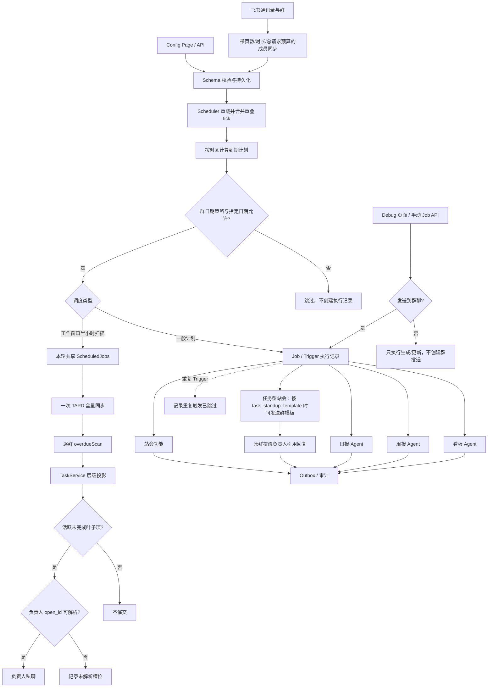

# 配置、通讯录与定时调度

管理群、成员、公司目录、模块开关、运行参数与定时计划，并把确定性调度转换为带作用域的功能触发。

## 功能定位

配置与调度属于系统控制面。配置决定“哪些群、成员、机器人和功能可以运行”，调度决定“在什么时间创建一次执行”；它们不负责生成日报、统计站会或构造看板。

把控制面和业务逻辑分开，可以避免配置页面、Scheduler 和手动 Debug 入口各自实现一套业务规则。无论请求来自定时器还是管理员手动触发，最终都进入相同的业务 Service 或 Agent Runtime。

## 实现流程图

## 能力边界

### 目标

- 配置变更可校验、可持久化，并能安全地重载 Scheduler。
- 群与成员配置为站会、日报、看板和 Bot 路由提供一致范围。

### 非目标

- Scheduler 只决定何时和以什么作用域触发，不实现业务规则。
- 配置页面不是 Agent，不需要模型参与确定性管理操作。

## 核心规则

自动调度统一通过 `backend/src/core/scheduleCalendar.ts` 判断群级 `schedule.calendar`。指定日期的触发/暂停优先于基础策略；`workdays` 使用中国工作日（含调休），`every_day` 不限制节假日，`selected_dates` 仅执行指定触发日。日期放行不绕过模块开关、任务开关或原定时刻，手动触发不受该日历限制。未配置或 `legacy` 保留原有 `workdays_only` 规则及周报、承诺到期提醒的例外；无效日期与非布尔覆盖值在读取配置时丢弃。

1. **配置先校验再持久化。** Cron、时区、群、Bot、模块开关和外部服务参数必须通过服务端 Schema；前端校验只改善体验。飞书发送与模型重试次数统一限制为 0–3，非法值回退安全默认值。
2. **保存成功只代表配置已持久化。** Scheduler 当前按轮询周期读取新配置，页面提示约 30 秒内生效；配置 API 不能把未来的调度执行描述成已经成功。
3. **Scheduler 只创建执行。** 到点后写入 Job/Trigger 记录，再调用对应 Agent 或领域服务；Scheduler 不复制日报、站会和看板规则。
4. **每个群独立调度。** 群配置、时区、计划和 Bot Binding 共同确定运行 Scope，一个群失败不阻塞其他群。
5. **定时执行使用稳定幂等键并禁止本进程重入。** 功能、群、计划时间或业务日期共同识别一次执行，服务重启不会重复完成同一业务动作；前一轮 `tick` 尚未结束时，后续 tick 复用同一进行中 Promise，不并行启动另一轮扫描。同一分钟的后续轮询若由 Agent Trigger Store 判定为 `duplicate`，只记录 `job_duplicate_skipped`，不能再次记录任务完成。
6. **计划任务只重试临时失败。** 当前调度链路对可重试失败额外尝试一次，并分别记录每次尝试；供应商给出 `Retry-After` 时优先使用，明确不可重试的权限、参数、月额度耗尽、分页预算耗尽或分页游标异常直接失败。Native Agent 的错误码和 `retryable` 必须穿透 Dispatcher，不能在外层重新变成默认可重试错误。业务副作用仍需自身幂等，发送跳过或拒绝记录 `completed_with_warnings`，不得伪装为干净完成。
7. **通讯录同步采用低频保守快照和硬预算。** 群成员后台自动同步默认每 6 小时一次，管理员手动同步立即执行；群/群成员通用分页最多 100 页、总计 30 秒。公司通讯录的部门及逐部门成员分页各最多 100 页，整次最多 200 个请求、60 秒；缺失或重复游标立即以不可重试错误终止。群成员职务查询按 Bot Adapter 缓存 24 小时、最多 5000 人。飞书返回空列表、分页不完整或请求失败时保留最近成功成员，不用异常结果清空配置；仅在完整的非空公司通讯录快照成功时，将本次缺失的公司成员标为离职，并同步停用其群成员配置。
8. **Secret 只保存引用。** 密钥不进入普通动态配置、前端完整响应、日志、Prompt 或 Artifact。
9. **模块开关影响入口，不改变历史数据。** 关闭功能停止新的调度和消息处理，但不删除既有记录。
10. **超期扫描限制在工作窗口且可按群关闭。** `overdue_scan_enabled` 是每个群的总开关，关闭后 Scheduler 不创建该群的扫描或私聊提醒；开启时默认使用 `Asia/Shanghai`，在工作日 09:00–18:30 每 30 分钟扫描；开始、结束、间隔和时区分别由 `overdue_scan`、`overdue_scan_end`、`overdue_scan_interval_minutes`、`overdue_scan_timezone` 配置。每次扫描的幂等键包含北京时间业务日期和实际时分。
11. **扫描频率与提醒频率分离。** Scheduler 只按半小时创建扫描；任务域按 10:00、16:00 或整点提醒槽决定是否私聊。18:30 扫描用于重试 18:00 的失败提醒，不创建 18:30 提醒；旧配置 `task_reminder_frequency_hours` 不再参与提醒判断。
12. **调度不判断任务是否可催。** 同一 tick 复用一个 `ScheduledJobs`，所有到期群共享一次 TAPD 全分页同步；任务域再对相邻 30 秒的其他日报、看板或周报请求复用成功刷新并合并并发。单次 TAPD 项目同步最多 50 页、30 秒；预算耗尽标记为不可重试，其他临时失败不缓存并允许 Job 重试。同步成功后由任务域选择唯一提醒群和活跃叶子项；负责人未解析、临时失败或永久拒绝由业务结果统计，Scheduler 记录部分完成。
13. **周报按周五、显式时区和站会资格触发。** `weekly_report`、`weekly_report_timezone`、`weekly_report_enabled` 和 `module_weekly_report_enabled` 分别控制时刻、时区、任务开关和模块开关；此外必须由 `StandupService.isGroupEnabled` 判定该群已开启日报站会。周报仍固定周五；沿用原规则时不受 `workdays_only` 跳过，选择新日期策略后按周报配置时区的日期统一过滤。
14. **全局维护任务独立于群业务任务。** 默认每天 `Asia/Shanghai` 03:30 清理 90 天以前的审计日志、临时调度幂等记录、`feishu:event:` 入站去重键和 `history-sync:` 历史补齐完成键；使用日期幂等键、批量上限和内部错误隔离，一个维护失败不能阻塞任一群的业务 Job。
15. **AI 新闻默认复用现有机器人。** 未设置 `AI_NEWS_ENABLED` 时功能保持启用，直接使用 `bot-default` 和已有 `FEISHU_APP_ID` / `FEISHU_APP_SECRET`；默认单页为 15 条，`AI_NEWS_DEFAULT_LIMIT` 可在 1–20 范围覆盖。“查看更多”固定使用下一批最多 20 条。`AI_NEWS_ENABLED=false` 只关闭新入口，不删除历史 Run。只有配置了不同的 `FEISHU_AI_NEWS_APP_ID` 时才创建独立 BotInstance，并通过 Secret 引用读取对应 App Secret。
16. **公开版集成配置默认不连接真实租户。** `TAPD_WORKSPACE_ID` 默认值为 `0`，`TAPD_WORKITEM_TYPE_ID`、飞书凭证和模型密钥默认留空；使用者必须显式提供自己的测试或生产配置。
17. **调度不得吞掉业务降级语义。** 日报、站会汇总和周报的 AI 失败由对应业务服务记录并生成带说明的确定性版本；Scheduler 仍把该次业务投递视为已执行，不能移除降级提示或再次调用模型重生成。
18. **普通站会与任务型站会独立调度。** 普通站会使用 `standup_push`，任务型站会使用独立的 `task_standup_template`；两者都受站会模块总开关约束，但互不依赖，可单独开启或同时开启。任务型模板按群和业务日期持久化领取，`standup_push_enabled` 关闭不会阻止任务型模板发送。
19. **任务型站会使用轮询到期扫描。** Scheduler 每轮调用站会域检查该群已到交付时间且未完成的承诺事项。提醒按任务、交付时间和负责人持久化领取，同一交付时间只发送一次；单群扫描失败记录审计但不阻塞其他群及常规定时任务。
20. **手动触发默认不发群。** Debug 页面和 `/api/jobs/:jobName` 的 `sendToGroup` 只有明确为 `true` 才发送群消息；关闭时仍执行日报生成、看板快照、站会统计及其他数据更新，站会/任务的私聊提醒不因该开关关闭。

## 用户能力

- 群高级配置「自动任务日期与节假日」支持四种策略、日历选择具体日期并设置触发或暂停；同日再次添加会更新，移除后恢复基础策略。例外日期仍沿用各任务时刻，不新增单日专属时刻。
- 超期扫描和周报按各自配置时区判断日期；其他任务沿用服务器本地日期，跨午夜补充汇总仍按被汇总的业务日期判断。全局维护、通讯录同步、公开源/Discord 轮询及已入 Outbox 的投递不受群日历限制。

- 配置群、项目、成员、邮箱、Bot 绑定和功能开关。
- 同步飞书群成员与公司通讯录。
- 设置日报、周报、站会、看板和超期催办计划；可在每个群的高级配置「其他基础配置」中开启或关闭超期催办，并通过 Debug 页面或 Agent API 手动验证任务。
- 在站会收集模块中单独开启任务型站会并设置任务模板发送时间；它可与普通站会并行，也可独立使用。

## 入口与触发

| 入口 | 输入 | 输出 |
| --- | --- | --- |
| Config API/页面 | 配置 Patch 或同步动作 | 保存结果与当前配置 |
| 服务启动/配置重载 | 持久化配置 | Scheduler 任务注册 |
| Scheduler | Cron、群、Bot、业务参数 | Agent Trigger 或 Job Execution |
| Debug 页面/API | Job、群、日期、`sendToGroup` | 业务执行结果；按开关选择群投递 |

## 运行逻辑

1. Config Page 调用后端 API 读取或提交受 Schema 约束的配置。
2. Core Config 合并允许字段并持久化，Secret 只保存引用或受控值。
3. 群成员/公司目录服务通过飞书 Adapter 同步身份数据；公司目录完整快照会停用缺失成员及其动态群成员配置，空或失败结果不写入。
4. Scheduler 根据启用模块和计划重建任务；一般计划按配置时刻触发，超期扫描按显式时区、工作窗口和扫描间隔触发。
5. 到期任务创建 Job/Trigger 执行记录，再调用站会、日报、周报、看板或超期扫描入口；Agent Trigger 命中同一幂等键时记录“重复触发已跳过”，不伪装成第二次完成。同轮传统 Job 复用一个 `ScheduledJobs`，普通站会和任务型站会分别按 `standup_push`、`task_standup_template` 触发，超期扫描只做一次 TAPD 同步。周报只对开启日报站会的群在配置时区周五触发，超期扫描由任务域判断唯一提醒群和活跃叶子项。
6. Debug 页面调用手动 Job API；后端只接受布尔 `sendToGroup`，默认关闭。关闭时业务方法仍生成 Artifact、快照或统计并写审计，但跳过群消息发送；定时任务不经过该选项，保持原有投递行为。

## Agent、Tool 与服务边界

| 对象 | 职责 | 禁止承担 |
| --- | --- | --- |
| Config Service/API | 校验、保存和读取配置 | 执行业务 Job |
| Scheduler | 时间编排和触发作用域 | 复制日报/站会/看板规则 |
| Group/Company Member Service | 同步身份和群范围 | 自行创建业务任务 |
| Scheduled Agent Dispatcher | 将调度请求交给 Agent Runtime | 绕过 Run 和 Trigger 记录 |

## 数据与状态

- 动态配置、群配置、成员目录和 Job Execution 是不同数据对象。
- 动态配置先持久化，Scheduler 再按轮询周期读取；实际业务执行由独立 Job/Trigger 状态记录。
- 调度幂等键至少包含功能、群、计划时间或业务日期；任务型站会模板使用 `standup-task-template:<group>:<date>`，超期扫描包含时区内的实际执行时分，同一半小时扫描不能重复执行。
- 任务提醒槽和原子发送领取由任务域持久化。扫描执行成功不等于已经发送提醒；临时失败时下一个扫描周期可重试，永久接收人错误按负责人和槽位抑制，负责人未解析时同槽只记录一次。存在跳过或失败时 Job 状态为 `completed_with_warnings`。

## 失败、安全与降级

- 虽为内网系统，配置接口仍应限制到管理员或可信网络边界；不能依赖前端隐藏按钮。
- Secret 不得进入日志、Agent Prompt、Artifact 或前端完整响应。
- 通讯录同步失败时使用最近成功快照并记录时间，避免错误清空成员。
- 非法 Cron、时区或群/Bot 绑定必须在保存前拒绝。
- 定时报告中的 AI 降级由业务 Job 负责审计和显式展示，不能因为定时链路仍成功投递就丢失失败证据。

## 代码地图

### 主要实现

- `backend/src/core/scheduleCalendar.ts`：共享日期规则、旧配置兼容与日期值规范化。
- `frontend/src/components/config/ScheduleCalendarEditor.tsx`：受控日期策略与日历选择表单。

- `backend/src/core/config.ts`：动态配置读取与保存。
- `backend/src/core/scheduler.ts`：定时器装配。
- `backend/src/core/dataRetention.ts`：全局维护任务的保留边界与分批清理。
- `backend/src/core/scheduleTime.ts`：时区时钟、工作窗口和循环触发判断。
- `backend/src/services/jobs.ts`：业务调度动作。
- `backend/src/services/jobExecution.ts`：执行记录。
- `backend/src/services/groupMembers.ts`、`companyMembers.ts`：成员同步。
- `backend/src/platform/bootstrap/scheduledAgentDispatcher.ts`：调度到 Agent Runtime。
- `frontend/src/pages/ConfigPage.tsx`、`frontend/src/components/config/GroupConfigList.tsx`、`frontend/src/pages/DebugPage.tsx`：配置和手动验证。

### 主要测试

- `backend/test/scheduleCalendar.test.ts`：节假日、调休、日期覆盖、时区、旧规则与调度入口。

- `backend/test/config.test.ts`：配置校验和持久化。
- `backend/test/scheduler.test.ts`：计划注册与执行。
- `backend/test/dataRetention.test.ts`、`maintenanceScheduler.test.ts`：维护配置、每日领取和失败隔离。
- `backend/test/jobs.test.ts`、`jobExecution.test.ts`：业务 Job 和记录。
- `backend/test/groupMembers.test.ts`、`companyMembers.test.ts`：成员同步、完整目录快照和离职停用。

## 变更记录

| 日期 | 变更 | 验证 |
| --- | --- | --- |
| 2026-07-29 | 公开版移除真实项目默认值，TAPD Workspace 与 Workitem Type 改为安全空值，并统一公开项目与机器人名称 | `config.test.ts` |
| 2026-10-05 | 自动调度增加群级节假日策略与日历日期覆盖，保留旧配置兼容 | `scheduleCalendar.test.ts`、`scheduler.test.ts`、`config.test.ts`、前后端类型检查 |
| 2026-08-19 | 普通站会与任务型站会拆分独立时间和调度任务；手动触发页增加独立任务型模板任务 | `jobs.test.ts`、`scheduler.test.ts`、前后端类型检查 |
| 2026-08-12 | 站会模块增加群级任务型站会开关；Scheduler 每轮扫描任意交付分钟并按持久化领取在原群提醒，配置页说明与默认值同步 | `jobs.test.ts`、`scheduler.test.ts`、前后端类型检查 |
| 2026-08-13 | 手动触发页增加“发送到群聊”开关，默认关闭；关闭时仍执行数据生成/更新，仅跳过群投递，定时任务行为不变 | `jobs.test.ts`、`jobExecution.test.ts`、前端 `typecheck` / `lint` / `build` |
| 2026-08-04 | Agent 定时任务命中重复 Trigger 时改记 `job_duplicate_skipped`，不再在同一分钟产生第二条“任务完成”审计 | `scheduler.test.ts`、前端日志类型检查 |
| 2026-08-03 | 群与通讯录分页增加重复/缺失游标、页数、总请求和总时长熔断；Scheduler 合并重叠 tick；TAPD 同步限制 50 页/30 秒并穿透不可重试错误；外部重试配置限制为 0–3 | `adapters.test.ts`、`dashboardData.test.ts`、`scheduler.test.ts`、`config.test.ts`、全量回归 |
| 2026-08-03 | 日报飞书历史分页预算、超时与游标保护错误标记为不可重试，防止 Scheduler 在异常分页后重新执行整份历史同步 | `adapters.test.ts`、`jobs.test.ts`、`scheduler.test.ts` |
| 2026-08-03 | 群成员后台同步由 30 分钟降为 6 小时，职务缓存 24 小时；TAPD 相邻功能刷新合并并发并复用 30 秒；维护清理历史同步完成键 | `adapters.test.ts`、`dashboardData.test.ts`、`dataRetention.test.ts`、全量 Scheduler 回归 |
| 2026-08-03 | 调度重试识别不可重试错误与供应商等待时间；维护任务纳入过期飞书事件 Claim | `scheduler.test.ts`、`dataRetention.test.ts` |
| 2026-07-31 | 明确定时日报、站会和周报在 AI 失败时由业务 Job 保持投递并携带降级说明，Scheduler 不重生成或隐藏失败证据 | `jobs.test.ts`、报告域回归 |
| 2026-07-29 | AI 新闻默认数量从 10 提升到 15，继续保留 1–20 的配置边界，续页固定最多 20 条 | `config.test.ts`、`aiNewsRadar.test.ts` |
| 2026-07-29 | AI 新闻改为默认启用并复用现有机器人凭证，关闭开关和独立机器人凭证均为可选配置 | `config.test.ts`、`agentHost.test.ts` |
| 2026-07-29 | 增加独立的每日数据维护调度；按时区和日期幂等执行，清理失败不影响群业务 Job | `dataRetention.test.ts`、`maintenanceScheduler.test.ts` |
| 2026-07-27 | 同一 tick 复用 Job 实例，使多群超期扫描只做一次 TAPD 全量同步；业务投递告警记录为部分完成 | `scheduler.test.ts`、`jobs.test.ts` |
| 2026-07-27 | 超期扫描增加负责人接收人校验；未解析 `open_id` 时按提醒槽记录业务跳过，不再调用飞书空 `receive_id` | `jobs.test.ts`、类型检查 |
| 2026-07-27 | 公司通讯录同步改为完整非空快照：缺失成员标为离职，并停用其动态群成员配置；分页或部门请求失败时不写入，避免部分数据误判离职 | `companyMembers.test.ts`、类型检查 |
| 2026-07-27 | 超期催办开关保留在群高级配置的「其他基础配置」中；关闭后 Scheduler 不再为该群创建超期扫描或私聊提醒 | `scheduler.test.ts`、前端类型检查 |
| 2026-07-27 | Scheduler 增加周报群站会资格校验，关闭站会模块或每日推送的群不创建周报 Trigger | `scheduler.test.ts` |
| 2026-07-27 | 配置页增加周报模块与周五生成时间，Scheduler 按群时区派发 `native.weekly-report` | `scheduler.test.ts`、前后端类型检查 |
| 2026-07-23 | 超期扫描改为只催活跃未完成叶子项，开发完成、已实现、父项和完成父项子树均不进入催交 | `tapdHierarchy.test.ts`、`jobs.test.ts`、类型检查 |
| 2026-07-22 | 超期扫描改为北京时间工作日 09:00–18:30 每 30 分钟触发，配置页增加窗口、间隔和时区 | `config.test.ts`、`scheduler.test.ts`、前后端类型检查 |
| 2026-07-22 | 超期扫描从每日一次调整为每小时一次，并按实际小时建立调度幂等键 | `scheduler.test.ts`、`jobs.test.ts`、类型检查 |
| 2026-07-22 | 补充配置保存、调度重载、成员同步和 Secret 规则，精简文档结构 | CodeGraph 与配置调度测试 |
| 2026-07-22 | 建立配置与调度功能卡，明确调度不承载业务规则 | CodeGraph 架构审查 |
