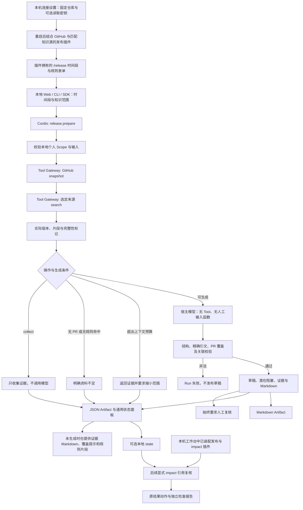

# 个人知识驱动的发布准备

结合明确配置的 GitHub 仓库事实和个人发布规则，生成带来源证据、潜在阻塞与待确认事项的只读发布草稿。

## 功能定位

`release.prepare` 是独立功能插件，依赖 `connector.github` 和一个知识来源。默认使用 Markdown/Obsidian；webPlugin.ts 切换到网页来源，复用同一发布实现。固定的取证、生成与验收管线使用 Native Agent，接入现有 Host、Tool Gateway、Run/Step/Artifact；不包含自主多 Agent 循环。

CLI、配置档与插件拥有的本地 /release 页面均可使用。HTTP 默认组合在明确保存 GitHub 仓库并重启后，增装 GitHub 和发布插件；知识来源沿用当前所选 Markdown/Obsidian 或网页。显式 AGENT_PLUGINS_FILE 仍完全管理组合。外部写入与持续监控未实现；保存后的实际知识引用可用独立 impact 插件显式复核。

## 实现流程图

## 能力边界

### 目标

- 在一个 Run 中使用实际 GitHub 事实和用户选定规则，保留引用版本。
- 每个供给模型的 PR 恰好出现在草稿一次，规则发现同时引用对应 PR 与个人知识。
- 无模型收集模式、资料不足和来源失败可区分，不伪造发布成功。

### 非目标

- 不创建 Release、评论、PR 或外部草稿，也不修改知识库。
- 不检查代码 Diff、CI/审核状态、标签实际部署或迁移文档是否存在于未读取文件中。
- 不保证模型语义、规则适用性或发布就绪；不提供聊天/共享 Web、多用户授权、跨来源联合检索或持续自动变更提醒。

## 核心规则

1. 插件依赖固定 GitHub Tool 与一个来源 Tool。请求只含时间窗口、operation、policyQuery 和 limit，不能更换仓库、来源路径、模型或权限。缺依赖在装配时拒绝。
2. 只允许无 chatId/conversationId 的手动或 Agent Scope。两次检索使用同一 Run、Scope、两次 Tool 预算和各自幂等键；API/模型异常使 Run 明确失败。
3. collect 只获取事实和知识证据，不调用模型。prepare 在无合并 PR 或无关键词命中时返回 insufficient_evidence；这不证明资料不存在。
4. 个人资料按现有 12000 字符预算选择完整片段。最多 30 个 PR、30 个开放 Issue，完整序列化生成上下文最多 48000 字符；超出时保留读取结果并返回 needs_review，不静默省略 PR 后生成完整草稿。
5. 仓库分页、重复、输出/正文截断及知识 partial/上下文截断进入 warnings。生成输入包含 coverage、非原子一致性、每条事实截断标记与当前 Issue 读取时间。PR 合并窗口与当前 Issue 状态不能混为历史快照。
6. 模型只收到必要事实文本、标题、证据 ID、数量与覆盖信息；不额外发送知识路径、URL 或打开 URI。正文自身的链接仍可能发送。CLI 在生成前显示模型地址与仓库事实/个人片段的数据去向。
7. 生成最多一步、8192 输出 token，45 秒或剩余 Run 期限取较小值；无 Tool/人工输入函数。Run 总期限 120 秒，不启动等待恢复 Checkpoint。
8. 草稿最多 64 KiB。每个 PR 恰好一个条目，条目必须引用该 PR 的证据。每个引用 ID 来自本轮供给，quote 是对应片段的非空精确子串。复用知识回答的 verifyCitations；重复证据 ID 拒绝。
9. 每个 finding 引用的 PR/Issue 必须真实供给且各自被引用。policy 类发现同时需要 PR 和知识依据，issue 类发现需要实际 Issue。仅返回 potential_blocker 或 needs_review，不产生“已证明可发布”的结论。
10. 无 warning/发现时可标为 draft，其余已生成草稿为 needs_review；始终 requiresHumanReview=true。verification 只说明引用与 PR 覆盖检查，semanticSupport=not_verified。不存在的 PR、漏 PR、改写引文或缺少相应来源都会拒绝整个草稿。
11. Markdown 将模型文字的 HTML 和标题语法按文本转义；原文链接只允许 HTTP(S)/Obsidian。JSON 保存完整证据与版本，打开链接指向当前来源。生成期间源文件变化时保留实际检索版本，不自动重写或标记旧产物。
12. SDK 团队默认组合不启用本插件。HTTP 工作台明确配置 RELEASE_GITHUB_REPOSITORY 后增装两个插件，使用当前知识来源及宿主模型；配置重启生效。CLI 生成仍要求专用 KNOWLEDGE_* 设置，不自动采用团队模型凭据。collect 不需要模型；GitHub 凭据仅经显式 tokenRef，不自动采用 Git 登录。
13. /release 页面随插件装配与释放，只提交时间段、规则关键词和操作；普通任务文本引导到该页面或高级参数。组合未安装 knowledge.workspace 时，个人规则链接转到插件页，避免指向未启用的知识页面。无模型时仍能收集证据。所有成功结果保存 JSON 与 Markdown：JSON 的通用状态面板区分证据、资料不足、待复核和草稿；未生成时 Markdown 展示实际 PR/Issue 链接、分页/重复/截断提示和选中规则版本及片段，原始完整 JSON 在运行详情。

## 用户能力

- 从个人规则与指定仓库生成可复制的 Markdown 发布草稿和待确认清单。
- 查看事实覆盖、每条依据的版本与原文，理解哪些内容没有读取或验证。
- 先用 collect 模式检查资料，再决定是否调用配置模型生成。

## 工作台引用复核

在 HTTP Host 显式组合发布与 impact 插件后，成功的发布 Run 详情可显示 impact 插件贡献的「检查引用变化」。它只复核知识文档版本并生成独立检查记录，不发布内容、不改写草稿，也不复核 GitHub 事实。未配置仓库时 HTTP 默认不装配发布插件；配置后与选定知识来源和 impact 一起加载。显式发布配置档仍需自行选择 impact 依赖组合。

## 入口与触发

| 入口 | 输入 | 输出 |
| --- | --- | --- |
| /release 本地页面 | 合并起止时间、规则关键词；收集或生成 | 真实 Run、状态面板、可读证据与草稿；来源设置需重启 |
| release.prepare Capability | since、可选 until/operation/policyQuery/limit | evidence_only、insufficient_evidence、needs_review 或 draft 数据与 Artifact |
| release.ts CLI | 仓库、目录或公开链接、时间段、可选 collect/tokenRef | Run ID 与 JSON；生成成功带 Markdown |
| release-demo / release-web-demo | 发布功能、GitHub 与一个知识源 | 独立配置组合，不加载默认团队功能 |

## 运行逻辑

1. 验证范围，经过 Tool Gateway 获取仓库和知识。
2. 构造版本化事实/规则证据与覆盖提示。
3. collect、空资料或上下文超预算直接返回明确结果。
4. 记录 Model Step，调用宿主模型，校验所有引用和 PR 关联。
5. 保存 JSON 与可复制 Markdown；失败保存步骤错误，不发布草稿。

## Agent、Tool 与服务边界

| 对象 | 职责 | 禁止承担 |
| --- | --- | --- |
| 发布 Agent | 取证编排、上下文预算与草稿验收 | 任意网页抓取、GitHub 写入或证明可发布 |
| GitHub / 知识来源 | 受限读取、版本、覆盖信息 | 选择业务结论或模型目的地 |
| 引用校验 | 身份、精确引文、PR 覆盖与关联 | 证明语义蕴含、规则有效或资料完整 |
| Markdown 导出 | 呈现草稿和证据，转义生成文字 | 执行模型 HTML 或自动打开链接 |

## 本地状态锁保护

CLI 状态文件与会话锁文件仅在不存在时独占创建，创建/关闭在同步段内完成；已有文件通过 lstat 验证常规文件、单链接与私有权限，不额外打开并关闭它们。这样重复打开被拒绝后，不会因原始文件句柄 close 取消同进程的 SQLite POSIX 锁，另一进程仍不能进入活跃状态会话。

## 数据与状态

- 每次任务保留实际使用的仓库快照、知识源版本和片段；Run 中两次 Tool 与 Model Step 可追踪。
- JSON/Markdown 都标记 privateKnowledge；本地 CLI 默认内存；显式 --state 保存 Run/Artifact，索引仍重建。
- 重复 Trigger 不重复请求来源或模型，新的任务重新读取。
- 生成期间来源改变不会覆盖已引用片段。当前可按已保存 Run 的实际知识引用显式检查变化；全局依赖索引与自动通知后续实现。

## 失败、安全与降级

来源/凭据/Schema/模型失败明确报错；非法模型输出不生成草稿。所有仓库与笔记内容均为不可信资料，生成阶段没有工具权限。当前 Scope 限制不能替代认证；只推荐可信本机/SDK，共享管理端仍需身份、数据范围和私人 Artifact 隔离。

## 代码地图

### 主要实现

- `backend/src/knowledge/impact/plugin.ts`、`presentation.ts`：针对 release.prepare 的后续动作与通用报告面板。

- `backend/src/platform/persistence/sqliteStore.ts`：可选私有运行记录。
- `backend/src/knowledge/impact/service.ts`：复核已引用规则的当前文档版本。
- `backend/src/domains/release/plugin.ts`：页面贡献、取证、模型调用、追踪、通用状态面板与产物。
- `frontend/src/pages/workspace/ReleasePage.tsx`、`releaseInput.ts`：时间段表单、模型前置条件、历史结果与日期输入校验。
- `backend/src/platform/workspace/connections.ts`、`knowledge.ts`：显式 GitHub 配置和知识来源匹配装配。
- `backend/src/domains/release/evidence.ts`：事实引用、草稿校验和 Markdown。
- `backend/src/domains/release/webPlugin.ts`：网页来源组合。
- `backend/src/connectors/github/plugin.ts`、`backend/src/connectors/github/source.ts`：仓库事实 Tool。
- `backend/src/knowledge/answer/evidence.ts`：共享精确引文核验。
- `backend/src/knowledge/modelConfiguration.ts`：CLI 专用模型设置。
- `backend/src/scripts/release.ts`：本地使用入口。
- `backend/profiles/agents/release-demo.yaml`、`backend/profiles/agents/release-web-demo.yaml`：显式组合。

### 主要测试

- `backend/test/workspace.test.ts`、`frontend/src/pages/workspace/releaseInput.test.mjs`：配置脱敏/重启/停用、两类知识组合、真实插件 HTTP 采集、页面释放与日期边界。
- `backend/test/releasePreparation.test.ts`：真实 Host/SDK 与受控 API/模型、PR 覆盖/引文拒绝、资料不足、预算、Scope、版本、网页、Markdown 与 CLI。
- `backend/test/githubConnector.test.ts`：来源范围、分页、凭据、重试、取消与预算。
- `backend/test/knowledgeAnswer.test.ts`、`backend/test/knowledgeMarkdown.test.ts`、`backend/test/knowledgeWeb.test.ts`：共享引用和模型设置回归。

## 本地页面验收

2026-11-05 使用独立本地数据库，实际匿名读取 upstash/context7：采集 52 个合并 PR、14 个当前开放 Issue，匹配 3 个虚构示例笔记片段；界面明确显示 PR 五页仍未读完及正文截断，不声称查全。没有调用真实模型或执行 GitHub 写入。GitHub 表单保存反馈和 375px 页面检查通过，页面宽度 375px、无横向溢出。后端全量 553 通过 / 1 TAPD 集成跳过，前端 16 项通过，类型、lint 和构建通过（保留既有 lint/包体警告）。

## 变更记录

| 日期 | 变更 | 验证 |
| --- | --- | --- |
| 2026-11-05 | 增加插件拥有的发布页面、可填写 GitHub 连接、匹配知识源装配与可读证据产物 | 工作台/发布专项、日期边界、后端回归、前端门禁与本地浏览器验证 |
| 2026-11-05 | 说明可选工作台引用复核入口，原发布与草稿契约保持不变 | 插件动作/API 专项、后端回归、前端检查与桌面/375px 浏览器验收 |
| 2026-11-05 | 修复已有 CLI 状态文件的文件检查释放 POSIX 会话锁，重复拒绝不能放行其他进程 | 本地状态与知识复核专项、类型检查、后端回归 |
| 2026-11-05 | 新增只读发布准备插件、网页组合、CLI 与共享引用核验 | 17 项发布专项、干净安装类型检查与后端 487 通过 / 1 TAPD 跳过；真实公开仓库 collect；生成使用本地模拟模型，不声明真实模型质量 |
| 2026-11-05 | 发布 CLI 可选保存记录，原知识身份供独立 impact 复核；不修改原发布草稿 | 发布回归与跨进程状态验证 |

## 模型供应商装配

生成配置档与 CLI 显式安装标准模型插件，KNOWLEDGE_PROVIDER=ollama 时无需密钥；collect CLI 保持无模型。发布生成复用共享网关，保留既有 PR/引用核验和人工审查，不添加 GitHub 写入。 完整协议、实现与验证边界见[模型提供者功能卡](../../platform/models/FEATURE.md)。验证：backend/test/modelProviders.test.ts、knowledgeAnswer.test.ts、personalResearch.test.ts 及既有回归。

