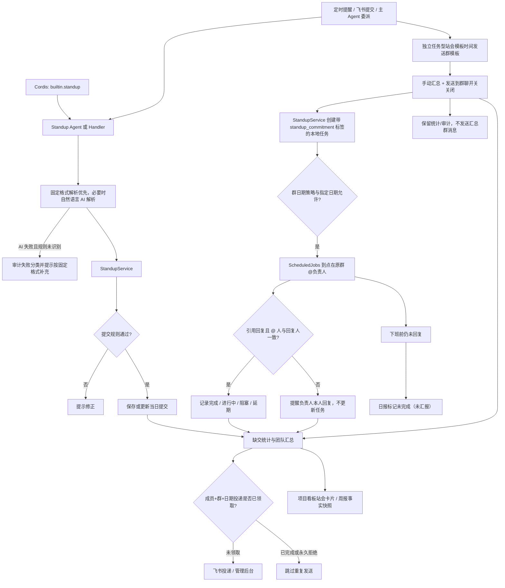

# 站会管理

统一管理固定模板站会与任务型站会的登记、提醒、提交、缺交统计和汇总，避免 Handler、定时任务和 Agent 各自形成不同口径。

## 功能定位

站会功能负责收集团队成员在某个业务日期的工作进展，并把个人提交转换为团队汇总。它看似是消息收集，实际包含日期、群范围、成员身份、重复提交和定时投递等规则；这些规则必须由一个领域入口统一处理。

Standup Agent 和 LLM 只把自然语言整理为结构化内容。`StandupService` 决定这份内容属于哪个群、哪个成员、哪一天，以及它是首次提交还是更正。

## 实现流程图

## 能力边界

### 目标

- 站会保存、重交、统计和汇总共用 `StandupService`。
- 支持群消息提交、定时提醒和后台查询。
- 支持群成员登记带负责人和交付时间的任务型站会事项，到点在原群收集结果。

### 非目标

- Standup Agent 不直接写提交记录。
- 日报可以消费站会信息，但日报生成归 `daily-summary`。

## 核心规则

运行时装配由 `builtin.standup` 插件负责，拥有Standup Agent、三个 Standup Tool 与 standup-management Skill的注册与清理。Agent/Capability/安装 ID 和领域行为保持原契约；确定性 Handler、页面与调度入口尚未全部迁为插件贡献。

自动调度统一通过 `backend/src/core/scheduleCalendar.ts` 判断群级 `schedule.calendar`。指定日期的触发/暂停优先于基础策略；`workdays` 使用中国工作日（含调休），`every_day` 不限制节假日，`selected_dates` 仅执行指定触发日。日期放行不绕过模块开关、任务开关或原定时刻，手动触发不受该日历限制。未配置或 `legacy` 保留原有 `workdays_only` 规则及周报、承诺到期提醒的例外；无效日期与非布尔覆盖值在读取配置时丢弃。

1. **站会记录绑定群、成员和业务日期。** 同一个人在不同群或不同日期的提交互不覆盖。
2. **重新提交更新当天记录。** 用户更正内容时保留一个有效结果，避免首次提交和补充提交同时进入汇总。
3. **保存、缺交、汇总使用同一成员范围。** 群配置和通讯录快照决定应提交人员，Handler 与 Job 不得各自计算成员名单。
4. **统计以业务时区为准。** 提醒时间、提交日期和汇总日期必须使用配置时区，不能直接使用服务器 UTC 日期。
5. **群级任务严格隔离。** 某个群的缺交检查和汇总只能读取该群成员与提交；单群历史数据兼容需要显式规则。
6. **解析失败不保存猜测内容。** 当 LLM 无法可靠提取昨日、今日和阻塞项时，系统提示用户补充结构，不生成半有效记录；若是 AI 限流、超时或非法响应，提示中必须明确说明 AI 异常，并记录 `ai_standup_parse_failed`。
7. **提醒和汇总允许重试，但不能重复发送。** 站会首轮模板按群、业务日期和成员持久化领取；成功或永久拒绝后不再发送，临时失败释放为可重试状态。Scheduler 重跑整项任务时只重新发送失败成员，已成功成员不能再次收到模板；永久接收人错误返回 `completed_with_warnings`，不得触发整项重试。
8. **补充汇总只包含主汇总后的新提交。** 系统不能在补充消息中重复整份主汇总。
9. **正式汇总、看板和周报共用结构化读模型。** `StandupService.buildSummaryView` 保留每位成员的昨日完成、当日计划、阻塞、风险和决策原始条目，同时生成团队重点与未提交统计；LLM 汇总、确定性兜底、项目看板和周报不得各自重新定义站会维度。
10. **站会启用资格由服务统一判断。** `StandupService.isGroupEnabled` 同时检查站会模块和每日站会推送开关；周报等消费方必须复用该入口，不能各自解释群开关。
11. **汇总降级不中断投递但必须公开。** 正式汇总和补充汇总的 AI 失败时继续使用统一结构化读模型生成确定性版本，正文顶部说明“内容未经过 AI 归纳”，并分别记录主汇总或补充汇总失败事件、分类和兜底方式。
12. **手动汇总可关闭群投递。** Debug/API 手动执行站会汇总时，`sendToGroup=false` 仍计算统计并写审计，但跳过主汇总和补充汇总的群消息；定时汇总默认保持原有投递行为，成员私聊提醒不受影响。
13. **任务型站会与 TAPD 意图严格隔离。** “事项 + 交付时间”在群开关启用时登记为带 `standup_commitment` 标签的本地任务；明确出现“创建/新建/同步 TAPD 任务或需求”时不拦截，继续交给现有任务命令链路。
14. **任务型站会与普通站会独立调度。** 开启任务型站会后，`task-standup-template` 按独立的 `task_standup_template` 时间向原群发送登记模板；模板按群、业务日期持久化领取，普通站会私聊开关关闭时任务型站会仍可单独发送，手动执行关闭群投递时不发送模板。
15. **任务型站会回复依赖引用上下文和身份一致。** 成员引用模板登记事项时必须再次 @机器人；模板或到点提醒都保存可恢复的引用上下文。到点后只有负责人本人引用提醒回复才能改变对应事项。若消息中的非机器人 @ 人与实际回复人不一致，机器人提醒被 @ 的负责人本人回复且不更新任务；自然语言归一为完成、进行中、阻塞或延期，延期可更新下一次交付时间。
16. **未回复按未完成进入日报。** 到点提醒先写 `standup_unreported` 更新；日报把该更新显示为“未完成（未汇报）”，负责人稍后回复后以最新进展覆盖同一事项。

## 用户能力

- 接收站会提醒并提交昨日、今日和阻塞信息。
- 在允许时间内更正提交。
- 查看缺交、团队汇总和历史记录。

## 入口与触发

| 入口 | 输入 | 输出 |
| --- | --- | --- |
| 飞书消息 | 站会文本或自然语言意图 | 保存结果与确认 |
| 飞书群 @机器人 | 事项、负责人、今天/明天的交付时间 | 任务型站会事项与到点汇报上下文 |
| 定时任务 | 群、成员和时间规则 | 普通站会/任务型站会各自按配置时间发送模板、到点提醒、缺交或汇总消息 |
| 管理后台/API 手动触发 | 群、日期、`sendToGroup` | 统计结果；按开关决定是否发送群汇总 |
| 管理后台/API | 日期、群、站会类型 | 普通站会成员统计或任务型站会事项统计 |

## 运行逻辑

1. Scheduler 分别按 `standup_push` 和 `task_standup_template` 触发普通站会私聊与任务型站会群模板；两者可分别开启，成员引用任务模板并再次 @机器人即可进入任务登记。
2. Standup Agent/Handler 解析并规范化提交内容。
3. `StandupService` 校验成员、日期和重交规则。
4. 自然语言 AI 解析失败时先记录分类；固定格式规则仍无法识别则提示补充结构并终止保存。
5. 服务保存唯一提交状态，并从同一口径计算缺交和七段式汇总读模型；任务型站会到点未回复的事项以 `standup_unreported` 进入日报，并展示为未完成（未汇报）。
6. 团队汇总优先使用 AI 归纳；失败时把确定性降级说明和规则汇总一起通过飞书投递。手动触发且 `sendToGroup=false` 时保留计算与审计，不创建群消息。

## Agent、Tool 与服务边界

| 对象 | 职责 | 禁止承担 |
| --- | --- | --- |
| Standup Agent | 理解表达、调用站会 Tool | 维护另一套提交状态 |
| `StandupHandler` | 确定性解析和响应 | 直接散落保存逻辑 |
| `StandupService` | 保存、重交、统计、汇总唯一入口 | 定时编排和页面渲染 |
| Scheduler/Jobs | 按配置触发站会动作 | 重复实现站会规则 |

## 数据与状态

- 站会提交以业务日期、群和成员识别；重交更新同一业务记录而非产生两个有效版本。
- 成员范围来自群配置与通讯录同步，统计口径必须使用同一快照或明确时间点。
- 固定模板使用 `standup-push:<group>:<date>:<member>`，任务型站会群模板使用 `standup-task-template:<group>:<date>`，都持久化领取及五分钟租约；提醒、缺交和汇总任务继续使用稳定执行键，避免重启或重试重复发送。

## 失败、安全与降级

- LLM 解析失败时应提示用户 AI 异常并使用结构化格式，不保存猜测内容；审计区分限流、超时、非法响应和服务不可用。
- 站会主汇总或补充汇总的 LLM 失败不阻断确定性事实投递，但群消息必须显式标记降级，后台日志保留失败原因。
- 群成员同步失败时使用最近可用数据并标注风险，不把未知成员自动视作缺交。
- 查询和提交必须绑定当前群、成员身份与日期范围。

## 代码地图

### 主要实现

- `backend/src/services/standupService.ts`：站会领域服务。
- `backend/src/services/standup.ts`：站会业务协作逻辑。
- `backend/src/services/standupLLM.ts`：站会汇总 LLM 调用及抛异常/失败返回归一化。
- `backend/src/services/messageHandler/handlers/StandupHandler.ts`：消息入口。
- `backend/src/agents/domain/standupAgent.ts`：Standup Agent 定义。
- `backend/src/services/jobs.ts`：提醒、缺交与汇总调度动作。
- `backend/src/domains/standup/cardRenderer.ts`：固定站会卡片布局、等宽指标、个人双栏进展和五个工作日排期。
- `backend/src/services/taskService.ts`：任务型站会复用的本地 `Task/TaskUpdate` 写入口，不调用 TAPD。
- `frontend/src/pages/StandupsPage.tsx`：普通站会/任务型站会分类统计页面。

### 主要测试

- `backend/test/standupHandler.test.ts`：提交和消息响应。
- `backend/test/domainAgents.test.ts`：Standup Agent 行为。
- `backend/test/jobs.test.ts`：定时提醒和汇总。
- `backend/test/standupHandler.test.ts`：任务型站会登记、TAPD 分流和引用回复。
- `backend/test/weeklyReport.test.ts`：跨工作日提交、缺交和成员明细聚合。

## 变更记录

| 日期 | 变更 | 验证 |
| --- | --- | --- |
| 2026-11-05 | 将Standup Agent、三个 Standup Tool 与 standup-management Skill装配移入 `builtin.standup`，保留业务与持久化契约 | 插件/Host 测试、后端全量回归 |
| 2026-10-05 | 自动调度增加群级节假日策略与日历日期覆盖，保留旧配置兼容 | `scheduleCalendar.test.ts`、`scheduler.test.ts`、`config.test.ts`、前后端类型检查 |
| 2026-08-31 | 站会卡片的 TAPD 任务与五日排期仅展示和未来五个工作日窗口相交的任务；窗口前的旧截止任务不再占用首日排期格，并让每次汇总复用 `TaskService` 的短缓存而非长期持有旧同步 Promise | `standupCard.test.ts`、后端类型检查 |
| 2026-08-27 | 五日排期改为单个等宽表格组件，减少行间默认留白并保持成员与日期列对齐 | `standupCard.test.ts`、后端类型检查 |
| 2026-08-27 | 收紧卡片成员姓名与“昨日完成”之间的间距，并在未提交区按成员 `open_id` 发送 @ 提及 | `standupCard.test.ts`、后端类型检查 |
| 2026-08-27 | 站会主汇总固化为紧凑双栏卡片；顶部指标使用等宽列，个人进展与 TAPD 任务分开，排期固定为五个工作日并隐藏“已超期”字样；团队重点恢复为 AI 主题归纳，规则分组作为兜底 | `standupCard.test.ts`、`jobs.test.ts`、后端类型检查 |
| 2026-08-19 | 普通站会与任务型站会使用独立开关和时间；手动触发增加独立任务型模板任务，统计页增加普通/任务分类；引用任务模板必须再次 @机器人 | `standupStats.test.ts`、`standupHandler.test.ts`、`jobs.test.ts`、`scheduler.test.ts`、前后端类型检查 |
| 2026-08-12 | 新增可配置的任务型站会：群内登记交付承诺、到点原群提醒、引用回复更新状态，未回复以待汇报进入日报；明确 TAPD 创建指令保持原路由 | `standupHandler.test.ts`、`jobs.test.ts`、`summaries.test.ts`、`messageHandler.test.ts`、`scheduler.test.ts`、前后端类型检查 |
| 2026-08-13 | 手动站会汇总增加群聊投递开关，默认关闭时仍保留汇总统计和审计；定时任务及私聊提醒行为不变 | `jobs.test.ts`、前端 `typecheck` / `lint` / `build` |
| 2026-08-03 | 站会首轮模板改为逐成员持久化领取；临时失败只重试失败成员，成功成员不重发，永久接收人错误转为部分完成 | `jobs.test.ts`、`scheduler.test.ts`、后端类型检查 |
| 2026-07-31 | 修复 Gemini 429 等 `llm.chat()` 直接抛错时越过规则降级的问题；站会主汇总和补充汇总统一把抛异常归一化为失败结果，再审计并发送确定性版本 | `jobs.test.ts`、后端类型检查 |
| 2026-07-31 | 自然语言站会解析、正式汇总和补充汇总统一增加 AI 失败分类、审计与用户可见降级说明；解析失败不保存，汇总失败继续投递确定性版本 | `standupHandler.test.ts`、`jobs.test.ts`、后端类型检查 |
| 2026-07-27 | 新增群站会启用统一判断，供周报命令、调度和生成服务复用 | `weeklyReport.test.ts`、`scheduler.test.ts` |
| 2026-07-27 | 周报按工作日复用 `listGroupSubmissions` 和 `buildSummaryView`，不新增第二套站会统计口径 | `weeklyReport.test.ts` |
| 2026-07-23 | 新增 `StandupService.buildSummaryView`，统一正式汇总、确定性兜底与项目看板的团队重点、昨日、今日、阻塞、风险、决策和未提交口径 | `jobs.test.ts`、`projectDashboard.test.ts`、`dashboardHtml.test.ts`、全量回归 |
| 2026-07-22 | 补充群、成员、业务日期、重交和汇总口径，精简文档结构 | CodeGraph 与站会测试 |
| 2026-07-22 | 建立站会功能卡并收敛统一服务口径 | CodeGraph 架构审查 |
