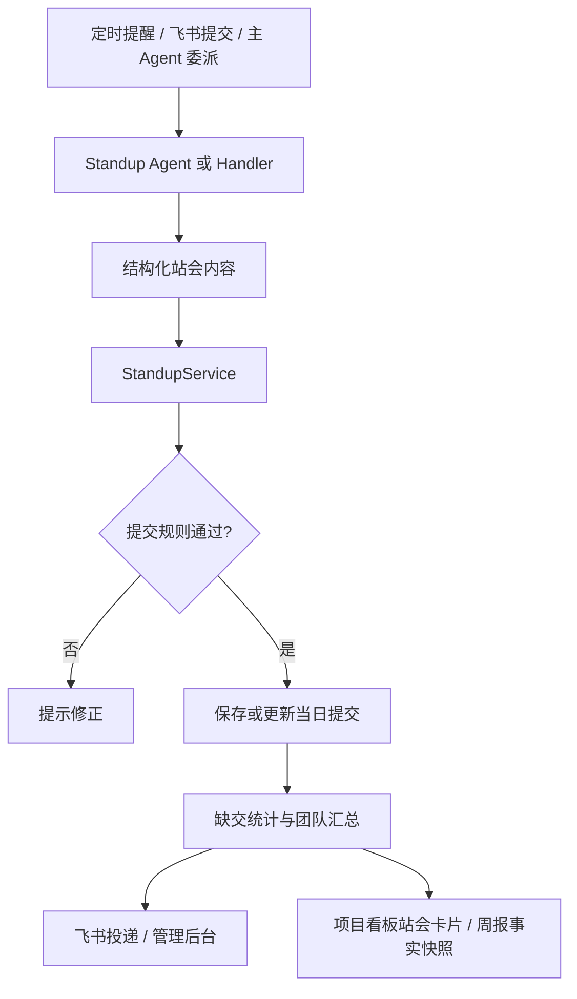

# 站会管理

统一管理站会提醒、提交、重新提交、缺交统计和汇总，避免 Handler、定时任务和 Agent 各自形成不同口径。

## 功能定位

站会功能负责收集团队成员在某个业务日期的工作进展，并把个人提交转换为团队汇总。它看似是消息收集，实际包含日期、群范围、成员身份、重复提交和定时投递等规则；这些规则必须由一个领域入口统一处理。

Standup Agent 和 LLM 只把自然语言整理为结构化内容。`StandupService` 决定这份内容属于哪个群、哪个成员、哪一天，以及它是首次提交还是更正。

## 实现流程图

## 能力边界

### 目标

- 站会保存、重交、统计和汇总共用 `StandupService`。
- 支持群消息提交、定时提醒和后台查询。

### 非目标

- Standup Agent 不直接写提交记录。
- 日报可以消费站会信息，但日报生成归 `daily-summary`。

## 核心规则

1. **站会记录绑定群、成员和业务日期。** 同一个人在不同群或不同日期的提交互不覆盖。
2. **重新提交更新当天记录。** 用户更正内容时保留一个有效结果，避免首次提交和补充提交同时进入汇总。
3. **保存、缺交、汇总使用同一成员范围。** 群配置和通讯录快照决定应提交人员，Handler 与 Job 不得各自计算成员名单。
4. **统计以业务时区为准。** 提醒时间、提交日期和汇总日期必须使用配置时区，不能直接使用服务器 UTC 日期。
5. **群级任务严格隔离。** 某个群的缺交检查和汇总只能读取该群成员与提交；单群历史数据兼容需要显式规则。
6. **解析失败不保存猜测内容。** 当 LLM 无法可靠提取昨日、今日和阻塞项时，系统提示用户补充结构，不生成半有效记录。
7. **提醒和汇总允许重试，但不能重复发送。** Job Execution 或稳定执行键记录尝试，同一计划时间只产生一个有效业务结果。
8. **补充汇总只包含主汇总后的新提交。** 系统不能在补充消息中重复整份主汇总。
9. **正式汇总、看板和周报共用结构化读模型。** `StandupService.buildSummaryView` 保留每位成员的昨日完成、当日计划、阻塞、风险和决策原始条目，同时生成团队重点与未提交统计；LLM 汇总、确定性兜底、项目看板和周报不得各自重新定义站会维度。
10. **站会启用资格由服务统一判断。** `StandupService.isGroupEnabled` 同时检查站会模块和每日站会推送开关；周报等消费方必须复用该入口，不能各自解释群开关。

## 用户能力

- 接收站会提醒并提交昨日、今日和阻塞信息。
- 在允许时间内更正提交。
- 查看缺交、团队汇总和历史记录。

## 入口与触发

| 入口 | 输入 | 输出 |
| --- | --- | --- |
| 飞书消息 | 站会文本或自然语言意图 | 保存结果与确认 |
| 定时任务 | 群、成员和时间规则 | 提醒、缺交或汇总消息 |
| 管理后台/API | 日期、群、成员筛选 | 站会列表和统计 |

## 运行逻辑

1. Scheduler 触发提醒，或消息路由识别站会意图。
2. Standup Agent/Handler 解析并规范化提交内容。
3. `StandupService` 校验成员、日期和重交规则。
4. 服务保存唯一提交状态，并从同一口径计算缺交和七段式汇总读模型。
5. 结果通过飞书回复、Outbox 或管理页面展示。

## Agent、Tool 与服务边界

| 对象 | 职责 | 禁止承担 |
| --- | --- | --- |
| Standup Agent | 理解表达、调用站会 Tool | 维护另一套提交状态 |
| `StandupHandler` | 确定性解析和响应 | 直接散落保存逻辑 |
| `StandupService` | 保存、重交、统计、汇总唯一入口 | 定时编排和页面渲染 |
| Scheduler/Jobs | 按配置触发站会动作 | 重复实现站会规则 |

## 数据与状态

- 站会提交以业务日期、群和成员识别；重交更新同一业务记录而非产生两个有效版本。
- 成员范围来自群配置与通讯录同步，统计口径必须使用同一快照或明确时间点。
- 提醒、缺交和汇总任务需要稳定执行键，避免重启或重试重复发送。

## 失败、安全与降级

- LLM 解析失败时应提示用户使用结构化格式，不保存猜测内容。
- 群成员同步失败时使用最近可用数据并标注风险，不把未知成员自动视作缺交。
- 查询和提交必须绑定当前群、成员身份与日期范围。

## 代码地图

### 主要实现

- `backend/src/services/standupService.ts`：站会领域服务。
- `backend/src/services/standup.ts`：站会业务协作逻辑。
- `backend/src/services/standupLLM.ts`：自然语言解析。
- `backend/src/services/messageHandler/handlers/StandupHandler.ts`：消息入口。
- `backend/src/agents/domain/standupAgent.ts`：Standup Agent 定义。
- `backend/src/services/jobs.ts`：提醒、缺交与汇总调度动作。
- `frontend/src/pages/StandupsPage.tsx`：查询页面。

### 主要测试

- `backend/test/standupHandler.test.ts`：提交和消息响应。
- `backend/test/domainAgents.test.ts`：Standup Agent 行为。
- `backend/test/jobs.test.ts`：定时提醒和汇总。
- `backend/test/weeklyReport.test.ts`：跨工作日提交、缺交和成员明细聚合。

## 变更记录

| 日期 | 变更 | 验证 |
| --- | --- | --- |
| 2026-07-27 | 新增群站会启用统一判断，供周报命令、调度和生成服务复用 | `weeklyReport.test.ts`、`scheduler.test.ts` |
| 2026-07-27 | 周报按工作日复用 `listGroupSubmissions` 和 `buildSummaryView`，不新增第二套站会统计口径 | `weeklyReport.test.ts` |
| 2026-07-23 | 新增 `StandupService.buildSummaryView`，统一正式汇总、确定性兜底与项目看板的团队重点、昨日、今日、阻塞、风险、决策和未提交口径 | `jobs.test.ts`、`projectDashboard.test.ts`、`dashboardHtml.test.ts`、全量回归 |
| 2026-07-22 | 补充群、成员、业务日期、重交和汇总口径，精简文档结构 | CodeGraph 与站会测试 |
| 2026-07-22 | 建立站会功能卡并收敛统一服务口径 | CodeGraph 架构审查 |
