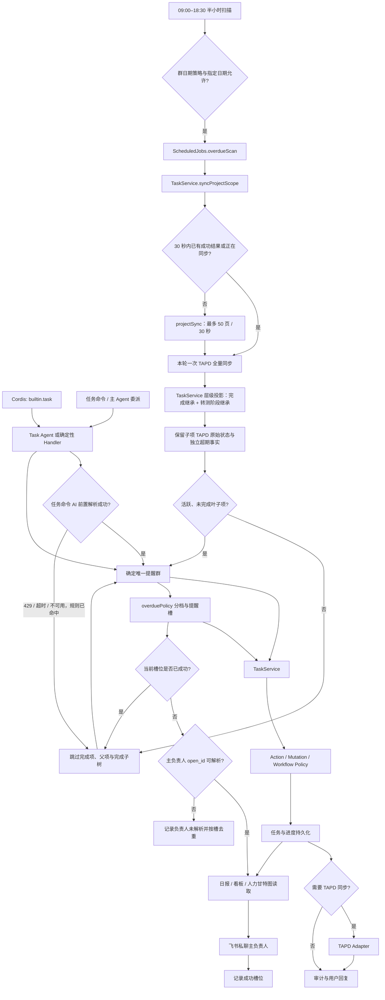

# 任务创建与跟踪

统一管理任务创建、查询、状态更新、进度记录、附件和 TAPD 同步，Task Agent 只通过受治理 Tool 进入任务域。

## 功能定位

任务管理是交付系统的核心业务域。它把群聊里的自然语言转换为可跟踪的任务，并维护任务从需求确认、开发、转测到验收的完整过程。日报、看板和人力甘特图都读取任务域数据，因此任务域必须提供稳定、统一的状态口径。

Task Agent 负责理解“用户想做什么”，`TaskService` 负责决定“系统允许怎样改变任务”。这种分工把模型的不确定性限制在意图层，让状态转换、TAPD 同步和审计继续由确定性代码控制。

## 实现流程图

## 能力边界

### 目标

- 用单一任务领域口径维护任务状态、更新记录和外部同步。
- 同时支持确定性命令与自然语言 Agent 调用。

### 非目标

- Task Agent 不拥有任务真相源，不直接调用 Store。
- 人力甘特图只读取任务域数据，展示逻辑归 `project-visibility`。

## 核心规则

运行时装配由 `builtin.task` 插件负责，拥有Task Agent、三个 Task Tool 与 task-management Skill的注册与清理。Agent/Capability/安装 ID 和领域行为保持原契约；确定性 Handler、页面与调度入口尚未全部迁为插件贡献。

自动调度统一通过 `backend/src/core/scheduleCalendar.ts` 判断群级 `schedule.calendar`。指定日期的触发/暂停优先于基础策略；`workdays` 使用中国工作日（含调休），`every_day` 不限制节假日，`selected_dates` 仅执行指定触发日。日期放行不绕过模块开关、任务开关或原定时刻，手动触发不受该日历限制。未配置或 `legacy` 保留原有 `workdays_only` 规则及周报、承诺到期提醒的例外；无效日期与非布尔覆盖值在读取配置时丢弃。

1. **所有任务写操作进入 `TaskService`。** Handler、Agent Tool、看板和定时任务不能直接调用底层 Store 拼装任务状态。
2. **创建与修改必须区分。** “安排一个明天完成的任务”表示创建；“把这个任务改到明天”表示修改截止时间。解析器不能只凭日期或“任务”关键词判断。
3. **AI 前置但不成为确定性命令的单点。** 已命中的创建命令可先由 AI 补全字段、理解语义或拆分任务；AI 被限流、超时或不可用时必须降级到原规则解析结果创建任务，记录降级审计并明确回复用户。规则降级只接受已验证的负责人、任务标题和创建意图，字段不足时继续追问而不是猜测。
4. **状态按工作流推进。** 接受、完成、打回、重新打开等动作由当前阶段和显式意图共同决定，禁止从任意状态直接跳到最终状态。
5. **多人任务按人员记录进展。** 多负责人任务只有在规则要求的参与者完成确认后才推进整体状态，个人进展不能覆盖其他参与者。
6. **显式任务引用优先。** 明确任务 ID 或 TAPD 链接优先于回复上下文；找不到目标时停止写入并要求补充信息。
7. **本地变更与 TAPD 同步分别记录。** 外部同步失败必须返回明确结果，不能把“本地已保存”描述成“全部成功”，也不能因同步失败误删本地任务。
8. **删除和缺失采用保守策略。** TAPD 明确返回删除时才标记删除；分页或网络失败时不批量修改本地任务。
9. **派生功能只读任务事实。** 日报、周报、看板和甘特图可以建立快照或投影，但不能维护第二套任务状态。
9. **超期采用统一三档口径。** 截止日早于北京时间业务日期的未完成任务统一由 `overduePolicy` 计算：超期 1–2 天在 10:00 提醒，3–4 天在 10:00、16:00 提醒，5 天以上在 09:00–18:00 每小时提醒；明日截止和今日截止沿用 10:00 提醒。提醒只私聊主负责人，不向来源群广播。
10. **提醒按持久化领取和成功槽位幂等。** 发送前以任务、场景、槽位和负责人原子领取，避免手动触发、Scheduler 或多实例并发重复私聊；临时失败释放为可重试状态，下一个半小时继续重试，成功后同槽不再发送。主负责人 `open_id` 未解析时禁止请求飞书，单独记录当前未解析槽位；飞书明确返回接收人无效或不在应用范围时记录永久拒绝，同一负责人、同一槽不再重试，负责人身份变化后允许恢复发送。
11. **TAPD 完成状态统一解释。** `开发完成` 和 `已实现` 都是完成；如果任一父项完成，则其全部后代无论原始状态为何都继承完成，不再作为待办、超期或负载。
12. **TAPD 转测状态按层级只读投影。** TAPD 不会因为父 Story 转测试或进入测试而自动修改子 Story；同步仍保存每个 Story 的原始状态，不批量回写子项。任务层级投影会将父项的 `转测试` / `测试中` 阶段传递给未完成后代，用于看板、负载和阶段展示；子项自身的超期、负责人和原始 TAPD 状态仍保留为独立事实。
13. **执行口径只取活跃叶子项。** 有活跃子项的父项是聚合项，不与子项重复计数或重复催交；删除、取消、草稿、直接完成及继承父项完成的任务均不是可执行项。
14. **TAPD 流程状态优先于机器人接单状态。** 项目全量同步必须使用 TAPD 当前工作流状态覆盖本地投影；手工在 TAPD 创建并分配的任务不需经过机器人确认流程。当前项目的 `status_6` 表示“测试进行中”，不得落入默认的“待负责人确认”。
15. **TAPD 人员姓名是外部归属依据。** TAPD Story 接口只提供处理人姓名，项目同步用 `trace.tapd.people_source=tapd_names` 标记来源，并优先以在职公司通讯录的精确姓名补全 `open_id`；精确姓名失败时，可在 Unicode、空白和末尾括号别名规范化后使用唯一匹配，存在同名冲突则保持未解析。看板按群成员筛选时，此类任务仍允许用 TAPD 姓名匹配当前群成员，避免由历史或跨群补全出的飞书 `open_id` 导致漏项。普通飞书任务仍优先使用 `open_id`，不能因同名扩大作用域。
16. **TAPD 字段变化形成历史证据。** 已存在 Story 的标题、TAPD 原始状态、优先级、截止日期和负责人变化在全量同步时写入 `TaskUpdate(source=tapd)`；本地的超期等派生状态不得作为 TAPD 流转写入。更新 ID 由任务、TAPD 修改时间和变化内容计算，重试不得重复。该证据供周报展示非状态字段；周报的状态流转另由同一 Adapter 的 `/story_changes` 直接查询，避免快照同步错过历史变化。
17. **TAPD 需求类别随全量同步留存。** 同步先读取项目需求类别，将类别名称规范为 `STORY`、`DEVELOP` 或 `ARTS` 并写入 `trace.tapd.workitem_type_key`；类别接口不可用时不阻断任务主数据同步，仍保留 Story 接口自带的类别字段供后续识别。类别会传给项目可视化，用于甘特和报表的统一标签。
18. **每个任务只选择一个提醒群。** 本地任务优先使用有效 `source_group_id`；无来源群的 TAPD 任务优先选择主负责人所在群，重叠群中选择活跃成员更少的具体团队，最后以群 ID 稳定排序。创建人或参与人仍可用于看板范围，但不能让同一任务以多个群名重复催交。
19. **人员映射只保留在职身份。** 全量同步只从活跃群成员和在职公司目录补全 `open_id`；旧 ID 已不在活跃目录时必须清空，不能因姓名未变化继续向离职或失效身份发送。
20. **甘特投影保留任务父级标识。** 人力甘特读模型为每条人员任务行返回原始 `parent_id`，供展示层在同一员工的可见任务范围内恢复父子树；该字段只描述任务域既有层级，不新增或修改父子关系。
21. **项目同步实现归任务域所有。** 外部调用继续统一进入 `TaskService.syncProjectScope`；分页读取、人员映射、差异判断和幂等变更证据由 `domains/task/projectSync.ts` 实现，Handler、Scheduler、看板和周报不得复制同步算法。
22. **项目刷新统一合并并发、短缓存与硬预算。** `TaskService.syncProjectScope` 对同一 Store 的并发请求只执行一次 TAPD 全分页同步，成功结果默认复用 30 秒；单次同步最多 50 页、总计 30 秒。页数或时间预算耗尽返回稳定错误码并标记不可重试，防止 Scheduler、日报、周报或看板重新执行整份同步；其他失败不缓存，显式 `force` 可绕过缓存。缓存和预算只约束远程读取，不改变本地任务真相源或字段级同步证据。
23. **任务型站会复用任务事实但不进入 TAPD。** `TaskService.createStandupCommitment` 创建带 `standup_commitment` 标签、空 `tapd_story_id` 的本地任务；`StandupService` 拥有登记、提醒和回复规则，所有任务及更新写入仍由 `TaskService` 完成。

## 用户能力

- 创建、查看、分派和更新任务状态或进度。
- 记录阻塞、附件、子任务和 TAPD 关联。
- 自动标记超期任务并按 1 / 3 / 5 天档位催办主负责人。
- 由主 Agent 委派 Task Agent 完成复合任务操作。

## 入口与触发

| 入口 | 输入 | 输出 |
| --- | --- | --- |
| 飞书任务命令/自然语言 | 任务描述、成员、时间、状态 | 任务结果与回复 |
| Task Agent capability | `task.manage` 请求 | Tool 执行结果 |
| TAPD 同步 | 外部工作项状态 | 本地任务或同步结果 |
| 超期扫描 | 群、业务时间、任务截止日 | 超期状态、任务更新与负责人私聊 |

## 运行逻辑

1. 飞书任务命令先由 AI 前置解析；成功时采用 AI 结果，AI 429、超时或异常且规则已经识别创建命令时，使用规则解析结果继续执行。
2. Handler 或 Task Agent 解析用户目标。
3. Tool Gateway 校验工具、参数和运行作用域。
4. `TaskService` 应用 Action、Mutation、Workflow 和 TAPD Policy。
5. 任务状态和进度更新按统一顺序持久化，必要时同步 TAPD。
5. 工作日 09:00–18:30 每 30 分钟扫描；同一 Scheduler tick 内所有群共享一次 TAPD 全分页同步，且相邻 30 秒内的日报、看板、周报和扫描复用同一成功刷新。任一页失败则不写缓存并使本轮任务失败，不使用陈旧状态误催。同步成功后为每个任务确定唯一提醒群，再由 `TaskService.projectHierarchy` 排除完成项、完成父项的整棵子树和非叶子父项。
6. 对剩余活跃叶子项用 `overduePolicy` 计算超期天数和当前提醒槽；`TaskService.markOverdue` 负责状态、更新和审计落库。
7. 负责人 `open_id` 可解析时先持久化领取当前提醒槽再请求飞书；私聊成功后保存成功槽位，临时错误保持可重试，接收人永久错误按负责人和槽位抑制重复请求。未解析时保存独立槽位并记录负责人姓名，不产生无效 `receive_id` 请求。18:30 只补偿未成功的 18:00 槽位，不产生新提醒。
8. 返回发送、跳过、临时失败和永久拒绝统计；存在任一告警时 Scheduler 记录“部分完成”，而不是干净的“任务完成”。日报、周报、看板和甘特图从任务域读取数据。

## Agent、Tool 与服务边界

| 对象 | 职责 | 禁止承担 |
| --- | --- | --- |
| Task Agent | 理解任务意图、组合受允许 Tool | 直接写存储或自行发明状态 |
| Task Tool | 校验输入、建立运行上下文、调用 `TaskService` | 复制领域策略 |
| `TaskService` | 任务写入唯一业务入口 | 页面渲染和消息路由 |
| Task Policy | 纯业务约束与状态转换 | 网络和持久化副作用 |
| `ScheduledJobs` | 按时间扫描并投递负责人提醒 | 直接拼装任务状态或向群广播超期任务 |

## 数据与状态

- 任务、任务更新、附件和 TAPD 映射由任务域拥有。
- 状态转换必须经过 `workflow.ts` 与相应 Policy；进度记录不能绕过 `TaskService`。
- 外部同步需要稳定映射键和幂等处理，防止重试生成重复任务或更新；字段级 TAPD 变化保存为 `TaskUpdate` 历史证据。
- TAPD 刷新缓存按当前进程内的 Store 实例隔离，仅保存最近成功结果和进行中的 Promise；失败立即清除，进程重启后自然失效。
- `overdue_reminders` 保存档位最后成功发送时间、成功槽位、最近的负责人未解析槽位和永久拒绝的负责人/槽位；Idempotency Store 保存发送领取租约与终态，未解析或拒绝都不会伪装成发送成功。

## 失败、安全与降级

- TAPD 不可用时保留本地结果并明确标注同步失败，避免静默不一致；达到 50 页或 30 秒预算时立即停止，且外层调度不得再次全量重跑。
- 主负责人姓名无法唯一映射到飞书 `open_id` 时跳过私聊并记录 `overdue_reminder_skipped_missing_owner`，禁止向飞书发送空 `receive_id`。
- 飞书返回接收人无效、不在应用范围等永久错误时记录 `overdue_reminder_rejected`；限流和临时网络错误保持可重试。
- Agent 只能调用注册工具，成员、群和项目范围必须在服务端重新校验。
- 附件路径、远程链接和用户输入不可直接用于任意文件或网络访问。

## 代码地图

### 主要实现

- `backend/src/services/taskService.ts`：稳定的任务域服务入口和兼容门面。
- `backend/src/domains/task/projectSync.ts`：TAPD 全量同步、人员映射、快照差异与幂等变更证据。
- `backend/src/adapters/tapd.ts`：TAPD Story、工作项类型和状态历史读取接口。
- `backend/src/domains/task/workflow.ts`：状态工作流。
- `backend/src/domains/task/actionPolicy.ts`：动作授权策略。
- `backend/src/domains/task/mutationPolicy.ts`：变更约束。
- `backend/src/domains/task/tapdPolicy.ts`：TAPD 同步策略。
- `backend/src/domains/task/tapdHierarchy.ts`：父子关系、完成继承和活跃叶子项投影。
- `backend/src/domains/task/overduePolicy.ts`：超期天数、档位和固定提醒槽的统一规则。
- `backend/src/domains/task/humanGantt.ts`：人力甘特人员、时间段和父级标识投影。
- `backend/src/core/scheduleTime.ts`：任务提醒与 Scheduler 共用的时区和时刻解析。
- `backend/src/services/jobs.ts`：超期扫描与负责人私聊编排。
- `backend/src/agents/domain/taskAgent.ts`：Task Agent 定义。
- `backend/src/services/messageHandler/handlers/TaskCommandHandler.ts`：确定性命令入口。

### 主要测试

- `backend/test/taskWorkflow.test.ts`、`taskActionPolicy.test.ts`、`taskMutationPolicy.test.ts`：领域规则。
- `backend/test/taskTapdPolicy.test.ts`：TAPD 约束。
- `backend/test/adapters.test.ts`：TAPD 需求类别和写入接口请求契约。
- `backend/test/tapdHierarchy.test.ts`：开发完成、已实现、父项完成继承和叶子执行口径。
- `backend/test/statusUpdates.test.ts`：进度更新。
- `backend/test/domainAgents.test.ts`：Task Agent 行为。
- `backend/test/overduePolicy.test.ts`、`jobs.test.ts`、`scheduler.test.ts`：超期分档、工作窗口、提醒槽、失败重试和私聊目标。
- `backend/test/weeklyReport.test.ts`：TAPD 字段级变更的幂等留痕与周报消费。
- `backend/test/humanGantt.test.ts`：甘特人员映射、时间段、工作项类别和父级标识投影。
- `backend/test/dashboardData.test.ts`：项目刷新并发合并、短缓存、强制刷新与全量同步。

## 变更记录

| 日期 | 变更 | 验证 |
| --- | --- | --- |
| 2026-11-05 | 将Task Agent、三个 Task Tool 与 task-management Skill装配移入 `builtin.task`，保留业务与持久化契约 | 插件/Host 测试、后端全量回归 |
| 2026-11-05 | 迁移公司版通用修复与任务型站会；甘特历史查询移除依赖当前日期的三个月截断，保留按查询区间投影 | 后端全量回归、前端门禁 |
| 2026-07-29 | 移除特定公司团队名的角色映射，改用产品、设计、研发、开发和内容等通用关键词识别团队职责 | `statusUpdates.test.ts`、`taskWorkflow.test.ts`、后端类型检查 |
| 2026-10-05 | 自动调度增加群级节假日策略与日历日期覆盖，保留旧配置兼容 | `scheduleCalendar.test.ts`、`scheduler.test.ts`、`config.test.ts`、前后端类型检查 |
| 2026-08-13 | 增加 TAPD 父项转测试/测试中的只读后代阶段投影；不回写子项原始状态，子项超期和 TAPD 字段继续独立保留 | `tapdHierarchy.test.ts`、`projectDashboard.test.ts`、后端类型检查 |
| 2026-08-12 | 增加任务型站会的本地任务创建、类型识别和完成/进行中/阻塞/延期进展写入口；不调用 TAPD | `standupHandler.test.ts`、`jobs.test.ts`、`summaries.test.ts`、后端类型检查 |
| 2026-08-03 | TAPD 项目全量同步增加 50 页和 30 秒硬预算；预算错误保持不可重试并由日报、周报、看板和超期扫描统一传递 | `dashboardData.test.ts`、`scheduler.test.ts`、各消费方回归、后端类型检查 |
| 2026-08-03 | `TaskService.syncProjectScope` 增加同 Store 并发合并和 30 秒成功短缓存，失败不缓存并支持强制刷新 | `dashboardData.test.ts`、Scheduler/看板/周报回归、后端类型检查 |
| 2026-07-31 | AI 仍优先补全任务命令；AI 限流、超时或异常时，已解析的任务命令降级到同一 `TaskService.createFromCommand` 入口 | `messageHandler.test.ts` |
| 2026-07-29 | 将 TAPD 全量同步实现从巨型 `TaskService` 文件下沉到任务域 `projectSync.ts`；所有调用继续经过原 `TaskService.syncProjectScope` 接口 | `dashboardData.test.ts`、`taskTapdPolicy.test.ts`、`projectDashboard.test.ts`、`jobs.test.ts`、`weeklyReport.test.ts`、后端类型检查 |
| 2026-07-28 | TapdAdapter 增加按日期读取 Story 状态历史接口，供周报直接取得一周真实状态流转；任务域仍只维护当前快照和幂等同步证据 | `weeklyReport.test.ts`、后端类型检查 |
| 2026-07-28 | 人力甘特读模型补充任务 `parent_id`，由展示层在员工可见任务范围内恢复父子树 | `humanGantt.test.ts`、类型检查 |
| 2026-07-27 | TAPD 同步历史仅记录原始 TAPD 状态 `tapd_status`，不把本地超期派生状态误记为外部状态流转 | `weeklyReport.test.ts`、类型检查 |
| 2026-07-27 | 超期扫描同轮只同步一次 TAPD；任务确定唯一提醒群；发送使用持久化领取；失效接收人停止同槽重试；失效历史 `open_id` 在同步时清空；部分失败显式上报 | `jobs.test.ts`、`scheduler.test.ts`、`taskTapdPolicy.test.ts`、`projectDashboard.test.ts`、`adapters.test.ts` |
| 2026-07-27 | TAPD 人员补全支持唯一的规范化姓名/括号别名匹配；超期提醒在负责人 `open_id` 缺失时按槽跳过并审计，不再请求飞书空 `receive_id` | `dashboardData.test.ts`、`jobs.test.ts`、类型检查 |
| 2026-07-27 | TAPD 同步以在职公司通讯录补全姓名处理人，并以 TAPD 创建时间更新任务创建时间；需求类别继续保留给甘特和报表统一展示 | `humanGantt.test.ts`、`dashboardData.test.ts`、类型检查 |
| 2026-07-27 | TAPD 全量同步读取需求类别元数据并留存规范类别，供周报标记 STORY / DEVELOP / ARTS | `adapters.test.ts`、`dashboardData.test.ts`、`weeklyReport.test.ts` |
| 2026-07-27 | TAPD 全量同步为已存在任务保存幂等字段级 `TaskUpdate`，给周报提供真实流转证据 | `weeklyReport.test.ts`、`dashboardData.test.ts` |
| 2026-07-23 | TAPD 全量同步显式标记处理人姓名来源；群范围投影对 TAPD 任务允许按权威姓名匹配，修复历史飞书 open_id 不一致造成的需求/开发/美术工作项漏计 | `dashboardData.test.ts`、`projectDashboard.test.ts`、全量回归 |
| 2026-07-23 | 补全项目 TAPD `status_6` 为“测试进行中”，手工创建任务全量同步后不再误判为待负责人确认 | `taskTapdPolicy.test.ts`、`projectDashboard.test.ts`、类型检查 |
| 2026-07-23 | 统一 TAPD 父子层级口径：开发完成/已实现视为完成，父项完成使后代继承完成，负载与催交只处理活跃未完成叶子项 | `tapdHierarchy.test.ts`、`projectDashboard.test.ts`、`jobs.test.ts`、类型检查 |
| 2026-07-22 | 超期催办改为北京时间工作窗口内的固定提醒槽，成功后按槽幂等，失败由下次半小时扫描重试 | `overduePolicy.test.ts`、`jobs.test.ts`、`scheduler.test.ts`、类型检查 |
| 2026-07-22 | 新增超期 1 / 3 / 5 天分档，状态写入收敛到 `TaskService`，提醒只发主负责人 | `overduePolicy.test.ts`、`jobs.test.ts`、类型检查 |
| 2026-07-22 | 补充任务工作流、多负责人、显式引用和 TAPD 一致性规则，精简文档结构 | CodeGraph 与任务域测试 |
| 2026-07-22 | 建立任务功能卡并明确 Agent、Tool、领域服务边界 | CodeGraph 架构审查 |
