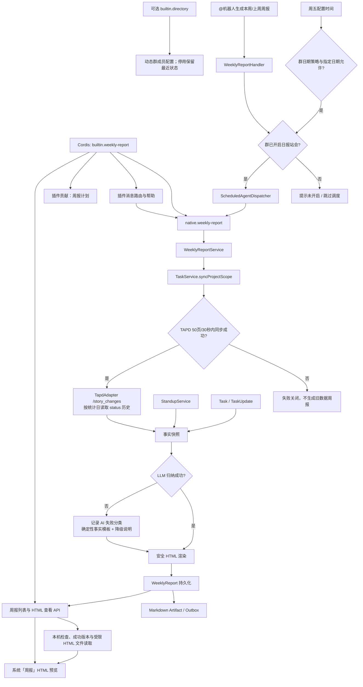

# 项目周报

把开启日报站会的群在每周工作日产生的成员站会、TAPD 当前全量数据、TAPD 状态变更历史和已留存字段变更证据，聚合为一份以成员为首要视角的紧凑 HTML 周报，并支持群命令和周五定时生成后回发原群。

## 功能定位

周报是跨站会域和任务域的只读事实快照。`WeeklyReportService` 负责固定统计口径、同步外部数据、保存事实与渲染产物；Native Agent 负责接入统一 Trigger、Run、Artifact 和 Outbox。LLM 只能归纳文字，不能修改人数、提交率、任务数或任务状态。

## 实现流程图

## 能力边界

### 目标

- 支持“生成本周周报”“生成上周周报”和每周五自动生成。
- 输出一份群级 HTML：成员周度统计前置，后接本周新增、本周完成、近期超期任务和以 TAPD 原始变更历史为准的可视化状态流转。
- 保存可审计的事实快照、文字摘要、版本、数据截止时间和 TAPD 同步时间。

### 非目标

- 不从当前 TAPD 状态反推历史状态；状态历史接口不可用时明确标记不可确认。
- 不让模型直接查询 TAPD、修改业务数据或自行计算指标。
- 不为每位成员发送独立文件，群内只投递一个完整周报链接。

## 宿主连接配置

本地工作台可填写飞书、模型与 TAPD 连接，重启后生效。模型供应商/地址/名称及 TAPD 项目/地址/工作项环境值优先于旧 config.json；工作台保存值在启动时覆盖同名环境设置。既有领域规则与消息/定时执行链路保持，详情见 docs/LOCAL_DEVELOPMENT.md。

## 核心规则

运行时装配由 `builtin.weekly-report` 插件负责，拥有 周报 Native Agent、群消息与周报计划的装配和清理。移除插件同时关闭消息、群调度、周报页面、列表与 HTML API；数据库记录和文件保留。全局维护/成员同步及基础服务的生命周期继续迁移。

周报插件拥有周五、配置时区、站会资格及模块开关判定，沿用群日历覆盖和旧工作日例外；移除后不再触发周报计划。

自动调度统一通过 `backend/src/core/scheduleCalendar.ts` 判断群级 `schedule.calendar`。指定日期的触发/暂停优先于基础策略；`workdays` 使用中国工作日（含调休），`every_day` 不限制节假日，`selected_dates` 仅执行指定触发日。日期放行不绕过模块开关、任务开关或原定时刻，手动触发不受该日历限制。未配置或 `legacy` 保留原有 `workdays_only` 规则及周报、承诺到期提醒的例外；无效日期与非布尔覆盖值在读取配置时丢弃。

1. **站会开关是前置资格。** 只有 `StandupService.isGroupEnabled` 判定已开启站会模块且每日站会推送未关闭的群才能生成；群命令、Scheduler 和 Service 三层一致拦截。
2. **先在硬预算内同步再生成。** 每次生成都执行 TAPD 全分页同步，单次最多 50 页、30 秒；任一页失败则本次失败，不使用不明新鲜度的任务数据。页数或时间预算耗尽属于不可重试错误，Native Agent 和 Scheduler 不得重新执行整份周报。
3. **周范围按配置时区计算。** 默认 `Asia/Shanghai`；本周从周一统计到生成日或周五，上周固定为上一个周一至周五。
4. **事实与叙事分离。** `facts_json` 保存确定性指标和证据，`narrative_json` 保存 LLM 或规则摘要；HTML 中所有数字只读事实快照。当前紧凑 HTML 不展示管理叙事。
5. **状态历史直接查询 TAPD。** 每次生成按统计周期的每个自然日分页调用 `/story_changes`，指定 `change_field=status` 和 `need_parse_changes=1`；只展示与当前群成员任务匹配的原始 `field_changes`，优先使用 TAPD 解析后的中文前后值。非状态字段流转仍使用幂等 `TaskUpdate(source=tapd)`；本地 `status`（如超期派生状态）永不展示为 TAPD 流转。历史接口失败时不把“未知”写成“无流转”，而是保留已留存字段变更并明确标记状态历史不可用。
6. **任务范围复用群成员口径。** 使用 `taskBelongsToMembers` 和任务层级投影，只把当前群成员相关任务纳入，进行中数量只统计活跃未完成叶子项。
7. **站会复用统一读模型。** 每个工作日通过 `StandupService.listGroupSubmissions` 与 `buildSummaryView` 计算成员产出、计划、阻塞、风险和提交统计；HTML 不再重复展示每日站会表。
8. **成员视角优先且任务可展开。** 成员矩阵固定在任务区之前；每人只展示最多三条产出、两条近期目标和两条风险。任务按当前分类内可解析的 `parent_id` 深度优先排列，父级匹配同时接受本地任务 ID 和 TAPD Story ID，用缩进和树枝线展示父子层级，并在标题前标记 `STORY`、`DEVELOP` 或 `ARTS`；父项不在当前分类时子项作为根节点展示，异常循环通过已访问集合截断。每类初始展示八项，其余内容由原生 `details` 控件展开和再次收起；展开后的“收起任务”固定在全部内容底部。“本周任务变更”清楚标示状态来源，并完整展示可获得的流转。
9. **状态统一中文并使用语义色。** 任务和 TAPD 状态由渲染器映射为中文；任务概览不显示完成百分比，只显示状态。TAPD 流转沿用看板的深墨绿、蓝、青、琥珀、紫与红色语义，分别区分通用字段、状态、进度、优先级、负责人和截止日；旧值低对比，新值带浅色底与边框。
10. **任务时间按明确范围展示。** 开始时间读取 TAPD `begin_date`，结束时间读取任务 `due_date`，任一侧缺失显示 `-`，不把创建时间冒充计划开始时间。
11. **任务标题只链接可信 TAPD 地址。** 有 `http/https` `tapd_url` 时标题支持 hover、键盘 focus 和新标签页打开；缺少链接或协议不安全时只展示纯文本。
12. **LLM 可选但降级必须透明。** 模型失败、空响应或非法 JSON 时自动使用确定性摘要，事实和报告仍可生成；`narrative_json` 保存降级标记、失败分类和脱敏错误，HTML 与群投递消息都明确说明内容未经过 AI 归纳。
13. **HTML 默认不信任输入。** 群名、成员名、任务标题和站会内容全部转义；产物只写入 `data_path/weekly-reports`。
14. **访问按记录解析。** API 先按报告 ID 读取成功记录，再通过共享 `readWorkspaceArtifact` 校验逻辑路径、真实目录边界、普通文件和 `.html` 后缀；拒绝叶子符号链接和跨目录链接，不接受客户端文件路径。
15. **重复生成保留版本。** 同一群和周期每次成功生成递增版本，不覆盖旧文件；并发版本冲突最多重算并重试三次，失败尝试产生的 HTML 会被清理；消息和调度级重复由 Agent Trigger 幂等。
16. **投递与生成分离。** Agent 返回加粗群名、统计周期和直达 HTML 周报的 Markdown Artifact，不在群消息中重复提交率或任务指标；若 AI 降级则额外加入一条明确说明。链接固定指向 `/api/weekly-reports/{reportId}`，优先使用 `runtime.public_base_url` 作为服务地址前缀，未配置时使用 `http://localhost:8090`；中台「周报」菜单仍可单独查看历史，但不是群消息跳转目标；Delivery Worker 发送到触发群，报告生成成功不等于飞书已经送达。
17. **定时任务固定周五。** 群配置控制模块、开关、时间和时区；沿用原规则时不受 `workdays_only` 影响；选择新日历策略后遵守周报时区日期的触发/暂停规则，指定非周五不会额外生成周报。

## 用户能力

- 在已配置群中 `@机器人 生成本周周报`。
- 在已配置群中 `@机器人 生成上周周报`。
- 同时启用日报站会和周报模块后，在每周五指定时间自动收到直达 HTML 周报链接。
- 打开链接优先查看成员产出、近期目标和任务统计，再查看群级任务与 TAPD 流转。
- 在插件贡献的「周报」页面按团队查看历史版本；统一浅色页头、历史抽屉、重试和空态。
- `?reportId` 与 `?groupId` 保留选择；明确指定的版本缺失时显示未找到，不悄悄回退其他版本。

## 入口与触发

| 入口 | 输入 | 输出 |
| --- | --- | --- |
| 飞书群命令 | `生成本周周报` / `生成上周周报` | 进度回复、Agent Run、周报链接 |
| Scheduler | 群、周五时间、时区 | `summary.weekly.generate` Trigger |
| Agent API/主 Agent | capability 与周期 | Agent Run 与 Markdown Artifact |
| 周报列表 API | 可选群 ID | 已生成周报的安全元数据 |
| 周报查看 API | 报告 UUID | `text/html` 周报 |
| 系统「周报」菜单 | 群与历史报告 | 页面内 HTML 预览 / 新窗口打开 |

## 数据与状态

- `WeeklyReport`：群、周期、截止时间、版本、事实、叙事、HTML 路径、公开 URL、同步时间、触发类型和源消息。
- `TaskUpdate(source=tapd)`：保存 TAPD 非状态字段级变化，ID 由任务、外部修改时间和变化内容计算，重试不重复。
- `TapdAdapter.listStoryStatusChanges`：按统计日分页读取 TAPD `/story_changes` 中不可变的状态变更历史；周报只在内存事实快照中消费，不反写任务状态。
- HTML 是不可变版本产物；数据库记录是访问路径和事实快照的权威索引。

## 失败、安全与降级

- TAPD 不可用：记录 `weekly_report_failed` 并终止，不写周报记录。
- LLM 不可用、限流、超时或返回非法内容：记录 `ai_weekly_report_failed`，使用确定性事实模板，不影响事实与 HTML 生成；HTML 和群消息都展示降级说明。
- DB 保存失败：删除刚写出的孤立 HTML 后向上抛错。
- 文件丢失、越界或记录无效：查看 API 返回 404。
- 周报 API 通过插件 Host 的本机 Host/Origin 边界，不是多人认证。缺少插件返回 404；内部读取错误不回显数据库或文件路径。

## 代码地图

### 主要实现

- `backend/src/agents/plugins/weeklyReport.ts`：Agent 与功能消息贡献的独立装配。

- `backend/src/domains/weeklyReport/period.ts`：周范围和时区口径。
- `backend/src/domains/weeklyReport/facts.ts`：站会、任务、变更事实聚合。
- `backend/src/domains/weeklyReport/narrative.ts`：受约束的 LLM 归纳和确定性降级。
- `backend/src/domains/weeklyReport/renderer.ts`：安全 HTML 和路径校验。
- `backend/src/domains/weeklyReport/service.ts`：同步、版本、持久化与 Artifact 内容。
- `backend/src/adapters/tapd.ts`：TAPD Story、工作项类型和状态变更历史接口。
- `backend/src/agents/native/weeklyReportAgent.ts`：Agent Manifest 与 Native Adapter。
- `backend/src/services/messageHandler/handlers/WeeklyReportHandler.ts`：群命令入口。
- `backend/src/core/scheduler.ts`、`frontend/src/components/config/GroupConfigList.tsx`：周五调度和配置。
- `backend/src/domains/weeklyReport/api.ts`：插件拥有的周报列表与 HTML API。
- `backend/src/platform/workspace/artifactFiles.ts`：与看板/纪要共用的产物读取边界。
- `frontend/src/pages/WeeklyReportsPage.tsx`、`frontend/src/layouts/MainLayout.tsx`、`frontend/src/App.tsx`、`frontend/src/api.ts`：周报导航、历史选择与 HTML 预览。

### 主要测试

- `backend/test/reportWeb.test.ts`：周报所有权、成功记录、群筛选、元数据、文件边界与 OpenAPI；配合现有周报业务回归。

- `backend/test/schedulePlugins.test.ts`：移除插件后的群任务关闭、跨午夜日期、第三方调度和停机收敛。

- `backend/test/messagePlugins.test.ts`：插件禁用、历史引用、帮助与生命周期；原业务 Handler 测试继续验证默认行为。

- `backend/test/weeklyReport.test.ts`：周期、事实、降级、HTML、失败关闭、命令和 TAPD 变更证据。
- `backend/test/scheduler.test.ts`：周五时区调度和 Agent 派发。
- `backend/test/dashboardData.test.ts`：TAPD 全分页同步回归。

## 变更记录

| 日期 | 变更 | 验证 |
| --- | --- | --- |
| 2026-11-05 | 周报历史页面/API 迁入插件，统一记录页和精确版本选择，文件读取复用真实目录边界 | reportWeb、projectVisibilityApi、pluginWeb、全量回归、前端门禁与本地浏览器验收 |
| 2026-11-05 | 同步本地连接表单与宿主环境配置优先级 | 工作台专项、后端回归、前端检查与本地浏览器验收 |
| 2026-11-05 | 周报计划改为插件贡献，业务日期、幂等、重试和持久化契约保留 | 原调度与插件回归、后端 428 通过 / 1 TAPD 跳过、类型检查 |
| 2026-11-05 | 将群聊周报指令和能力提示归属 `builtin.weekly-report`，移除后同步关闭消息入口；业务服务契约保留 | 消息插件及原业务回归、后端 422 通过 / 1 TAPD 跳过、类型检查 |
| 2026-11-05 | 将周报 Native Agent装配移入 `builtin.weekly-report`，保留业务与持久化契约 | 插件/Host 测试、后端全量回归 |
| 2026-10-05 | 自动调度增加群级节假日策略与日历日期覆盖，保留旧配置兼容 | `scheduleCalendar.test.ts`、`scheduler.test.ts`、`config.test.ts`、前后端类型检查 |
| 2026-08-03 | 周报前置 TAPD 同步增加 50 页/30 秒预算，预算错误穿透 Agent 调度且不再整轮重试 | `dashboardData.test.ts`、`weeklyReport.test.ts`、`scheduler.test.ts` |
| 2026-07-31 | 周报 LLM 限流、超时、空响应或非法 JSON 时保存降级元数据，记录 `ai_weekly_report_failed`，并在 HTML 与群投递中公开确定性模板降级 | `weeklyReport.test.ts`、后端类型检查 |
| 2026-07-29 | 将周报页面加载状态的条件表达式改为等价的显式分支，消除会阻断前端 lint 门禁的问题，加载与刷新行为保持不变 | 前端 lint、类型检查、测试、生产构建 |
| 2026-07-28 | 周报状态流转改为直接分页读取 TAPD `/story_changes` 的 `status` 历史；接口不可用时明确标记不可确认，不再误报“暂无流转”；区块更名为「本周任务变更」并标示数据来源 | `weeklyReport.test.ts`、后端类型检查 |
| 2026-07-27 | 周报状态流转只展示 TAPD 原始状态，过滤超期等本地派生状态，避免伪造状态倒退 | `weeklyReport.test.ts`、类型检查 |
| 2026-07-27 | TAPD 流转按字段增加看板主题语义色，并突出字段新值 | `weeklyReport.test.ts`、后端类型检查 |
| 2026-07-27 | 群消息链接改为直达 `/api/weekly-reports/{reportId}`；优先使用服务地址前缀，未配置时回退 `http://localhost:8090`，不再跳转中台页面 | `weeklyReport.test.ts` |
| 2026-07-27 | 周报页面将 HTML 预览固定为视口高度，移除 iframe 下方由伸展容器造成的空白区域 | 前端类型检查、生产构建 |
| 2026-07-27 | 群消息标题改为加粗；移除开发机公网地址回退；新增系统「周报」历史菜单、列表 API 和页面内 HTML 预览 | `weeklyReport.test.ts`、前后端类型检查 |
| 2026-07-27 | 群内周报消息移除提交率及任务统计，只保留群名、统计周期和完整周报链接 | `weeklyReport.test.ts` |
| 2026-07-27 | 周报父子层级兼容 TAPD Story ID，并在任务标题前展示 STORY / DEVELOP / ARTS 类别标签 | `dashboardData.test.ts`、`weeklyReport.test.ts`、本地 HTML 视觉验证 |
| 2026-07-27 | 任务概览按 `parent_id` 展示父子树，并将展开状态下的收起控件移动到列表底部 | `weeklyReport.test.ts`、本地 HTML 交互与视觉验证 |
| 2026-07-27 | 任务列表支持展开/收起、标题安全跳转 TAPD、开始至结束时间范围；修复成员表格对齐，补全指标文案，完整展示 TAPD 流转并删除冗余说明 | `weeklyReport.test.ts`、本地 HTML 交互与视觉验证 |
| 2026-07-27 | 周报改为仅对开启日报站会的群生成；HTML 改为成员矩阵前置、三类任务短看板、中文状态和可视化 TAPD 流转，移除管理摘要、每日站会表及数据提示 | `weeklyReport.test.ts`、`scheduler.test.ts`、本地 HTML 视觉验证 |
| 2026-07-27 | 新增周报事实快照、Native Agent、群命令、周五调度、HTML 访问和 TAPD 字段变更证据 | `weeklyReport.test.ts`、`scheduler.test.ts`、前后端类型检查 |

通讯录依赖（2026-11-06）：成员自动刷新与 /api/feishu 现由 builtin.directory 拥有，团队默认包含；自定义组合需要时显式选择。未装配则继续读取已配置成员，不隐式查询飞书或删除历史。领域服务的成员筛选和业务统计规则保持。来源、失败保护与验证见 [配置与调度功能卡](../../core/configuration-scheduling/FEATURE.md)；专项为 backend/test/directoryPlugin.test.ts 与原领域回归。

## 应用装配代码地图更新（2026-11-06）

agents/context.ts 按需提供 TAPD、意图解析、看板、项目看板和已启用邮件 Adapter；index 不再直接创建，显式配置重载后创建新 Context。agents/jobsApi.ts 拥有原团队手动 Job HTTP 实现，平台旧路径仅兼容转出；agents/plugins/jobs.ts 复用原 ScheduledJobOptions（services/jobs.ts 仅导出该既有类型）透传 sendToGroup，不改变生成、发送、幂等、统计或领域状态归属。移除插件仍在创建 Job 前拒绝。MessageHandler 删除的邮件字段从未用于发送，纪要继续使用 Context 的邮件端口且维持 dormant 生成开关。

验证：applicationContext.test.ts 确认空/个人/Echo 启动不构造团队服务、单 Context 复用及重载配置隔离；原 pluginWeb、schedulePlugins、jobExecution、messageHandler 与全量业务回归。实际临时 SQLite/HTTP 组合切换保留原 Echo 历史，不对真实飞书、TAPD、模型或邮箱发起业务验证。

## 飞书通道装配收尾（2026-11-06）

channel.feishu 拥有原入站 Manager/Ingress、路由投递 Adapter 及连接健康信息；Host 只依赖通用 TransportRegistry，index 不再构造这些对象或 FeishuAdapter。应用 Context 的默认飞书 Adapter 按需创建，每次访问都检查通道是否安装（已缓存也不绕过停用），仍保留群成员姓名与审计回调；传入 SDK Adapter 的旧用法兼容。团队 SDK/team.yaml 为十六插件/七 Agent；个人默认仍十六插件/九 Agent，不装配通道。个人或独立文件如需通信，应显式安装 channel.feishu 并配置对应 Bot 与能力，不会因为填写凭据就启动未装配的通道。

initialize 只注册传输，start 在所有 Catalog/Binding 恢复后启动连接，再启动 Worker；停止立即拒绝新消息/调度/Run，先关闭入站，再等待已接受工作和 Worker，最后关闭传输并释放贡献。并发 start 共用启动，stop 共用收尾；启动失败关闭全部已创建客户端，包括启动失败的客户端，停止中的启动不继续打开后续 Bot。默认/专用 Bot、持久化去重、secretRef、群/私聊路由与真实投递回执不变。

移除通道不领取 Outbox、消耗重试或删除队列；重装后可继续原消息，成功后仍沿用原幂等/租约/回执。TransportRegistry 当前限定一个组合一个提供者，BotPlatform 仍仅飞书；不提供多协议并发或热替换。原生插件继续是可信代码。readiness 和 /api/agent-host/health 从实际传输读取连接信息，缺少插件为零必需连接，不代表历史消息已投递。

代码地图：platform/transports/registry.ts；platform/bots/feishuPlugin.ts / feishuBotConnectionManager.ts；platform/plugins/contracts.ts / runtime.ts；platform/bootstrap/agentHost.ts；platform/delivery/worker.ts；agents/context.ts / plugins/builtins.ts、profiles/agents/team.yaml、index.ts。验证：transportPlugins.test.ts 六项、原 multiBotIngress/routedFeishuDelivery/deliveryOutbox/agentHost、组合与前后端门禁；全新 SQLite 证明缺通道零尝试、重装仅投递一次、移除后回执及 Run/Step/Artifact 不变；真实本机 HTTP 以虚构完整飞书配置验证无通道也不连接，并验证无凭据通道就绪，未向真实飞书发送消息。
