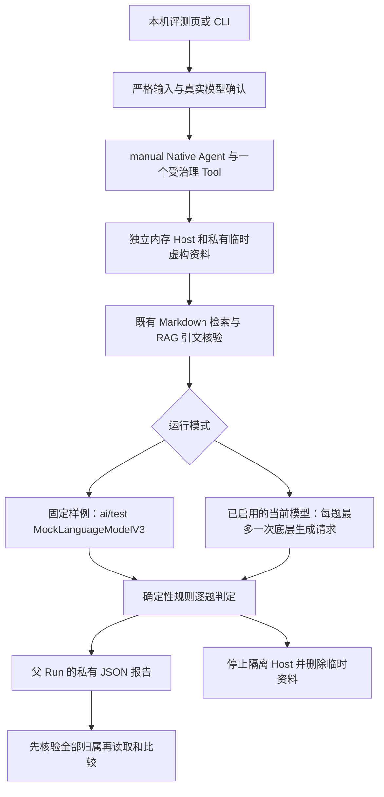

# 知识问答固定题集评测

为修改模型或检索管线的开发者提供可重复的六题规则回归与逐题差异。使用虚构资料、实际 RAG 链路与可选当前模型；不把规则通过包装成语义正确率。

## 功能定位

独立可选 `quality.evaluation` 插件，默认十四插件九 Agent 保持。Native Agent 负责一次有时限的评测任务和持久报告，确定性评判由本目录服务拥有；无需新增模型规划循环。复用已有 AgentHost、Markdown 插件、knowledge.answer、模型提供者与 Tool Gateway，不读取父 Host 的知识源，也不装配其业务工具。

## 实现流程图

CLI 直接调用同一 runner，输出同契约 JSON，不建立父工作台记录；内部题目 Run 只存在隔离内存，报告保留其 ID 和精简轨迹，不能作为工作台可访问的子运行。

## 能力边界

### 目标

- 固定六题覆盖准确引用、资料冲突、夹带指令、空检索、无关干扰、命中但事实不足。
- 分开提供无网络固定回复与明确确认的当前模型；同题集/规则/模式比较逐题通过变化。
- 保存题集、选择的源码/锁文件、运行 Manifest 与判定器指纹，以及实际回答、引文、轨迹、生成调用、SDK Token 和耗时。

### 非目标

不评判语义蕴含、不使用 LLM 裁判、不宣称真实准确率；不加载自定义题集或任意目录，不重放历史业务工具/环境，不写个人 Vault，不计算货币费用，不提供榜单或在线自动评测。

## 核心规则

1. 输入只有 fixture（baseline/regression）或 model（confirmed=true）和 1–80 字名称；不接受来源路径、插件模块或任意网络工具。
2. 六份虚构笔记写入独立 0700 临时目录、0600 文件；内存 Store，显式装配三项内部插件。停止时销毁，不开启消息或调度 Worker。
3. 工作台模型模式必须通过当前已装配的模型注册表；禁用模型插件后即使留下密钥也拒绝运行。CLI 只读取 EVAL_*，不回退 AI_* / KNOWLEDGE_* 或公司配置。支持标准 OpenAI 兼容、Google、Ollama；不自动改派供应商。
4. 每题 12 秒，顺序执行；包装 SDK 底层生成方法，最多一次提供者请求，自动重试不得再联网；最多六次，空检索通常使总调用为五次。父 Agent 90 秒、Tool 85 秒，CLI 85 秒；父取消传入模型并终止评测。
5. baseline 为脚本化正确回复，regression 故意加入无效引用、注入标记和编造邮箱；它们检验管线与规则，不是录制的真实模型成绩。
6. 判定检查成功状态、回答形态、实际引用路径与已核验引文契约、指定词组/禁词。资料不足的原因也进入文本检查。有效引文仍不能证明其支持回答；故意编造邮箱即使引文有效仍按规则失败。
7. 顶层任务成功表示报告完整，失败题数可以大于零。Fixture Token 为 null；模型模式只记录 SDK 实际提供的数值，缺失为 null，不伪造零。耗时中位数用偶数两值均值，P95 用 nearest rank；含检索/SDK/检查开销，离线耗时不代表推理性能。
8. 报告不保存 API Key、完整端点 URL 或供应商原始错误。仅保留端点 origin，并按实际提供者的默认值与 Google 旧 OpenAI 地址兼容逻辑归一化；无路径、凭据、查询或片段。读取一/两份报告时先核验全部根 Run 的 workspace、bot、成功状态与 Capability，再读指定角色的 Artifact。重新计算题目身份、检查项、计数和耗时统计；题集/规则指纹或模式不同拒绝比较。JSON 指纹是版本凭证，不是签名，用户修改的离线文件不具真实性保证。源码 SHA 是选定磁盘文件的快照，不证明进程加载态或模型权重；修改后端后需重启再测。

## 用户能力与入口

| 入口 | 输入 | 输出 |
| --- | --- | --- |
| `/evaluations` | 模式、样例、名称、真实模型确认 | 六题详情、实际引文、内部轨迹、下载、保存记录对比 |
| 普通本机 Run API | capability `quality.rag.evaluate` | `native.rag-evaluation` Run / Tool Step / 私有 JSON Artifact |
| `GET /api/evaluations/suite` | 无查询 | 固定题目与请求预算，不调用模型 |
| `GET /api/evaluations/report?runId=…` | 一个根评测 Run | 经验证报告 |
| `GET /api/evaluations/compare?baselineId=…&candidateId=…` | 两份报告 ID | 逐题新增失败/恢复通过，不运行模型 |
| `backend/src/scripts/evaluate.ts` | 命令行参数，显式 EVAL_* | stdout JSON；0 全过、1 存在失败、2 参数或顶层错误 |

## Agent、Tool 与数据边界

父 Native 仅调用一个 `quality.rag.evaluate` Tool；`maxAgentCalls=0`，内部隔离用例不冒充父 Host 委派。父 metrics.modelCalls 记录内部实际生成数，toolCalls 是父 Tool 调用数；内部检索步骤放在报告。只有父 Host 持久化报告，临时 Host 不使用 SQLite 或个人状态文件。

## 失败、安全与降级

单题模型/契约失败计为失败题并继续；取消或无法生成完整报告时顶层失败，不保存半份绿色报告。无模型时离线模式可用，真实模型按钮禁用，后端也检查。执行错误不保存原始提供者消息。当前模型调用仍受现有提供者网络/代理配置管理；不是网络或进程沙箱。模型结果存在随机性，单次题集变化不能归因于一个改动。

## 代码地图

- `backend/src/evaluations/dataset.ts`：虚构资料、题目、固定回复与题集 SHA。
- `backend/src/evaluations/runner.ts`：隔离 Host、实际 RAG、请求限制、Token/耗时与清理。
- `backend/src/evaluations/grading.ts`：严格输入/报告、词语规则、统计与可比性。
- `backend/src/evaluations/plugin.ts`：Native/Tool/页面/API、归属先于产物读取。
- `backend/src/scripts/evaluate.ts`：标准库命令解析、EVAL_* 与退出码。
- `backend/examples/plugins.evaluations.yaml`：三项模型提供者加评测插件的独立组合。
- `frontend/src/pages/workspace/EvaluationsPage.tsx`、`PluginPage.tsx`、`frontend/src/api.ts`：界面、路由与 HTTP。
- `backend/src/platform/plugins/contracts.ts`、`runtime.ts`：插件对当前模型注册表的 configured/resolve 访问，注册仍由 Cordis 释放。

### 主要测试

- `backend/test/evaluations.test.ts`：实际六题、退化对照、伪造统计/成绩、模式隔离、临时清理、无模型、真实 SDK 的本地 HTTP 协议/usage、重试请求上限、取消、禁用提供者、跨范围先检查、CLI JSON/退出码和卸载。
- 既有 `modelProviders.test.ts`、`knowledgeAnswer.test.ts`、`pluginRuntime.test.ts` 及工作台回归验证共享模型访问和原 RAG 行为。
- 前端类型/lint/build；浏览器验证基线、退化对比、引文、报告下载与 375px 布局。协议样例不等于真实模型质量评估。

## 变更记录

| 日期 | 变更 | 验证 |
| --- | --- | --- |
| 2026-11-06 | 修正报告中的默认端点 origin 与 Google 旧地址兼容归一化，移除凭据/路径/查询 | 提供者默认值专项与类型检查；后续公开 CI 全量回归 |
| 2026-11-06 | 新增可选六题规则评测、独立运行、当前模型确认、CLI 与记录比较 | 专项测试、后端回归、前端检查与本地浏览器验收；未调用真实付费模型 |
