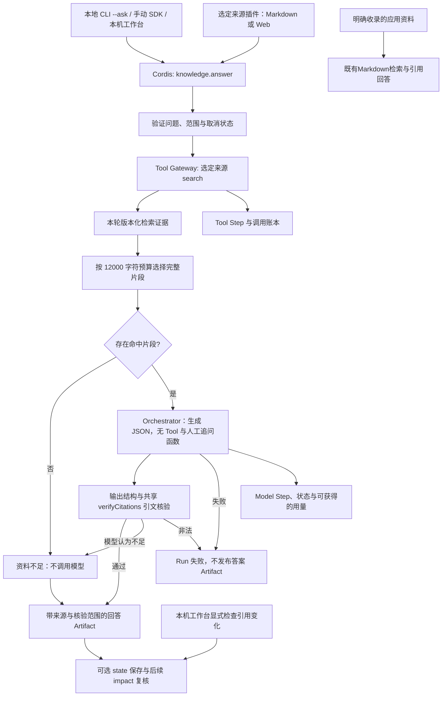
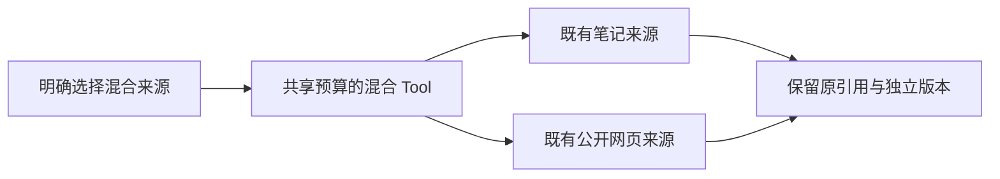
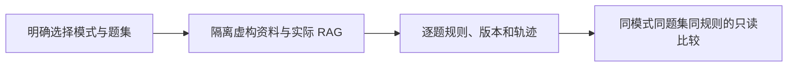

# 个人知识 RAG 回答与引用核验

使用个人知识检索结果增强模型回答，并在发布前核验引用身份与原文引文。通过独立插件和本地 CLI 显式启用。

## 功能定位

`knowledge.answer` 默认依赖 `knowledge.markdown`；网页组合改为依赖 `knowledge.web` 并调用其检索 Tool。两者复用同一实现与 Capability，每个 Host 只能选择一个回答组合；混合来源通过独立 knowledge.mixed 组合。不复制来源读取、索引或授权逻辑。它通过现有 Tool Gateway 取得片段，由宿主 Orchestrator 生成结构化结论，再执行确定性引用校验。当前 RAG 使用关键词检索；向量、重排、自动监控与多人共享尚未实现；独立 knowledge.impact 可显式检查已保存 Run 的实际引用。

这是固定的检索、生成与核验管线，因此使用 Native Agent；模型在生成阶段没有 Tool，也不承担调度或文件读写。既有 Model Loop、委派和 Checkpoint 仍由平台其他 Agent 提供，本功能不伪装成多 Agent 自治或暂停恢复流程。

## 实现流程图

## 能力边界

### 目标

- 用真实来源片段增强回答，并保存本次生成实际使用的版本化证据。
- 拒绝不存在的引用、错误引文、无引用结论及非法模型输出。
- 无关键词命中时不调用模型，明确返回证据不足。
- 问题和选定片段的数据去向由显式模型配置决定。

### 非目标

- 引用身份与引文存在不等于结论得到充分语义支持，不称为自动事实验证。
- 不写回笔记，不执行外部业务动作，不提供群聊、私聊、多用户授权或共享 Web 入口。
- 不自动扩展笔记图谱、不提供向量检索或检索质量达标承诺。
- 不把模型失败降级为伪成功的规则答案，不从未读取资料推断“事实不存在”。

## 本机工作台入口

本地 HTTP 工作台可以配置和使用引用回答。来源设置仅接受本机控制面请求，保存后重启生效；检索请求不能改写目录或 URL，仍要求无 chat/conversation 的个人 manual Scope。HTTP 应用复用宿主 Prisma KV 保存本次 Run 与证据，与 CLI 可选独立 SQLite 状态文件分开；不提供多人共享授权。界面展示行号、原文、版本证据及部分来源失败，Markdown 不自动加载远端图片。模型回答发送所选片段给当前宿主模型。见 [工作台功能卡](../../platform/workspace/FEATURE.md)。

## 核心规则

1. `manifest.requires` 显式要求知识源插件。输入只含 question 和可选 limit，不能覆盖根目录、来源 Tool 或模型权限。
2. 复用知识源的本地个人范围检查：拒绝 chatId/conversationId 和消息触发；输入与取消状态在检索前检查。
3. 固定调用一次选定来源的 search Tool（默认 `knowledge.markdown.search`，网页组合 `knowledge.web.search`），经过 Tool Gateway、同一 Run 的 Scope、原子账本与一次调用预算。默认检索 5 项、最多 10 项。
4. 证据协议验证来源版本、片段 ID、行号与长度。生成上下文最多 12000 个标题/小标题/片段字符，按排名选择完整片段；不静默截断原文。返回检索数量、实际供给数量和截断状态。
5. 模型只收到问题、部分索引标记和选定片段的 ID/标题/小标题/正文，不发送同步报告、失败文件路径、未命中文件或 Obsidian 打开 URI。
6. 生成最多一步，输出请求上限 2048 token，时间取剩余 Run 时限与 30 秒的较小值。关闭 Orchestrator 默认人工输入函数，且不提供业务 Tool。缺资料用结构化不足状态表达，不创建不可恢复的 Checkpoint。
7. 模型输出只接受 answered+claims 或 insufficient_evidence+reason。每条结论需要至少一个引用；引用 ID 必须来自本次供给证据，引文必须是对应原文中的非空精确子串。模型文本在解析前限制为 64 KiB。
8. 非法 JSON、未知引用、改写引文、无引用结论、意外 Tool 请求或模型异常使 Run 失败，不保存答案 Artifact。模型自行判断证据不足时可返回不足状态，保持来源和检索信息。
9. `verification.citationIdentityAndQuotePresence=checked` 只表示上述确定性检查通过。`semanticSupport=not_verified` 明确说明语义蕴含、完整性和真实世界正确性未自动证明。
10. 源文件在生成期间改变时，答案仍引用检索时的实际版本和片段，不把当前文件冒充历史依据；下一次运行重新检索。不在答案完成时自动重验；后续可用 knowledge.impact 显式检查已保存 Run 的实际引用，原答案和旧证据保持。
11. 索引 partial 状态保留在生成输入和输出中。回答仅依据可读且命中的资料，不能声称已经检查全部知识。
12. 默认团队组合不装配本插件。CLI 只在 `--ask` 时装配，并要求专用 KNOWLEDGE_API_BASE/MODEL/API_KEY；不自动使用团队 AI 凭据。命令显示模型目标地址，密钥不输出。

选择应用资料库时仍使用既有 Markdown search Tool 与 knowledge.answer；收录本身和原文检索不调用模型。资料先由用户确认，正文作为不可信证据进入原有精确引用核验；不增加自动写入或模型权限。backend/test/knowledgeLibrary.test.ts 用本地模拟模型验证真实保存/重启/RAG/复核链路，未验证付费模型质量。

## 用户能力

- 在已配置可信模型后，根据选定目录提问，获得结论、引文、内容版本和行号。
- 看到资料不足、索引不完整、生成失败或引用非法等不同结果。
- 查看同一 Run 内的检索 Tool 与模型步骤；本地 CLI 默认内存，可用 --state 保存跨进程记录。

## 工作台来源组合

HTTP 默认组合将所选来源、knowledge.answer 与 knowledge.impact 一起装配。回答详情的「检查引用变化」来自 impact 插件，显式核验旧结果实际引用的版本；状态刷新只读最近评估，原文与回答不重写。SDK 团队组合不默认装配知识功能，未声明 base: personal 的显式 AGENT_PLUGINS_FILE 仍完全管理插件选择；个人基底按当前本机设置组合本插件与来源。

## 入口与触发

| 入口 | 输入 | 输出 |
| --- | --- | --- |
| CLI `--ask` | 固定目录或公开链接、问题、可选数量及专用模型环境变量 | JSON 答案、证据、核验范围与 Run ID |
| `knowledge.answer` Capability | question、可选 limit 1–10 | 回答或资料不足状态、JSON Artifact |
| `knowledge-answer-demo.yaml` | 显式选择回答与来源插件 | 依赖排序后的组合，不代表已配置模型 |

## 运行逻辑

1. 装配选定来源与对应回答组合；缺依赖立即拒绝。`createKnowledgeAnswerPlugin` 绑定来源插件 ID 和 Tool，跨来源不复制生成实现。
2. 通过 Tool Gateway 检索，并验证跨插件结果协议。
3. 选择预算内的完整片段，无命中直接返回资料不足。
4. 记录模型步骤，调用宿主模型执行器进行无 Tool 生成。
5. 校验输出和精确引文；失败写入步骤/运行状态，不发布答案。
6. 成功或资料不足结果带实际证据进入 Artifact，由同一 Host 保持作用域与生命周期。

## Agent、Tool 与服务边界

| 对象 | 职责 | 禁止承担 |
| --- | --- | --- |
| `knowledge.answer` | 检索编排、上下文、生成与验收 | 文件路径授权、索引复制和笔记回写 |
| 来源 Tool | 固定来源读取与版本化证据 | 选择模型或授予模型权限 |
| Orchestrator | 按宿主配置调用模型并返回用量 | 将文档指令升级为工具能力 |
| 引用校验器 | 校验来源 ID、引文和结构 | 声称证明结论语义或资料完整性 |

## 本地状态锁保护

CLI 状态文件与会话锁文件仅在不存在时独占创建，创建/关闭在同步段内完成；已有文件通过 lstat 验证常规文件、单链接与私有权限，不额外打开并关闭它们。这样重复打开被拒绝后，不会因原始文件句柄 close 取消同进程的 SQLite POSIX 锁，另一进程仍不能进入活跃状态会话。

## 数据与状态

- 单次回答保存原始检索证据、引用版本、段落行号、partial 和上下文截断信息。网页证据额外保留 sourceKind、fetchedAt 和 lineBasis=extracted_text；行号不冒充原始 HTML 定位。
- CLI 索引可重建，Run/Step/Artifact 默认在内存；显式 --state 保存记录；宿主应用嵌入使用时遵循其存储和留存策略。
- Tool 账本和模型步骤归同一个 Run；重复 Trigger 不重复调用模型。
- 模型失败时步骤保留失败状态，不将缺失用量冒充已测得的零费用。

## 失败、安全与降级

- 模型服务可能接收问题和选定片段。选择本地 API 地址也需要信任其后端处理方式；本功能不替代模型服务的数据政策。
- 当前只适用于可信本机/SDK；手动 Scope 检查不等于身份认证，共享管理端仍缺登录/RBAC 和私有 Artifact 隔离。
- 资料中的指令不作为授权；生成阶段不提供任何 Tool。引用校验仍不保证抵抗所有模型语义错误，结果需要适当评估和人工复核。
- 模型配置错误、服务失败与引用失败明确报错，不静默使用其他模型或生成规则答案。

## 代码地图

### 主要实现

- `backend/src/platform/workspace/knowledge.ts`：HTTP 选定来源/回答/复核组合。

- `backend/src/knowledge/impact/service.ts`：读取实际引用，独立保存复核结果。
- `backend/src/platform/persistence/sqliteStore.ts`：CLI 可选私有运行记录。
- `backend/src/knowledge/answer/plugin.ts`：RAG 插件、受治理检索、模型调用和步骤记录。
- `backend/src/knowledge/answer/evidence.ts`：证据协议、上下文预算、结构与共享 verifyCitations；发布准备复用同一精确引文检查。
- `backend/src/knowledge/modelConfiguration.ts`：CLI 专用模型设置，与发布准备复用，保持原环境变量与验证。
- `backend/src/knowledge/markdown/plugin.ts`：默认只读来源。
- `backend/src/knowledge/scope.ts`：共享个人范围校验。
- `backend/src/knowledge/web/answerPlugin.ts`：网页来源的回答组合。
- `backend/src/knowledge/web/plugin.ts`：网页检索 Tool。
- `backend/src/scripts/knowledge.ts`：query/sync 与显式 ask 模式。
- `backend/profiles/agents/knowledge-answer-demo.yaml`：回答组合示例。
- `backend/src/platform/plugins/contracts.ts`：宿主 Orchestrator 与 Tool Gateway 服务。
- `backend/src/platform/models/aiSdkOrchestrator.ts`：可关闭默认人工输入函数的生成模式。

### 主要测试

- `backend/test/workspaceActions.test.ts`：工作台组合、只读缓存、实际版本复核与原证据保留。

- `backend/test/knowledgeWeb.test.ts`：网页组合、真实 SDK/Tool Gateway、来源元数据和 Scope。
- `backend/test/knowledgeAnswer.test.ts`：真实 SDK 与本地模拟 HTTP 模型；引用拒绝、空命中、不足、版本快照、partial、Scope、CLI 与上下文预算。
- `backend/test/toolSkillRuntime.test.ts`：调用账本、预算、取消与原 Tool/Skill 回归。
- `backend/test/knowledgeMarkdown.test.ts`：来源解析、范围、同步与引用基线。

## 变更记录

| 日期 | 变更 | 验证 |
| --- | --- | --- |
| 2026-11-05 | HTTP 来源/回答组合默认加入复核插件，提供显式界面入口 | 插件动作/API 专项、后端回归、前端检查与桌面/375px 浏览器验收 |
| 2026-11-05 | 修复已有 CLI 状态文件的文件检查释放 POSIX 会话锁，重复拒绝不能放行其他进程 | 本地状态与知识复核专项、类型检查、后端回归 |
| 2026-11-05 | 增加本机工作台来源配置与检索/回答入口，保留个人 Scope 和来源契约 | 工作台专项、后端回归、前端检查与本地浏览器验收 |
| 2026-11-05 | 新增可选 RAG 回答插件，复用宿主 Orchestrator/Tool Gateway，发布前核验引用与引文；CLI 显式配置模型 | 专项 13 项使用真实 SDK 与本地模拟模型；类型检查、后端 452 通过 / 1 TAPD 跳过；未调用付费远端模型 |
| 2026-11-05 | 同一回答实现支持显式网页来源组合，保留提取文本定位与抓取时间 | 33 项知识专项、后端全量与类型检查 |
| 2026-11-05 | 精确引文校验与 CLI 模型设置供发布准备复用，回答口径保持；拒绝重复证据 ID | 原知识专项与发布准备回归 |
| 2026-11-05 | 保留稳定来源身份供历史引用复核，CLI 可选跨进程保存；原生成与引文核验保持 | 原知识回归与真实 CLI 模拟模型验证 |

## 模型供应商装配

RAG 通过共享 Host 网关选择已装配提供者，支持无密钥 Ollama，不复制模型调用逻辑。CLI 与生成配置档显式安装模型插件，纯检索不依赖它。原引用身份/精确引文核验继续生效，不证明真实模型语义质量。 完整协议、实现与验证边界见[模型提供者功能卡](../../platform/models/FEATURE.md)。验证：backend/test/modelProviders.test.ts、knowledgeAnswer.test.ts、personalResearch.test.ts 及既有回归。

## 笔记与网页混合来源

混合组合通过 knowledge.mixed.search 并行调用两个现有来源，仍保留各自引用身份和引文核验；可信 source port 声明 3 次共享调用成本、90 秒 Run 时限，默认单源仍为 1。sources 覆盖仅作为可选字段保留，不发给模型；partial 标记与实际 budget.used 保持。 实现、配置与验证边界见[混合知识功能卡](../mixed/FEATURE.md)；验证：backend/test/knowledgeMixed.test.ts 及既有功能回归。

## 固定题集知识问答评测

评测消费者复用原 knowledgeAnswerPlugin 的 Native handler、来源 Tool 与引文核验，只在独立 Host 将题目时限设为 12 秒。六题基线与三题故意退化对照覆盖引用拒绝、冲突、注入、空命中、干扰与不足；原个人 RAG 的输入/来源/产物行为保持。有效引文不等于语义支持，规则评测亦不证明模型正确率。

实现与限制见[评测功能卡](../../evaluations/FEATURE.md)。代码：backend/src/evaluations/、backend/src/scripts/evaluate.ts、frontend/src/pages/workspace/EvaluationsPage.tsx。验证：backend/test/evaluations.test.ts、既有模型/插件/RAG/工作台回归、前端类型/lint/build 与桌面/375px 浏览器验收。固定样例和本机 HTTP 协议服务不代表真实模型质量；无语义裁判、个人资料评测或历史业务环境回放。

## 历史检索作为 Skill 输入

Skill 工作台复用本目录 evidence.ts 的 retrievalEvidence 与 selectEvidence，读取已成功检索的私有历史产物，人工确认后提供片段。RAG 的生成、结构与 verifyCitations 核验保持；自由文本 Skill 不调用 verifyDraft/verifyCitations，不能沿用 RAG 的“引文存在已检查”标记。它只保存选入快照，不证明实际采用或来源仍最新。验证：backend/test/skillKnowledgeContext.test.ts 及既有 knowledgeAnswer.test.ts；实现见[Skill 功能卡](../../connectors/skill-workbench/FEATURE.md)。

共享 Scope 回归（2026-11-06）：requirePersonalScope 本体和本功能的原 manual/agent 限制不变。仅引用复核 Agent 及来源 versions Tool 改用独立 requirePersonalVersionScope 接受无群聊 schedule；本功能不因此获得定时执行或新写入权限。验证：backend/test/localSchedules.test.ts 和本功能既有回归。
