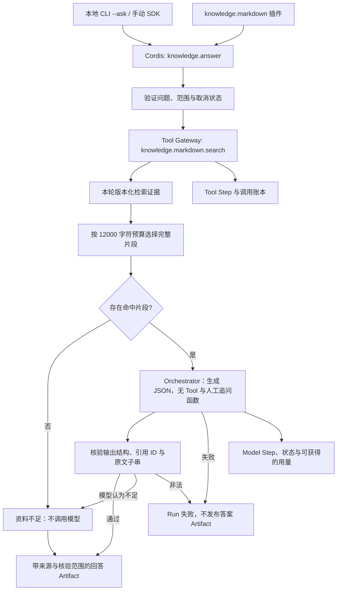

# 个人知识 RAG 回答与引用核验

使用个人知识检索结果增强模型回答，并在发布前核验引用身份与原文引文。通过独立插件和本地 CLI 显式启用。

## 功能定位

`knowledge.answer` 依赖 `knowledge.markdown`，不复制文件读取、索引或路径授权逻辑。它通过现有 Tool Gateway 取得片段，由宿主 Orchestrator 生成结构化结论，再执行确定性引用校验。当前 RAG 使用关键词检索；向量、重排、历史产物过期和多人共享均未实现。

这是固定的检索、生成与核验管线，因此使用 Native Agent；模型在生成阶段没有 Tool，也不承担调度或文件读写。既有 Model Loop、委派和 Checkpoint 仍由平台其他 Agent 提供，本功能不伪装成多 Agent 自治或暂停恢复流程。

## 实现流程图

## 能力边界

### 目标

- 用真实来源片段增强回答，并保存本次生成实际使用的版本化证据。
- 拒绝不存在的引用、错误引文、无引用结论及非法模型输出。
- 无关键词命中时不调用模型，明确返回证据不足。
- 问题和选定片段的数据去向由显式模型配置决定。

### 非目标

- 引用身份与引文存在不等于结论得到充分语义支持，不称为自动事实验证。
- 不写回笔记，不执行外部业务动作，不提供群聊、私聊、多用户授权或共享 Web 入口。
- 不自动扩展笔记图谱、不提供向量检索或检索质量达标承诺。
- 不把模型失败降级为伪成功的规则答案，不从未读取资料推断“事实不存在”。

## 核心规则

1. `manifest.requires` 显式要求知识源插件。输入只含 question 和可选 limit，不能覆盖根目录、来源 Tool 或模型权限。
2. 复用知识源的本地个人范围检查：拒绝 chatId/conversationId 和消息触发；输入与取消状态在检索前检查。
3. 固定调用一次 `knowledge.markdown.search`，经过 Tool Gateway、同一 Run 的 Scope、原子账本与一次调用预算。默认检索 5 项、最多 10 项。
4. 证据协议验证来源版本、片段 ID、行号与长度。生成上下文最多 12000 个标题/小标题/片段字符，按排名选择完整片段；不静默截断原文。返回检索数量、实际供给数量和截断状态。
5. 模型只收到问题、部分索引标记和选定片段的 ID/标题/小标题/正文，不发送同步报告、失败文件路径、未命中文件或 Obsidian 打开 URI。
6. 生成最多一步，输出请求上限 2048 token，时间取剩余 Run 时限与 30 秒的较小值。关闭 Orchestrator 默认人工输入函数，且不提供业务 Tool。缺资料用结构化不足状态表达，不创建不可恢复的 Checkpoint。
7. 模型输出只接受 answered+claims 或 insufficient_evidence+reason。每条结论需要至少一个引用；引用 ID 必须来自本次供给证据，引文必须是对应原文中的非空精确子串。模型文本在解析前限制为 64 KiB。
8. 非法 JSON、未知引用、改写引文、无引用结论、意外 Tool 请求或模型异常使 Run 失败，不保存答案 Artifact。模型自行判断证据不足时可返回不足状态，保持来源和检索信息。
9. `verification.citationIdentityAndQuotePresence=checked` 只表示上述确定性检查通过。`semanticSupport=not_verified` 明确说明语义蕴含、完整性和真实世界正确性未自动证明。
10. 源文件在生成期间改变时，答案仍引用检索时的实际版本和片段，不把当前文件冒充历史依据；下一次运行重新检索。尚未提供答案完成时的源文件重验或历史产物自动过期标记。
11. 索引 partial 状态保留在生成输入和输出中。回答仅依据可读且命中的资料，不能声称已经检查全部知识。
12. 默认团队组合不装配本插件。CLI 只在 `--ask` 时装配，并要求专用 KNOWLEDGE_API_BASE/MODEL/API_KEY；不自动使用团队 AI 凭据。命令显示模型目标地址，密钥不输出。

## 用户能力

- 在已配置可信模型后，根据选定目录提问，获得结论、引文、内容版本和行号。
- 看到资料不足、索引不完整、生成失败或引用非法等不同结果。
- 查看同一 Run 内的检索 Tool 与模型步骤；本地 CLI 的记录只存于进程内存。

## 入口与触发

| 入口 | 输入 | 输出 |
| --- | --- | --- |
| CLI `--ask` | 固定目录、问题、可选数量及专用模型环境变量 | JSON 答案、证据、核验范围与 Run ID |
| `knowledge.answer` Capability | question、可选 limit 1–10 | 回答或资料不足状态、JSON Artifact |
| `knowledge-answer-demo.yaml` | 显式选择回答与来源插件 | 依赖排序后的组合，不代表已配置模型 |

## 运行逻辑

1. 装配来源与回答插件；缺依赖立即拒绝。
2. 通过 Tool Gateway 检索，并验证跨插件结果协议。
3. 选择预算内的完整片段，无命中直接返回资料不足。
4. 记录模型步骤，调用宿主模型执行器进行无 Tool 生成。
5. 校验输出和精确引文；失败写入步骤/运行状态，不发布答案。
6. 成功或资料不足结果带实际证据进入 Artifact，由同一 Host 保持作用域与生命周期。

## Agent、Tool 与服务边界

| 对象 | 职责 | 禁止承担 |
| --- | --- | --- |
| `knowledge.answer` | 检索编排、上下文、生成与验收 | 文件路径授权、索引复制和笔记回写 |
| 来源 Tool | 固定目录读取与版本化证据 | 选择模型或授予模型权限 |
| Orchestrator | 按宿主配置调用模型并返回用量 | 将文档指令升级为工具能力 |
| 引用校验器 | 校验来源 ID、引文和结构 | 声称证明结论语义或资料完整性 |

## 数据与状态

- 单次回答保存原始检索证据、引用版本、段落行号、partial 和上下文截断信息。
- CLI 索引、Run/Step/Artifact 在内存中；宿主应用嵌入使用时遵循其存储和留存策略。
- Tool 账本和模型步骤归同一个 Run；重复 Trigger 不重复调用模型。
- 模型失败时步骤保留失败状态，不将缺失用量冒充已测得的零费用。

## 失败、安全与降级

- 模型服务可能接收问题和选定片段。选择本地 API 地址也需要信任其后端处理方式；本功能不替代模型服务的数据政策。
- 当前只适用于可信本机/SDK；手动 Scope 检查不等于身份认证，共享管理端仍缺登录/RBAC 和私有 Artifact 隔离。
- 资料中的指令不作为授权；生成阶段不提供任何 Tool。引用校验仍不保证抵抗所有模型语义错误，结果需要适当评估和人工复核。
- 模型配置错误、服务失败与引用失败明确报错，不静默使用其他模型或生成规则答案。

## 代码地图

### 主要实现

- `backend/src/knowledge/answer/plugin.ts`：RAG 插件、受治理检索、模型调用和步骤记录。
- `backend/src/knowledge/answer/evidence.ts`：证据协议、上下文预算、结构与引用校验。
- `backend/src/knowledge/markdown/plugin.ts`：依赖的只读来源与共享范围校验。
- `backend/src/scripts/knowledge.ts`：query/sync 与显式 ask 模式。
- `backend/profiles/agents/knowledge-answer-demo.yaml`：回答组合示例。
- `backend/src/platform/plugins/contracts.ts`：宿主 Orchestrator 与 Tool Gateway 服务。
- `backend/src/platform/models/aiSdkOrchestrator.ts`：可关闭默认人工输入函数的生成模式。

### 主要测试

- `backend/test/knowledgeAnswer.test.ts`：真实 SDK 与本地模拟 HTTP 模型；引用拒绝、空命中、不足、版本快照、partial、Scope、CLI 与上下文预算。
- `backend/test/toolSkillRuntime.test.ts`：调用账本、预算、取消与原 Tool/Skill 回归。
- `backend/test/knowledgeMarkdown.test.ts`：来源解析、范围、同步与引用基线。

## 变更记录

| 日期 | 变更 | 验证 |
| --- | --- | --- |
| 2026-11-05 | 新增可选 RAG 回答插件，复用宿主 Orchestrator/Tool Gateway，发布前核验引用与引文；CLI 显式配置模型 | 专项 13 项使用真实 SDK 与本地模拟模型；类型检查、后端 452 通过 / 1 TAPD 跳过；未调用付费远端模型 |
