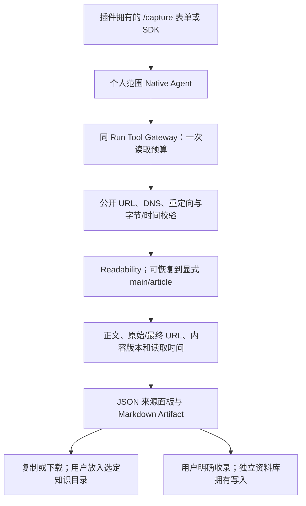

# 网页资料收集

将用户指定的一篇公开网页提取为带来源、读取时间和内容版本的 Markdown，供下载和个人知识整理。

## 功能定位

knowledge.capture 是独立插件，提供 knowledge.page.capture Native Agent 与 web.page.capture 只读 Tool。它复用公开网页来源的 DNS/IP 校验、正文提取与版本协议，不依赖配置好的知识源，不调用模型，也不自动写入用户 Vault。

## 实现流程图

## 能力边界

### 目标

- 收集指定单页的实际正文和来源凭证，无需模型密钥。
- 在工作台、Agent 列表与 SDK 中通过同一 Capability 使用。
- 复用既有来源防护，失败不伪造空文章或成功结果。

### 非目标

- 不爬全站、不处理登录/交互页面、附件或视频。
- 不生成摘要、验证事实、自动写入知识库或执行网页指令。
- 正文提取不保留全部网页样式、图片和链接语义；不是网页归档工具。

## 核心规则

1. 输入仅为一个公开 HTTP(S) URL；不能携带凭据、非标准端口或访问本机/内网。每跳 DNS 与重定向继续使用既有 network.ts 校验，不携带用户认证或 Cookie。
2. 只允许个人 manual/agent 范围，群聊请求在读取前拒绝。工具使用同 Run/Scope 的一次预算和幂等键。
3. 单响应最多 512 KiB，读取 10 秒、Tool 20 秒、Run 30 秒；提取正文最多 256 KiB，超出失败，不静默截断。
4. 原始文本、原始/最终 URL、原响应哈希、提取内容版本、提取方式与读取时间保存在结果中。Markdown 包含原始来源、时间和版本。
5. HTML 使用既有 Readability；解析器抛错但有显式 main/article 时回退该受限正文。没有可读内容时失败，不擅自拿整页导航当正文。
6. 结果通过通用文本面板与 Markdown 展示；原文为不可信资料，前端不执行 HTML、不自动加载远端图片。原始 JSON 保留在运行详情。
7. 移除插件会释放 Agent、Tool、菜单和页面；历史结果保留。页面声明对应 Capability，Agent 卡片和任务选择直接进入结构化表单。

可选 knowledge.library 插件为成功采集结果贡献“收录到资料库”动作；用户点击后由资料库服务写入应用目录。网页采集插件本身依然只读，不修改个人 Vault 或自动收录。采集插件可移除，资料库可继续使用已有成功结果。验证：backend/test/knowledgeLibrary.test.ts。

## 用户能力

- 粘贴公开文章链接，查看提取正文和来源版本。
- 复制/下载 Markdown，再放入自己选择的笔记目录。

## 入口与触发

| 入口 | 输入 | 输出 |
| --- | --- | --- |
| /capture | 单篇公开链接 | 真实运行、来源面板和 Markdown |
| knowledge.page.capture | url | 正文与来源 Artifact |
| web.page.capture | 同一受限 URL | 版本化正文，不创建外部写入 |

## 运行逻辑

1. 校验输入和 Scope，经 Tool Gateway 请求公开单页。
2. 提取正文，计算版本并检查输出预算。
3. 保存来源与 Markdown，供复制/下载；错误保留失败 Run。

## Agent、Tool 与服务边界

| 对象 | 职责 | 禁止承担 |
| --- | --- | --- |
| Native Agent | 调用受治理 Tool、生成来源产物 | 把原文当授权或自动改写 Vault |
| 公开网络/提取服务 | 固定网络边界、正文与版本 | 生成结论或执行页面代码 |
| 页面与结果抽屉 | 明确输入、状态和导出 | 伪造已收录到用户知识库 |

## 数据与状态

来源和 Markdown 保存在宿主私有 Run/Artifact；无单独索引或数据库实体。新请求重新读取，同 Trigger 不重复取证。

## 失败、安全与降级

无正文、读取失败、私网、取消和预算超限明确失败。正文提取不保证识别登录提示或全部噪声；内容版本不代表事实正确。本机接口不是多用户认证。

## 代码地图

### 主要实现

- `backend/src/knowledge/capture/plugin.ts`：Agent、Tool、页面与来源产物。
- `backend/src/knowledge/web/network.ts`、`parser.ts`：复用网络与正文实现。
- `frontend/src/pages/workspace/CapturePage.tsx`：收集表单。
- `frontend/src/pages/workspace/RunDrawer.tsx`：复制/下载与既有安全 Markdown 展示。

### 主要测试

- `backend/test/webCapture.test.ts`：真实 Host/Tool、提取回退、版本、重复 Trigger、Scope、URL 与正文预算。
- `backend/test/knowledgeWeb.test.ts`：既有网络/DNS/重定向/提取回归。
- `frontend/src/pages/workspace/pages.test.mjs`：声明式结构化入口。

## 变更记录

| 日期 | 变更 | 验证 |
| --- | --- | --- |
| 2026-11-05 | 新增独立网页资料收集插件，复用受限单页提取并提供来源 Markdown | 专项、全量回归、前端门禁与本地页面验收 |
