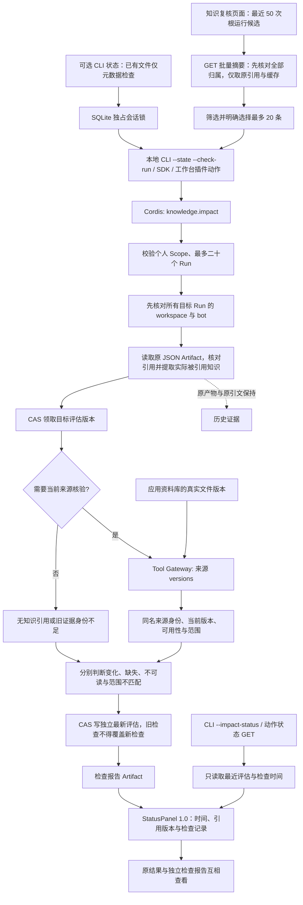
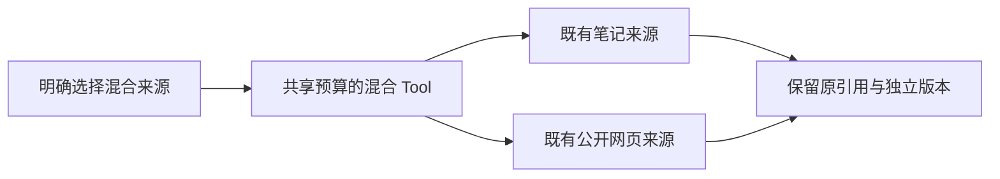

# 知识变更与历史产物复核

检查历史回答和发布草稿实际引用的知识版本，标记需要复核、无法核验或内容未变化，保存原产物与证据。

## 功能定位

`knowledge.impact` 是独立确定性功能插件。选择 Markdown 或网页来源版本 Tool，通过现有 Run/Artifact 存储读取指定历史运行，并保存独立评估。它不调用模型、不复制来源读取、不修改原 Artifact。

工作台提供「知识复核」集中入口，列出最近 50 次根运行中的成功回答/草稿，可按路径与上次状态筛选，一次明确检查最多 20 条。它仍是显式检查，不是全库自动监控、历史全量索引或文件变更推送。

## 实现流程图

## 能力边界

### 目标

- 只对有记录的实际引用建立文档依赖，未被引用的命中片段不造成误报。
- 检查更新、删除/改名、来源失效、排除项与错误来源，保留旧证据。
- 使用可选本地 SQLite 保存跨进程记录和评估，不需要模型密钥或服务器。

### 非目标

- 不判断语义影响、结论正确性、规则适用性或没有记录引用的隐含依赖。
- 不自动重生成、执行外部写入、全库扫描历史 Run、持续监控或发送通知。
- 不提供共享 Web 身份、多用户权限或敌对本机进程的文件系统沙箱。

## 核心规则

1. 仅允许无 chatId/conversationId 的手动或 Agent Scope。一次最多二十个不同 Run；必须先核对全部目标的 workspaceId/botInstanceId，再读取 Artifact。这个入口检查不是认证。
2. 当前支持成功的 knowledge.answer 与 release.prepare。必须有一个受支持的 privateKnowledge JSON Artifact。检查其中实际 claims / draft citations，重新验证引用身份和精确 quote，再提取被引用知识；发布草稿的 GitHub 事实不作为知识源依赖。
3. 多个片段引用同一文档版本合并，保留 citationIds。最多每个产物十个知识文档，总共二百个版本请求，来源 Tool 在一次刷新中比较，不按查询词重搜旧引用。
4. 新引用携带 sourceKind/sourceKey。Markdown 身份绑定逻辑来源 ID 与 canonical root；网页身份绑定来源 ID 与原始规范 URL。相同相对路径出现在其他 Vault 时不能据此核验旧资料。路径迁移或来源 ID 改变会要求重新确认范围。
5. 引用 ID 也绑定来源身份；旧 Artifact 保持原引用，不迁移或伪造旧身份。缺少新身份的记录返回 legacy_unverifiable，不能按当前目录猜测来源。
6. 文档版本相同为 current，不同为 changed。Markdown 在成功扫描范围内找不到旧路径时为 missing；改名按旧路径缺失处理。读取/解析失败为 unavailable，排除/符号链接/来源身份不匹配为 out_of_scope。网页请求失败不能证明页面删除，因此为 unavailable。
7. 目标有 changed/missing 时 needs_review；只有全部可核验且版本相同才为 current。其余未知情况为 unverifiable；没有实际知识引用为 not_applicable。current 仅表示文档字节/提取版本吻合，不证明旧结论仍正确。
8. 使用文档级版本：同一被引用文档的其他段落变化也会要求复核，不宣称精确判断语义影响。未引用文档的修改不影响结果。
9. 根目录/整轮读取失败或跨插件协议不一致时，把本次检查记为 unverifiable，不回退旧 current。取消则中止运行，留下的不完整评估在 status 中显示 check_incomplete。
10. 每次检查以 CAS 领取新 revision；完成时仅更新自己仍持有的 revision。后完成的旧检查不能覆盖更新检查。独立检查 Artifact 仍记录其实际结果，并返回 recordedAsLatest。
11. 原 Run/Artifact/正文/引文不修改。评估按 workspace/bot/目标 Run 独立保存；状态读取返回最近评估及其 checkedAt，不刷新来源，不声称是当前实时状态。
12. knowledge.review 动作由本插件注册，匹配成功的回答/发布 Run。GET 只读评估；POST 固定一个目标 Run，经既有 Capability 执行，不重新调用模型。文本面板显示检查时间；旧检查未成为最新评估时明确提示，不伪装最新结论。卸载插件不删除历史。
13. CLI 默认仍为内存；显式 --state 才保存记录。文件私有权限、专用数据库身份和独占会话锁由 SQLitePersistentKeyValueStore 提供。同一状态文件不允许两个 CLI 同时启动 Host，避免重启恢复误标仍活跃的运行。

应用资料库选作来源后，knowledge.impact 使用同一固定目录和 workspace-library 身份的 Markdown versions Tool。收录记录与原采集结果彼此独立；资料变动依真实文件版本要求复核，原回答不重写。backend/test/knowledgeLibrary.test.ts 验证 current 到 needs_review 及原证据保持。

## 集中复核入口

knowledge.impact 自己贡献 /knowledge-reviews、GET /api/knowledge-impact/reviews 与已打包视图。卸载后页面和 API 同时不可用，历史评估保留；不新增插件或 Agent，也不修改默认装配数量。Agent 目录的引用复核入口进入该页面。

列表从既有工作台最近 50 次根运行中选出成功的 knowledge.answer/release.prepare，再按最多 50 个不同 runId 查询摘要。GET 不扫描历史前缀、读取来源、创建 Run 或改写评估；请求 URL 最多 15000 字符，只接受重复 runId 参数。服务先校验全部目标 workspace/bot 归属，再读取任何 Artifact；失败不返回部分私有结果。

摘要只返回 Run 标识/类型/时间、经原引用验证得到的路径/来源类型、可检查标记及上次评估的状态/时间/检查 Run ID，不回传问题、回答、精确引文或完整 Artifact。没有实际引用时无需检查；原格式损坏、未知旧评估或缓存目标 ID 不一致时不能显示绿色状态。评估 Schema 由服务统一拥有；缓存目标 ID、current 的版本相等关系及 needs_review 的变化事实都需匹配，原单结果状态面板与 CLI status 共用校验，损坏缓存显式失败。

页面将 current 标为“上次版本未变化”，明确显示时间；刷新列表不自动读取知识，不能冒充当前来源仍一致。搜索与状态切换会清空选择；批量动作只取当前筛选下仍可检查且不超过 20 条的 ID，通过普通 Run API 和同一 Native Agent 执行，继续遵守来源身份、共享预算、CAS 与错误语义。完成后刷新列表及所选原运行的动作缓存，可打开原结果或独立检查记录。不存在自动重新生成或语义验收。

## 用户能力

- 保存回答/发布草稿，之后修改知识并按旧 Run ID 检查受影响结果。
- 区分内容变化、文档缺失、来源不可读和选错来源。
- 无模型读取最近一次评估，查看检查时间与原产物 ID。

## 入口与触发

| 入口 | 输入 | 输出 |
| --- | --- | --- |
| /knowledge-reviews | 最近 50 次根运行候选、路径/状态、最多 20 条选择 | 只读摘要与独立批量检查 |
| GET /api/knowledge-impact/reviews | 最多 50 个不同 runId | 同一默认 workspace/bot 的只读引用/评估摘要 |
| 工作台「检查引用变化」 | 当前成功回答/草稿 | 独立检查 Run、缓存状态与报告跳转 |
| knowledge.impact.check | runIds、可选 operation=check/status | 独立评估、原 Artifact ID 与检查报告 |
| knowledge.ts --check-run | 目录或网页、原状态文件、重复 Run ID | 刷新来源并检查 |
| --impact-status | 同一状态文件、--check-run | 最近评估，不发起来源读取 |
| --state | 新建或既有专用私有 SQLite 文件 | 跨 CLI 进程运行记录；不持久化来源索引 |

## 运行逻辑

1. 验证并读取目标，提取实际引用与来源身份。
2. 为选定目标领取评估 revision。
3. 通过一次来源 versions Tool 检查唯一文档版本，或明确返回不可核验。
4. 形成每个目标的独立结论，经 CAS 保存最新状态并产生新的检查 Artifact。
5. 显式 status 只读取评估缓存；需要实时核验时重新 check。

## Agent、Tool 与服务边界

| 对象 | 职责 | 禁止承担 |
| --- | --- | --- |
| Impact Native Agent | Scope、取证、预算和报告编排 | 调用模型或读取任意目录 |
| Impact Service | 原引用提取、目标归属、评估 CAS | 修改历史产物或证明语义 |
| 来源 versions Tool | 固定范围当前版本与可用性 | 静默切换来源或猜测旧身份 |
| SQLite Store | KV 原子操作、持久化和本地单会话 | 替代应用认证或多机数据库 |

## 本地状态锁保护

CLI 状态文件与会话锁文件仅在不存在时独占创建，创建/关闭在同步段内完成；已有文件通过 lstat 验证常规文件、单链接与私有权限，不额外打开并关闭它们。这样重复打开被拒绝后，不会因原始文件句柄 close 取消同进程的 SQLite POSIX 锁，另一进程仍不能进入活跃状态会话。 原因见 [SQLite 官方锁说明](https://www.sqlite.org/howtocorrupt.html#posix_close_bug)。

## 数据与状态

- 原证据仍在原 Artifact；独立评估只保存引用路径/身份/版本/片段 ID，不复制旧正文。
- 最新状态键为 knowledge:impact:workspace:bot:targetRun 的编码组合，CAS revision 防止检查竞争。
- SQLite 记录包含其他原 Run/Tool/Artifact 中的个人问题、原文片段和仓库事实；不是加密存储。默认文件 0600/新目录 0700，使用者仍需管理备份和设备访问。
- .lock 使用独立 SQLite 独占事务作为操作系统会话锁，不以 PID 或超时猜测进程存活；锁与状态提交分离，进程意外退出后锁释放、已提交数据保持。

## 失败、安全与降级

来源失败、未知旧格式和未完成检查不会显示为 current。另一个 workspace/bot 的目标整体拒绝。状态文件拒绝符号链接、硬链接、共享文件权限和其他应用的数据库；当前支持符合 POSIX 私有权限语义的本地文件系统（如 macOS/Linux），不支持网络共享或多个后端共同打开同一状态文件。

## 代码地图

### 主要实现

- `backend/src/knowledge/impact/plugin.ts`：检查编排、协议核对、插件动作和 Artifact。
- `backend/src/knowledge/impact/presentation.ts`：评估到通用文本面板，拒绝缺少证据/时间的绿色状态。
- `backend/src/knowledge/impact/service.ts`：原引用提取、Scope、CAS、缓存 Schema 与只读批量摘要。
- `frontend/src/pages/workspace/KnowledgeReviewsPage.tsx`、`knowledgeReviews.ts`：集中筛选、最多二十条批量动作、缓存刷新与历史跳转。
- `backend/src/knowledge/impact/webPlugin.ts`：网页版本来源组合。
- `backend/src/knowledge/versions.ts`：版本请求/响应协议。
- `backend/src/knowledge/markdown/source.ts`、`backend/src/knowledge/web/source.ts`：来源身份与版本读取。
- `backend/src/platform/persistence/sqliteStore.ts`：私有本地状态实现与会话锁。
- `backend/src/scripts/knowledge.ts`、`backend/src/scripts/release.ts`：可选持久化和检查命令。
- `backend/profiles/agents/knowledge-impact-demo.yaml`、`backend/profiles/agents/knowledge-web-impact-demo.yaml`：独立组合。

### 主要测试

- `backend/test/knowledgeReviews.test.ts`：批量归属先于证据读取、缓存无写入/无来源读取、变化与未变化独立判断、非法旧记录、请求边界、页面/API 所有权。
- `frontend/src/pages/workspace/knowledgeReviews.test.mjs`：状态、真实引用路径过滤、失效/不可查项剔除与二十条执行上限。

- `backend/test/runActions.test.ts`、`backend/test/workspaceActions.test.ts`：状态不刷新、显式复核、原 Artifact 不变、独立报告与错误呈现。

- `backend/test/knowledgeImpact.test.ts`：引用准确性、变化/缺失/失败/范围、旧格式、Scope、竞争、网页与真实跨进程 CLI。
- `backend/test/localState.test.ts`：重开、原子 KV、权限、拒绝外部数据、并发进程和强制退出后的恢复。
- `backend/test/knowledgeAnswer.test.ts`、`backend/test/releasePreparation.test.ts`：原生成与引用回归。

## 变更记录

| 日期 | 变更 | 验证 |
| --- | --- | --- |
| 2026-11-06 | 增加插件拥有的集中复核入口，批量检查与只读上次状态分离 | 服务/API 专项、前后端门禁、实际 SDK 协议样例与桌面/375px 验收 |
| 2026-11-05 | 插件贡献工作台复核动作、检查时间与原结果/检查记录跳转，保持历史证据不变 | 插件动作/API 专项、后端回归、前端检查与桌面/375px 浏览器验收 |
| 2026-11-05 | 修复已有 CLI 状态文件的文件检查释放 POSIX 会话锁，重复拒绝不能放行其他进程 | 本地状态与知识复核专项、类型检查、后端回归 |
| 2026-11-05 | 新增显式历史知识复核、稳定来源身份与本地持久化 | 15 项新增专项；干净安装类型检查与后端 502 通过 / 1 TAPD 跳过；跨进程模拟模型验证，不连接服务器或执行外部写入 |

## 共享 CLI 模型装配边界

同一 knowledge CLI 的 --ask 分支现在显式选择模型插件，支持无密钥本机 Ollama；--check-run / --impact-status 分支仍只装配来源与复核插件，不调用或安装模型。版本核对与原证据保存规则不变，验证沿用 backend/test/knowledgeImpact.test.ts，生成分支另由 knowledgeAnswer.test.ts 覆盖。

## 笔记与网页混合来源

混合组合接受笔记与网页两类实际引用，经固定路由分别调用原版本 Tool；最多三次共享额度，只引用一种来源时只花两次。单源不可读只影响该源引用，原回答不覆盖；metrics 记录实际额度消耗。 实现、配置与验证边界见[混合知识功能卡](../mixed/FEATURE.md)；验证：backend/test/knowledgeMixed.test.ts 及既有功能回归。

