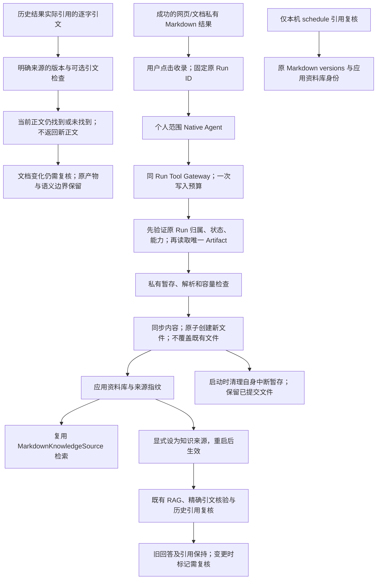

# 个人资料库

将用户确认的网页或文档结果收录为应用拥有的本地 Markdown，支持立即检索，以及选择为现有 RAG 和引用复核的来源。

## 功能定位

knowledge.library 是独立插件，拥有收录动作、资料库页面/API、Native Agent 和两个 Tool。它不依赖采集插件仍然安装，可收录已有的成功历史结果。资料写入 DATA_DIR 下独立范围目录；用户的 Vault、示例资料和原 Artifact 不修改。

## 实现流程图

## 能力边界

### 目标

- 网页/文档收集后可显式纳入后续 Agent 资料来源。
- 同一原 Artifact 重复收录只有一个文件；保留归属、原 Run、指纹和时间。
- 无模型检索；配置模型后复用已有回答与复核链路。

### 非目标

- 不自动收录、不接受模型传入正文/路径、不写回 Obsidian 或覆盖文件。
- 不新增向量索引、联合来源、后台监控、共享认证或文件编辑器。
- 单个数据目录由一个本地后端拥有；多进程写入需另加共享锁。

## 核心规则

1. Native 仅接受个人 manual/agent 范围。保存输入仅 operation=save 与 runId；检索仅 operation=search、query/limit。模型或页面不能指定目录或正文。
2. 先核对原 Run 的 workspace/bot、succeeded 状态和采集 Capability，再读取 Artifact。只接受一个 privateKnowledge=true 的 text/markdown；二进制、不可索引或超过 768 KiB 的内容拒绝。
3. 每个 workspace/bot 的目录由归属哈希确定；文件 ID 绑定原 Run/Artifact。目录 0700、文件 0600，拒绝符号链接、硬链接、公开权限和无效来源记录。API 只读取应用默认范围。
4. 单后端串行保存；最多 100 份和 20 MiB。保存前验证 Markdown 可解析，临时文件同步后用 link 原子创建，目标存在时不覆盖。完成后移除临时链接，取消发生在提交前时不发布文件。
5. 重复收录读回既有文件及原始内容哈希；相同内容返回 duplicate。收录后有外部改动时显示警告，重复保存失败并保留该文件。
6. 首次初始化按范围清理应用自己的隐藏 UUID 暂存；提交前崩溃留下的临时内容被移除，提交后尚未清理的临时链接被解除，已提交 Markdown 保留。该恢复依赖单后端所有权，不声称跨主机协调。
7. 每份 Markdown 使用 JSON/YAML 属性记录来源，正文保留原结果。来源/指纹表示收录出处，不证明事实、格式或语义正确。检索复用已有精确片段、行号和文档版本。
8. /library 可立即检索。KNOWLEDGE_KIND=library 在重启后选择固定资料目录、workspace-library 来源 ID，复用 knowledge.markdown、knowledge.answer 与 knowledge.impact；旧 Vault 名与排除配置不应用于资料库。
9. 显式插件文件完全管理组合，页面不覆盖它。收录动作的状态读取不创建 Run；实际保存通过普通 Runtime，保留 Tool Step、Run 和结果面板。卸载释放贡献，资料和历史保留。

## 用户能力

- 在成功结果中检查内容后收录，查看资料列表与原始运行。
- 检索已收录原文，将资料库选作 RAG 来源并复核历史引用。

## 入口与触发

| 入口 | 输入 | 输出 |
| --- | --- | --- |
| /library、GET /api/library | 默认本机范围 | 元数据列表、检索和原始结果入口 |
| knowledge.collect 运行动作 | 固定当前原 Run | 普通收录 Run 与状态面板 |
| knowledge.library.manage | save/runId 或 search/query/limit | 来源记录或带引用的命中 |
| knowledge.library.save / search | 严格输入与执行范围 | 私有文件或检索证据 |

## 运行逻辑

1. 核对源运行与输入，读取原 Markdown；不依据网页正文中的指令执行动作。
2. 保存有效资料或复用已有副本；记录收录结果，不改原证据。
3. 读取当前资料建立检索快照；显式配置来源后由既有 RAG/impact 使用同一目录身份。

## Agent、Tool 与服务边界

| 对象 | 职责 | 禁止承担 |
| --- | --- | --- |
| Native Agent / RunAction | 显式入口、一次 Tool 预算与运行产物 | 根据原文自动扩大权限 |
| KnowledgeLibrary | 归属、来源、容量、私有文件与原子保存 | 覆盖用户文件或任意目录写入 |
| Markdown / Answer / Impact | 检索、引用核验与版本复核 | 修改原证据或证明语义支持 |

## 数据与状态

资料保存于 DATA_DIR/knowledge-library/范围哈希/*.md，独立于原 Run 留存；正文带收录来源属性，可由现有知识 CLI 只读使用。页面列表和检索索引可重建。文件与本地数据库为明文，沿用设备账户访问控制。没有新增数据库表或后台任务。

## 失败、安全与降级

跨范围、不支持的源、重复/缺失 Artifact、容量、解析、权限和 IO 错误明确失败。部分写入只留临时文件，启动恢复会清理自身暂存；文件修改后不擅自覆盖。共享服务认证和敌对本机进程沙箱不在当前能力内。选择来源需要重启，保存设置不冒充已切换。

## 代码地图

### 主要实现

- `backend/src/knowledge/library/service.ts`：保存、私有读取、容量和恢复。
- `backend/src/knowledge/library/plugin.ts`：Agent、Tool、动作、页面与 API。
- `backend/src/platform/workspace/knowledge.ts`、`connections.ts`：默认装配与固定资料来源选择。
- `backend/src/knowledge/workspace/plugin.ts`：明确来源描述与依赖。
- `frontend/src/pages/workspace/LibraryPage.tsx`、`KnowledgePage.tsx`：列表、检索与来源选择。
- `backend/examples/plugins.collectors.yaml`：无模型的采集与资料库组合。

### 主要测试

- `backend/test/knowledgeLibrary.test.ts`：真实采集/MarkItDown 收录与检索、重复/改动/范围/文件边界、容量、暂存恢复、设置重启、实际 RAG/引用复核管线（本地模拟模型）。
- `backend/test/workspace.test.ts`、`workspaceActions.test.ts`、`knowledgeWorkspace.test.ts`：配置、运行后续动作与来源界面回归。

## 变更记录

| 日期 | 变更 | 验证 |
| --- | --- | --- |
| 2026-11-05 | 独立资料库插件，显式收录、检索与选作 RAG 来源 | 专项七项、后端全量与前端门禁、本地界面验收；生成使用本地模拟模型 |

## 定时复核资料版本（2026-11-06）

资料库作为知识来源时仍复用 workspace-library 身份与固定 libraryRoot 的 Markdown 版本工具；新版本入口只允许无群聊的 schedule 核对引用版本。资料收录、资料检索 Tool 和管理 Agent 的 manual/agent 限制不变，定期复核没有收录或改写授权。验证：backend/test/localSchedules.test.ts 的资料库版本正向及收录/搜索拒绝，原 knowledgeLibrary.test.ts 回归。

## 文档版本与逐字引文复核（2026-11-06）

资料库作为知识来源时复用 Markdown versions Tool 1.2.0，支持逐字引文存在性检查。固定资料目录和 workspace-library 身份、私有文件、原收录信息及保存入口保持；没有新增资料写入或新索引持久化。实现仍由 markdown/source.ts 与 versions.ts 拥有，验证包括 knowledgeQuoteChecks.test.ts、knowledgeImpact.test.ts 和原 knowledgeLibrary.test.ts。

完整协议、边界与测试地图由 backend/src/knowledge/impact/FEATURE.md 统一维护；使用说明见 docs/KNOWLEDGE_IMPACT.md。

## 显式重新回答的来源消费者（2026-11-06）

可选 knowledge.answer 1.1.0 允许从旧成功回答核对当前来源/模型后生成独立新结果，仍调用本来源现有 search Tool 并保留实际读取版本。当前内容在运行时刷新，旧回答保持；来源组合变更需要重新确认。没有增加来源权限、自动监控或语义影响分析。审查、关联、失败与测试边界统一见 [知识回答](../answer/FEATURE.md)。
