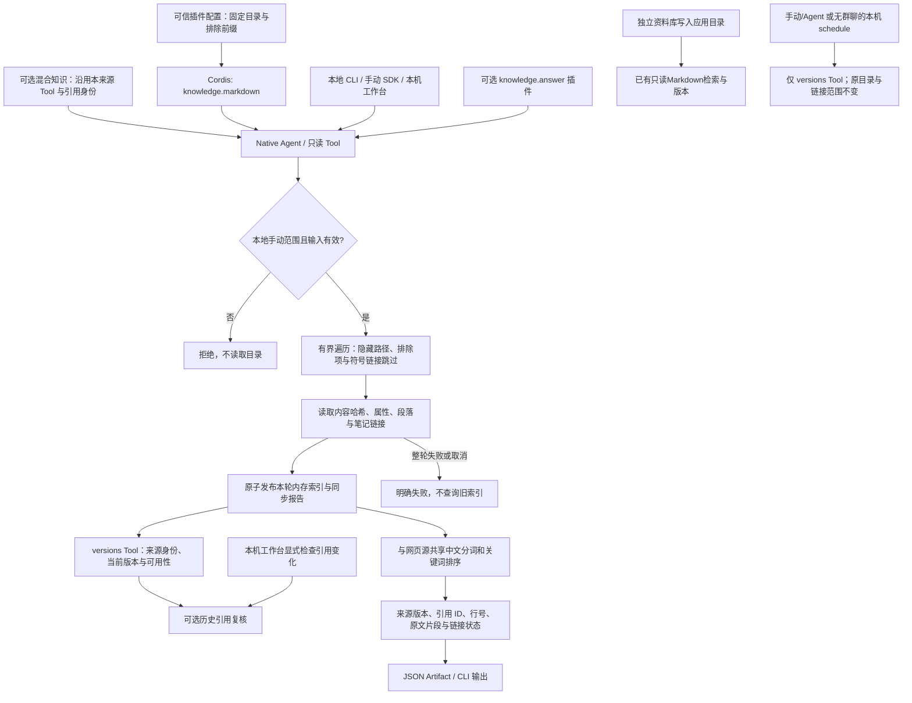

# 个人 Markdown 与 Obsidian 知识源

从部署者明确选择的目录只读同步 Markdown 笔记，提供带版本、段落与原文定位的关键词检索。当前可通过本地 CLI 和显式安装的功能插件使用。

## 功能定位

这是个人知识接入的文件源、索引、引用和检索实现。来源文件仍是事实源，进程内索引是可重建副本。它为独立的 `knowledge.answer` RAG 插件及后续知识驱动任务提供证据；来源插件本身不生成回答；新增版本 Tool 供独立 knowledge.impact 检查历史引用，向量检索与知识回写仍未实现。

Native Agent 是该确定性能力进入现有 Host、Trigger、Run 和 Artifact 的适配入口，不包含自主模型循环。来源本身是领域服务；同一插件也提供受治理 Tool，主 Host 无需修改。

## 实现流程图

## 能力边界

### 目标

- 保留 Markdown/Obsidian 的标题、YAML title/aliases/tags、常见内部链接和来源定位。
- 同步新增、更新、删除、改名与失效文件，避免把旧内容继续当成当前知识。
- 通过独立插件与本地 CLI 使用，不依赖飞书、TAPD 或模型凭据。

### 非目标

- 本来源不处理网页、PDF、OCR、Canvas、Bases 或社区插件语义；公开网页由独立 `knowledge.web` 插件提供。
- 不执行文件、脚本或笔记中的指令，不写回原文件。
- 不提供生成式回答、向量检索、完整 Markdown 语法解析或自动关联笔记正文扩展。
- 不提供多用户认证、Vault 共享或原生代码/敌对文件系统的操作系统沙箱。

## 本机工作台入口

界面由独立 knowledge.workspace 插件贡献，来源自身不隐式注册页面。可同时安装两个来源并明确选择界面使用哪一个；回答必须依赖同一来源。移除界面仍可通过 CLI/SDK 使用来源。见 [知识工作台功能卡](../workspace/FEATURE.md)。

本地 HTTP 工作台可以配置和使用Markdown / Obsidian。来源设置仅接受本机控制面请求，保存后重启生效；检索请求不能改写目录或 URL，仍要求无 chat/conversation 的个人 manual Scope。HTTP 应用复用宿主 Prisma KV 保存本次 Run 与证据，与 CLI 可选独立 SQLite 状态文件分开；不提供多人共享授权。界面展示行号、原文、版本证据及部分来源失败，Markdown 不自动加载远端图片。模型回答发送所选片段给当前宿主模型。见 [工作台功能卡](../../platform/workspace/FEATURE.md)。

## 核心规则

1. 目录仅来自插件配置，检索/同步输入不能覆盖根路径。排除项是相对文件或目录前缀，拒绝绝对路径、上级路径和 glob，避免误以为通配表达式已生效。
2. 只读取普通 `.md` 文件。隐藏条目、排除项和符号链接条目跳过；路径须位于已解析的根目录中，读取使用只读句柄和可用的平台 no-follow 标志。
3. 默认最多 2000 个 Markdown 文件、单文件 1 MiB、整轮 32 MiB；硬限制包括 10000 个目录条目、32 层目录、相对路径 1024 字节、每笔记 2048 个段落/256 个链接、整轮 20000 段。超出整轮预算时不发布部分索引。
4. 文件读取/UTF-8/属性解析失败或文件过大时，标记 partial、报告失败并从当前索引排除其旧版本。根目录、遍历或整轮预算失败时查询失败，不回退到上次结果。取消同样停止本次操作。
5. 内容哈希标识原始字节版本。相同版本复用已解析笔记；改名按旧路径移除、新路径新增处理。每个成功同步完成后一次性替换索引，串行处理同一来源的并发请求。
6. 关键词检索使用 Intl 中文分词和标题/别名/标签/正文匹配，返回正匹配结果；不是语义相似度或正确性置信度。空结果表示未找到关键词证据，不代表知识中一定不存在答案。
7. 引用包含来源 ID、相对路径、内容版本、段落行号、原文片段和稳定引用 ID。源文件改变时引用 ID 改变；Obsidian 打开链接仅定位当前笔记，不伪装成历史快照。
8. 普通 Wikilink、简单行内 Markdown 链接与标题引用保留关系。同名笔记或别名有多个候选时标为歧义；附件、越界、块引用和缺失链接分别标注。代码围栏内不提取链接；不展开嵌入正文。
9. 成功同步报告含增改移除数量、文件失败和链接状态。变化路径与失败详情各最多 25 条，返回总数及变化截断标记；检索只附少量链接关系，候选数量仍可见。
10. 插件只接受无 chatId/conversationId 的手动或 Agent 范围；拒绝群聊、私聊和消息触发。此限制缩小当前入口，不等于访问控制。不得在缺少认证的共享管理端加载真实私人资料。
11. CLI 的 root 模式仅选择此来源；url 模式选择独立网页来源，两类当前互斥。query/sync 不调用模型；显式 `--ask` 才增加回答插件并使用专用模型配置。CLI 不启动 Web、消息连接、业务定时器或投递 Worker；默认运行、Artifact 和索引在内存中；显式 --state 保存运行记录与 Artifact，索引仍可重建。宿主应用安装插件时则沿用宿主的持久化及留存策略。

新增引用包含 sourceKind/sourceKey：来源身份参与 citationId，避免不同 Vault/URL 的同名内容混淆。versions Tool 不接受新根目录或新抓取地址；刷新既定来源后比较历史版本，无法读取时不伪装成删除。旧引用缺少来源身份时由 impact 插件明确标记无法核验。CLI 可选择 --state 保存私有运行记录；默认内存模式保持。

应用资料库是可选的 Markdown 来源：独立 knowledge.library 插件显式写入 DATA_DIR 的范围目录，KNOWLEDGE_KIND=library 选择该目录及 workspace-library 来源 ID。MarkdownKnowledgeSource 本身仍只读，用户 Vault 与默认示例不写入。收录文件带来源属性，行号和文档版本仍按真实文件计算。验证：backend/test/knowledgeLibrary.test.ts。

## 用户能力

- 用 `bun run src/scripts/knowledge.ts --root examples/knowledge-vault --query 'API 迁移说明'` 执行真实检索。
- 不传 query 时获取同步报告；可传目录排除前缀和可选 Obsidian Vault 名称。
- 使用虚构样例 Vault 验证来源、链接和引用。

## 工作台来源组合

HTTP 默认组合将所选来源、knowledge.answer 与 knowledge.impact 一起装配。回答详情的「检查引用变化」来自 impact 插件，显式核验旧结果实际引用的版本；状态刷新只读最近评估，原文与回答不重写。SDK 团队组合不默认装配知识功能，显式 AGENT_PLUGINS_FILE 仍完全管理插件选择。

## 入口与触发

| 入口 | 输入 | 输出 |
| --- | --- | --- |
| 本地 CLI | 固定目录、query/limit、排除前缀、可选 Vault 名 | JSON 同步或检索结果、Run ID |
| `knowledge.markdown.retrieve` | operation=sync/search、可选 query/limit | Native Agent 结果与 JSON Artifact |
| `knowledge.markdown.search` Tool | query、可选 limit 1–10 | 来源报告和命中片段 |
| `knowledge.markdown.sync` Tool | 空对象 | 同步报告 |
| `knowledge.markdown.versions` Tool | 最多二百个路径/来源身份/旧版本 | 当前、变化、缺失、不可读或范围外；不返回正文 |

## 运行逻辑

1. 显式加载 `knowledge.markdown` 并用 Config 校验可信来源。
2. 插件注册两个只读 Tool 和 Native Agent；每次入口先验证输入与个人范围。
3. 枚举选定目录，对文件有界读取、哈希并复用或重建解析结果。
4. 一次性发布当前笔记与已解析链接；不可用旧文档从新索引移除。
5. 同步返回变化报告；检索先同步，再按本轮快照生成引用结果。
6. Host 保存该次 JSON Artifact。停止后注册清理，原文件保持不变。

## Agent、Tool 与服务边界

| 对象 | 职责 | 禁止承担 |
| --- | --- | --- |
| `knowledge.markdown` | 配置、能力声明与生命周期 | 修改 Host 或默认团队组合 |
| Native Agent / Tool | 验证入口、调用来源、输出证据 | 模型生成或自评事实 |
| `MarkdownKnowledgeSource` | 来源范围、同步、索引与检索 | 外部写入和共享授权 |
| Parser | 保留属性、段落与链接关系 | 执行代码或完整解析 Obsidian 扩展 |

## 本地状态锁保护

CLI 状态文件与会话锁文件仅在不存在时独占创建，创建/关闭在同步段内完成；已有文件通过 lstat 验证常规文件、单链接与私有权限，不额外打开并关闭它们。这样重复打开被拒绝后，不会因原始文件句柄 close 取消同进程的 SQLite POSIX 锁，另一进程仍不能进入活跃状态会话。

## 数据与状态

- 原文件由用户拥有，插件没有写文件入口。
- 索引仅保留当前可读版本；CLI 默认不持久化，可用 --state 保存运行证据。运行证据保存本次实际返回的片段与版本，不保存整座 Vault 的历史快照。
- 在同一服务实例内报告增改移除；每次 CLI 启动都是新实例，因此首次同步会将所有当前文档报告为新增。
- 历史 Artifact 不因源文件删除自动删除。独立 knowledge.impact 可按指定 Run 检查文档版本并保存复核评估；自动监控和全局影响索引仍待实现。

## 失败、安全与降级

- 不可访问根目录、取消或整轮预算不足时明确失败，无静默旧索引降级。
- 个别失败与未支持内容明确计数，不声称已纳入全部知识。
- 文本、链接和 YAML 均为不可信资料；处理器不执行其中指令。
- 群/会话拒绝并不能替代身份认证。当前推荐入口是可信本机 CLI；共享 Web 部署需先补齐认证、访问范围和私有 Artifact 隔离。
- 不支持恶意本机进程同时替换目录的强隔离；需要该威胁模型时使用独立进程与受限只读挂载。

## 代码地图

### 主要实现

- `backend/src/platform/workspace/knowledge.ts`：HTTP 选定来源/回答/复核组合。

- `backend/src/knowledge/versions.ts`：版本请求与响应协议。
- `backend/src/platform/persistence/sqliteStore.ts`：CLI 可选私有持久化与单会话锁。
- `backend/src/knowledge/modelConfiguration.ts`：知识 CLI 与发布准备共用显式模型配置，query/sync 不使用模型。
- `backend/src/knowledge/markdown/source.ts`：配置、有界读取、同步与关键词检索。
- `backend/src/knowledge/search.ts`、`backend/src/knowledge/scope.ts`：与网页来源共享排序和范围校验；原 Scope 导出保持兼容。
- `backend/src/knowledge/markdown/parser.ts`：属性、分段与链接解析。
- `backend/src/knowledge/markdown/plugin.ts`：独立插件、Native Agent 与 Tool。
- `backend/src/scripts/knowledge.ts`：无模型和无集成凭据的本地入口。
- `backend/profiles/agents/knowledge-demo.yaml`、`backend/examples/knowledge-vault/`：显式组合和虚构资料。

### 主要测试

- `backend/test/workspaceActions.test.ts`：工作台组合、只读缓存、实际版本复核与原证据保留。

- `backend/test/knowledgeMarkdown.test.ts`：解析定位、链接歧义、增删改/改名、排除与符号链接、预算、失败关闭、取消、真实 Host/Artifact、入口限制和 CLI 只读。

## 变更记录

| 日期 | 变更 | 验证 |
| --- | --- | --- |
| 2026-11-05 | HTTP 来源/回答组合默认加入复核插件，提供显式界面入口 | 插件动作/API 专项、后端回归、前端检查与桌面/375px 浏览器验收 |
| 2026-11-05 | 修复已有 CLI 状态文件的文件检查释放 POSIX 会话锁，重复拒绝不能放行其他进程 | 本地状态与知识复核专项、类型检查、后端回归 |
| 2026-11-05 | 增加本机工作台来源配置与检索/回答入口，保留个人 Scope 和来源契约 | 工作台专项、后端回归、前端检查与本地浏览器验收 |
| 2026-11-05 | 首次实现只读 Markdown/Obsidian 来源插件、版本化关键词检索与本地 CLI | 专项 10 项测试与 CLI 执行、类型及打包检查；后端全量 438 通过 / 1 真实 TAPD 跳过 |
| 2026-11-05 | 排序与个人范围校验提取供网页来源复用，目录检索口径保持；CLI 显式选择来源 | 原 23 项来源/RAG 回归、新增网页专项与后端全量 |
| 2026-11-05 | CLI 模型设置提取为与发布准备共享的读取器，原来源行为和显式模型边界保持 | 原知识专项和后端回归 |
| 2026-11-05 | 来源身份参与引用，新增只读 versions Tool；支持独立历史引用复核与 CLI 可选持久化 | 来源回归、Impact 专项与跨进程 CLI |

## 可选生成的模型组合

纯同步/检索 CLI 不安装模型。--ask 显式装配标准模型插件，只读 KNOWLEDGE_*；KNOWLEDGE_PROVIDER=ollama 可不填密钥和地址，仍须填现有模型名。来源读取、排除和版本规则不变。 完整协议、实现与验证边界见[模型提供者功能卡](../../platform/models/FEATURE.md)。验证：backend/test/modelProviders.test.ts、knowledgeAnswer.test.ts、personalResearch.test.ts 及既有回归。

## 可选混合组合

本来源保持独立读取与权限边界；knowledge.mixed 可通过原 search/versions Tool 与另一来源组合，保留各自身份和版本。它不扩大本来源的目录或 URL 范围，不自动启用；实现与测试见 [混合知识功能卡](../mixed/FEATURE.md) 及 backend/test/knowledgeMixed.test.ts。

## 可选新笔记回写消费者

独立 knowledge.writeback 复用本功能的读取/引用/版本契约，未增加原来源写入口或改变复核状态。人工审查后仅向显式收件目录排他新建笔记；如果位于选定 Vault，下次同步沿原规则检索，新笔记保留原运行及引用版本。既有笔记与历史产物不覆盖。见[回写功能卡](../writeback/FEATURE.md)，验证：backend/test/knowledgeWriteback.test.ts 及既有回归。

## 本机 schedule 的只读版本检查（2026-11-06）

本来源插件与 versions Tool 为 1.1.0，版本入口改用 requirePersonalVersionScope，允许无 chat/conversation 的本机 schedule；search/sync/检索 Agent 继续使用原 requirePersonalScope 和原 triggers，不接受 schedule。内容、来源身份、URL/目录边界、输出与预算保持。混合检查沿原共享预算传递相同 Scope，资料库知识来源复用 Markdown 版本入口。验证：backend/test/localSchedules.test.ts，及原知识/混合/引用回归。
