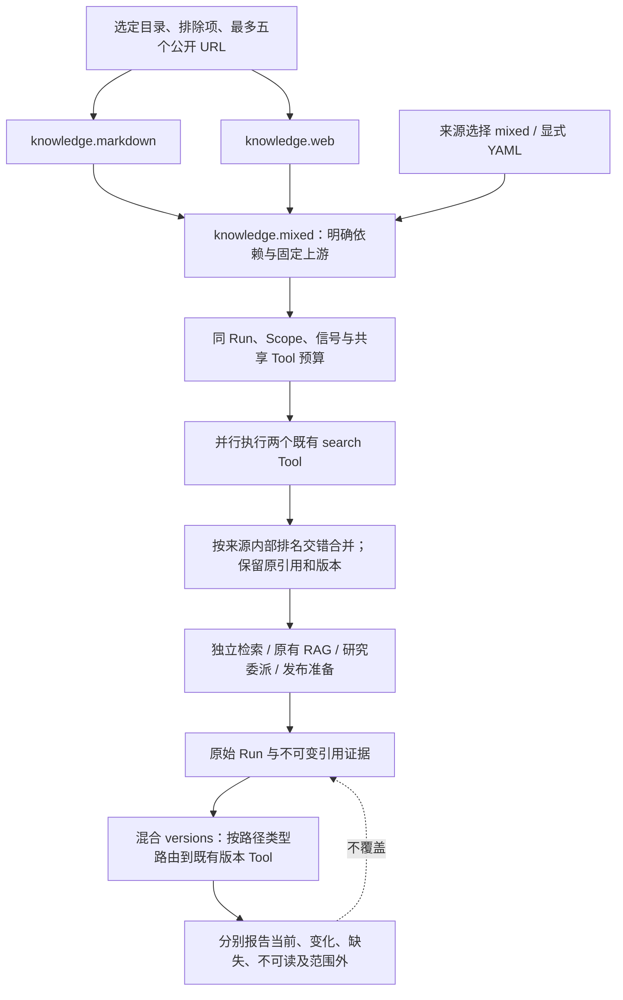

# 笔记与网页混合知识

在同一问题中检索用户明确配置的 Markdown/Obsidian 目录和公开网页，保留各自的原文、引用身份与版本，并让现有 RAG、研究、发布准备及历史复核使用同一混合来源。

## 功能定位与边界

knowledge.mixed 是独立确定性编排插件，依赖已有 knowledge.markdown 与 knowledge.web。它不复制索引、网页读取、分词或引用生成，也不提供向量检索、全站抓取、知识回写、多用户授权或语义事实验证。Native Agent 仅适配既有 Run/Tool 接口，没有自主模型循环。

底层来源可以继续独立使用；同时安装两个来源不会自动混合，必须显式选择本插件及匹配的回答/复核/研究/发布组合。目录及 URL 只来自可信来源配置，问题参数不能扩大读取范围。

## 实现流程

## 核心规则

1. knowledge.mixed.retrieve 仅接受 operation=search、query（最多 500 字符）、limit（1–10）；单独检索不需要模型。Native Agent 使用三次共享调用额度：混合路由一次、两个来源各一次。Tool 在进入上游前检查个人 Scope 与共享预算，不补发额度。
2. 两个来源独立并行，等待双方完成后合并。保留来源内排名，按笔记第 1 条、网页第 1 条、笔记第 2 条……交错；引用 ID 去重后按总 limit 截取。不比较未校准的跨源分数，不宣称语义重排。limit=1 时只保留首个笔记命中，笔记无命中时选网页。
3. 上游结果按现有 retrievalEvidence 验证，要求实际来源种类和 sourceKey。sourceKind、sourceId、sourceKey、documentVersion、citationId、行号、打开链接和网页 extracted_text 语义保持，不把网页包装成本地笔记。
4. 一个来源失败时只用另一个来源的本轮结果，source.partial=true，sources 列出笔记/网页可读状态；不返回失败来源的旧缓存。上游返回 partial=true 且 indexed=0 视为该来源不可读；空目录/无关键词命中且读取成功不等同故障。双方均不可读时 Run 失败，不伪装为空成功。预算耗尽或父信号取消始终失败，不能用部分结果掩盖。
5. 合并 source.version 是各来源状态/版本的汇总指纹，不替代每份文档的引用身份；syncedAt 为本轮合并时间。两个来源不是同一原子快照，内容可能在读取间变化。
6. RAG 的混合组合仍走 createKnowledgeAnswerPlugin 和精确引文核验。可信 source port 只增加调用成本，默认单源成本仍为 1；混合 RAG 成本为 3，Run 时限 90 秒。模型只收到选中片段、标题、引用 ID 与 partial 标记，不收到配置目录、未命中正文或来源错误详情；输出另保留 sources 覆盖。语义支持仍为 not_verified。
7. 研究工厂明确委派 knowledge.mixed.retrieve，仍以真实子 Run 作为完成资料门槛。发布工厂复用相同来源，混合采集共四次共享 Tool 调用（GitHub + 路由 + 两源），不添加远程写入。实际 metrics 使用 budget.used，不把声明上限写成实际调用数。
8. mixed versions 将 http(s):// 路径交给网页版本 Tool，其他相对路径交给笔记版本 Tool；每个上游仍校验固定范围与 sourceKey，不根据路径直接读取。结果必须完整对应本次请求；某源失败时仅该源引用标为 unavailable，保留另一源状态。路径分类依赖现有笔记相对路径规范与网页规范 URL，不支持第三种来源。
9. 现有 impact 混合组合接受 markdown/web 两种证据，最多三次 Tool 调用；只有一个来源有实际引用时最多两次，不检查未被引用的来源。原回答、原证据和历史检查保留，检查不生成新回答。
10. HTTP 选择 KNOWLEDGE_KIND=mixed 时增加 knowledge.web 与 knowledge.mixed，默认混合为 16 插件/11 Agent，配置 GitHub 后 18/12；普通默认仍为 14/9。来源表单同时验证绝对目录、排除项和公开 URL，失败不替换保存文件；保存后重启生效。显式配置文件完全覆盖默认组合，仍由文件管理来源。
11. 界面展示来源覆盖及每个引用的笔记/网页类型；来源 API 返回 mixed 及明确 Capability，不返回私有目录或 URL 列表。原有单源 CLI 保持不变；混合可通过工作台、SDK 或公开配置档使用。
12. 注册随 Cordis 回滚与释放；移除插件后路由、组合及新执行不可用，原资料与历史不删除。插件是可信宿主代码，固定上游和预算不是原生代码沙箱。

## 配置与入口

- 工作台「知识库 → 配置来源 → 笔记 + 公开网页」：KNOWLEDGE_KIND=mixed、KNOWLEDGE_ROOT、KNOWLEDGE_URLS；可选 KNOWLEDGE_VAULT_NAME/EXCLUDE。
- backend/profiles/agents/knowledge-mixed-demo.yaml：虚构样例目录和固定版本公开 Harness README，选择 11 插件/7 Agent（含三个模型提供者、研究和网页收集）。不执行远端仓库代码。原文检索无需密钥，问答/研究需自己的模型。
- SDK：knowledgeMixedPlugin + 两个原始来源插件；按需加入 mixed/answerPlugin.ts、impactPlugin.ts、workspacePlugin.ts、researchPlugin.ts、releasePlugin.ts。

## 代码与测试地图

- backend/src/knowledge/mixed/plugin.ts：固定两源 search/versions Tool 与 Native Agent。
- backend/src/knowledge/mixed/*Plugin.ts：复用既有工厂的明确组合。
- backend/src/knowledge/answer/evidence.ts、plugin.ts：可选覆盖字段、共享预算与原引文核验。
- backend/src/knowledge/impact/plugin.ts、domains/release/plugin.ts、agents/personal-research/plugin.ts：对应来源、权限和调用成本。
- backend/src/knowledge/workspace/plugin.ts、platform/workspace/knowledge.ts、connections.ts、api.ts：来源描述、默认装配及私有设置。
- frontend/src/pages/workspace/KnowledgePage.tsx、RunDrawer.tsx、ReleasePage.tsx、input.ts、pages.ts、state.ts：配置、来源展示与默认入口。
- backend/test/knowledgeMixed.test.ts：真实来源/SDK、两源引用、部分/完全失败、版本变更/删除、Scope/预算、研究及发布组合。
- backend/test/workspace.test.ts、workspaceComposition.test.ts：原子校验、重启及显式/默认混合选择。
- frontend/src/pages/workspace/input.test.mjs、pages.test.mjs：混合输入与默认能力，保留原显式选择。

模型测试使用本机协议服务，不证明真实模型质量。浏览器记录、全量验证和已知限制随本批保存于 docs/PROJECT_EVIDENCE.md；未部署、未编辑用户 Vault 或远端仓库。

## 变更记录

| 日期 | 变更 | 验证 |
| --- | --- | --- |
| 2026-11-06 | 增加明确装配的笔记/网页混合来源，复用 RAG、研究、发布与历史版本复核 | 混合专项、既有回归、类型与本地浏览器验收 |
