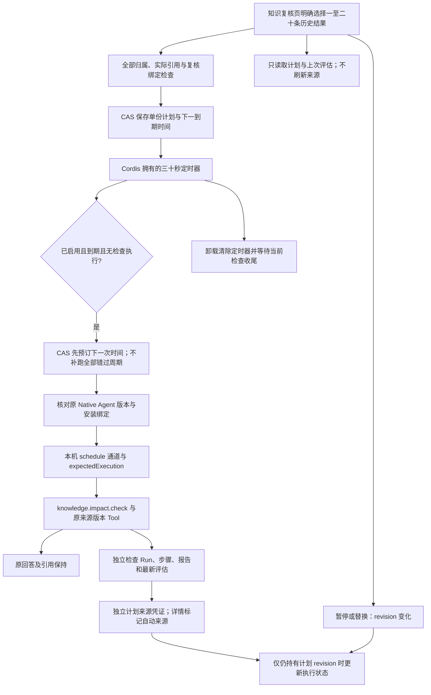

# 知识引用定期复核

为个人用户选定的历史回答或发布草稿定期检查知识版本，保留原结果和独立复核记录。

## 功能定位

knowledge.watch 是可选控制面插件，依赖 knowledge.impact。计划属于固定本机 workspace/bot，复用原 Native 引用复核 Agent；确定性调度不增加空壳 Agent。默认个人组合仍为十五插件九 Agent，示例追加本插件后为十六插件九 Agent。

## 实现流程图

## 能力边界

### 目标

- 明确选择带完整来源身份的成功 knowledge.answer/release.prepare，最多二十条。
- 持久保存频率、暂停状态、下一次检查与实际执行记录；重启后继续。
- 复用现有来源身份、引用校验、版本比较、Scope、Tool 预算和独立报告。

### 非目标

- 不判断语义、自动重生成、覆盖笔记、发出站通知或持续扫描全量历史结果。
- 不提供操作系统后台服务、多人认证、通用 cron 或精确墙钟时刻调度。
- 插件关闭期间不执行；读取来源的规则与范围仍由原知识插件拥有。

## 核心规则

1. 每个固定个人范围一份计划；严格 runIds UUID 数组，1–20 项且唯一，频率只接受 1/15/60/1440 分钟。请求不能指定模型、工具、URL、目录、workspace 或 bot。
2. 配置前先检查所有 Run 归属，再读取实际引用。拒绝失败、无引用、不支持、旧引用缺少来源身份的结果；先创建有效知识回答再配置。
3. 绑定 native.knowledge-impact 的安装 ID 与 Manifest hash；每次执行前再次核对，Host expectedExecution 再检查实际版本。变化后自动暂停并要求用户重新保存，不静默切换能力。
4. 三十秒轮询；保存后等待一整个周期，下一时间按实际发起时间加周期计算。离线期间最多补一次到期检查，不补跑积压，不承诺精确分钟边界。
5. 先以原 JSON CAS 预订下一次时间和 running 状态，再调用 Agent。多实例竞争仅一个取得 revision，单实例不重叠；同一数据库仍遵守原存储的单后端约定。
6. 运行通过 Host.runScheduledLocal / PluginHostServices.runScheduledLocal 创建固定个人范围、无 chat/conversation 的 schedule 触发；Native Agent 必须声明 schedule。原 manual 入口不变，scope triggerKey 仍不是 Run.triggerId。旧 1.0 计划绑定 manual-only Agent Manifest，到期时自动暂停，保留目标和历史，由用户重新启用后绑定新契约。
7. 独立来源凭证记录实际 check Run、计划 revision、原目标、频率、发起时间与触发键；重新配置/暂停不删除已产生的凭证和检查。凭证写入失败明确提示，保留实际 Run，不能声称完整执行。
8. 暂停/替换增加 revision；旧检查完成不能覆盖新计划。暂停停止后续检查，已开始检查仍按原范围完成并保存独立结果。
9. Agent/来源失败维持明确失败或 unverifiable；执行成功只表示版本检查完成。current 不是语义正确性。所有状态显示原检查时间。
10. 配置/查询不刷新来源；轮询只运行已启用且到期的固定计划。没有计划不读取来源。卸载清除计时器并等待已开始的本机检查，历史计划与产物保留。
11. 进程中断可留下 running/不完整状态；下一到期可新建检查，不把旧状态补成成功。预订后、发起前中断时等下一周期再试；不提供恰好一次外部执行保证。

## 用户能力

- 在知识复核页选择结果、选择频率、启用/替换、暂停与恢复原计划；没有重新勾选记录时可直接调整原计划频率，原目标不必仍在最近五十条或当前筛选中。
- 查看原结果、上次实际检查、计划目标和各自最近评估；详情显示计划来源。

## 入口与触发

| 入口 | 输入 | 输出 |
| --- | --- | --- |
| examples/plugins.knowledge-watch-personal.yaml | 明确个人基底插件选择 | 可选计划控件与本机 API |
| GET /api/knowledge-watch | 无 | 计划与缓存评估；不读来源 |
| POST /api/knowledge-watch | runIds、intervalMinutes | 已启用计划和下一到期时间 |
| POST /api/knowledge-watch/pause | 严格空对象 | 暂停后续检查 |
| GET /api/knowledge-watch/runs/:runId | 当前范围 UUID | 计划来源凭证或 null |
| Cordis effect | 每三十秒 | 到期后受治理本机检查 |

## 运行逻辑

选择与核对 → 保存 → 到期领取 → 固定 Native Agent → 原来源 Tool → 独立报告 → 来源凭证 → 带 revision 的计划状态。列表/计划查询只读取缓存，界面每十秒刷新；插件未装配时不请求本插件 API。

## Agent、Tool 与服务边界

| 对象 | 职责 | 禁止承担 |
| --- | --- | --- |
| KnowledgeWatchService | 单份计划、CAS、时机与凭证 | 判断知识语义或直接读取笔记/网页 |
| knowledge.impact | 引用取证、版本核对和报告 | 持有计划计时器或修改原结果 |
| Host / Cordis | 固定本机执行、版本防护、注册释放 | 将原生插件当成不可信代码沙箱 |

## 数据与状态

固定 knowledge:watch:workspace-default:bot-default:plan 保存计划；其 :run:UUID 子键保存已发起运行的计划来源。存储复用当前私有数据库，资料仍在原 Artifact；凭证只保留 Run ID 等任务元数据。CAS 验证原始序列化表示，不重排字段后再比较。长期启用会持续新增检查历史，按实际需求选择频率。

## 失败、安全与降级

本机 Host/Origin、16 KiB/五秒请求限制和 API 卸载沿用平台。错误不回显未识别字段或异常中的路径/凭据。引用跨范围整体拒绝；查询凭证先核对实际 Run 的 workspace/bot。模型与外部写入不参与，但公开网页版本检查仍联系原来明确配置的网站，底层来源可能刷新原索引。

## 代码地图

### 主要实现

- backend/src/knowledge/watch/service.ts：计划、绑定、CAS 与运行来源。
- backend/src/knowledge/watch/plugin.ts：Cordis 计时器、API 和清理。
- frontend/src/pages/workspace/KnowledgeWatchControls.tsx、KnowledgeReviewsPage.tsx：按装配启用控件和计划评估。
- frontend/src/pages/workspace/RunDrawer.tsx、frontend/src/api.ts：实际检查与来源凭证。
- backend/examples/plugins.knowledge-watch-personal.yaml：可选个人组合。
- backend/src/knowledge/impact/plugin.ts、service.ts：复用既有引用复核；未修改运行契约。

### 主要测试

- backend/test/localSchedules.test.ts：正式调度端口、就绪/停止、Manifest/执行绑定、HTTP 不可选触发类型、普通 Scope 拒绝及网页/混合/资料库版本 Tool 正向检查。
- backend/test/knowledgeWatch.test.ts：严格输入/归属、真实 Native 检查、CAS 竞争、漏期、重启、暂停/替换竞态、绑定变化、凭证失败、API/定时器释放与真实配置加载。
- backend/test/knowledgeReviews.test.ts、knowledgeImpact.test.ts：原引用、版本和评估回归。
- backend/test/runRecipes.test.ts：宿主 expectedExecution 的实际执行前检查。
- 前端既有测试、类型/lint/build 和本机计时器/来源变更/暂停/重启的浏览器验收。

## 变更记录

| 日期 | 变更 | 验证 |
| --- | --- | --- |
| 2026-11-06 | 1.1.0：正式 schedule 触发、绑定变化自动暂停，原计划无需重新选择即可调整/恢复 | 正式触发专项、旧计划保护、全量回归与实际升级验收 |
| 2026-11-06 | 新增独立可选计划插件，复用既有 Native 复核并保存自动来源 | 专项、原功能回归、前端门禁与本地浏览器；见项目证据 |
