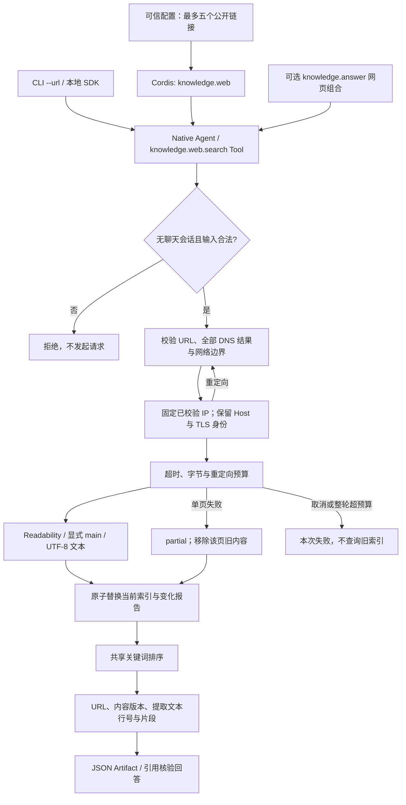

# 公开网页知识源

将用户明确提供的公开单页链接作为知识源，提取正文并返回带来源、版本和读取时间的检索证据。

## 功能定位

独立的 `knowledge.web` 功能插件负责网页读取、解析、同步与检索。它与 Markdown 来源复用中文关键词排序和证据协议，通过现有 Tool Gateway 供 `knowledge.answer` 使用。Native Agent 只把确定性来源服务接入 Host、Run 与 Artifact，不包含模型循环。

`knowledge.web/answerPlugin.ts` 是现有回答插件的网页来源组合，不复制生成、引用核验或运行记录逻辑。每个 Host 只能选一个 `knowledge.answer` 组合；当前不提供网页与 Vault 的联合检索。

## 实现流程图

## 能力边界

### 目标

- 读取明确配置的公开 HTML、Markdown 或纯文本单页；保留原始/最终 URL、抓取时间和内容版本。
- 读取发生变化或失败时更新检索结果，避免静默返回旧正文。
- 接入现有回答和运行追踪，不依赖飞书、TAPD 或额外抓取服务密钥。

### 非目标

- 登录态、Cookie、私有站点、付费墙、浏览器交互、JavaScript 渲染、全站爬取和附件解析。
- 联合检索、向量检索、持久化索引、历史产物自动过期、知识回写和多人授权。
- 不将正文提取和精确引文核验宣称为语义事实证明。

## 核心规则

1. URL 只来自可信插件配置，查询输入不能替换地址。最多五个链接，规范化后拒绝重复；HTTP(S)、默认端口，不含凭据。片段标识移除，URL 最长 1024 字符。
2. 拒绝本机、私网、链路本地、CGNAT、文档/保留地址、IPv4 映射 IPv6 与常见本地域名。IPv6 只允许保守的全球单播范围；部分特殊但可公开路由的地址也会拒绝。地址表参考 IANA，未承诺覆盖未来所有路由政策。
3. 每一跳重新检查 URL 与全部 DNS 结果；有任何非公开结果即拒绝。请求直接连接选定 IP，同时保持原始 Host 和 TLS servername，防止检查后再次 DNS 解析。证书验证保持开启，HTTPS 不降级为 HTTP，最多三次重定向。
4. 默认每页 5 秒、512 KiB、整轮 2 MiB；最大配置每页 10 秒/1 MiB、整轮 4 MiB。DNS、重定向和正文读取共享单页超时。请求不携带 Cookie/认证，不读取代理环境变量，拒绝压缩响应，响应头上限 16 KiB。工具整体 45 秒、Native 60 秒的宿主预算仍生效。
5. 仅支持 UTF-8/ASCII 的 HTML、Markdown 和纯文本。HTML 使用 LinkeDOM 与 Mozilla Readability；不执行脚本或加载页面资源，只输出文本。去除已识别的导航、表单、脚本和隐藏节点；Readability 无结果时仅尝试显式 main/article。无法保证剔除所有站点噪声或识别登录提示。HTML 最多 10000 元素，整轮最多 10000 段。
6. 网页引用的行号属于提取文本，不是原始 HTML 行号；返回 `lineBasis=extracted_text`。`openUri` 打开当前网页，不是历史快照。Markdown 网页当前也采用此统一定位标识。
7. `rawVersion` 是响应原始字节哈希；文档版本还绑定最终地址、MIME、提取实现版本、实际文本与标题。相同内容和提取结果产生稳定引用；原始响应或提取内容变化均使文档版本变化。
8. 每次查询重新抓取，单来源内串行同步并原子替换当前索引。单页失败返回 partial 并移除该页旧内容；取消、整轮字节或段落超预算使整次查询失败，不回退旧索引。当前变化报告相对于同一进程上次成功同步。
9. CLI 使用 `--root` 或可重复的 `--url`，只能选一类；文件排除和 Vault 名称仅适用于 root。query/sync 不调用模型；ask 复用专用模型配置和现有引用核验。默认团队组合不加载网页插件。
10. 只允许无聊天/会话的手动或 Agent 范围；这不构成认证或 RBAC。原生插件是可信宿主代码，Manifest 的 networkHosts 不会自动沙箱化其请求；本来源的实际网络限制由固定 URL 配置与 network.ts 执行。

## 用户能力

- 提供一个或多个公开链接，查看抓取结果、失败、变化与可引用正文。
- 使用相同 CLI 对网页关键词检索，或在显式模型配置后提问。
- 从回答证据打开当前原文，并区分原始地址、重定向后地址与本次内容版本。

## 入口与触发

| 入口 | 输入 | 输出 |
| --- | --- | --- |
| CLI `--url` | 重复公开链接、query/ask、可选 limit | JSON 来源/回答与 Run ID |
| `knowledge.web.retrieve` | operation=sync/search、query/limit | 同步报告或检索 Artifact |
| `knowledge.web.search` Tool | query、limit 1–10 | 当前来源报告与证据 |
| 网页回答组合 | `knowledge.answer` question/limit | 原有回答与引用核验结果 |

## 运行逻辑

1. 配置校验并装配来源与可选回答插件。
2. 验证个人范围和查询后，按固定链接执行有界网络读取。
3. 提取文本、分段与版本，聚合成功页和明确失败。
4. 一次性替换当前索引，返回变化报告或关键词证据。
5. 回答组合经 Tool Gateway 取证，再走原有无 Tool 生成和引用核验链路。

## Agent、Tool 与服务边界

| 对象 | 职责 | 禁止承担 |
| --- | --- | --- |
| `knowledge.web` 插件 | 配置、注册、生命周期与本地入口 | 修改 Host 或安装任意抓取代码 |
| WebKnowledgeSource | 同步、预算、版本与当前索引 | 登录授权或选择业务动作 |
| network.ts | URL/DNS/IP、传输和重定向边界 | 浏览器会话与通用代理 |
| Parser | HTML 正文与 Markdown 文本分段 | 执行网页脚本或返回可执行 HTML |
| 回答组合 | 复用已有生成和确定性引文检查 | 证明语义正确或写入网站 |

## 数据与状态

- 网站仍是来源；索引为内存副本，原始页面不持久化。
- Artifact 保存本次返回的证据与版本；历史 Artifact 不随网页失效自动删除。
- 页面读取与模型调用的数据目的地不同；ask 仅把选定片段和问题发到配置模型，不额外发送来源 URL 字段，正文中包含的链接仍可能随片段发送。
- 可注入传输/读取实现用于受控测试，YAML 和 CLI 不提供绕过网络检查的开关；自行编写原生插件仍属于可信代码。

## 失败、安全与降级

- HTTP 错误、不支持编码/MIME、解析失败和单页超预算都明确列为来源失败，不能称为读取成功。
- 网站脚本和正文中的指令不是宿主授权，生成阶段没有 Tool。提取错误和结论语义仍需单独评估。
- 当前仅面向可信本机/SDK；共享管理端尚缺登录、访问控制与私人 Artifact 隔离。

## 代码地图

### 主要实现

- `backend/src/knowledge/web/network.ts`：公共网络检查、IP 固定、传输和预算。
- `backend/src/knowledge/web/parser.ts`：正文提取、定位语义与版本。
- `backend/src/knowledge/web/source.ts`：来源配置、同步与检索。
- `backend/src/knowledge/web/plugin.ts`：Native Agent 和 Tool 注册。
- `backend/src/knowledge/web/answerPlugin.ts`：既有回答插件的网页组合。
- `backend/src/knowledge/search.ts`、`backend/src/knowledge/scope.ts`：来源共享排序与个人入口限制。
- `backend/src/knowledge/answer/plugin.ts`、`backend/src/knowledge/answer/evidence.ts`：回答组合和跨来源证据协议。
- `backend/src/scripts/knowledge.ts`：URL/目录互斥的 CLI。
- `backend/profiles/agents/knowledge-web-demo.yaml`、`backend/profiles/agents/knowledge-web-answer-demo.yaml`：显式组合。

### 主要测试

- `backend/test/knowledgeWeb.test.ts`：网络拒绝/重定向/DNS 固定/取消/超时、真实本地传输、提取、版本变化、失效移除、真实 Host/SDK 引用与 CLI 校验。
- `backend/test/knowledgeMarkdown.test.ts`、`backend/test/knowledgeAnswer.test.ts`：共享排序、原目录入口与原 RAG 回归。

## 变更记录

| 日期 | 变更 | 验证 |
| --- | --- | --- |
| 2026-11-05 | 新增公开单页来源与网页回答组合，复用原排序和 RAG | 专项 33 通过；类型检查；后端 462 通过 / 1 TAPD 跳过；公开网页 CLI 抓取成功；生成使用本地模拟模型 |
| 2026-11-05 | 显式引用解析依赖要求的标准 DOM 类型，修复干净后端安装的类型检查失败 | 干净归档安装、类型检查和后端回归；不依赖本机其他依赖带入 DOM 声明 |

设计依据：[Mozilla Readability](https://github.com/mozilla/readability)、[LinkeDOM](https://github.com/WebReflection/linkedom)、[Node HTTPS](https://nodejs.org/api/https.html)、[IPv4 特殊地址](https://www.iana.org/assignments/iana-ipv4-special-registry)、[IPv6 特殊地址](https://www.iana.org/assignments/iana-ipv6-special-registry)。依赖固定为 Readability 0.6.0（Apache-2.0）和 LinkeDOM 0.18.15（ISC）。
