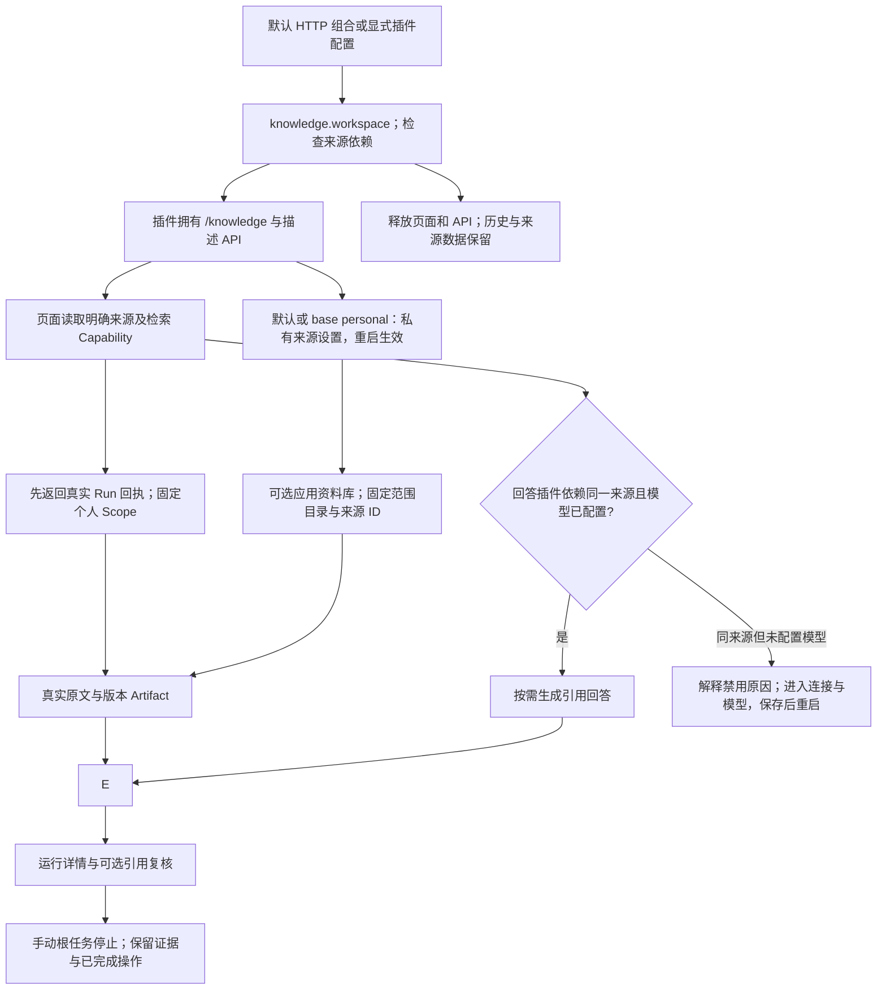
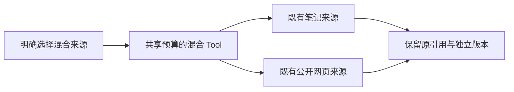

# 个人知识工作台插件

让用户通过可选本地界面检索选定的笔记或网页、查看证据，并配置默认应用的个人来源。

## 功能定位

knowledge.workspace 是独立的确定性界面插件，不创建 Agent、模型或索引。它依赖一个明确选择的知识来源插件，拥有 /knowledge 导航和来源描述 API；检索、生成、引用复核和私有设置分别复用来源 Agent、回答/impact 插件及 LocalConnections。

## 实现流程图

## 能力边界

### 目标

- 知识导航、直接路由与 API 跟随插件装配与释放。
- 同时安装两个来源时，界面采用明确选择，不依赖 Agent 注册顺序。
- 没有模型时仍可检索；配置、资料不足和执行失败保持真实状态。

### 非目标

- 不自行实现联合检索、向量索引、自动安装、多人认证或远端 UI 代码。
- 不改变底层来源、回答、引用校验或运行记录协议。
- 显式插件文件管理来源时不通过页面覆盖它；连接与核心运行服务仍逐步迁移。

## 核心规则

1. createKnowledgeWorkspacePlugin 接受 sample、markdown、web、library 或 mixed，依赖对应来源插件；缺依赖在装配前拒绝。一个 Host 只装配一个知识工作台，底层两种来源可以并存。
2. /api/knowledge-workspace 仅提供 GET；返回 kind、pluginId 和 capability，不返回文件根目录、URL 列表或密钥。来源由宿主工厂选择，客户端不能改写。
3. 默认 HTTP 组合增加本插件；Markdown 与网页来源自身不自动贡献 Web 界面。CLI/SDK 来源能力、SDK 默认团队组合和显式 AGENT_PLUGINS_FILE 语义不变。
4. /knowledge 由 PluginPage 验证所有者后渲染已打包视图。核心 App/MainLayout 不再固定注册该路由与菜单。移除界面插件关闭描述 API 与入口，来源检索可单独保留。
5. 来源和回答能力匹配但模型未配置时，解释回答按钮禁用原因，提供“配置模型”链接；配置仍需保存并重启，模型是否实际可用由执行结果确认。页面使用描述中的明确 Capability。知识回答按钮仅在 knowledge.answer 声明同一来源依赖、对应 Agent 活跃且模型已配置时可用；不会根据插件顺序猜测资料去向。
6. 描述 API 失败时显示重试并禁用检索，不能用旧来源状态冒充就绪。页面不执行第三方脚本或远端界面包。
7. 默认应用的来源配置由 LocalConnections 保存，重启后切换。未声明 base: personal 的显式插件文件管理组合时禁用页面配置入口并解释以文件为准；显式个人基底仍采用本机设置，允许保存并重启。sourceSettingsManagedByPluginFile 是来源所有权标记，managedByPluginFile 继续表示存在组合文件。
8. 来源文本、引用和结果的验证、权限、数据留存及失败行为遵循各自功能卡；本插件不复制检索实现。

## 用户能力

- 从选定来源检索原文，查看真实 Run、步骤和证据。
- 对匹配来源按需生成回答，无模型时仍可体验检索。
- 在默认应用或 base: personal 组合中配置来源；在其他显式组合中按说明修改对应可信文件。

## 入口与触发

| 入口 | 输入 | 输出 |
| --- | --- | --- |
| knowledge/workspace/plugin.ts | 默认 Markdown；工厂可指定 sample | UI 插件与来源依赖 |
| knowledge/workspace/webPlugin.ts | 已配置 knowledge.web | 网页 UI 组合 |
| /knowledge | 关键词或问题 | 既有 Run 和证据 |
| GET /api/knowledge-workspace | 本机页面请求 | 明确来源种类、插件 ID 和检索 Capability |
| examples/plugins.knowledge-workspace.yaml | 本地目录 | 仅来源 + 知识界面，无模型或消息插件 |

## 运行逻辑

1. 装配校验来源依赖，注册页面、API 与 disposer。
2. 页面读取描述和当前 Agent/插件状态；失败明确提示。
3. 检索或匹配的回答经既有本地 Run API 执行。
4. 移除或停止插件时释放贡献，原始 Artifact 保留。

## Agent、Tool 与服务边界

| 对象 | 职责 | 禁止承担 |
| --- | --- | --- |
| 知识工作台插件 | 来源选择、导航与描述 | 持有索引或生成答案 |
| 来源 / 回答插件 | 检索与引用生成 | 根据页面参数改变目录或权限 |
| LocalConnections / Run API | 私有设置与固定 Scope 的执行入口 | 接受任意客户端执行器或 Scope |

## 数据与状态

- 描述为插件内只读常量，无新数据库实体。
- 设置文件、索引与 Run/Artifact 继续由已有服务拥有。
- UI 可释放，不删除来源、笔记、历史或模型设置。

## 失败、安全与降级

缺依赖或重复插件拒绝启动；停止后的 Host 拒绝请求。API 经通用插件边界验证回环 Host 和 Origin，错误方法/路径返回 404；这是本机信任边界，不构成多用户认证。描述不可用时按钮禁用，不静默切换来源。

## 代码地图

### 主要实现

- `backend/src/knowledge/workspace/plugin.ts`、`webPlugin.ts`：独立插件与明确来源描述。
- `backend/src/platform/workspace/knowledge.ts`：HTTP 默认来源/回答/复核/界面组合。
- `backend/src/platform/plugins/web.ts`：释放原核心保留路径和通用生命周期。
- `frontend/src/pages/workspace/KnowledgePage.tsx`、`PluginPage.tsx`：描述驱动的检索和插件页面检查。
- `frontend/src/layouts/MainLayout.tsx`、`frontend/src/App.tsx`：动态导航和路由。
- `frontend/src/api.ts`：描述请求。

### 主要测试

- `backend/test/knowledgeWorkspace.test.ts`：两来源并存时的明确选择、实际检索、缺依赖、独立移除、路径/方法/Origin、描述不含路径与可运行配置样例。
- `backend/test/workspace.test.ts`、`backend/test/pluginWeb.test.ts`：默认组合、控制面和生命周期回归。
- 前端类型、lint、构建及默认来源/移除/来源不匹配的本地浏览器验收。

## 本地验收记录

2026-11-05：默认示例来源通过实际页面检索到 Release.md 的原文片段；Context7 独立组合中没有知识菜单，直接访问 /knowledge 显示插件未启用。另用隔离本地配置同时安装两个来源与占位本地模型：界面明确选择 Markdown，网页回答依赖不匹配时按钮禁用并解释原因；换成 Markdown 回答依赖后按钮开放。未调用真实模型或付费服务。后端全量 557 通过 / 1 TAPD 集成跳过；前端 16 项及类型、lint、构建通过，保留既有 lint 和包体警告。

## 变更记录

| 日期 | 变更 | 验证 |
| --- | --- | --- |
| 2026-11-05 | 知识界面成为独立插件，明确来源与回答依赖；默认组合保留可用入口 | 知识工作台专项、既有回归与本地浏览器验收 |

## 笔记与网页混合来源

createKnowledgeWorkspacePlugin 新增 mixed，明确依赖 knowledge.mixed 并返回 knowledge.mixed.retrieve。默认来源设置同时显示目录/排除项和公开 URL，保存后重启；显式配置管理方式不变。 实现、配置与验证边界见[混合知识功能卡](../mixed/FEATURE.md)；验证：backend/test/knowledgeMixed.test.ts 及既有功能回归。

## 本机任务体验

本功能发起页使用持久启动回执，立即进入可轮询详情；手动根任务可请求停止，关闭页面后仍可从运行记录找回。停止沿既有执行信号传递，取消后不能继续或接受迟到成功，已保存产物与完成操作保留；子任务由父任务管理。CLI/SDK 与内联审查操作仍使用原同步接口。完整协议见[工作台功能卡](../../platform/workspace/FEATURE.md)；验证：backend/test/runControl.test.ts、localRunApi.test.ts 和本功能既有回归，frontend/src/api.test.mjs。

选择个人基底接入 Skill 后，知识检索入口与历史仍保留；Skill 页面可显式预览并选择一次成功检索的历史片段，不改变本插件的检索或 RAG 契约。验证：backend/test/workspaceComposition.test.ts、skillKnowledgeContext.test.ts；流程见[Skill 功能卡](../../connectors/skill-workbench/FEATURE.md)。

2026-11-06 首次体验：同来源回答能力可用但模型未配置时，知识页提供直接配置入口；检索仍无需模型。仅修改已打包视图，未改变来源、模型、执行或配置契约。验证：前端既有测试、类型/lint/build 和全新公开克隆的无密钥检索、入口跳转与 375px 本地浏览器检查。
