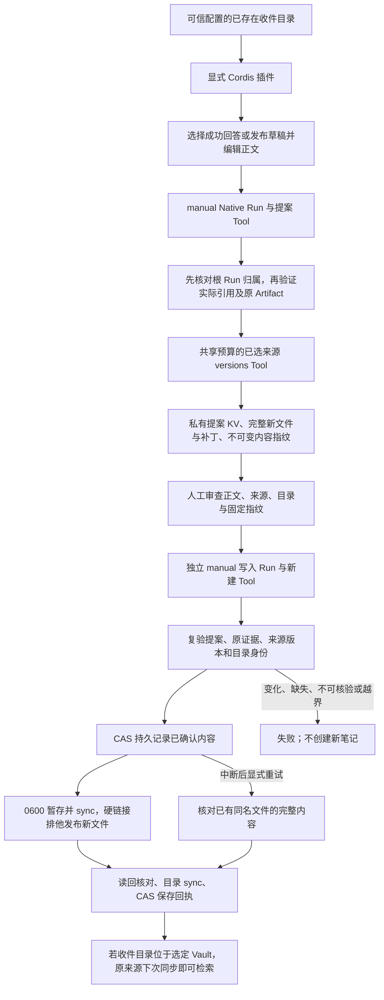

# 审查后新建知识笔记

把当前工作区成功回答或发布草稿转成可编辑、可审查的新笔记，在人工确认与来源版本复验后写入显式选择的收件目录。

## 功能定位

knowledge.writeback 是显式安装的独立插件，拥有原生 Agent、提案/新建 Tool、页面与只读提案 API。它复用 KnowledgeImpactService 的实际引用提取与来源 versions Tool，不调用模型，不修改原运行或已有笔记。可选 Markdown、Web、mixed 组合，默认十四插件九 Agent 保持。

## 实现流程图

## 能力边界

### 目标

- 只从当前范围成功根 knowledge.answer / release.prepare 中提取实际被引用知识，不接受客户端自报引用。
- 允许编辑标题与最多 64 KiB 正文，保存原 Run 与 Artifact 指纹、原引用身份/版本；生成新文件补丁供审查。
- 确认必须绑定提案 SHA；重新检查来源后在固定目录新建唯一文件，重复确认不重复创建，保存时读回核验。

### 非目标

不修改/替换/追加已有笔记，不删除文件，不自动审批，不把语义正确性或签名身份当成已验证事实。不是通用补丁执行器，不接收目标路径或新权限。尚未支持既有笔记的替换补丁、任意研究格式和无引用回答；无人值守模型调用不能直接批准。真实模型质量、外部采用和多人共享权限未验证。

## 核心规则

1. 插件必须显式配置 outputRoot；目录已存在、末级不是符号链接。canonical path、dev/ino 绑定本次 Host 与提案；目录移动/替换或配置切换后旧提案不能转写到新位置。预览不创建目录或笔记文件。
2. 来源必须为当前 workspace/bot 的成功根运行。复用实际引用验证，拒绝空引用、旧格式、来源类型不匹配、损坏证据或超过预算；原记录保持。
3. 通过来源 versions Tool 核对完整请求身份、数量和每份文档 current/相同版本；来源变动、删除、排除或不可读均拒绝。检查是当次快照，来源与目标文件之间不提供跨文件原子事务或语义证明。
4. 提案只保存在私有范围 KV；固定 sourceRunId/Artifact 内容哈希、目标目录身份、标题、完整文件和引用，并计算 approvalSha256。确认请求只能带 proposalId、匹配 SHA 与 confirmed=true。
5. prepare/apply 都必须是个人 manual Scope、共享预算与幂等键；Manifest 不允许 agent/message 触发。可信原生插件与本机 API 仍不是敌对代码沙箱或登录认证。
6. 状态 draft → approved → saved；approved 在文件发布前通过 CAS 持久化。文件名固定为 agent-note-UUID.md，用户输入不能指定路径。先创建 0600 排他暂存文件并 sync，再 link 排他发布，最后删除本次暂存；不使用覆盖性 rename。
7. 新建后以 no-follow 只读句柄核对普通、单链接、0600 和完整内容，sync 目录后保存回执。已有文件内容不一致、符号/硬链接、已保存文件被移动都拒绝，不覆盖或静默重建。
8. 若文件已创建但回执未完成，已确认提案的显式重试只读回相同内容并补回执；若文件不存在则重新核验来源再创建。确认前冒出的同名文件拒绝。取消/超时可能留下 approved 状态或本次私有暂存，应查看目录后重试同一提案；不生成新提案以“重试”。
9. 同实例串行写入，跨请求 CAS 与排他文件发布避免重复；本地 POSIX、单后端与可信目录是支持范围，不保证恶意进程替换父目录的隔离或共享文件系统语义，不自动按时间删除中断暂存。

## 用户能力

选择最近成功结果，编辑正文，查看完整文件/版本/补丁，明确确认新建，查看原结果、提案和写入记录，重开最近五十份提案或恢复回执。保存状态表示当次读回验证，不代表现在文件没有变化。

## 入口与触发

| 入口 | 输入 | 输出 |
| --- | --- | --- |
| /knowledge-writeback | 最近成功回答/草稿，人工编辑与确认 | 完整预览与保存回执 |
| GET /api/knowledge-writeback/source?runId | 同范围成功根 Run UUID | 可编辑原正文、实际引用与证据指纹；不刷新来源 |
| GET /api/knowledge-writeback/proposals | 无参数 | 最近 50 份元数据与已配置目录；无正文/来源 IO |
| GET /api/knowledge-writeback/proposal?proposalId | 同范围提案 UUID | 已保存的不可变提案，不检查当前文件 |
| knowledge.note.writeback | prepare 或 apply 的严格输入 | 独立普通 Native Run/Tool/JSON Artifact |

## 运行逻辑

先在用户选择的 Vault 下准备独立收件目录，显式装配匹配的来源与写回模块。预览提取原引用、核验当次版本并固定内容；用户审查后发起另一个写入 Run。创建新笔记后原只读来源下一次同步会发现它；原结果、原引用与已存在笔记不变。

## Agent、Tool 与服务边界

| 对象 | 职责 | 禁止承担 |
| --- | --- | --- |
| Native Agent | manual 输入、预算、选 Tool 与产物 | 自动批准或修改原证据 |
| 提案 Tool | 来源核验、固定正文和补丁 | 新建笔记文件 |
| 新建 Tool/Service | 固定确认、来源复验、排他发布和回执 | 接收任意路径或覆盖已有文件 |
| 来源 versions | 既定读取范围内核对真实版本 | 扩大读取权限或证明语义正确 |

## 数据与状态

私有 KV 保存提案正文、源运行/证据哈希、引用、目录身份、确认与保存时间。新笔记带来源属性及 JSON 引用列表，显式标记 semanticSupport=not_verified。审批/写入结果存普通 Run/Artifact，GET 不新建运行。移除插件释放 Agent/Tool/API/页面，历史与已批准笔记保留。

## 失败、安全与降级

提案与内容/目录不匹配、原证据变化、版本协议不一致、超限、磁盘错误、取消或无法读回都明确失败，不回退旧核验。不提供共享登录权限，使用真实私人资料前需保障本机访问；云模型生成原结果时的资料去向沿原模型设置，回写本身零模型，网页版本检查仍可能联网。

## 代码地图

### 主要实现

- `backend/src/knowledge/writeback/service.ts`：提案、实际来源、范围/指纹、版本协议、排他新建与恢复回执。
- `backend/src/knowledge/writeback/plugin.ts`、`webPlugin.ts`、`mixedPlugin.ts`：显式来源组合、manual Agent/Tool、页面/API 和预算。
- `backend/src/knowledge/impact/service.ts`：复用原引用核验与提取，不改变原逻辑。
- `backend/src/knowledge/versions.ts`：既有当前版本协议。
- `frontend/src/pages/workspace/KnowledgeWritebackPage.tsx`、`noteBody.ts`：选择、编辑、审查、明确确认和原记录跳转。
- `frontend/src/pages/workspace/PluginPage.tsx`、`frontend/src/api.ts`：插件存在时懒加载与 API 客户端。
- `backend/examples/plugins.knowledge-writeback.yaml`、`docs/KNOWLEDGE_WRITEBACK.md`：本地组合与操作限制。

### 主要测试

- `backend/test/knowledgeWriteback.test.ts`：实际来源、补丁应用、预览零文件、新建后检索、重复/并发确认、变化/缺失/不可读/目录替换、权限/指纹/证据变动、符号/硬链接、回执失败跨 Host 恢复、manual/预算/API 边界及 Web/mixed 实际组合。
- `backend/test/knowledgeImpact.test.ts`、`knowledgeAnswer.test.ts`、`knowledgeMixed.test.ts`：既有来源、引用与生成回归。
- `frontend/src/pages/workspace/noteBody.test.mjs`：正文预览完整保留用户文字与相似标记，未知格式回退完整文件。
- `backend/test/featureIndex.test.ts`：Owner 索引与默认组合计数。

## 变更记录

| 日期 | 变更 | 验证 |
| --- | --- | --- |
| 2026-11-06 | 新增显式的新笔记回写插件；独立人工审查、版本复验、排他创建与恢复回执 | 专项、前后端门禁、隔离本地 SDK 协议/浏览器验收；不验证真实模型质量 |
