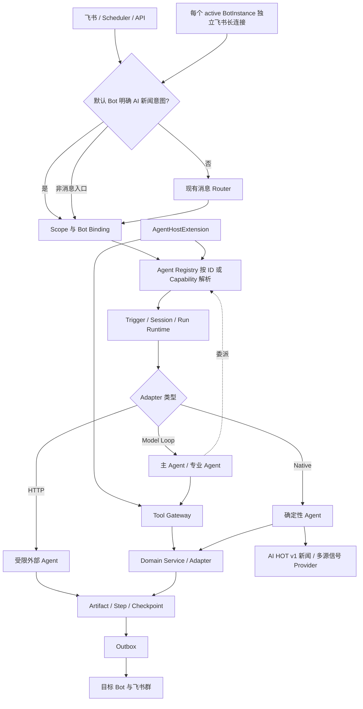

# Agent 平台与多机器人控制面

提供可注册、可委派、可暂停恢复、可审计的 Agent Runtime，并通过 Tool、Skill、Trigger、Run、Artifact、Outbox 和 Bot Binding 支持内置与外部 Agent 插拔。

## 功能定位

Agent 平台把“一个模型调用”提升为可管理的执行单元。每个 Agent 通过 Manifest 声明身份、版本、Capability、运行方式和可使用资源；Runtime 负责作用域、运行记录、委派、暂停恢复和产物投递。

平台的核心价值不是把所有功能 Agent 化，而是建立稳定边界：Agent 决策下一步，Tool 暴露受控动作，Skill 提供可复用方法，Domain Service 保存业务事实。新增外部 Agent 或新机器人时，系统扩展注册和绑定，不复制整条业务链路。

## 实现流程图

## 能力边界

### 目标

- 用统一 Manifest、Capability 和 Adapter 接入 Model Loop、Native 与 HTTP Agent。
- 主 Agent 可以按 capability 委派专业 Agent，所有副作用经过受治理 Tool。
- 为多机器人预留 Bot Registry、Binding 和目标路由，而不是在业务代码写死机器人。

### 非目标

- 不把所有业务函数包装成 Agent；确定性、强一致逻辑保留在领域服务。
- Skill 是可复用能力包，不拥有长期业务状态，也不等同 Agent。
- Agent Registry 不是任意远程代码执行器；外部 Agent 必须通过协议和 allowlist 接入。

## 核心规则

1. **Manifest 是运行契约。** Agent 只能声明并使用自己的 Capability、Tool、Skill 和可委派子 Agent；运行时不接受 Prompt 临时扩大权限。
2. **Registry 负责发现，Binding 负责使用。** 安装 Agent 不等于所有机器人自动可用；Bot Binding 决定某个机器人可路由哪些 Capability，以及优先级和覆盖配置。
3. **所有执行携带 Scope。** workspace、bot、group 和 user 共同限制读取、Tool 调用、Run 查询和最终投递，跨 Scope 操作在服务端拒绝。
4. **三类 Adapter 使用同一生命周期。** Model Loop、Native 和 HTTP Agent 都产生 Trigger、Run、Step 和 Artifact，但各自执行策略不同。
5. **Agent 不直接写业务存储。** 具有副作用的动作进入 Tool Gateway，再由 Domain Service 校验身份、状态、参数和幂等键。
6. **委派必须有界。** 父 Agent 只能调用 Manifest 允许的 Capability；子 Run 保存 parent、root 和 correlation 关系，并受深度、步数、预算和超时限制。
7. **暂停恢复复用原 Run。** 等待用户补充信息时保存 Checkpoint；用户回复后继续原来的根 Run，不能创建另一条失去上下文的执行链。
8. **外部 Agent 默认不可信。** HTTP Adapter 校验 endpoint allowlist、Secret 引用、请求超时和响应大小，并区分可重试错误与永久错误。
9. **Agent 完成不等于消息送达。** Runtime 先保存 Artifact，再写 Outbox；Delivery Worker 独立完成 Bot 路由、重试和最终状态。
10. **功能是否 Agent 化看运行特征。** 需要多步决策、会话恢复、独立部署或资源预算时使用 Agent；稳定知识和操作方法使用 Skill；强一致状态始终归 Domain Service。
11. **本地二开通过显式扩展装配。** 自定义模块实现带唯一 ID 的 `AgentHostExtension`，在 Runtime 就绪前取得受限的 Registry、Native/Model-loop Adapter、Tool 与 Skill 注册入口；重复 ID 或注册失败会让 Host 启动失败，不能留下部分就绪状态。内置 Agent 的默认注册顺序和外部 HTTP Agent 安装协议保持不变。
12. **多机器人入口与出口使用同一 Bot Scope。** 每个 active BotInstance 建立自己的飞书长连接，入站闭包固定 bot ID；Trigger 幂等和 Outbox 目标都包含 bot ID，出站再按该 BotInstance 解析凭证。
13. **默认机器人可按确定性意图前置调用 Capability。** 现有机器人收到明确的 AI 新闻 p2p 文本时，在成员映射和 Delivery Ops 主 Agent 之前调用 `knowledge.ai.news.fetch`；同会话 30 分钟内的“查看更多”、关键词、来源和分类追问沿用新闻路由。其他模糊追问、否定、元问题、开发任务和非新闻文本继续原业务链路。显式配置不同 App ID 时才启用带 `entryCapability` 的独立新闻机器人。
14. **机器人日志最小化且可验收。** AI 新闻入站和出站审计只保留 bot、message、chat、投递结果等路由元数据，不保存私聊或卡片正文；飞书事件先以 workspace、BotInstance、message ID 建立数据库原子 Claim，再写入最多 1000 条的进程内快速缓存，`/readyz` 要求所有启用的入站机器人连接可用。默认复用模式不增加连接数。
15. **外部投递遵守供应商反馈。** 飞书请求接收 Worker 的取消信号；429 使用 `Retry-After`，月额度耗尽按 App ID 进入不可重试熔断，不能重新运行 Agent 或误伤其他机器人。
15. **文章产物由平台安全渲染。** `article_list` 只接受 HTTP/HTTPS 原文链接，平台负责追加信号来源和操作提示；Provider 返回内容不能控制提示语、生成任意卡片结构或暴露内部 cursor。

## 用户能力

- 通过 Delivery Ops 主 Agent 调用 Task、Standup、Daily Summary、Weekly Report 和 Project Dashboard Agent。
- 安装、启用和调用符合 HTTP 契约的外部 Agent，例如 AI Hot。
- 为不同机器人绑定 Agent/能力和投递目标。
- 查看 Agent Run、Step、Artifact、Tool Call，并对可恢复运行暂停或继续。

## 入口与触发

| 入口 | 输入 | 输出 |
| --- | --- | --- |
| 消息兜底/主 Agent | 用户目标和会话作用域 | Tool 调用、委派或回复 |
| Scheduler/API | Agent ID、capability、payload、scope | Agent Run 与 Artifact |
| 外部 Agent 安装 | Manifest、endpoint、Secret 引用 | Registry 中的 Agent |
| Bot Binding | Bot、群、Agent/capability 规则 | 受路由约束的执行和投递 |

## 运行逻辑

1. Bootstrap 注册 Agent、Tool、Skill、Bot、Adapter 和持久化组件。
   自定义 `AgentHostExtension` 在内置 Model-loop 能力之后、Skill 包目录加载和 Runtime 创建之前执行一次。
2. 入口创建带 tenant/group/bot/user 的 Scope，并按 ID 或 capability 解析 Agent。
3. Runtime 建立 Trigger、Session、Checkpoint 和 Run。
4. Adapter 执行 Model Loop、Native 函数或受限 HTTP 调用。
5. Model Agent 只能通过 Tool Gateway 调用领域能力，或经 Runtime 委派其他 Agent。
6. Step、Tool Call、Artifact 和状态增量持久化；投递写入 Outbox，再按 Bot Binding 发送。

## Agent、Tool、Skill 与服务边界

| 对象 | 何时使用 | 状态与副作用 |
| --- | --- | --- |
| Agent | 有独立目标、决策循环、会话/恢复或独立部署需求 | 拥有运行状态，不直接拥有业务真相 |
| Tool | Agent 需要调用确定性系统能力 | 强 Schema、权限、幂等和审计；副作用入口 |
| Skill | 可复用提示、流程说明或工具组合 | 默认无长期状态，不直接绕过 Tool |
| Domain Service | 强一致业务规则和唯一写入口 | 拥有业务状态 |
| Native Agent | 希望接入统一调度/审计的确定性长流程 | 复用 Service，不能复制领域规则 |
| HTTP Agent | 独立部署或外部开源 Agent | 仅经协议、超时、认证和网络 allowlist 调用 |

### Agent 与 Skill 判断规则

满足任一强信号时优先 Agent：需要多步自主决策、独立会话或暂停恢复、独立扩缩容/部署、独立 SLA 和资源预算。仅包含稳定知识、提示模板、确定性步骤或多个 Tool 的可复用操作方式时优先 Skill。需要持久化业务状态时，两者都不是状态所有者，应进入领域服务。

## 当前 Agent 清单

| Agent ID | Capability | Adapter | 角色 |
| --- | --- | --- | --- |
| `built-in.delivery-ops-agent` | `delivery.ops.orchestrate` | Model Loop | 主编排 Agent |
| `built-in.task-agent` | `task.manage` | Model Loop | 任务专业 Agent |
| `built-in.standup-agent` | `standup.manage` | Model Loop | 站会专业 Agent |
| `native.daily-summary` | `summary.daily.generate` | Native | 日报 Agent |
| `native.weekly-report` | `summary.weekly.generate` | Native | 周报 Agent |
| `native.project-dashboard` | `dashboard.project.generate` | Native | 看板 Agent |
| `native.ai-news-radar` | `knowledge.ai.news.fetch` | Native | 实时 AI 新闻 Agent |
| `external.ai-hot` | `knowledge.ai.hot.fetch` | HTTP | 可选外部知识 Agent |

## 数据与状态

- Manifest/Registry 保存定义；Trigger、Session、Checkpoint、Run、Step、Artifact 和 Tool Call 保存执行事实。
- Scope 至少区分 tenant、group、bot 和 user；Run 与 Artifact 不能跨 Scope 查询或投递。
- Outbox 与业务 Run 分离：Agent 完成不代表外部消息已送达。
- Bot Binding 决定入口 Agent 和出口 Bot，新增机器人不需要复制业务 Agent。

## 失败、安全与降级

- 外部 Agent endpoint 必须执行协议校验、认证、连接/读取超时、响应大小限制和内网地址策略，防止 SSRF。
- Tool Gateway 必须服务端校验 Schema、调用者 scope、权限、超时和幂等键；Prompt 不是权限边界。
- Secret 只通过 Resolver 传给 Adapter，不进入 Prompt、日志或 Artifact。
- 循环委派、无限 Tool 调用和 Token 消耗需要深度、步数、预算和截止时间上限。
- Runtime 崩溃后从持久化 Checkpoint 恢复，不能重复已经确认的副作用。

## 代码地图

### 主要实现

- `backend/src/platform/agents/registry.ts`、`runtime.ts`、`contracts.ts`：Agent 注册与运行契约。
- `backend/src/platform/agents/modelLoopAdapter.ts`、`nativeAdapter.ts`、`httpAdapter.ts`：三种执行 Adapter。
- `backend/src/platform/bootstrap/agentHost.ts`：平台装配，并提供带唯一 ID 的本地扩展注册上下文，供二开模块注册 Agent、Tool、Skill 或 Adapter。
- `backend/src/platform/tools/gateway.ts`、`registry.ts`：Tool 治理。
- `backend/src/platform/skills/registry.ts`、`runtime.ts`、`packageLoader.ts`：Skill 加载与执行。
- `backend/src/platform/session/**`：会话和 Checkpoint。
- `backend/src/platform/bots/**`、`delivery/routedFeishuAdapter.ts`：多机器人长连接、入站隔离与路由投递。
- `backend/src/agents/**`：当前 Agent 定义。

### 主要测试

- `backend/test/agentHost.test.ts`、`agentRuntime.test.ts`：Host 与 Runtime。
- `backend/test/modelLoopAgent.test.ts`、`domainAgents.test.ts`：Agent 执行。
- `backend/test/toolSkillRuntime.test.ts`：Tool 与 Skill 治理。
- `backend/test/sessionRuntime.test.ts`、`persistentAgentKernel.test.ts`：恢复和持久化。
- `backend/test/agentDelegation.test.ts`：委派边界。
- `backend/test/externalAgent.test.ts`：HTTP Agent。
- `backend/test/agentControlPlane.test.ts`、`platformScope.test.ts`：控制面与隔离。
- `backend/test/multiBotIngress.test.ts`、`aiNewsRadar.test.ts`：多 Bot 入站和专用 Native Agent。

## 变更记录

| 日期 | 变更 | 验证 |
| --- | --- | --- |
| 2026-08-03 | 飞书事件增加数据库跨实例原子去重；投递链路传递取消信号、供应商重试时间和按 App ID 隔离的额度错误 | `multiBotIngress.test.ts`、`deliveryOutbox.test.ts`、`externalApiHealth.test.ts` |
| 2026-07-29 | AI 新闻增加同会话续页、关键词/来源/信号追问；`article_list` 卡片展示多源信号并追加受控操作提示 | `aiNewsRadar.test.ts`、`routedFeishuDelivery.test.ts`、后端类型检查 |
| 2026-07-29 | AI 新闻默认复用 `bot-default`，增加确定性私聊意图分流；仅显式提供不同 App ID 时创建专用 Bot | `config.test.ts`、`multiBotIngress.test.ts`、`aiNewsRadar.test.ts`、`agentHost.test.ts` |
| 2026-07-29 | 增加每 BotInstance 独立飞书长连接、p2p 专用 Capability 路由，并注册 `native.ai-news-radar` | `multiBotIngress.test.ts`、`aiNewsRadar.test.ts`、`agentHost.test.ts` |
| 2026-07-29 | 增加 `AgentHostExtension` 本地装配入口；扩展只初始化一次，重复 ID 或注册失败时 Host 不进入就绪状态 | `agentHost.test.ts`、Agent 平台全量回归、后端类型检查 |
| 2026-07-27 | 注册 `native.weekly-report`，加入主 Agent 可委派 capability，并通过 Artifact/Outbox 投递周报链接 | `weeklyReport.test.ts`、`scheduler.test.ts`、Agent Host 回归 |
| 2026-07-22 | 补充 Manifest、Binding、Scope、委派和 Agent 化判断规则，精简文档结构 | CodeGraph 与 Agent Runtime 测试 |
| 2026-07-22 | 建立 Agent 平台功能卡，记录当前 Agent、Skill 判断和多机器人扩展点 | CodeGraph 架构审查 |
