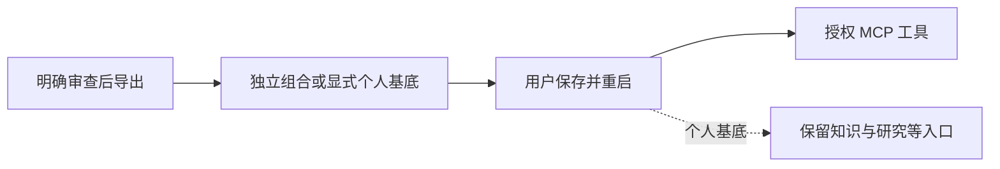
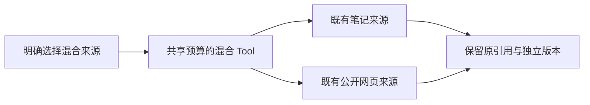
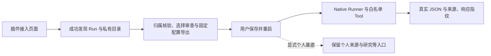
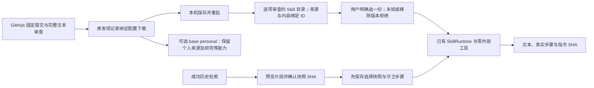
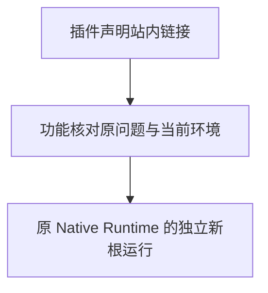
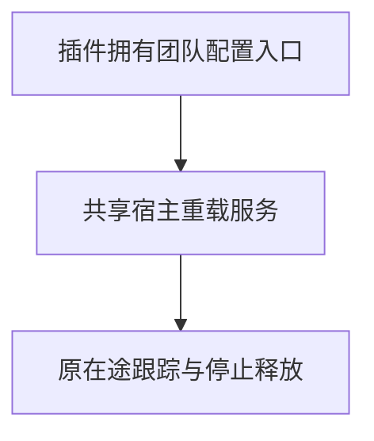

# Agent 平台与多机器人控制面

提供可注册、可委派、可暂停恢复、可审计的 Agent Runtime，并通过 Tool、Skill、Trigger、Run、Artifact、Outbox 和 Bot Binding 支持内置与外部 Agent 插拔。

## 功能定位

Agent 平台把“一个模型调用”提升为可管理的执行单元。每个 Agent 通过 Manifest 声明身份、版本、Capability、运行方式和可使用资源；Runtime 负责作用域、运行记录、委派、暂停恢复和产物投递。

平台的核心价值不是把所有功能 Agent 化，而是建立稳定边界：Agent 决策下一步，Tool 暴露受控动作，Skill 提供可复用方法，Domain Service 保存业务事实。新增外部 Agent 或新机器人时，系统扩展注册和绑定，不复制整条业务链路。

## 实现流程图

```mermaid
flowchart TD
    EXTERNAL_OWNER[builtin.ai-hot-schedule：专用安装 API] --> INSTALL_PORT[宿主通用 installExternal 端口]
    INSTALL_PORT --> CATALOG[原 Catalog、安装与 Binding；移除入口保留记录]
    RETENTION_PLUGIN[可选 platform.maintenance] --> RETENTION_TICK[全局 tick：无群也执行；自主检查时刻与每日 Claim]
    RETENTION_TICK --> RETENTION_SERVICE[原 DataRetentionService：批量审计及白名单临时键]
    RETENTION_SERVICE --> RETENTION_KEEP[保留 Run、Step、Artifact 与业务事实]
    QUOTED_HISTORY[历史结果实际引用的逐字引文] --> QUOTE_SOURCE[明确来源的版本与可选引文检查]
    QUOTE_SOURCE --> QUOTE_DETAIL[当前正文仍找到或未找到；不返回新正文]
    QUOTE_DETAIL --> QUOTE_REVIEW[文档变化仍需复核；原产物与语义边界保留]
    BOT_ENTRY_PLUGIN[所选插件注册默认 Bot 的确定性入口] --> BOT_ENTRY_GATE[有效私聊文本与可派发能力]
    BOT_ENTRY_GATE --> BOT_ENTRY_ORDER[唯一优先级；首个命中选择 Capability]
    BOT_ENTRY_ORDER --> BOT_ENTRY_RUN[原 bot-scoped Trigger 与 Host]
    BOT_ENTRY_GATE -- 未命中 --> BOT_ENTRY_FALLBACK[原上下文与消息 Router]
    REVIEWED_PROFILE[已审查 Skill/MCP/OpenAPI：预览后明确确认] --> PRIVATE_PROFILE[固定导出契约复验；私有 CAS 保存]
    PRIVATE_PROFILE --> PROFILE_APPLY[空闲重载；新实例与同一保存版本确认]
    PROFILE_APPLY --> PROFILE_OWNER[显式文件优先；否则启用保存组合或个人预设]
    PRIVATE_PROFILE --> PROFILE_RESET[停用并恢复个人预设；组合与 Run 历史保留]
    ASSIST_UI[默认个人：选择 Skill/OpenAPI 助手] --> ASSIST_SAVE[私有偏好保存；严格枚举，可空值停用]
    ASSIST_SAVE --> ASSIST_BOOT[已有本地应用流程；新实例确认后生效]
    ASSIST_BOOT --> X
    UI[个人默认 / 按需团队工作台] --> A
    UI --> LC[私有连接配置；本地启动器空闲应用或手动重启]
    LC --> X
    A["飞书 / Scheduler / API"] --> R{"默认 Bot 明确 AI 新闻意图?"}
    R -- "是" --> B["Scope 与 Bot Binding"]
    R -- "否" --> Q["现有消息 Router"]
    R -- "非消息入口" --> B
    Q --> B
    B --> C["Agent Registry 按 ID 或 Capability 解析"]
    X["Cordis FeaturePlugin / 兼容扩展"] --> C
    X --> I["Tool / Skill / Adapter 注册"]
    X --> SKIMP[标准 SKILL.md：元数据导入与独立权限]
    SKIMP --> I
    X --> MR["消息路由、引用上下文与帮助贡献"]
    MR --> Q
    X --> WEB[页面、API 与手动任务贡献]
    WEB --> WREQ[本机与声明路由检查；Host 在途跟踪]
    WREQ -- 未声明方法或路径 --> W404[404；不进入插件处理器]
    WEB --> FORM[可选 Capability 元数据：Agent 入口进入结构化表单]
    WREQ --> DOC[私有文档暂存 ID；Native Tool 转换与来源 Artifact]
    WREQ --> PV[报告/纪要受限文件 API / TaskService 甘特与计划审计]
    WREQ --> MAIL[纪要邮件接受/未确认审计，失败不伪造成功]
    WREQ --> J
    X --> RA[成功 Run 的插件动作与状态面板]
    UI --> RA
    RA -- 显式执行 --> B
    X --> DIRECTORY[builtin.directory：通讯录 API 与全局轮询]
    DIRECTORY --> WREQ
    X --> SJ[群业务计划与轮询贡献]
    SJ --> A
    C --> D["Trigger / Session / Run Runtime"]
    D --> E{"Adapter 类型"}
    E -- Model Loop --> F["主 Agent / 专业 Agent"]
    E -- Native --> G["确定性 Agent"]
    E -- HTTP --> H["受限外部 Agent"]
    F --> RG[可选请求守卫、持久委派预算与完成资料守卫]
    RG --> RI[研究稿、真实子资料索引与覆盖警告]
    RI --> K
    F --> I["Tool Gateway"]
    F -. 委派 .-> C
    D --> AB[父信号或自身截止时间中止执行；停止等待并拒绝迟到成功]
    UI --> START[持久启动回执与本机手动根运行停止]
    START --> D
    START --> AB
    AB --> FAIL[失败 Run / Step；不向调用者返回成功产物]
    I --> SV[标准 JSON Schema 校验；同 ID 契约隔离]
    SV --> J["Domain Service / Adapter"]
    X --> MCP[可选 MCP stdio / 公开 HTTPS 连接插件]
    MCP --> I
    MCP --> MHTTP[HTTP 固定端点、公开 DNS/IP 与 TLS；有界 JSON/SSE]
    MHTTP --> I
    J --> MS[显式选择的本地 MCP 工具]
    I -- "调用前已取消" --> XC["拒绝进入 Tool Handler"]
    X --> NP["Native 插件：宿主模型与 Tool 组合"]
    NP --> I
    NP --> OM["Orchestrator：可选无人工输入函数的纯生成"]
    OM --> K
    G --> J
    H --> K["Artifact / Step / Checkpoint"]
    K --> LS[CLI 可选私有 SQLite KV 与独占会话]
    LS --> IR[历史知识引用复核；原证据保留]
    J --> K
    K --> L["Outbox"]
    L --> M["目标 Bot 与飞书群"]
    N["配置完整的 active BotInstance 独立飞书长连接"] --> R
    G --> O["AI HOT v1 新闻 / 多源信号 Provider"]
    DOC --> KLIB[明确收录；既有知识检索与引用回答]
    K --> QCR[实际执行快照与保存记录验收]
    X --> QRULE[随插件释放的结果规则]
    QRULE --> QCR
    UI --> MCPSETUP[匿名 MCP 发现与审查配置导出]
    MCPSETUP --> MCPRESTART[用户保存并重启独立组合]
    MCPRESTART --> MCPRUN[通用读取路由与上游 Tool：共享预算及同一 Run]
    MCPRUN --> I
    REC[任务配方：原参数与版本审查] --> RECRUN[固定本机新运行；Runtime 核对实际契约]
    RECRUN --> RECEIPT[独立来源回执，原记录保留]
    PC[插件页组合入口] --> PVF[固定 Skill/MCP/OpenAPI 导出契约校验]
    PVF --> PD[下载个人基底配置；用户保存重启]
    RFIX[研究任务：用户确认固定外部请求] --> RSNAP[持久确认与目的地址/契约指纹]
    RSNAP --> RPOL[仅收紧已声明委派；执行前检查常量参数]
    RPOL --> RCHILD[原 MCP/OpenAPI 子任务与真实资料索引]
    SETUP_UI[默认插件页选择接入助手] --> SETUP_FILE[固定内置模块配置；下载后保存重启]
    SETUP_FILE --> INSPECT_UI[Skill/API 发现与原审查流程]
    INSPECT_UI --> REVIEWED_FILES[实际能力导出后按原契约组合]
    FORMAL_LOCAL_SCHEDULE[可信插件本机 schedule 端口] --> SCHEDULE_MANIFEST[声明检查与执行指纹；真实 schedule Run]
```

## 能力边界

### 目标

- 用统一 Manifest、Capability 和 Adapter 接入 Model Loop、Native 与 HTTP Agent。
- 主 Agent 可以按 capability 委派专业 Agent，所有副作用经过受治理 Tool。
- 为多机器人预留 Bot Registry、Binding 和目标路由，而不是在业务代码写死机器人。

### 非目标

- 不把所有业务函数包装成 Agent；确定性、强一致逻辑保留在领域服务。
- Skill 是可复用能力包，不拥有长期业务状态，也不等同 Agent。
- Agent Registry 不是任意远程代码执行器；外部 Agent 必须通过协议和 allowlist 接入。

## 本地工作台

HTTP 应用首页提供任务、运行详情、Agent/插件清单和连接表单，复用现有 Host；本地请求固定默认 workspace/bot，最终结果不投递会话。HTTP 默认组合数量见[工作台功能卡](workspace/FEATURE.md)与[首页装配表](../../../README.md#能力与插件)，首页数量由回归对照实际声明校验；团队 SDK 组合保持十五个插件、七个 Agent。管理 API 校验回环 Host/Origin；这不是多人认证。站会、看板、甘特、周报与隐藏纪要页面/API 已按插件装配；旧根查询和 HTML 链接同样核对所有者，甘特计划继续由 TaskService 保存。

## 核心规则

团队 SDK 组合为十五个插件、七个 Agent。各插件拥有自己的消息指令与引用贡献；Router 无业务默认项，空组合无消息和群业务调度功能。私聊组合中的成员门槛继续保留，不表示已提供逐路由授权或 RBAC。

原生插件现在可调用宿主 Orchestrator 和 Tool Gateway 组合受治理管线。知识回答用一个检索 Tool 和一次无 Tool 的模型生成，在发布前核验引用；两个个人知识插件均不进入默认团队组合。`allowHumanInput: false` 关闭模型执行器的默认人工输入函数，其他 Agent 保持原有默认暂停恢复行为。

Tool Gateway 在预取消和领取账本期间取消时拒绝进入 Handler；已领取调用记录失败，预取消不领取。超时将同一个 TOOL_TIMEOUT 原因传给 Handler 与等待方，避免协作取消把超时混成未知错误。已经发出的外部操作仍需业务幂等和结果核验。

Agent Runtime 在进入 Adapter 前核对父信号，并让父中止与自身截止时间参与等待；忽略信号或中止后返回成功的 Adapter 不能把迟到结果变成成功 Run。接收结果及持久化成功状态前再次检查信号。自身超时保留 TIMEOUT/可重试，父中止记录 PARENT_ABORTED/不可重试，Agent/委派 Step 同步失败并保留执行快照；不将其标成用户主动取消。已持久化的事实保留，失败返回不交付成功产物。原生代码不构成可强杀沙箱，已发出的业务副作用不自动回滚。

子截止时间受父截止时间约束，二者同时到期时，父中止和子计时器可能按不同平台顺序先触发；错误按实际先触发的来源记录。委派回归分别验证预中止/执行中止为 PARENT_ABORTED，自身超时为 TIMEOUT，相同截止时间允许这两种原因，但必须失败、保留对应重试属性且不产生迟到成功。

执行始终使用请求中记录的绝对 deadlineAt；保存运行步骤等等待会消耗剩余时间，不能在等待之后重新计满配置时长。计时器按剩余时间启动，每个执行/结果边界同时核对当前时间，即使事件循环尚未处理计时器，也不能接受已过期成功。agentRuntime.test.ts 用慢步骤保存和绝对截止后才返回的 Adapter 重现并校验该边界。

1. **Manifest 是运行契约。** Agent 只能声明并使用自己的 Capability、Tool、Skill 和可委派子 Agent；运行时不接受 Prompt 临时扩大权限。
2. **Registry 负责发现，Binding 负责使用。** 安装 Agent 不等于所有机器人自动可用；Bot Binding 决定某个机器人可路由哪些 Capability，以及优先级和覆盖配置。
3. **所有执行携带 Scope。** workspace、bot、group 和 user 共同限制读取、Tool 调用、Run 查询和最终投递，跨 Scope 操作在服务端拒绝。
4. **三类 Adapter 使用同一生命周期。** Model Loop、Native 和 HTTP Agent 都产生 Trigger、Run、Step 和 Artifact，但各自执行策略不同。
5. **Agent 不直接写业务存储。** 具有副作用的动作进入 Tool Gateway，再由 Domain Service 校验身份、状态、参数和幂等键。
6. **委派必须有界。** 父 Agent 只能调用 Manifest 允许的 Capability；子 Run 保存 parent、root 和 correlation 关系，并受深度、步数、预算和超时限制。
7. **暂停恢复复用原 Run。** 等待用户补充信息时保存 Checkpoint；用户回复后继续原来的根 Run，不能创建另一条失去上下文的执行链。
8. **外部 Agent 默认不可信。** HTTP Adapter 校验 endpoint allowlist、Secret 引用、请求超时和响应大小，并区分可重试错误与永久错误。
9. **Agent 完成不等于消息送达。** Runtime 先保存 Artifact，再写 Outbox；Delivery Worker 独立完成 Bot 路由、重试和最终状态。
10. **功能是否 Agent 化看运行特征。** 需要多步决策、会话恢复、独立部署或资源预算时使用 Agent；稳定知识和操作方法使用 Skill；强一致状态始终归 Domain Service。
11. **功能 Agent 通过 Cordis 插件装配。** 七个内置 Agent 已拆为独立 `FeaturePlugin`，版本、依赖、配置和 effect 清理由插件运行时管理；`AgentHost` 默认无业务插件，应用通过 `createDeliveryOpsHost` 选择组合。完整规范见 `docs/PLUGIN_AUTHORING.md`。旧扩展继续兼容： 自定义模块实现带唯一 ID 的 `AgentHostExtension`，在 Runtime 就绪前取得受限的 Registry、Native/Model-loop Adapter、Tool 与 Skill 注册入口；重复 ID 或注册失败会让 Host 启动失败，不能留下部分就绪状态。内置 Agent 的默认注册顺序和外部 HTTP Agent 安装协议保持不变。
12. **多机器人入口与出口使用同一 Bot Scope。** 每个配置了入站连接的 active BotInstance 建立自己的飞书长连接，入站闭包固定 bot ID；Trigger 幂等和 Outbox 目标都包含 bot ID，出站再按该 BotInstance 解析凭证。
13. **默认机器人可按确定性意图前置调用 Capability。** 现有机器人收到明确的 AI 新闻 p2p 文本时，在成员映射和 Delivery Ops 主 Agent 之前调用 `knowledge.ai.news.fetch`；同会话 30 分钟内的“查看更多”、关键词、来源和分类追问沿用新闻路由。其他模糊追问、否定、元问题、开发任务和非新闻文本继续原业务链路。显式配置不同 App ID 时才启用带 `entryCapability` 的独立新闻机器人。
14. **机器人日志最小化且可验收。** AI 新闻入站和出站审计只保留 bot、message、chat、投递结果等路由元数据，不保存私聊或卡片正文；飞书事件先以 workspace、BotInstance、message ID 建立数据库原子 Claim，再写入最多 1000 条的进程内快速缓存，`/readyz` 要求所有启用的入站机器人连接可用。默认复用模式不增加连接数。
15. **外部投递遵守供应商反馈。** 飞书请求接收 Worker 的取消信号；429 使用 `Retry-After`，月额度耗尽按 App ID 进入不可重试熔断，不能重新运行 Agent 或误伤其他机器人。
15. **文章产物由平台安全渲染。** `article_list` 只接受 HTTP/HTTPS 原文链接，平台负责追加信号来源和操作提示；Provider 返回内容不能控制提示语、生成任意卡片结构或暴露内部 cursor。

## 插件运行后续动作

Host 持有 RunActionRegistry，Cordis 管理注册生命周期。状态 GET 先核对默认 workspace/bot，再读取插件状态并校验 StatusPanel 1.0；读取失败返回错误面板。POST 仅接受 UUID，由插件固定目标与输入，经已启用 Capability 进入正常 Runtime；幂等键绑定动作和目标 Run。Host 停止等待在途状态读取和动作执行后释放插件。原始历史与后续报告分别持久化，不修改旧 Artifact。

## 外部工具与 Schema

可选 connector.mcp 将已审查的本地 stdio 工具显式导入 Tool Registry，仍受 Scope、Agent allowedTools 和预算约束。标准 JsonSchema 类型与校验使用官方 SDK 的 JSON Schema 实现，支持联合类型、额外字段、引用及数值/长度约束；非法或不支持的 Schema 失败关闭，不自动下载远端引用。同一 $id 的不同契约不复用验证器，防止错误套用另一份契约。现有基础 Schema 保持兼容，错误描述改用标准校验器文案。MCP 是 Tool 连接，不是新增 Agent Adapter；具体边界见 [MCP 功能卡](../connectors/mcp/FEATURE.md)。

## 本地启动

默认飞书 App ID/Secret 均为空时跳过该入站连接，保留默认 Bot 的本地 Agent Scope。只填一项或格式错误仍阻止连接启动；其他已配置机器人继续独立启动。连接管理器的 `requiredBots()` 同时驱动启动与 `/readyz`，避免未配置飞书使本地永远不就绪。`HOST` 可指定 HTTP 绑定地址，本地示例使用 `127.0.0.1`；未设置 HOST 时也默认监听回环地址。操作步骤见 [本地运行](../../../docs/LOCAL_DEVELOPMENT.md)。

## 本地 CLI 状态

知识与发布 CLI 可显式选择 SQLitePersistentKeyValueStore，复用既有 KV/Run/Artifact 契约。默认团队应用仍使用既有持久化路径。新状态文件校验专用 application_id/schema，创建私有文件与目录，拒绝符号链接、硬链接、共享权限与外部数据库。独立 SQLite 锁事务限制同一文件一个 CLI Host，避免重启恢复误标另一个活跃会话；已提交状态单独持久化，进程退出释放锁。此实现不是应用认证、加密存储或多机数据库。

## 插件 Web 生命周期

Host 提供 PluginWebRegistry，由 Cordis 管理页面/API/原有手动任务授权。handlePluginRequest 与 executePluginJob 统一进入在途跟踪；停止后拒绝新请求，等待已接受请求和任务后才释放插件。路由声明同时用于 HTTP 装配、OpenAPI 和直接分发检查；未声明方法/路径返回 404，不进入处理器或解析正文。匹配复用 Elysia 的参数、通配与 ALL 规则，Fetch handler 保留原 Request 请求体；本机 Host/Origin 边界仍生效。页面元数据不提供认证或原生代码沙箱，旧业务路由仍逐项迁移。

已打包 builtin 页面可选声明 capability，让 Agent 卡片和任务选择进入所属结构化表单。网页收集与 MarkItDown 文档导入分别以独立 Native Agent/Tool 使用现有 Run、Scope、预算、幂等与私有 Artifact，不修改 Agent 执行协议。文档通过不透明上传 ID 消费私有暂存；转换器独立子进程固定上游版本，不接收用户提供的主机路径。专项验证见 backend/test/webCapture.test.ts、backend/test/markitdown.test.ts，页面入口回归见 frontend/src/pages/workspace/pages.test.mjs。

## 社区 Skill 与 Context7 验证

标准 SKILL.md 可经 readAgentSkill 显式导入现有 Prompt Skill Runtime；元数据不能自动取得工具或 Agent 授权，不执行目录脚本。community.context7 是真实使用者：接入上游 MCP 两个读取工具，提供无模型查询和需模型的研究助手；页面按插件贡献，未知能力标签使用作者声明的 Agent 名称。默认组合不自动安装它。来源、许可、运行命令和验收边界见 [社区接入说明](../../../docs/COMMUNITY_PLUGINS.md)。

验证：backend/test/context7Plugin.test.ts 覆盖格式/边界、权限不继承、受控 Prompt Skill 执行及插件装配；本地实际 MCP 与工作台验收覆盖公开文档检索。真实付费模型未调用。

资料库作为独立 Native 插件复用 Agent/Tool/Artifact 与运行后续动作；收录只接受固定原 Run ID，不把正文或路径视为动作授权。一次预算写入应用私有目录，检索和来源切换复用 Markdown/RAG/impact。没有新的 Agent 协议或共享 Store 表。验证：backend/test/knowledgeLibrary.test.ts，包含保存后重启、真实 MarkItDown、模拟模型引用回答与变更复核。

Agent Runtime 为每次实际 invoke 的 Agent Step 保存 execution 1.0：Agent ID/版本、Manifest 序列化指纹和可用的请求输入指纹；成功/失败都保留，人工继续创建新步骤，原 metrics 不丢失。不可序列化的 SDK 输入不使执行失败，缺失指纹不能作为可比较凭证。quality.checks 通过新规则注册表读取已保存证据，独立验收；历史版本不从当前安装推断。验证：agentRuntime.test.ts、pluginChecks.test.ts。

## MCP 接入与通用运行

HTTP 默认加入独立 mcp.setup 接入助手，公开 HTTPS 匿名发现、审查勾选与 local.yaml 导出；不调用目录内工具或读取 Secret。保存并重启明确组合后，mcp.runner 按可信 allowedTools 转调已注册读取工具，实时 Schema 校验、同一 Scope/信号与共享两次 Tool 预算，记录 Agent/路由/上游三步。ctx.delivery.tools.list 只返回契约副本，ToolExecutionContext.budget 沿用既有预算，不给旧调用新增额度。移除插件释放页面/API/Agent/Tool，历史保留；无在线安装或 OS 沙箱。实现与测试见 [接入功能卡](../connectors/mcp-workbench/FEATURE.md)。

mcp.setup / openapi.setup 1.1.0 的配置导出接受可选 includePersonalWorkspace 布尔值。页面默认勾选保留个人工作台，切换选择会清除已生成配置，需重新生成；缺省或 false 的旧 API 请求仍导出原独立组合。true 声明 base: personal，按重启时本机设置保留知识、研究、资料库、配方与模型提供者。MCP 只追加 connector.mcp / mcp.runner（基底已有 mcp.setup），标准基底下十六插件十 Agent；OpenAPI 追加 connector.openapi / openapi.setup，为十六插件十一 Agent。文件仍保存于 backend/examples，个人文件名含 .personal.local.yaml。不会合并其他自定义附加插件或团队组合；重复 ID 拒绝，授权/输入/预算/历史语义保持，不为研究 Agent 自动授予新工具。

验证补充：backend/test/mcpWorkbench.test.ts 与 openApiConnector.test.ts 将实际导出 YAML 经 loadWorkspacePlugins 装配，同 Host 成功运行知识检索和授权工具，检查入口、数量、MCP setup 唯一、历史保留与旧参数兼容。代码：mcp-workbench/catalog.ts / plugin.ts、openapi/setup.ts、McpSetupPage.tsx、OpenApiSetupPage.tsx、frontend/src/api.ts。

## HTTP 默认组合边界

HTTP 仅默认加载个人知识、采集、资料库、验收、MCP 接入助手、个人研究及任务配方（十六插件/九 Agent）；SDK 团队默认不变，HTTP 团队通过既有可信文件显式选择。工作台根据实际 active Agent 和页面/手动任务贡献选择默认能力与导航，不将隐藏菜单作为 API 授权。默认没有站会/看板/周报插件接口或九项团队业务任务；切换保留成功历史，不自动重新启用旧插件。真实装配与保留历史验证见 backend/test/workspaceComposition.test.ts；首页数量由 featureIndex.test.ts 对照实际 HTTP 选择器检查。

## 个人研究与 Model Loop 守卫

个人默认增加 personal.research Model Loop，按当前来源委派检索、引用回答、网页收集与引用复核；可选 Context7/发布准备仅在实际绑定后暴露。父模型没有直接文件或任意网络权限，完成守卫读取真实子运行生成资料索引；部分失败保留警告，未结束子任务阻止完成。索引只证明保存的查询/回答存在，研究稿语义仍未验证。

ModelLoopAgentDefinition 新增可选 artifactMetadata、validateRequest(request, signal) 和 validateCompletion(request, signal)。请求守卫先于 Session/Checkpoint 读取及模型调用；成功模型返回后、完成 Checkpoint/追加助手消息之前执行完成守卫，其额外 ArtifactInput[] 与模型稿交给既有 Runtime 校验、预算和持久化。人工提问不执行完成守卫。回调后核对取消信号；异常走原失败链路。旧定义无需修改。这些回调是受信任宿主代码，不在 Manifest 序列化指纹内，行为变更须同步作者版本与测试，不提供代码沙箱。

Model Loop 从原 Run 的 delegate: Agent Step 恢复已用委派数，失败和恢复都计数；暂停不能重置 maxAgentCalls。无 RunStore 的裸 Adapter 仅有当前调用计数。验证：backend/test/personalResearch.test.ts（真实 SDK 对本机模拟模型，含复合/部分失败/暂停/预算/完成拒绝），既有 modelLoopAgent/agentDelegation/pluginChecks 回归；真实模型研究效果未验证。

## 用户能力

- 通过 Delivery Ops 主 Agent 调用 Task、Standup、Daily Summary、Weekly Report 和 Project Dashboard Agent。
- 安装、启用和调用符合 HTTP 契约的外部 Agent，例如 AI Hot。
- 为不同机器人绑定 Agent/能力和投递目标。
- 查看 Agent Run、Step、Artifact、Tool Call，并对可恢复运行暂停或继续。

## 入口与触发

| 入口 | 输入 | 输出 |
| --- | --- | --- |
| 消息兜底/主 Agent | 用户目标和会话作用域 | Tool 调用、委派或回复 |
| Scheduler/API | Agent ID、capability、payload、scope | Agent Run 与 Artifact |
| 外部 Agent 安装 | Manifest、endpoint、Secret 引用 | Registry 中的 Agent |
| Bot Binding | Bot、群、Agent/capability 规则 | 受路由约束的执行和投递 |

## 运行逻辑

1. Bootstrap 注册 Agent、Tool、Skill、Bot、Adapter 和持久化组件。
   先由 Cordis 装配插件拥有的 Agent、Tool、Skill、消息路由与 Adapter，再恢复持久化控制面并发送 `delivery/restored`；兼容扩展在 Runtime 创建前执行。
2. 入口创建带 tenant/group/bot/user 的 Scope，并按 ID 或 capability 解析 Agent。
3. Runtime 建立 Trigger、Session、Checkpoint 和 Run。
4. Adapter 执行 Model Loop、Native 函数或受限 HTTP 调用。
5. Model Agent 只能通过 Tool Gateway 调用领域能力，或经 Runtime 委派其他 Agent。
6. Step、Tool Call、Artifact 和状态增量持久化；投递写入 Outbox，再按 Bot Binding 发送。

## Agent、Tool、Skill 与服务边界

| 对象 | 何时使用 | 状态与副作用 |
| --- | --- | --- |
| Agent | 有独立目标、决策循环、会话/恢复或独立部署需求 | 拥有运行状态，不直接拥有业务真相 |
| Tool | Agent 需要调用确定性系统能力 | 强 Schema、权限、幂等和审计；副作用入口 |
| Skill | 可复用提示、流程说明或工具组合 | 默认无长期状态，不直接绕过 Tool |
| Domain Service | 强一致业务规则和唯一写入口 | 拥有业务状态 |
| Native Agent | 希望接入统一调度/审计的确定性长流程 | 复用 Service，不能复制领域规则 |
| HTTP Agent | 独立部署或外部开源 Agent | 仅经协议、超时、认证和网络 allowlist 调用 |

### Agent 与 Skill 判断规则

满足任一强信号时优先 Agent：需要多步自主决策、独立会话或暂停恢复、独立扩缩容/部署、独立 SLA 和资源预算。仅包含稳定知识、提示模板、确定性步骤或多个 Tool 的可复用操作方式时优先 Skill。需要持久化业务状态时，两者都不是状态所有者，应进入领域服务。

## 当前 Agent 清单

| Agent ID | Capability | Adapter | 角色 |
| --- | --- | --- | --- |
| `built-in.delivery-ops-agent` | `delivery.ops.orchestrate` | Model Loop | 主编排 Agent |
| `built-in.task-agent` | `task.manage` | Model Loop | 任务专业 Agent |
| `built-in.standup-agent` | `standup.manage` | Model Loop | 站会专业 Agent |
| `native.daily-summary` | `summary.daily.generate` | Native | 日报 Agent |
| `native.weekly-report` | `summary.weekly.generate` | Native | 周报 Agent |
| `native.project-dashboard` | `dashboard.project.generate` | Native | 看板 Agent |
| `native.ai-news-radar` | `knowledge.ai.news.fetch` | Native | 实时 AI 新闻 Agent |
| `external.ai-hot` | `knowledge.ai.hot.fetch` | HTTP | 可选外部知识 Agent |

## 本地状态锁保护

CLI 状态文件与会话锁文件仅在不存在时独占创建，创建/关闭在同步段内完成；已有文件通过 lstat 验证常规文件、单链接与私有权限，不额外打开并关闭它们。这样重复打开被拒绝后，不会因原始文件句柄 close 取消同进程的 SQLite POSIX 锁，另一进程仍不能进入活跃状态会话。

## 数据与状态

- Manifest/Registry 保存定义；Trigger、Session、Checkpoint、Run、Step、Artifact 和 Tool Call 保存执行事实。
- Scope 至少区分 tenant、group、bot 和 user；Run 与 Artifact 不能跨 Scope 查询或投递。
- Outbox 与业务 Run 分离：Agent 完成不代表外部消息已送达。
- Bot Binding 决定入口 Agent 和出口 Bot，新增机器人不需要复制业务 Agent。

## 失败、安全与降级

- 外部 Agent endpoint 必须执行协议校验、认证、连接/读取超时、响应大小限制和内网地址策略，防止 SSRF。
- Tool Gateway 必须服务端校验 Schema、调用者 scope、权限、超时和幂等键；Prompt 不是权限边界。
- Secret 只通过 Resolver 传给 Adapter，不进入 Prompt、日志或 Artifact。
- 循环委派、无限 Tool 调用和 Token 消耗需要深度、步数、预算和截止时间上限。
- Runtime 崩溃后从持久化 Checkpoint 恢复，不能重复已经确认的副作用。

## 代码地图

### 主要实现

- `backend/src/platform/plugins/web.ts`、`backend/src/platform/workspace/jobsApi.ts`：Web 注册、API 路由与手动任务所有者校验。

- `backend/src/platform/agents/schema.ts`、`contracts.ts`：标准 JSON Schema 契约与失败关闭。
- `backend/src/connectors/mcp/plugin.ts`、`http.ts`：可选 stdio / 公开 HTTPS 工具连接；不进入默认组合。
- `backend/test/mcpHttp.test.ts`：真实 TCP JSON/SSE、固定 IP/TLS 参数、Bearer 引用、DNS/URL 拒绝、取消/预算与会话清理；真实 HTTPS 另经官方 Context7 验收。

- `backend/src/platform/plugins/runActions.ts`：成功 Run 的插件动作注册与文本面板协议。

- `backend/src/platform/persistence/sqliteStore.ts`：CLI 私有 KV、专用 schema 和独占会话。
- `backend/test/localState.test.ts`：KV/重开、权限、跨进程与强制退出恢复。
- `backend/src/platform/plugins/contracts.ts`、`runtime.ts`：版本化功能插件与 Cordis 生命周期。
- `backend/src/agents/host.ts`、`backend/src/agents/plugins/`：应用组合与七个独立 Agent 插件。

- `backend/src/platform/agents/registry.ts`、`runtime.ts`、`contracts.ts`：Agent 注册与运行契约。
- `backend/src/platform/agents/modelLoopAdapter.ts`、`nativeAdapter.ts`、`httpAdapter.ts`：三种执行 Adapter。
- `backend/src/platform/bootstrap/agentHost.ts`：平台装配，并提供带唯一 ID 的本地扩展注册上下文，供二开模块注册 Agent、Tool、Skill 或 Adapter。
- `backend/src/platform/tools/gateway.ts`、`registry.ts`：Tool 治理。
- `backend/src/platform/skills/registry.ts`、`runtime.ts`、`packageLoader.ts`：Skill 加载与执行。
- `backend/src/platform/session/**`：会话和 Checkpoint。
- `backend/src/platform/bots/**`、`delivery/routedFeishuAdapter.ts`：多机器人长连接、入站隔离与路由投递。
- `backend/src/agents/**`：当前 Agent 定义。

### 主要测试

- `backend/test/pluginWeb.test.ts`：页面/API/任务元数据、默认组合、回滚、请求体与在途停止。

- `backend/test/jsonSchema.test.ts`、`backend/test/mcpConnector.test.ts`：完整约束、Schema 身份隔离、工具权限与 MCP 生命周期。

- `backend/test/runActions.test.ts`、`backend/test/workspaceActions.test.ts`：动作校验、Scope、固定输入、幂等与停机等待。

- `backend/test/knowledgeAnswer.test.ts`：真实 SDK/本地模拟模型、无 Tool 生成、引用核验、Scope 和运行证据。
- `backend/test/toolSkillRuntime.test.ts`：预取消与领取期间取消不执行处理者，及原工具/Skill 预算和幂等回归。
- `backend/test/schedulePlugins.test.ts`：群调度贡献、空组合、插件禁用、错误隔离与在途停止。

- `backend/test/messagePlugins.test.ts`：共享消息注册表、插件禁用、第三方私聊与确定性消息在途停止。

- `backend/test/pluginRuntime.test.ts`：版本、依赖、配置、恢复、失败回滚与清理。

- `backend/test/agentHost.test.ts`、`agentRuntime.test.ts`：Host 与 Runtime。
- `backend/test/modelLoopAgent.test.ts`、`domainAgents.test.ts`：Agent 执行。
- `backend/test/toolSkillRuntime.test.ts`：Tool 与 Skill 治理。
- `backend/test/sessionRuntime.test.ts`、`persistentAgentKernel.test.ts`：恢复和持久化。
- `backend/test/agentDelegation.test.ts`：委派边界；预中止、执行中止、忽略信号、持久化期间中止及真实父超时，拒绝假成功并保留原记录。
- `backend/test/externalAgent.test.ts`：HTTP Agent。
- `backend/test/agentControlPlane.test.ts`、`platformScope.test.ts`：控制面与隔离。
- `backend/test/multiBotIngress.test.ts`、`aiNewsRadar.test.ts`：多 Bot 入站和专用 Native Agent。

本批验证：`backend/test/projectVisibilityApi.test.ts` 覆盖插件关闭后的读写拒绝、文件边界、计划校验和审计；`frontend/src/pages/workspace/pages.test.mjs` 覆盖旧看板链接的所有权。配合后端全量回归、前端门禁和桌面/移动端浏览器验收。

## 变更记录

| 日期 | 变更 | 验证 |
| --- | --- | --- |
| 2026-11-05 | 父中止参与实际等待；拒绝预取消执行和迟到成功，区分父中止与自身超时 | 委派五种中止回归、Runtime/Trigger/模型/Tool 专项、类型及后端全量回归 |
| 2026-11-05 | Host 跟踪插件 HTTP 和手动任务，拒绝已移除插件的旧入口 | 插件 Web/站会 API 专项、后端回归、前端检查及默认/空配置/MCP 浏览器验收 |
| 2026-11-05 | 接入可选 MCP 工具插件，升级标准 JSON Schema 校验，保持 Agent/Tool/Skill 共用参数边界 | MCP/Schema 专项、后端全量回归与官方文件服务实际读取/越界拒绝 |
| 2026-11-05 | Host 支持受 Scope 与生命周期约束的插件动作，复用现有 Capability 与 Runtime | 插件动作/API 专项、后端回归、前端检查与桌面/375px 浏览器验收 |
| 2026-11-05 | 修复已有 CLI 状态文件的文件检查释放 POSIX 会话锁，重复拒绝不能放行其他进程 | 本地状态与知识复核专项、类型检查、后端回归 |
| 2026-11-05 | 增加本地控制面、固定 Scope 运行与人工继续；区分 HTTP 与 SDK 插件组合 | 工作台专项、后端回归、前端检查与本地浏览器验收 |
| 2026-11-05 | 未配置默认飞书时支持本地启动；连接与就绪共用候选列表，拒绝部分凭据；增加 HOST 绑定 | 多机器人/健康回归、空库本地启动与 HTTP 就绪检查、后端全量回归 |
| 2026-11-05 | 扩展 Native 插件模型/Tool 服务、纯生成禁用人工输入函数选项；修复取消边界和统一超时原因 | RAG、模型循环、Tool/Skill 与后端全量回归、类型检查 |
| 2026-11-05 | 群业务调度改为可释放插件贡献，新增外部 AI Hot 调度插件；空组合不隐式执行群任务；停机等待本轮结束 | 调度/日历/插件回归、后端 428 通过 / 1 TAPD 跳过、类型检查 |
| 2026-11-05 | 插件扩展消息路由贡献；Host 停止先拒绝并等待在途确定性消息，再清理插件 | 消息插件、Host 和原业务回归；类型检查 |
| 2026-11-05 | 增加可信 YAML Agent 插件选择与本地/已安装包加载；未启用模块不导入，消息 AI/新闻分流检查实际 Capability | 配置加载、插件/Host 测试与后端全量回归 |
| 2026-11-05 | 用 Cordis 装配七个 Agent 插件，Host 去除业务 Agent 直接依赖；停止前等待在途执行，清理注册且保留运行数据 | 插件/Host 测试、后端全量回归 |
| 2026-08-03 | 飞书事件增加数据库跨实例原子去重；投递链路传递取消信号、供应商重试时间和按 App ID 隔离的额度错误 | `multiBotIngress.test.ts`、`deliveryOutbox.test.ts`、`externalApiHealth.test.ts` |
| 2026-07-29 | AI 新闻增加同会话续页、关键词/来源/信号追问；`article_list` 卡片展示多源信号并追加受控操作提示 | `aiNewsRadar.test.ts`、`routedFeishuDelivery.test.ts`、后端类型检查 |
| 2026-07-29 | AI 新闻默认复用 `bot-default`，增加确定性私聊意图分流；仅显式提供不同 App ID 时创建专用 Bot | `config.test.ts`、`multiBotIngress.test.ts`、`aiNewsRadar.test.ts`、`agentHost.test.ts` |
| 2026-07-29 | 增加每 BotInstance 独立飞书长连接、p2p 专用 Capability 路由，并注册 `native.ai-news-radar` | `multiBotIngress.test.ts`、`aiNewsRadar.test.ts`、`agentHost.test.ts` |
| 2026-07-29 | 增加 `AgentHostExtension` 本地装配入口；扩展只初始化一次，重复 ID 或注册失败时 Host 不进入就绪状态 | `agentHost.test.ts`、Agent 平台全量回归、后端类型检查 |
| 2026-07-27 | 注册 `native.weekly-report`，加入主 Agent 可委派 capability，并通过 Artifact/Outbox 投递周报链接 | `weeklyReport.test.ts`、`scheduler.test.ts`、Agent Host 回归 |
| 2026-07-22 | 补充 Manifest、Binding、Scope、委派和 Agent 化判断规则，精简文档结构 | CodeGraph 与 Agent Runtime 测试 |
| 2026-07-22 | 建立 Agent 平台功能卡，记录当前 Agent、Skill 判断和多机器人扩展点 | CodeGraph 架构审查 |

本地状态变更（2026-11-05）：新增可选 CLI SQLite 实现，知识与发布 Run 可跨进程保存；不改变默认团队应用的业务 Store。验证覆盖原子 KV、外部文件拒绝、独占进程及已提交记录恢复。

## 任务配方与本机执行服务

personal.recipes 独立拥有任务配方页面/API 与私有 KV，默认个人组合增加一个插件但不增加 Agent。保存时先核对成功根 Run 的 Scope、单次 execution 1.0、原参数指纹及当前安装/Manifest；多轮人工补充或旧凭证不补造。使用前审查本次参数，经可选 PluginHostServices.runLocal 进入固定默认 workspace/bot、manual Trigger 和 none 回复策略，继续受实际 Agent Schema、Scope、预算和运行记录约束。该服务在 Host 未就绪/停止时拒绝，不可在 apply 阶段等待调用；原生插件仍是可信宿主代码。

运行参数可修改，原配方不覆盖；请求 UUID 持久绑定配方/参数/契约。Runtime 在真正解析根执行后核对可信 expectedExecution 的安装及 Manifest 指纹，拒绝预检查后契约变化，不接受客户端 input 扩权。子委派及人工继续保持既有协议；指纹不冻结模型、知识、Tool 实现或全部环境。旧调用不带该上下文，语义保持。

前端仅在装配配方时于页面内存保留有界候选输入，刷新/移除清空；明确保存才写本机完整参数。来源回执在插件 KV，避免向其他 Agent 注入越出 Manifest 的 Artifact；写回执失败返回真实 Run ID 与警告。RunDrawer 展示配方来源和参数变化，可回到原始结果；移除插件关闭入口但保留记录。

实现/规则见 [任务配方功能卡](../recipes/FEATURE.md)，验证：backend/test/runRecipes.test.ts、frontend/src/runInputs.test.mjs、既有 Runtime/插件回归和桌面/375px 浏览器验收；本批不验证真实模型质量。

## Agent 模型端口

Host 持有空 ModelProviderRegistry，模型提供者由 model.openai/model.google/model.ollama 或自定义插件注册，Orchestrator 复用共享网关；未装配时 modelConfigured=false，不隐式恢复云端。停止等待在途任务后释放贡献，历史与连接保存不变。 完整协议、实现与验证边界见[模型提供者功能卡](models/FEATURE.md)。验证：backend/test/modelProviders.test.ts、knowledgeAnswer.test.ts、personalResearch.test.ts 及既有回归。

## 笔记与网页混合来源

增加可选 knowledge.mixed Native 编排入口，在同一 Tool Gateway 组合两个已有来源；RAG、研究、发布及引用复核明确选择该端口。没有新增 Runtime、Store 或 Agent 协议，私有 Scope、预算、取消和历史保持原契约。 实现、配置与验证边界见[混合知识功能卡](../knowledge/mixed/FEATURE.md)；验证：backend/test/knowledgeMixed.test.ts 及既有功能回归。

## 显式 OpenAPI 接入与运行

openapi.setup 与 connector.openapi 通过既有 Cordis 注册独立 Agent、Tool、页面/API，不改变默认十四插件九 Agent。发现不调用接口；导出先核对成功根 Run 的默认 workspace/bot 和带角色目录，仅接受该次可用接口及服务器选择，固定输入契约后重启生效。运行沿用 Scope、共享两次预算、取消与 Run/Step/Artifact；卸载释放入口而保留历史。workspace/request.ts 提供 MCP/OpenAPI 共用的 16 KiB/5 秒取消感知正文读取，原 MCP 导出语义保持。

边界与代码地图见[OpenAPI 功能卡](../connectors/openapi/FEATURE.md)。验证：backend/test/openApiConnector.test.ts、mcpWorkbench.test.ts、knowledgeWeb.test.ts；前端类型/lint/build 与桌面/375px 验收。不提供认证、私网、写入或完整输出 Schema 验证。

## 显式审查后的新笔记回写

knowledge.writeback 贡献独立 manual Native Agent、提案/新建 Tool、页面/API；默认装配数量不变。先按原运行归属提取实际引用并核验版本，生成不落笔记文件的固定提案；人工审查后通过另一普通 Run 绑定内容 SHA 确认，重验来源与目录身份，再 0600 暂存、排他发布新文件并读回验证。draft/approved/saved 与回执由插件私有 KV 拥有；已确认文件可恢复缺失回执，重复确认不重复写入，已有笔记和原 Artifact 保留。

实现、边界与代码地图见[知识回写功能卡](../knowledge/writeback/FEATURE.md)。验证：backend/test/knowledgeWriteback.test.ts、既有知识/Runtime 回归、前端类型/lint/build 与桌面/375px 本地验收。仅新建，不支持已有笔记替换或自动批准；真实模型效果未验证。

## 固定题集知识问答评测

quality.evaluation 复用既有 Native/Tool/Artifact 建立显式评测任务，另建只含虚构 Markdown、实际 RAG 和所选模型的内存 Host。内部题目 ID/轨迹仅保留在父报告，不冒充本工作台子运行；默认十四插件九 Agent 保持。

实现与限制见[评测功能卡](../evaluations/FEATURE.md)。代码：backend/src/evaluations/、backend/src/scripts/evaluate.ts、frontend/src/pages/workspace/EvaluationsPage.tsx。验证：backend/test/evaluations.test.ts、既有模型/插件/RAG/工作台回归、前端类型/lint/build 与桌面/375px 浏览器验收。固定样例和本机 HTTP 协议服务不代表真实模型质量；无语义裁判、个人资料评测或历史业务环境回放。

## GitHub Skill 审查与文本运行

原 PluginHostServices.skills 端口增加 execute，直接使用既有 SkillRuntime，不新增模型或 Skill 执行器。skills.prompt 的 Native Agent 明确使用固定 Skill，留下实际 Skill/Model Step；实际指令 SHA 与原文件 SHA 分开保存。共享 Runtime 拒绝已取消或步骤持久化间取消的执行，并防止取消/超时清理文本发布为成功。

多份 Skill 在 skills.prompt 1.2.0 内共用一个 Native Runner，最多八份、内容配置 JSON 512 KiB；每份原成功发现记录及双确认在导出时复验，同名/不同来源或版本不覆盖。目录 ID 按固定来源与原文指纹生成，顺序变化不影响选择；模型只收到所选指令，未知/移除 ID 在调用前拒绝。旧单份配置和省略 ID 的单项运行保持，多份不能省略。结果保留实际 ID/来源/步骤；目录 GET 不调用模型，停用释放全部注册。代码与验证补充 catalog.ts、service.ts、promptPlugin.ts、SkillSetupPage.tsx、SkillRunnerPage.tsx、backend/test/skillWorkbench.test.ts。

显式配置只有声明 base: personal 才继承当前本机个人预设；未声明的旧文件仍完整替换。基底在重启时按本机来源与 GitHub 设置生成，不是冻结环境；追加插件重复 ID 拒绝，不覆盖基底，不递归继承其他文件或合并团队/自定义组合。 Skill 导出勾选保留个人工作台时生成 plugins.skills-personal.local.yaml，只追加 setup/prompt；默认个人基底加 Skill 为十六插件十一 Agent。sourceSettingsManagedByPluginFile 区分来源所有权，base personal 的来源仍可在页面保存并重启。

skills.prompt 1.2.0 可在手动任务中绑定已预览并确认的成功知识检索根运行。先验 workspace/bot/根运行/Capability/成功状态，再读取唯一私有 JSON，复用 retrievalEvidence / selectEvidence 的十条、12000 字符预算；请求仅含原 Run ID、快照 SHA 和 confirmed=true，不接受客户端片段。模型只收到历史标记、partial 与片段 ID/标题/小标题/原文，不额外提供路径、URI 或版本字段；文字自身可能含这些信息。模型调用前保存私有 skill.knowledge.context Artifact 和 guardrail Step，失败/取消也保留“选入”记录，不能视作接收/采用/引文核验或当前来源证明。成功文本与来源产物关联源 Run/Artifact、快照 SHA 和选择产物；纯文本旧任务保持两个产物。

代码/验证补充：connectors/skill-workbench/knowledgeContext.ts、platform/plugins/configuration.ts、workspace/composition.ts / api.ts；backend/test/skillKnowledgeContext.test.ts、pluginConfiguration.test.ts、workspaceComposition.test.ts。

实现与限制见[Skill 工作台功能卡](../connectors/skill-workbench/FEATURE.md)。代码：backend/src/connectors/skill-workbench/、platform/skills/packageLoader.ts、runtime.ts；前端 SkillSetupPage.tsx / SkillRunnerPage.tsx。验证：backend/test/skillWorkbench.test.ts、toolSkillRuntime.test.ts、context7Plugin.test.ts 与既有 Host/Plugin/模型回归，前端检查及桌面/375px 验收。仅支持指令文本，无脚本/引用资源自动执行或完整上游能力兼容；模型协议样例不证明真实质量。

## 本机长任务控制边界

启动回执在 Adapter 运行前持久绑定 UUID、输入 SHA 与 Run；后台执行纳入 Host 在途跟踪，关闭持续排空集合后才释放插件。新的异步入口最多四个活跃本机手动根任务，既有同步 SDK/API 保持完成契约。停止仅允许同默认 Scope 且明确 manual 来源的根运行，子任务随父控制；RUN_CANCELLED 形成 cancelled Run/Step，不按成功投递，原产物和暂停快照保留。完成提交与停止按单运行锁排序；旧记录不推断控制权限。忽略信号的原生代码不能强杀，已完成的副作用不回滚。一般父中止 PARENT_ABORTED、自身 TIMEOUT 语义不变。

完整流程与代码地图见[工作台功能卡](workspace/FEATURE.md)。验证：backend/test/runControl.test.ts、localRunApi.test.ts、既有 Agent/委派/Trigger/Host 回归；frontend/src/api.test.mjs。未新增业务插件或 Agent。

## 插件组合配置（2026-11-06）

默认个人组合新增可独立移除的 plugins.compose 控制面插件，当前十五插件、九 Agent；GitHub 配置后十七插件、十 Agent。插件页按实际页面贡献展示入口，页面不增加侧栏项目。只转换已审查的 Skill、匿名 HTTPS MCP 和固定 GET OpenAPI 导出文件，各一份；输出 base personal 与 backend 根目录相对模块路径。原 Skill 形态/ID、内容/许可及工具授权保留，不读取当前自定义配置、不导入输入指定模块、不联网、不持久化或创建 Run。下载后由用户保存并重启；历史运行数据保留。组合校验不替代来源/许可/用途审查。

共享 JSON 读取器仅新增宿主指定的字节上限：默认仍 16 KiB，组合入口为 3 MiB 请求、1 MiB YAML 内容，保留五秒、取消和流清理。功能流程、代码与边界见[组合功能卡](../connectors/profile-workbench/FEATURE.md)。实现：backend/src/connectors/profile-workbench/compose.ts、plugin.ts，frontend/src/pages/workspace/ProfileComposerPage.tsx / CatalogPage.tsx / PluginPage.tsx，platform/workspace/knowledge.ts / request.ts；验证：backend/test/profileComposer.test.ts、workspaceComposition.test.ts、featureIndex.test.ts，既有 Skill/MCP/OpenAPI 回归及前端门禁。

## 研究任务固定请求协作（2026-11-06）

personal.research 1.1.0 可按本次人工确认的固定参数委派已装配 MCP HTTP/OpenAPI GET；空选择保持原研究能力，不暴露这两项可选委派。先留私有确认记录再联系模型，实际完成仍由成功子 Run/Artifact 证明；确认记录不是资料证据，原结果规则按 artifactRole 继续只检查研究稿与资料索引。新可选 delegationSchema 回调只能过滤/约束 Manifest 已声明能力，Schema 与原契约组合，并在执行前独立校验，拒绝留下 guardrail、不调用子任务。默认未提供回调的模型插件行为保持。

ToolDefinition 可带连接器生成的 binding（公开地址与配置/契约 SHA，无 Secret 值）；MCP/OpenAPI 路由输入 Schema 明确枚举本地授权工具，原调用前白名单与共享预算保留。研究目录绑定 Tool、路由授权、Agent Manifest 和安装 ID；继续读取原确认，拒绝端点/契约变化与新授权。没有增加 Agent 或默认插件数量。

实现与边界见[研究功能卡](../agents/personal-research/FEATURE.md)。代码：agents/personal-research/externalRequests.ts、plugin.ts，platform/agents/modelLoopAdapter.ts、platform/tools/contracts.ts，connectors/mcp/plugin.ts、mcp-workbench/runner.ts、openapi/plugin.ts；前端 ResearchRequests.tsx / ResearchPage.tsx、api.ts、index.css。测试：backend/test/researchRequests.test.ts、modelLoopAgent.test.ts、personalResearch.test.ts，原 MCP/OpenAPI、结果验收、Host/生命周期/取消回归，以及前端检查和本地界面验证。

## 默认界面启用接入助手（2026-11-06）

plugins.compose 1.1.0 提供独立 POST /api/plugin-profiles/setup：严格接受 skills/openapi 非空唯一选择，只输出已打包的固定模块与个人基底，不接受路径/凭据/自定义配置。16 KiB、五秒、本机 Host/Origin 和 Cordis 卸载边界沿用现有平台。默认十六插件九 Agent 不变；同时选择两助手后在标准示例预设为十七插件十一 Agent，只有发现能力，尚不启用实际 Skill/API Runner。下载后用户保存并重启；既有能力组合接口、三份/1 MiB 文件限制与历史保留不变。

插件页进入“接入与组合”，两种流程使用有活动状态的页签；切换页签或输入会清除旧预览，处理中禁止改变，助手已启用标签来自真实页面贡献。当前自定义附加插件不自动合并，助手文件仅供首次启用，不作为审查能力文件上传。完整流程见[接入与组合功能卡](../connectors/profile-workbench/FEATURE.md)。代码：connectors/profile-workbench/compose.ts、plugin.ts，frontend/src/pages/workspace/ProfileComposerPage.tsx / CatalogPage.tsx、frontend/src/api.ts；验证：backend/test/profileComposer.test.ts（固定配置边界、真实加载、原检索历史与未审查运行器拒绝）、原导出/组合回归、前端门禁及浏览器接入。

## 正式本机 schedule 入口（2026-11-06）

AgentHost.runScheduledLocal 与可选 PluginHostServices.runScheduledLocal 创建固定 workspace-default/bot-default、无 chat/conversation、replyPolicy none 的 schedule 触发，复用原 Trigger/Agent Runtime。插件端口在 Host 完成 initialize 且未停止时可用；Manifest 未声明 schedule 会在 Adapter 前拒绝，expectedExecution 仍校验实际版本，幂等键按触发类型区分。既有 runLocal 和工作台 HTTP 入口仍为 manual，HTTP 不能通过正文选择 schedule。Host 继续跟踪并收尾执行；本机手动停止入口仍只管理 manual 根任务，自动计划通过暂停控制后续检查。

knowledge.watch 1.1.0 调用该端口；knowledge.impact 插件 1.2.0 / Native Agent 1.1.0 声明 schedule。仅来源 versions 的独立 Scope helper 允许该无群聊类型，检索/生成/写入等原限制保持。绑定变化自动暂停，旧历史和旧 manual 记录不迁移；用户重新启用后绑定新契约。界面详情标记“定时触发”，原计划可在零勾选或空筛选下调整/恢复。代码：platform/bootstrap/agentHost.ts、platform/plugins/contracts.ts、knowledge/scope.ts、knowledge/watch、knowledge/impact 与来源 plugin.ts；前端 KnowledgeWatchControls.tsx、RunDrawer.tsx、state.ts。验证：backend/test/localSchedules.test.ts、knowledgeWatch.test.ts、原运行/来源回归及前端和实际升级验收。

## 本机保存并应用配置（2026-11-06）

根目录 bun run local/setup:local 管理的后端在连接快照中返回 reloadAvailable 和本次 instanceId；保存格式、0600 原子文件、字段白名单、来源归属和脱敏保持。POST /api/workspace/reload 只接受本机页面及空对象，Host 必须已初始化、未停止且没有进行中的受管操作。独立后端返回 409 并提示手动重启；忙碌时保留已保存设置并返回 409，不打断任务。

成功返回 202 后通过 Elysia afterResponse 才请求正常收尾；此后拒绝新的工作台写入。index.ts 所有停止请求等待同一份收尾 Promise，成功以专用码 75 退出，错误退出 1。启动器只重启本次后端，重新验证会话与实际端口，保持原 API 端口及前端进程；普通崩溃不会自动恢复。旧 Run/Step/Artifact 和连接文件保持，插件按原组合规则重建，没有新增 Agent 或自动授权外部模块。

连接与知识页提供“保存并应用”；新后端 instanceId 变化且 restartRequired=false 才显示已应用，最长等待约一分钟，丢失 HTTP 回执时只观察状态，不重复提交。忙碌或未确认时保留明确提示和“应用已保存配置”入口；保存/加载并不证明外部模型、飞书或 TAPD 可达。手写插件配置文件仍按原文档重启。

代码：scripts/local/launcher.ts、backend/src/index.ts、platform/bootstrap/agentHost.ts 的 isIdle、platform/workspace/api.ts、frontend/src/api.ts 和 ConnectionsPage.tsx/KnowledgePage.tsx/state.ts。验证：backend/test/localLauncher.test.ts、workspace.test.ts、frontend/src/api.test.mjs，既有完整回归、前后端类型和前端构建，以及隔离实例浏览器验收。生命周期依据：[Elysia After Response](https://elysiajs.com/essential/life-cycle#after-response)。完整边界见[本地启动功能卡](../../../scripts/local/FEATURE.md)。

## 默认个人组合的助手开关（2026-11-06）

plugins.compose 1.2.0 的默认个人页不再要求下载助手 YAML。页面使用既有连接保存和本机应用接口；新增字段 PLUGIN_SETUP_ASSISTANTS，只接受 skills/openapi 的唯一子集（每行一项，最多两项；空值停用）。来源、模型和其他连接字段保持原值。重载沿用空闲检查、稳定 API、共享应用标记与实例确认，不创建业务 Run 或调用模型。

workspaceKnowledge 只静态追加 skills.setup / openapi.setup；未选择时仍为十六插件九 Agent，两项时为十七插件十一 Agent（示例来源且无额外 GitHub）。不会追加实际第三方 Skill、API 或 MCP Runner。显式 AGENT_PLUGINS_FILE 保持完整控制权，包含 base personal 时也忽略本机助手偏好；API 拒绝改写此字段，防止静默叠加和重复模块。高级助手导出及已审查能力组合仍可用，不能把发现入口称为已安装第三方能力。

代码：connectors/profile-workbench/compose.ts / plugin.ts、platform/workspace/knowledge.ts / composition.ts / connections.ts 和 frontend/src/pages/workspace/ProfileComposerPage.tsx。验证：workspaceComposition.test.ts 的设置前后实际 Host、清空、历史及文件优先专项，profileComposer.test.ts、workspace.test.ts、featureIndex.test.ts 和本机页面启用/停用/实际入口/API 释放。完整规则见[配置组合功能卡](../connectors/profile-workbench/FEATURE.md)。

## 插件 API 声明分发边界（2026-11-06）

PluginWebRegistry 注册时为每项 API 建立现有 Elysia 路由；前缀只标识所有者，方法与路径必须匹配声明才进入原 Fetch handler。未知路径、未声明方法和已释放贡献返回 404；本机来源检查与 Host 停机等待保持。代理不预先解析正文，参数路径、通配与 ALL 沿用应用路由规则。可信原生插件仍需自行校验参数、数据范围与写入授权。

代码：backend/src/platform/plugins/web.ts。验证：backend/test/pluginWeb.test.ts 先复现前缀内未声明请求返回 200，再覆盖直接/HTTP 两个入口、声明匹配、原始 POST 正文、不读取错误正文、处理器未调用、卸载、初始化回滚与在途等待；现有业务 API 回归检查声明完整性。

## 通讯录独立插件（2026-11-06）

builtin.directory 拥有原五项 /api/feishu API 与 directory.members-sync 全局轮询，不新增 Agent。团队 SDK/显式 team.yaml 为十三插件七 Agent，个人默认和空组合不安装；停用不读取飞书、不改写既有成员或历史。Scheduler 不再导入成员服务，global-poll 在逐群任务前执行，HTTP 保留六小时低频与尝试时间记录；第三个构造参数位置保持，SDK 默认一小时、非正值禁用。同步继续调用原 GroupMemberSyncService / CompanyMemberService，保留分页预算、空/失败快照保护、离职停用与审计。

Host 可选 reloadConfiguration 只供可信原生插件重载应用配置；HTTP 注入原 reloadConfig。手动写入在缺少回调时返回 503，不先读取或写入；变化后重载并脱敏返回配置。读取、全局同步、生命周期清理与停机等待复用现有平台。同步写入后重载失败仍返回错误，不能声称回滚。

代码：agents/plugins/directory.ts、core/configuration-scheduling/api.ts / publicConfig.ts、platform/scheduling/registry.ts、core/scheduler.ts、platform/plugins/contracts.ts、platform/bootstrap/agentHost.ts、index.ts、agents/plugins/builtins.ts、profiles/agents/team.yaml（均在 backend）。验证：backend/test/directoryPlugin.test.ts（五接口、脱敏、禁用零调用、重载条件、逐群前同步、六小时间隔、失败保留与停机等待），schedulePlugins.test.ts（无群全局轮询、频率、错误隔离）及原群同步、配置、调度和插件回归。

配置页同步：frontend/src/pages/ConfigPage.tsx 根据实际 builtin.directory 装配状态使用 SWR 请求群列表；缺少插件时不挂载通讯录树，GroupConfigList 停用远端刷新、保留成员配置并允许直接输入群 ID。配置保存与业务表单保持。验证包含前端类型/lint/测试/构建与本地禁用状态浏览器检查。

## 已审查组合的本地保存与应用（2026-11-06）

plugins.compose 1.3.0 在预览后接收 expectedRevision 与 confirmed:true，将原始导出文件私有保存到 data_path/plugin-profile.json；串行写入、原子替换和文件 SHA 防止同一 Host 中旧页面覆盖新配置。每次读取及启动重新执行固定模块/授权/来源校验，拒绝链接、非普通文件、共享权限及超量内容。预览/保存不联网、不创建业务 Run；新 Host 装配时才连接所选 MCP。只在新实例、目标保存版本和 pending=false 均确认后报告应用成功。

装配优先级是显式 AGENT_PLUGINS_FILE、启用的保存组合、个人预设。显式文件不读取保存文件且拒绝页面改写。保存组合随自身配置选择接入助手，忽略旧助手偏好；恢复个人预设后恢复原偏好。base personal 的知识来源/模型/GitHub 配置仍沿用本机设置，原 Run/Step/Artifact 不改写。保存、启停和恢复不删除原配置。独立后端保留手动重启提示；服务启动失败不会自动回滚，可停止服务后用根命令 bun run plugins:reset 再启动 local 恢复个人预设，损坏文件只报错。

代码：backend/src/connectors/profile-workbench/saved.ts / plugin.ts、backend/src/platform/workspace/composition.ts / api.ts / connections.ts、backend/src/platform/plugins/configuration.ts、backend/src/index.ts、backend/src/scripts/resetPluginProfile.ts、frontend/src/api.ts / pages/workspace/ProfileComposerPage.tsx / state.ts。验证：backend/test/savedPluginProfiles.test.ts、profileComposer.test.ts（复用 helpers/profileExports.ts）、featureIndex.test.ts，以及既有组合/重载回归；浏览器实际应用与恢复，核对六条旧 Run 的完整步骤与产物不变，桌面及 375px 确认操作。模型 SDK 端到端用本地协议样例，不代表真实模型质量。完整边界见 docs/PLUGIN_PROFILES.md。

## 默认机器人入口由插件贡献（2026-11-06）

MessageRouteRegistry 新增 registerBotEntry / resolveBotEntry。每条入口声明唯一 ID、唯一数值优先级、固定 Capability 与同步 matches；仅有效 p2p 文本和可派发能力进入匹配，按优先级从高到低选择首个命中者。未命中沿用原默认消息处理，独立机器人的 entryCapability 路径保持。入口不创建业务状态、不授予额外 Tool 权限，停止后拒绝解析；Cordis 自动释放成功/失败装配中的注册项。

builtin.ai-news 1.1.0 在 apply 中注册入口和本次 Host 独立的意图会话缓存，保留新闻开关、共用/独立应用判断、否定/任务排除和三十分钟续问。index.ts 只调用通用解析，不导入新闻意图或 Capability。共享 Feishu 入站层的非文本与失败提示改为通用任务措辞，适用于其他插件。已有 Host 在恢复后禁用缺少能力绑定的独立 Bot，避免读取凭据或建立连接；这部分实现保持，新增跨 Host 恢复回归。

代码：backend/src/services/messageHandler/routes.ts、backend/src/platform/plugins/contracts.ts / runtime.ts、backend/src/agents/plugins/aiNews.ts、backend/src/platform/bots/feishuBotMessageIngress.ts、backend/src/index.ts。验证：backend/test/botEntryPlugins.test.ts（注册/优先级/准入、真实新闻插件与会话隔离、独立插件经真实 Host 的 Run/Artifact、持久 Bot 移除/恢复与零凭据调用），pluginRuntime.test.ts（正常释放与失败回滚），multiBotIngress.test.ts（默认/独立 Bot、泛用提示与失败），以及既有 messagePlugins.test.ts / aiNewsRadar.test.ts。没有新增 Agent、默认插件或外部连接方式。

## 文档版本与逐字引文复核（2026-11-06）

knowledge.impact 插件 1.3.0 和既有 Native Agent 1.2.0 增加有界逐字引文存在性信息，不新增 Agent 或模型循环。调用仍经同一 Tool Gateway、Scope 和预算，未声明能力的旧来源只做版本核验；历史运行不重放或改写。实现：knowledge/impact/plugin.ts、knowledge/versions.ts；验证：knowledgeImpact.test.ts、knowledgeMixed.test.ts 和既有 Host 回归。

完整协议、边界与测试地图由 backend/src/knowledge/impact/FEATURE.md 统一维护；使用说明见 docs/KNOWLEDGE_IMPACT.md。

## 显式重新回答的宿主边界（2026-11-06）

knowledge.answer 1.1.0 复用原 Native Agent、Tool Gateway、模型端口及本机异步启动回执，创建新根 Run；不增加独立 Agent 或回放执行引擎。平台仅透出插件声明的站内链接，源问题与当前模型/来源确认由功能拥有。原记录和取消/预算语义保持。实现/测试见 [知识回答](../knowledge/answer/FEATURE.md)、backend/test/knowledgeAnswer.test.ts 和 pluginWeb.test.ts。

## 团队配置入口归属（2026-11-06）

团队配置作为独立 builtin.configuration 注册页面/API，不新增 Agent。宿主继续提供可选 reloadConfiguration；无该服务的 SDK 在写前拒绝，已接受请求由原在途集合排空后释放。团队 SDK/显式组合为十五插件七 Agent，默认个人组合保持。验证为 configurationPlugin.test.ts、pluginConfiguration.test.ts 与 workspaceComposition.test.ts；详细状态和数据边界见 [配置功能卡](../core/configuration-scheduling/FEATURE.md)。

## 审计维护插件（2026-11-06）

原维护任务现由 platform.maintenance 拥有，注册 maintenance.cleanup / global-tick，不新增 Agent。个人默认十六插件/九 Agent、GitHub 组合十八插件/十 Agent、团队 SDK/profile 十五插件/七 Agent；显式空组合或未包含该插件的独立文件不再隐式清理。base: personal 继承维护插件；可用 MAINTENANCE_ENABLED=false 关闭执行。安装插件不改变原九十天保留、03:30 Asia/Shanghai、每批五百条/最多二十批的默认策略。

Scheduler 先执行到期 global-poll，再执行每 tick 的 global-tick，随后处理既有 Outbox 和逐群任务；同一阶段按 priority 排序。global-tick 无 group、不受低频轮询间隔或群日历限制，插件自己判断时刻、领取每日键和记录结果。维护失败保留失败凭证并继续其他任务；全局贡献抛出错误仍走 scheduler_poll_failed。停止先拒绝并等待在途 tick，再释放贡献，不删除历史。

DataRetentionService 策略未改：只删除严格早于保留边界的审计和 scheduled:/maintenance:/feishu:event:/history-sync: 四类有效过期键；不扩展到 Agent Run、Step、Artifact、业务消息或未知/无有效时间键。审计与临时键共用单次批数预算，可能分多日消化积压；每日失败不在同日自动重试。

代码地图：backend/src/agents/plugins/maintenance.ts、builtins.ts；platform/scheduling/registry.ts；core/scheduler.ts / dataRetention.ts；platform/workspace/knowledge.ts；profiles/agents/team.yaml。验证：maintenancePlugin.test.ts（空组合零清理、时刻/批量/跨 Host 每日去重、关闭、失败隔离、在途停止与阶段顺序），maintenanceScheduler.test.ts 显式安装维护贡献，dataRetention.test.ts 保留策略不变；workspaceComposition.test.ts / pluginConfiguration.test.ts 及导出组合测试同步数量。另在全新临时 SQLite 中生成真实 Echo Run，验证分批清理、四类临时键、历史三条 Run/Step/Artifact 字节不变与卸载释放；不使用模型或个人库。

## 专用外部 Agent 入口归属（2026-11-06）

builtin.ai-hot-schedule 同时拥有原 POST /api/agents/ai-hot/install 和原定时贡献；个人/空组合不装配。旧 URL、安装/绑定 ID 与成功响应保持。移除插件关闭快捷 API 和定时调度，保留已安装外部 Agent 的 Catalog/Binding；通用手动运行和通用安装接口仍可管理它，不承诺删除插件会卸载持久化外部包。插件通过可选 installExternal 端口调用原 Host 安装服务，不自行操作 Catalog。未提供端口先返回 503、不读取正文；输入限制 16 KiB/十秒，严格字段、HTTPS 和 env:// 引用检查后才安装，跨工作区或持久化失败返回错误。

Web 注册仍保留核心命名空间；/api/agents 改为保留 list/install/run 三个实际控制入口，允许不相交的插件子前缀。装配时按实际路径段检查核心路由冲突，静态、参数、通配符和尾斜杠冲突均拒绝，不只比较首层目录；插件间前缀仍禁止重叠。团队特定调度快捷方法移到 agents/dispatcher.ts；旧 platform/bootstrap/scheduledAgentDispatcher.ts 仅兼容转出，HTTP 组合层使用应用路径，通用 Host 没有导入 AI Hot 工厂。

代码：agents/external/aiHotApi.ts、aiHotAgent.ts；agents/plugins/aiHotSchedule.ts；agents/dispatcher.ts；platform/plugins/contracts.ts / web.ts；platform/bootstrap/agentHost.ts；platform/workspace/api.ts；index.ts 移除专用路由。验证：aiHotPlugin.test.ts（安装/移除/恢复、零写入拒绝、缺端口与在途停止）；pluginWeb.test.ts（实际路径冲突和并存）；原 SDK 调度/安装与 Web 回归。此批只验证安装协议与保存，不请求真实外部 Agent 服务。
