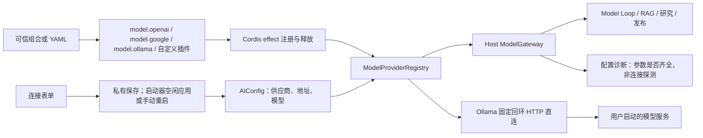
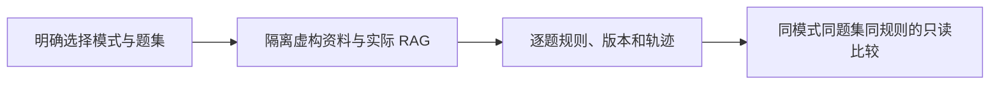

# 模型供应商插件与本机 Ollama

Agent Host 的模型端口由独立 FeaturePlugin 注册。个人知识问答、个人研究、发布准备和 Model Loop 复用同一 ModelGateway；模型供应商本身没有独立目标、会话或 Agent。

## 用户能力与边界

- 默认工作台提供 OpenAI 兼容、Google Gemini、Ollama 三个插件；UI 可保存自己的地址、模型名称和密钥。
- Ollama 仅连接本机 HTTP 回环接口，不需要密钥，不启动服务或下载模型。模型由用户事先准备，需要满足所用任务的工具调用能力。
- 使用 localhost/127.0.0.1/[::1] 并不保证推理离线：用户的 Ollama 可以选择云端模型。应用不验证模型权重位置，也不承诺效果或速度。
- 旧团队业务的独立 LLMAdapter 与诊断脚本保留兼容实现，未迁移此模型端口。此批聚焦 Agent/RAG/研究/发布链路，不声称所有遗留模型入口已插件化。

## 入口与运行流程

## 核心规则

1. Host 注册表初始为空，必须显式装配模型插件；移除或启动失败回滚后无法解析对应提供者。不隐式回退云端服务。业务插件与模型插件分别选择，模型缺失不影响确定性检索和资料收集。
2. ModelProviderDefinition 提供唯一 id、name、isConfigured(AIConfig)、create(AIConfig)。注册最多 30 项，返回身份绑定的 disposer。自定义提供者无需修改 Host；本地原生插件仍是可信代码，不是网络权限沙箱。
3. openai/openai-compatible/deepseek 共用 OpenAI Chat Completions；google/gemini 显式选择 Google。保留旧 OpenAI 别名下根据 Gemini 模型名/官方地址识别的兼容行为。未知供应商只匹配同 ID 的自定义插件，不降级到 OpenAI。
4. 云端提供者要求模型名与密钥；Ollama 要求模型名和有效本机接口。configured 只检查配置，不发网络请求，不证明服务运行、模型存在或推理成功。
5. Ollama 接口只允许 HTTP 的 localhost、127.0.0.1、[::1]；localhost 规范为 127.0.0.1，避免额外 DNS 解析。根路径规范为 /v1，拒绝其他路径、内嵌凭据、查询和片段；仅发 POST /v1/chat/completions。
6. 本机请求通过固定 origin 的 Undici Client 直接建立连接，不受 HTTP_PROXY/HTTPS_PROXY/ALL_PROXY 或云端代理设置影响。仅发送 JSON/Accept/identity 头，不转发保存的云端密钥。拒绝重定向、压缩响应，单次请求和响应各最多 4 MiB；传递取消信号并在 finally 释放连接。
7. 必须使用 undici/index.js 的安装包入口；本项目验证的 Bun 1.3.13 对 bare undici 使用 fetch shim，且 fetch 的 proxy:false 未按预期绕过环境代理。独立子进程回归同时设置大小写代理变量，真实 SDK 请求只到本机目标。
8. 云端代理继续使用显式 fetch 选项，不修改全局代理环境。Ollama 不清除旧云密钥，切换回云端时可保留，但本机传输不会发送该密钥。
9. HTTP 默认为 15 插件/9 Agent，配置 GitHub 后 17/10；团队 SDK 为 12/7。显式配置文件完整覆盖默认组合，空配置保持零模型/业务插件。需生成的公开 YAML 和 CLI 显式装配模型插件；纯采集/检索组合可不安装。
10. 独立 AiSdkModelGateway(getConfig) 保留标准供应商默认值方便 SDK 直接使用；AgentHost 始终显式传自己的空注册表，不能借此隐式恢复已移除的插件。

## 配置与状态

工作台读取 AI_PROVIDER / AI_API_BASE / AI_MODEL / AI_API_KEY。AI_PROVIDER=ollama 且地址为空时默认 http://127.0.0.1:11434/v1。连接表单保存先写入现有私有连接文件；根目录启动器在空闲时自动重载后端并确认新实例，独立启动仍需手动重启；API 仅接受标准别名或当前装配的自定义供应商 ID，Secret 不完整回显。workspace.state.modelProviders 只包含 ID/名称，modelConfigured 按实际 Host 注册表计算。

知识/发布 CLI 继续只读取 KNOWLEDGE_*，不会退回团队 AI_* 凭据。KNOWLEDGE_PROVIDER=ollama 时允许省略 KNOWLEDGE_API_KEY/API_BASE，模型名仍必填；其他提供者仍需显式地址与密钥。

## 失败与数据边界

缺失插件、无效配置、连接失败、超时或返回不兼容格式沿既有模型/Run 错误链路返回，不生成空成功结果。提供者没有独立持久状态；停止或更换组合不会删除运行、知识、配方或连接配置。密钥存在本机私有连接文件中；选中证据是否发往云端取决于用户实际选择的服务和模型。

## 代码地图

- backend/src/platform/models/registry.ts：注册、选择、配置判断、生命周期。
- backend/src/platform/models/gateway.ts、contracts.ts：现有模型端口和标准 SDK 入口。
- backend/src/platform/models/providers/：三个提供者、FeaturePlugin 工厂与 YAML 默认导出。
- backend/src/platform/plugins/contracts.ts、runtime.ts：受作用域管理的 modelProviders.register。
- backend/src/platform/bootstrap/agentHost.ts：空注册表、共享网关与可用性判断。
- backend/src/platform/workspace/knowledge.ts、api.ts、connections.ts：默认组合、公开状态与保存校验。
- backend/src/core/config.ts、knowledge/modelConfiguration.ts、scripts/knowledge.ts、scripts/release.ts：配置默认值与 CLI 组合。
- frontend/src/pages/workspace/ConnectionsPage.tsx、state.ts：本机接口表单、已装配列表与状态语义。

## 验证地图

- backend/test/modelProviders.test.ts：别名、显式 Google、自定义注册、空 Host、释放/回滚、回环校验、真实 SDK 代理绕过、Secret 不转发、大小/取消/重定向/压缩及私有连接保存。
- backend/test/knowledgeAnswer.test.ts：无密钥 Ollama 形状服务的 RAG 与 CLI，引用身份与原文校验仍生效。
- backend/test/personalResearch.test.ts：无密钥 SDK 工具调用、真实子 Run 与持久资料索引。
- backend/test/workspaceComposition.test.ts、workspace.test.ts、featureIndex.test.ts：组合、API 与文档数量契约。
- 既有云端 SDK/RAG/发布/Context7/Model Loop 回归、前后端类型与构建、工作台桌面/窄屏验收。

测试使用真实 AI SDK 与本机可控 HTTP 服务，不证明真实模型质量；本机未安装 Ollama/模型，未实际推理或验证模型硬件适配。

## 变更记录

| 日期 | 变更 | 验证 |
| --- | --- | --- |
| 2026-11-06 | 模型提供者独立插件化，增加 keyless Ollama 固定回环直连与配置界面 | 提供者/知识/研究专项、全量回归、类型与本机浏览器验收；真实推理未测 |

## 固定题集知识问答评测

PluginHostServices.modelProviders 增加当前注册表的 configured/resolve 访问，注册仍通过 Cordis effect。可选 RAG 评测只在当前模型插件已启用且配置完整时解析它；在隔离 Host 包装其 SDK 实现合并取消信号并禁止每题第二次底层生成请求，不另选供应商。CLI 显式 EVAL_* 使用标准提供者；离线 MockLanguageModelV3 不发网络请求、不记录推理 Token。

实现与限制见[评测功能卡](../../evaluations/FEATURE.md)。代码：backend/src/evaluations/、backend/src/scripts/evaluate.ts、frontend/src/pages/workspace/EvaluationsPage.tsx。验证：backend/test/evaluations.test.ts、既有模型/插件/RAG/工作台回归、前端类型/lint/build 与桌面/375px 浏览器验收。固定样例和本机 HTTP 协议服务不代表真实模型质量；无语义裁判、个人资料评测或历史业务环境回放。

2026-11-06 本机模型配置可“保存并应用”，等待新实例确认后才刷新 modelConfigured。未发连接探测或生成请求，不把“已应用”解释为模型已验证。后台忙碌时保留设置并允许稍后应用。验证：workspace.test.ts、localLauncher.test.ts、frontend/src/api.test.mjs 和既有模型回归；生命周期边界见[本地启动功能卡](../../../../scripts/local/FEATURE.md)。
