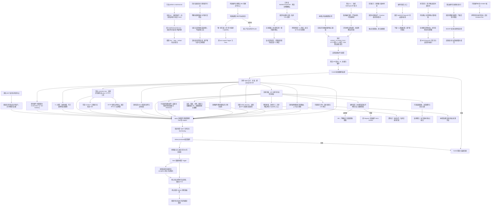
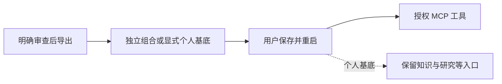
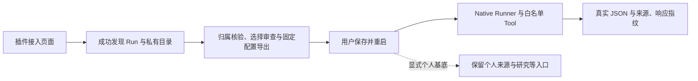
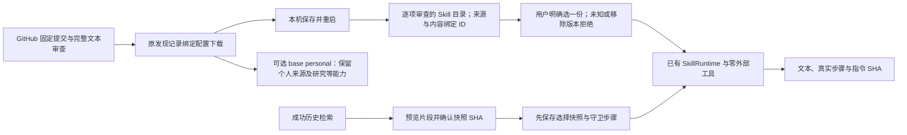
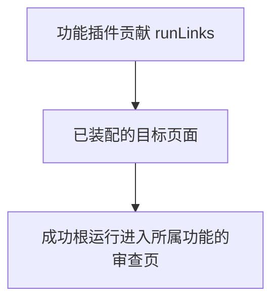
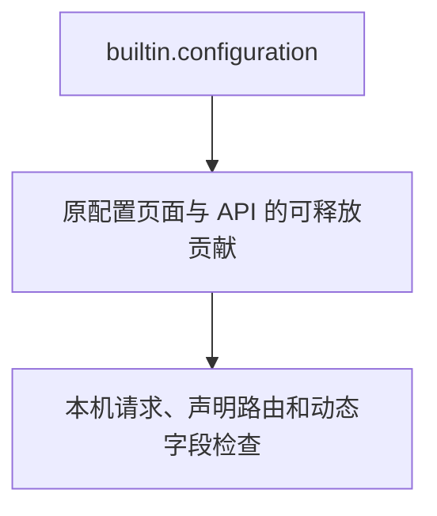

# Cordis 功能插件运行时

使用 DeepSeek Harness 所采用的 Cordis 装配功能插件，校验版本和依赖，并按插件生命周期注册、回滚和释放运行时贡献。

## 功能定位

插件拥有能力定义与装配逻辑；Host 提供受治理的 Agent、Tool、Skill 和持久化执行服务。当前七个内置 Agent 均由独立插件注册，应用默认组合放在 `agents/plugins/builtins.ts`，Host 不导入具体业务 Agent。

当前阶段覆盖 Agent、Tool、Skill、消息路由、群业务调度、运行后续动作和新闻机器人配置装配。默认组合为十五个插件、七个 Agent；会议纪要和外部 AI Hot 调度插件没有独立 Agent，会议纪要保留 dormant 开关，外部 AI Hot 能力仍需单独安装。审计维护也由独立插件贡献；剩余专用外部 Agent 安装入口与宿主直接构造的业务服务仍需收尾，不能把本阶段描述为“整个产品已完全插件化”。

## 实现流程图

## 能力边界

### 目标

- 同一标准支持内置和受信任的第三方 TypeScript 功能插件。
- 空插件列表不隐式注册业务 Agent、Tool、Skill 或消息路由。
- 插件启动、配置恢复失败及停止时清理注册和自有资源。

### 非目标

- 原生插件属于宿主代码，本接口不提供 JavaScript 沙箱。
- 本阶段不自动下载或执行远程仓库，也未承诺 DeepSeek Harness 插件的服务接口兼容。
- 剩余专用外部 Agent 安装入口与业务服务的依赖收尾见路线图后续节点。

## HTTP 工作台组合

团队 SDK 默认仍为十五个插件、七个 Agent；HTTP 通过 workspace/composition.ts 默认只加载个人来源、回答、复核、知识界面、网页收集、文档导入、资料库、结果验收、MCP 接入助手、个人研究及任务配方，共十六个插件、九个 Agent。GitHub 配置后增加连接和发布插件，为 18 个插件、10 个 Agent。原团队组合用 profiles/agents/team.yaml 显式选择，未声明 base: personal 的显式文件完全覆盖默认，不隐式叠加个人能力；历史数据保留。页面从真实已装配贡献显示，团队分区仅在可见团队页面或手动任务存在时出现；默认没有团队业务 API/手动任务。来源设置仍在默认个人组合中保存并重启生效。

## 核心规则

1. `manifest.apiVersion` 必须为 `1.0`；ID 唯一，版本采用 SemVer 形式，名称与说明不能为空。配置可使用 Cordis Standard Schema 接口，如 Zod。
2. `requires` 声明插件依赖；缺失、重复或循环在调用任何 `apply` 前拒绝。Cordis 注入对应的就绪服务。
3. Agent ID、安装 ID、Capability、默认 Binding ID 和领域行为在迁移中保留；团队 SDK 默认组合继续提供七个 Agent。
4. `ctx.delivery.tools`、`nativeAgents`、`modelAgents`、`skills`、`modelProviders`、`messageRoutes`、`schedules` 和 `runActions` 的注册返回 disposer，并自动归属当前插件的 Cordis effect。连接、定时器等自有资源显式使用 `ctx.effect`。
5. 插件声明的 Skill 包必须存在。路径限定为 Skill 根目录的直接子包名，指令引用继续执行原有目录边界校验。
6. `delivery/restored` 在外部 Agent 和持久化 Bot 配置恢复后触发。新闻机器人配置由新闻插件维护，Host 不包含新闻业务规则。
7. 移除插件后，它的 Agent/Tool/Skill/消息路由/群业务调度不装配；历史引用、免 @ 回复和帮助也不会恢复该功能。引用缺失安装的持久化 Binding 保留在数据库、暂不投影。缺少可用入口 Capability 的 Bot 在本次内存投影中停用，不删除用户配置。
8. `AgentHost.stop` 拒绝新的消息和调度请求，等待在途动作状态读取、确定性消息、调度轮次、Agent 执行和投递，再释放插件；停止后的 Host、消息和调度注册表不能重新启动，应创建新实例。运行、Artifact、Session 与用户绑定数据保留。
9. `messageRoutes` 可声明静态贡献或通过受作用域管理的注册函数按配置添加。上下文阶段只选择首个匹配者，普通消息按唯一优先级执行；业务判断留在插件与 Handler，Router 不导入内置功能。
10. `orchestrator` 与 `toolGateway.execute` 供受信任 Native 插件组合模型和 Tool；调用者必须传同一 Run 的身份、Manifest 工具列表、预算和取消信号。它们不是原生恶意代码的权限沙箱。知识回答插件实际使用这条链路并在发布前验收引用。

插件 Adapter 在父信号中止后返回成功不能绕过 Runtime：预中止不调用处理者，执行中止停止等待并记录 PARENT_ABORTED；自身超时继续为 TIMEOUT。Run/Step 失败、迟到返回不交付成功产物，原生代码及已经发出的副作用不能据此认为已终止或回滚。验证：backend/test/agentDelegation.test.ts、agentRuntime.test.ts。

## 运行后续动作

插件通过 ctx.delivery.runActions.register 声明唯一动作 ID、标签、Capability、appliesTo、固定目标输入函数和只读 readState。仅匹配成功 Run；Host 校验本地 Scope 与可派发能力后通过既有 Runtime 执行。状态与结果使用 StatusPanel 1.0 文本协议，不加载远程 UI 代码。注册随 Cordis effect 回滚和释放；Host 停止先等待在途状态读取。knowledge.impact 注册 knowledge.review，是实际使用者；详见作者规范。

## 本地 MCP 插件

connector.mcp 1.1.0 通过现有 FeaturePlugin/Config/effect 接入，无需修改 Host 或默认组合。它启动已审查的本地服务或连接固定公开 HTTPS，发现工具后只注册显式选中项，失败回滚并关闭连接。HTTP 每次校验全量 DNS、固定 IP 并保留 Host/TLS，拒绝重定向，凭据只用可选 Bearer 引用；JSON/SSE 受流预算和超时约束。工具名称与读取授权由安装者声明，不采用上游注解作为权限证明；当前不支持写工具、OAuth 或私网 HTTP。停止先等待 Run，再尝试终止远端会话并关闭本地流。旧 stdio 配置保持兼容；完整规范、官方 Context7 HTTP 例子和测试边界见 [MCP 使用说明](../../../../docs/MCP_TOOLS.md)。

本机配置副本统一使用 .local.yaml，Git 忽略规则覆盖 profiles、examples 和自定义目录，公开 .yaml 示例继续跟踪。backend/test/featureIndex.test.ts 在独立临时 Git 仓库验证该边界，不依赖运行目录已有 .git；配置中的 Secret 仍只使用引用。

## Web 贡献

ctx.delivery.web.register 注册唯一贡献 ID、页面元数据、API 前缀/路由/Fetch handler 和可手动执行的原有任务名称。注册随 Cordis 回滚与释放。页面路径、任务名和 API 前缀不能重复或覆盖保留入口；前端只支持已打包视图或跳到指定 Agent 的入口，不执行远端 UI 包。

站会、项目看板和人力甘特图已把页面与 API 从全局组合移入各自所有者；builtin.dashboard 使用两个 Web 贡献分别声明文件与甘特命名空间，卸载时一起释放。旧根查询与 HTML 链接也不能绕过插件检查。任务、日报、看板插件各自声明原有手动任务；缺少所有者时旧 /api/jobs 不执行，显式团队组合仍为九个原有任务，默认个人组合没有这些任务。MCP 读取示例通过元数据增加页面入口，不修改前端业务表。周报与隐藏纪要页/API 同样归属插件；navigation=false 仅隐藏菜单，不绕过安装检查。知识工作台页面与只读来源描述已归属 knowledge.workspace；核心通用输入/结果中的部分知识适配、飞书连接、全局维护和基础服务生命周期仍需继续解耦，当前不宣称全产品已经插件化。

## 资料收集插件

knowledge.capture 复用受限公开网页读取，community.markitdown 通过私有上传 ID 和固定 Python 流式转换接入真实开源项目。两者独立贡献 Agent、Tool 与页面，使用既有 JSON/Markdown Artifact；文档原始暂存有容量/过期/Scope/指纹边界。已打包页面可选声明 view.capability，Agent 卡片与首页选择按元数据进入表单，不为每种输入在核心解析器加分支。验证覆盖真实格式、取消、预算、生命周期与页面入口。

## 发布工作流装配

发布插件拥有 /release 页面贡献，不在核心路由直接开放；移除插件释放入口。HTTP 默认组合仅在明确配置仓库后添加 connector.github 和匹配当前知识来源的 release.prepare；SDK 默认与显式插件文件语义不变。发布结果使用既有 StatusPanel 1.0 和 Markdown 展示，未增加业务专用前端执行器或平台协议。验证见工作台与发布专项。

## 社区 Skill 与 Context7 验证

标准 SKILL.md 可经 readAgentSkill 显式导入现有 Prompt Skill Runtime；元数据不能自动取得工具或 Agent 授权，不执行目录脚本。community.context7 是真实使用者：接入上游 MCP 两个读取工具，提供无模型查询和需模型的研究助手；页面按插件贡献，未知能力标签使用作者声明的 Agent 名称。默认组合不自动安装它。来源、许可、运行命令和验收边界见 [社区接入说明](../../../../docs/COMMUNITY_PLUGINS.md)。

验证：backend/test/context7Plugin.test.ts 覆盖格式/边界、权限不继承、受控 Prompt Skill 执行及插件装配；本地实际 MCP 与工作台验收覆盖公开文档检索。真实付费模型未调用。

knowledge.library 独立拥有资料库 Agent、两个 Tool、页面/API 与 knowledge.collect 动作；无必需采集插件依赖，可以收录历史成功结果。停止释放贡献但保留私有 Markdown。默认个人组合添加此插件，未声明 base: personal 的明确文件组合仍完全覆盖。验证涵盖真实采集、MarkItDown、存储边界、恢复和已有 RAG 管线。

FeaturePlugin.checks 新增静态结果规则，由 Host 的 RunCheckRegistry 校验归属、Schema 与预算，再随 Cordis effect 注册/回滚/释放。提供者不依赖验收界面；quality.checks 可单独移除，历史报告保留。规则只检查保存的状态、产物和步骤，不执行规则脚本。首批为网页收集和 MarkItDown；作者规范与 backend/test/pluginChecks.test.ts 覆盖实际用法。

## MCP 接入与通用运行

HTTP 默认加入独立 mcp.setup 接入助手，公开 HTTPS 匿名发现、审查勾选与 local.yaml 导出；不调用目录内工具或读取 Secret。保存并重启明确组合后，mcp.runner 按可信 allowedTools 转调已注册读取工具，实时 Schema 校验、同一 Scope/信号与共享两次 Tool 预算，记录 Agent/路由/上游三步。ctx.delivery.tools.list 只返回契约副本，ToolExecutionContext.budget 沿用既有预算，不给旧调用新增额度。移除插件释放页面/API/Agent/Tool，历史保留；无在线安装或 OS 沙箱。实现与测试见 [接入功能卡](../../connectors/mcp-workbench/FEATURE.md)。

mcp.setup / openapi.setup 1.1.0 的配置导出接受可选 includePersonalWorkspace 布尔值。页面默认勾选保留个人工作台，切换选择会清除已生成配置，需重新生成；缺省或 false 的旧 API 请求仍导出原独立组合。true 声明 base: personal，按重启时本机设置保留知识、研究、资料库、配方与模型提供者。MCP 只追加 connector.mcp / mcp.runner（基底已有 mcp.setup），标准基底下十六插件十 Agent；OpenAPI 追加 connector.openapi / openapi.setup，为十六插件十一 Agent。文件仍保存于 backend/examples，个人文件名含 .personal.local.yaml。不会合并其他自定义附加插件或团队组合；重复 ID 拒绝，授权/输入/预算/历史语义保持，不为研究 Agent 自动授予新工具。

验证补充：backend/test/mcpWorkbench.test.ts 与 openApiConnector.test.ts 将实际导出 YAML 经 loadWorkspacePlugins 装配，同 Host 成功运行知识检索和授权工具，检查入口、数量、MCP setup 唯一、历史保留与旧参数兼容。代码：mcp-workbench/catalog.ts / plugin.ts、openapi/setup.ts、McpSetupPage.tsx、OpenApiSetupPage.tsx、frontend/src/api.ts。

## 个人研究与复合产物规范

personal.research 是独立 Model Loop 插件，markdown/web 工厂同时固定依赖与委派来源；没有模型时仍保留原文检索入口。modelAgents.register 可声明请求/完成守卫及 artifactMetadata，复用 Adapter 的会话、预算和持久化，不新建执行框架；完成守卫返回额外 ArtifactInput[]，不由模型伪造索引。回调为可信宿主代码，定义本身不纳入 Manifest 哈希，行为修改须更新版本与测试。

checks 的产物断言增加可选 selector（完整 Artifact 上的标准 JSON Schema）。先按 type/selector 匹配，恰好一份再校验 schema；省略时保持旧语义，注册时编译两份 Schema。选择不会丢弃子资料或把等待问题当最终稿；缺少、重复或坏 Schema 明确失败。验证：backend/test/personalResearch.test.ts、pluginChecks.test.ts。

## 用户能力

开发者可以组合插件、声明和验证配置，接入自定义 Agent 与 Tool，并清理插件拥有的资源。应用启动默认使用 `createDeliveryOpsHost`；直接构造 `AgentHost` 默认无业务插件。

## 入口与触发

| 入口 | 输入 | 输出 |
| --- | --- | --- |
| PluginRuntime | 插件列表、宿主服务与按插件 ID 的配置 | 完成装配或明确失败 |
| FeaturePlugin.apply | Cordis Context 与验证后的配置 | Agent/Tool/Skill/消息等贡献 |
| delivery/restored | 持久化控制面恢复完成 | 插件拥有的配置协调 |
| AgentHost.stop | 宿主停止请求 | 在途执行收敛、资源释放 |

## 运行逻辑

1. 应用组合层选择插件，创建 Host。
2. Host 恢复遗留运行状态，建立共享执行服务。
3. PluginRuntime 先验证全部插件，再由 Cordis 依赖装配并管理贡献。
4. 控制面恢复持久化安装与绑定，再串行触发插件配置恢复事件。
5. 就绪后，Agent 继续通过原 Runtime、Tool Gateway、Session 与 Outbox 执行。
6. 失败时回滚内存贡献；停止时先完成在途运行，再释放资源。

## Agent、Tool 与服务边界

| 对象 | 职责 | 禁止承担 |
| --- | --- | --- |
| PluginRuntime | 协议校验、依赖装配、贡献生命周期 | 任务、站会或新闻业务规则 |
| FeaturePlugin | 声明能力并注册实现 | 绕过 Tool Gateway 扩大模型权限 |
| Domain Service | 业务事实与状态一致性 | 插件安装与资源生命周期 |
| 持久化 Catalog | 保存用户安装、绑定和机器人配置 | 删除暂未装配插件的历史事实 |

## 数据与状态

插件清理只删除内存定义、安装、绑定、Skill、消息路由、群调度和 Adapter 注册。持久化运行与业务记录继续归原 Store 所有。本地原生插件使用受信任代码模型；外部 HTTP Agent 仍受已有 Secret、网络与输出约束。

## 失败、安全与降级

- 错误的 API 版本、配置、依赖和 Skill 包使启动失败，不进入就绪状态。
- 资源必须通过 effect 或受作用域管理的注册入口获得，防止泄漏连接或定时器。
- 新插件使用 FeaturePlugin；旧 AgentHostExtension 暂时保留兼容，其原始注册 API 不具备新插件的 effect 管理保证。
- 全产品插件禁用仍需后续迁移全局维护、API 和页面；当前空插件列表约束运行时注册与消息路由，不关闭这些其他入口；群业务计划和站会到期轮询已经随插件选择。
- 私聊成员识别按组合保留：有要求项目成员的私聊路由时仍先校验身份；纯个人插件组合可以不依赖项目成员。这不构成逐路由访问控制。

## 代码地图

### 主要实现

- `backend/src/platform/plugins/web.ts`：页面、声明路由和原有手动任务的注册、冲突检查与清理。
- `backend/src/platform/workspace/api.ts`、`jobsApi.ts`：请求体保留、OpenAPI 路由与 Host 授权/在途跟踪。

- `backend/src/connectors/mcp/plugin.ts`、`backend/examples/plugins/mcp-reader.ts`：可选外部 MCP 工具与示例 Agent。

- `backend/src/platform/plugins/runActions.ts`：动作注册、校验、匹配与文本面板协议。
- `backend/src/knowledge/impact/plugin.ts`、`presentation.ts`：知识复核动作与报告呈现。

- `backend/src/platform/scheduling/registry.ts`、`calendar.ts`：群调度协议、唯一优先级、通用日历与在途跟踪。
- `backend/src/knowledge/answer/plugin.ts`：复用宿主模型与受治理 Tool 的实际插件示例。
- `backend/src/core/scheduler.ts`：执行插件贡献，统一重试、幂等和记录；保留全局维护。
- `backend/src/agents/plugins/aiHotSchedule.ts`：独立的外部 AI Hot 调度贡献。

- `backend/src/platform/plugins/configuration.ts`、`backend/profiles/agents/`：可信配置加载与 Agent 组合示例。

- `backend/src/platform/plugins/contracts.ts`、`runtime.ts`：插件协议、依赖检查与 Cordis 生命周期。
- `backend/src/agents/plugins/`：七个业务 Agent 插件、无 Agent 的会议纪要插件及默认组合。
- `backend/src/services/messageHandler/routes.ts`：消息贡献协议、唯一优先级和在途消息等待。
- `backend/src/agents/host.ts`：保持原应用能力的组合工厂。
- `backend/src/platform/bootstrap/agentHost.ts`：通用 Host 与在途执行收敛。
- `backend/src/platform/agents/registry.ts`、`nativeAdapter.ts`、`modelLoopAdapter.ts`：可释放的 Agent 注册。
- `backend/src/platform/tools/registry.ts`、`backend/src/platform/skills/registry.ts`、`packageLoader.ts`：Tool/Skill 贡献与包清理。
- `backend/src/platform/bots/catalog.ts`：暂不投影缺失插件安装的持久化绑定。

### 主要测试

- `backend/test/workspaceComposition.test.ts`、`frontend/src/pages/workspace/pages.test.mjs`：默认个人、显式团队/空组合、动态导航与历史保留。

- `backend/test/pluginWeb.test.ts`、`backend/test/standupApi.test.ts`：第三方贡献、移除后拒绝、回滚、Scope 与停止等待。

- `backend/test/mcpConnector.test.ts`：可信配置组合、真实子进程、装配失败回滚、在途停止和 Secret 隔离。

- `backend/test/runActions.test.ts`、`backend/test/workspaceActions.test.ts`：第三方动作、校验、Scope、幂等与在途清理。

- `backend/test/knowledgeAnswer.test.ts`：原生插件模型/Tool 组合、依赖、步骤记录、引用拒绝与本地 HTTP 模型集成。
- `backend/test/schedulePlugins.test.ts`：群调度贡献、空组合、插件禁用、错误隔离与在途停止。

- `backend/test/pluginConfiguration.test.ts`：配置 Schema、依赖顺序、真实模板、禁用模块不导入与远程 URL 拒绝。

- `backend/test/pluginRuntime.test.ts`：依赖、版本、配置、Skill、失败回滚、恢复事件与资源释放。
- `backend/test/agentHost.test.ts`：默认兼容、空插件、第三方执行、在途停止、绑定保留与新闻 Bot。
- `backend/test/messagePlugins.test.ts`：关闭功能后的历史上下文与帮助、第三方私聊、确定性消息在途停止。
- `backend/test/agentControlPlane.test.ts`：持久化控制面兼容。
- 现有 Agent、Tool、Skill、调度和业务测试：迁移行为回归。

本批验证：`backend/test/projectVisibilityApi.test.ts` 覆盖插件关闭后的读写拒绝、文件边界、计划校验和审计；`frontend/src/pages/workspace/pages.test.mjs` 覆盖旧看板链接的所有权。配合后端全量回归、前端门禁和桌面/移动端浏览器验收。

## 变更记录

| 日期 | 变更 | 验证 |
| --- | --- | --- |
| 2026-11-05 | 增加 Web 贡献协议；迁移站会页面/API 与原有业务手动任务授权 | 插件 Web/站会 API 专项、后端回归、前端检查及默认/空配置/MCP 浏览器验收 |
| 2026-11-05 | 新增独立 MCP 连接插件与配置样例，不改变默认团队和工作台组合 | MCP/Schema 专项、后端全量回归与官方文件服务实际读取/越界拒绝 |
| 2026-11-05 | 新增随插件生命周期释放的运行后续动作，通用文本面板与知识引用检查实例 | 插件动作/API 专项、后端回归、前端检查与桌面/375px 浏览器验收 |
| 2026-11-05 | 区分团队 SDK 与 HTTP 个人知识默认组合 | 工作台专项、后端回归、前端检查与本地浏览器验收 |
| 2026-11-05 | 向原生插件提供宿主 Orchestrator 和 Tool Gateway；独立 RAG 插件验证同 Run 检索、生成与验收 | RAG/插件专项、类型与后端全量回归；默认业务不变 |
| 2026-11-05 | 群业务调度改为可释放插件贡献，新增外部 AI Hot 调度插件；空组合不隐式执行群任务；停机等待本轮结束 | 调度/日历/插件回归、后端 428 通过 / 1 TAPD 跳过、类型检查 |
| 2026-11-05 | 将确定性消息、引用上下文、免 @ 回复和帮助归属功能插件；默认新增无 Agent 的会议纪要插件；停机等待在途消息 | 消息插件与现有路由回归、后端 422 通过 / 1 TAPD 跳过、类型检查 |
| 2026-11-05 | 增加可信 YAML Agent 插件选择与本地/已安装包加载；未启用模块不导入，消息 AI/新闻分流检查实际 Capability | 配置加载、插件/Host 测试与后端全量回归 |
| 2026-11-05 | 引入 Cordis 4.1.0 与版本化插件协议，拆出七个 Agent 插件，提供贡献回滚、释放和在途停止 | 插件与 Host 测试、后端类型及全量回归 |

## 任务配方与本机执行服务

personal.recipes 独立拥有任务配方页面/API 与私有 KV，默认个人组合增加一个插件但不增加 Agent。保存时先核对成功根 Run 的 Scope、单次 execution 1.0、原参数指纹及当前安装/Manifest；多轮人工补充或旧凭证不补造。使用前审查本次参数，经可选 PluginHostServices.runLocal 进入固定默认 workspace/bot、manual Trigger 和 none 回复策略，继续受实际 Agent Schema、Scope、预算和运行记录约束。该服务在 Host 未就绪/停止时拒绝，不可在 apply 阶段等待调用；原生插件仍是可信宿主代码。

运行参数可修改，原配方不覆盖；请求 UUID 持久绑定配方/参数/契约。Runtime 在真正解析根执行后核对可信 expectedExecution 的安装及 Manifest 指纹，拒绝预检查后契约变化，不接受客户端 input 扩权。子委派及人工继续保持既有协议；指纹不冻结模型、知识、Tool 实现或全部环境。旧调用不带该上下文，语义保持。

前端仅在装配配方时于页面内存保留有界候选输入，刷新/移除清空；明确保存才写本机完整参数。来源回执在插件 KV，避免向其他 Agent 注入越出 Manifest 的 Artifact；写回执失败返回真实 Run ID 与警告。RunDrawer 展示配方来源和参数变化，可回到原始结果；移除插件关闭入口但保留记录。

实现/规则见 [任务配方功能卡](../../recipes/FEATURE.md)，验证：backend/test/runRecipes.test.ts、frontend/src/runInputs.test.mjs、既有 Runtime/插件回归和桌面/375px 浏览器验收；本批不验证真实模型质量。

## 模型提供者贡献

ctx.delivery.modelProviders.register 接受唯一 id/name/isConfigured/create，返回随 Cordis effect 回滚与释放的 disposer。modelProviderPlugin 是三种标准供应商与第三方的同一工厂，提供者不新增 Agent。空 Host/显式空配置无模型；业务插件不隐式安装模型。 完整协议、实现与验证边界见[模型提供者功能卡](../models/FEATURE.md)。验证：backend/test/modelProviders.test.ts、knowledgeAnswer.test.ts、personalResearch.test.ts 及既有回归。

## 笔记与网页混合来源

knowledge.mixed 明确依赖两个现有来源；不自动合并同时安装的来源。answer/impact/workspace/research/release 通过既有工厂选择混合端口及调用成本，不修改 Host 执行协议；停止/缺依赖沿原 Cordis 生命周期处理。 实现、配置与验证边界见[混合知识功能卡](../../knowledge/mixed/FEATURE.md)；验证：backend/test/knowledgeMixed.test.ts 及既有功能回归。

## 显式 OpenAPI 接入与运行

openapi.setup 与 connector.openapi 通过既有 Cordis 注册独立 Agent、Tool、页面/API，不改变默认十四插件九 Agent。发现不调用接口；导出先核对成功根 Run 的默认 workspace/bot 和带角色目录，仅接受该次可用接口及服务器选择，固定输入契约后重启生效。运行沿用 Scope、共享两次预算、取消与 Run/Step/Artifact；卸载释放入口而保留历史。workspace/request.ts 提供 MCP/OpenAPI 共用的 16 KiB/5 秒取消感知正文读取，原 MCP 导出语义保持。

边界与代码地图见[OpenAPI 功能卡](../../connectors/openapi/FEATURE.md)。验证：backend/test/openApiConnector.test.ts、mcpWorkbench.test.ts、knowledgeWeb.test.ts；前端类型/lint/build 与桌面/375px 验收。不提供认证、私网、写入或完整输出 Schema 验证。

## 显式审查后的新笔记回写

knowledge.writeback 贡献独立 manual Native Agent、提案/新建 Tool、页面/API；默认装配数量不变。先按原运行归属提取实际引用并核验版本，生成不落笔记文件的固定提案；人工审查后通过另一普通 Run 绑定内容 SHA 确认，重验来源与目录身份，再 0600 暂存、排他发布新文件并读回验证。draft/approved/saved 与回执由插件私有 KV 拥有；已确认文件可恢复缺失回执，重复确认不重复写入，已有笔记和原 Artifact 保留。

实现、边界与代码地图见[知识回写功能卡](../../knowledge/writeback/FEATURE.md)。验证：backend/test/knowledgeWriteback.test.ts、既有知识/Runtime 回归、前端类型/lint/build 与桌面/375px 本地验收。仅新建，不支持已有笔记替换或自动批准；真实模型效果未验证。

## 固定题集知识问答评测

quality.evaluation 通过既有贡献注册 manual Native、Tool 与 /evaluations 页面/API。独立示例配置显式选择，默认数量保持；移除插件释放所有入口。插件 modelProviders 端口增加 configured/resolve，仍使用当前 Host 注册表，注册的 Cordis disposer 保持，禁用提供者不能被评测隐式恢复。

实现与限制见[评测功能卡](../../evaluations/FEATURE.md)。代码：backend/src/evaluations/、backend/src/scripts/evaluate.ts、frontend/src/pages/workspace/EvaluationsPage.tsx。验证：backend/test/evaluations.test.ts、既有模型/插件/RAG/工作台回归、前端类型/lint/build 与桌面/375px 浏览器验收。固定样例和本机 HTTP 协议服务不代表真实模型质量；无语义裁判、个人资料评测或历史业务环境回放。

## GitHub Skill 审查与文本运行

skills.setup 和 skills.prompt 分别贡献发现/导出与运行入口，均显式装配，默认数量保持。skills.execute 委托宿主现有 Runtime，register 仍由 Cordis effect 释放；共用文本解析器导入固定 Skill，外部 allowed-tools 不授予权限。无热安装或任意仓库代码执行。

多份 Skill 在 skills.prompt 1.2.0 内共用一个 Native Runner，最多八份、内容配置 JSON 512 KiB；每份原成功发现记录及双确认在导出时复验，同名/不同来源或版本不覆盖。目录 ID 按固定来源与原文指纹生成，顺序变化不影响选择；模型只收到所选指令，未知/移除 ID 在调用前拒绝。旧单份配置和省略 ID 的单项运行保持，多份不能省略。结果保留实际 ID/来源/步骤；目录 GET 不调用模型，停用释放全部注册。代码与验证补充 catalog.ts、service.ts、promptPlugin.ts、SkillSetupPage.tsx、SkillRunnerPage.tsx、backend/test/skillWorkbench.test.ts。

显式配置只有声明 base: personal 才继承当前本机个人预设；未声明的旧文件仍完整替换。基底在重启时按本机来源与 GitHub 设置生成，不是冻结环境；追加插件重复 ID 拒绝，不覆盖基底，不递归继承其他文件或合并团队/自定义组合。 Skill 导出勾选保留个人工作台时生成 plugins.skills-personal.local.yaml，只追加 setup/prompt；默认个人基底加 Skill 为十六插件十一 Agent。sourceSettingsManagedByPluginFile 区分来源所有权，base personal 的来源仍可在页面保存并重启。

skills.prompt 1.2.0 可在手动任务中绑定已预览并确认的成功知识检索根运行。先验 workspace/bot/根运行/Capability/成功状态，再读取唯一私有 JSON，复用 retrievalEvidence / selectEvidence 的十条、12000 字符预算；请求仅含原 Run ID、快照 SHA 和 confirmed=true，不接受客户端片段。模型只收到历史标记、partial 与片段 ID/标题/小标题/原文，不额外提供路径、URI 或版本字段；文字自身可能含这些信息。模型调用前保存私有 skill.knowledge.context Artifact 和 guardrail Step，失败/取消也保留“选入”记录，不能视作接收/采用/引文核验或当前来源证明。成功文本与来源产物关联源 Run/Artifact、快照 SHA 和选择产物；纯文本旧任务保持两个产物。

代码/验证补充：connectors/skill-workbench/knowledgeContext.ts、platform/plugins/configuration.ts、workspace/composition.ts / api.ts；backend/test/skillKnowledgeContext.test.ts、pluginConfiguration.test.ts、workspaceComposition.test.ts。

实现与限制见[Skill 工作台功能卡](../../connectors/skill-workbench/FEATURE.md)。代码：backend/src/connectors/skill-workbench/、platform/skills/packageLoader.ts、runtime.ts；前端 SkillSetupPage.tsx / SkillRunnerPage.tsx。验证：backend/test/skillWorkbench.test.ts、toolSkillRuntime.test.ts、context7Plugin.test.ts 与既有 Host/Plugin/模型回归，前端检查及桌面/375px 验收。仅支持指令文本，无脚本/引用资源自动执行或完整上游能力兼容；模型协议样例不证明真实质量。

## 本机长任务控制边界

启动回执在 Adapter 运行前持久绑定 UUID、输入 SHA 与 Run；后台执行纳入 Host 在途跟踪，关闭持续排空集合后才释放插件。新的异步入口最多四个活跃本机手动根任务，既有同步 SDK/API 保持完成契约。停止仅允许同默认 Scope 且明确 manual 来源的根运行，子任务随父控制；RUN_CANCELLED 形成 cancelled Run/Step，不按成功投递，原产物和暂停快照保留。完成提交与停止按单运行锁排序；旧记录不推断控制权限。忽略信号的原生代码不能强杀，已完成的副作用不回滚。一般父中止 PARENT_ABORTED、自身 TIMEOUT 语义不变。

完整流程与代码地图见[工作台功能卡](../workspace/FEATURE.md)。验证：backend/test/runControl.test.ts、localRunApi.test.ts、既有 Agent/委派/Trigger/Host 回归；frontend/src/api.test.mjs。未新增业务插件或 Agent。

## 插件组合配置（2026-11-06）

默认个人组合新增可独立移除的 plugins.compose 控制面插件，当前十五插件、九 Agent；GitHub 配置后十七插件、十 Agent。插件页按实际页面贡献展示入口，页面不增加侧栏项目。只转换已审查的 Skill、匿名 HTTPS MCP 和固定 GET OpenAPI 导出文件，各一份；输出 base personal 与 backend 根目录相对模块路径。原 Skill 形态/ID、内容/许可及工具授权保留，不读取当前自定义配置、不导入输入指定模块、不联网、不持久化或创建 Run。下载后由用户保存并重启；历史运行数据保留。组合校验不替代来源/许可/用途审查。

共享 JSON 读取器仅新增宿主指定的字节上限：默认仍 16 KiB，组合入口为 3 MiB 请求、1 MiB YAML 内容，保留五秒、取消和流清理。功能流程、代码与边界见[组合功能卡](../../connectors/profile-workbench/FEATURE.md)。实现：backend/src/connectors/profile-workbench/compose.ts、plugin.ts，frontend/src/pages/workspace/ProfileComposerPage.tsx / CatalogPage.tsx / PluginPage.tsx，platform/workspace/knowledge.ts / request.ts；验证：backend/test/profileComposer.test.ts、workspaceComposition.test.ts、featureIndex.test.ts，既有 Skill/MCP/OpenAPI 回归及前端门禁。

## 研究任务固定请求协作（2026-11-06）

personal.research 1.1.0 可按本次人工确认的固定参数委派已装配 MCP HTTP/OpenAPI GET；空选择保持原研究能力，不暴露这两项可选委派。先留私有确认记录再联系模型，实际完成仍由成功子 Run/Artifact 证明；确认记录不是资料证据，原结果规则按 artifactRole 继续只检查研究稿与资料索引。新可选 delegationSchema 回调只能过滤/约束 Manifest 已声明能力，Schema 与原契约组合，并在执行前独立校验，拒绝留下 guardrail、不调用子任务。默认未提供回调的模型插件行为保持。

ToolDefinition 可带连接器生成的 binding（公开地址与配置/契约 SHA，无 Secret 值）；MCP/OpenAPI 路由输入 Schema 明确枚举本地授权工具，原调用前白名单与共享预算保留。研究目录绑定 Tool、路由授权、Agent Manifest 和安装 ID；继续读取原确认，拒绝端点/契约变化与新授权。没有增加 Agent 或默认插件数量。

实现与边界见[研究功能卡](../../agents/personal-research/FEATURE.md)。代码：agents/personal-research/externalRequests.ts、plugin.ts，platform/agents/modelLoopAdapter.ts、platform/tools/contracts.ts，connectors/mcp/plugin.ts、mcp-workbench/runner.ts、openapi/plugin.ts；前端 ResearchRequests.tsx / ResearchPage.tsx、api.ts、index.css。测试：backend/test/researchRequests.test.ts、modelLoopAgent.test.ts、personalResearch.test.ts，原 MCP/OpenAPI、结果验收、Host/生命周期/取消回归，以及前端检查和本地界面验证。

## 默认界面启用接入助手（2026-11-06）

plugins.compose 1.1.0 提供独立 POST /api/plugin-profiles/setup：严格接受 skills/openapi 非空唯一选择，只输出已打包的固定模块与个人基底，不接受路径/凭据/自定义配置。16 KiB、五秒、本机 Host/Origin 和 Cordis 卸载边界沿用现有平台。默认十六插件九 Agent 不变；同时选择两助手后在标准示例预设为十七插件十一 Agent，只有发现能力，尚不启用实际 Skill/API Runner。下载后用户保存并重启；既有能力组合接口、三份/1 MiB 文件限制与历史保留不变。

插件页进入“接入与组合”，两种流程使用有活动状态的页签；切换页签或输入会清除旧预览，处理中禁止改变，助手已启用标签来自真实页面贡献。当前自定义附加插件不自动合并，助手文件仅供首次启用，不作为审查能力文件上传。完整流程见[接入与组合功能卡](../../connectors/profile-workbench/FEATURE.md)。代码：connectors/profile-workbench/compose.ts、plugin.ts，frontend/src/pages/workspace/ProfileComposerPage.tsx / CatalogPage.tsx、frontend/src/api.ts；验证：backend/test/profileComposer.test.ts（固定配置边界、真实加载、原检索历史与未审查运行器拒绝）、原导出/组合回归、前端门禁及浏览器接入。

## 可选知识定期复核（2026-11-06）

knowledge.watch 依赖 knowledge.impact，在 Cordis effect 中拥有三十秒计时器；每范围一份、最多二十个明确目标，先 CAS 预订下一周期再调用固定 Native 复核。复用正式本机 schedule 通道和 expectedExecution，独立凭证关联计划来源；没有新增 Agent 或默认插件。卸载清除计时器并等待当前检查，暂停/替换的 revision 防止迟到覆盖。知识复核页按实际插件装配显示控件，GET 只读缓存，详情可读取同范围来源凭证；本机 Host/Origin、16 KiB/五秒边界保持。完整流程与风险见[定期复核功能卡](../../knowledge/watch/FEATURE.md)。代码：knowledge/watch/service.ts、plugin.ts；frontend/src/pages/workspace/KnowledgeWatchControls.tsx、KnowledgeReviewsPage.tsx、RunDrawer.tsx 和 frontend/src/api.ts。验证：backend/test/knowledgeWatch.test.ts、原知识复核/生命周期回归、前端门禁和实际本机计时器验收。

## 正式本机 schedule 入口（2026-11-06）

AgentHost.runScheduledLocal 与可选 PluginHostServices.runScheduledLocal 创建固定 workspace-default/bot-default、无 chat/conversation、replyPolicy none 的 schedule 触发，复用原 Trigger/Agent Runtime。插件端口在 Host 完成 initialize 且未停止时可用；Manifest 未声明 schedule 会在 Adapter 前拒绝，expectedExecution 仍校验实际版本，幂等键按触发类型区分。既有 runLocal 和工作台 HTTP 入口仍为 manual，HTTP 不能通过正文选择 schedule。Host 继续跟踪并收尾执行；本机手动停止入口仍只管理 manual 根任务，自动计划通过暂停控制后续检查。

knowledge.watch 1.1.0 调用该端口；knowledge.impact 插件 1.2.0 / Native Agent 1.1.0 声明 schedule。仅来源 versions 的独立 Scope helper 允许该无群聊类型，检索/生成/写入等原限制保持。绑定变化自动暂停，旧历史和旧 manual 记录不迁移；用户重新启用后绑定新契约。界面详情标记“定时触发”，原计划可在零勾选或空筛选下调整/恢复。代码：platform/bootstrap/agentHost.ts、platform/plugins/contracts.ts、knowledge/scope.ts、knowledge/watch、knowledge/impact 与来源 plugin.ts；前端 KnowledgeWatchControls.tsx、RunDrawer.tsx、state.ts。验证：backend/test/localSchedules.test.ts、knowledgeWatch.test.ts、原运行/来源回归及前端和实际升级验收。

## 本机保存并应用配置（2026-11-06）

根目录 bun run local/setup:local 管理的后端在连接快照中返回 reloadAvailable 和本次 instanceId；保存格式、0600 原子文件、字段白名单、来源归属和脱敏保持。POST /api/workspace/reload 只接受本机页面及空对象，Host 必须已初始化、未停止且没有进行中的受管操作。独立后端返回 409 并提示手动重启；忙碌时保留已保存设置并返回 409，不打断任务。

成功返回 202 后通过 Elysia afterResponse 才请求正常收尾；此后拒绝新的工作台写入。index.ts 所有停止请求等待同一份收尾 Promise，成功以专用码 75 退出，错误退出 1。启动器只重启本次后端，重新验证会话与实际端口，保持原 API 端口及前端进程；普通崩溃不会自动恢复。旧 Run/Step/Artifact 和连接文件保持，插件按原组合规则重建，没有新增 Agent 或自动授权外部模块。

连接与知识页提供“保存并应用”；新后端 instanceId 变化且 restartRequired=false 才显示已应用，最长等待约一分钟，丢失 HTTP 回执时只观察状态，不重复提交。忙碌或未确认时保留明确提示和“应用已保存配置”入口；保存/加载并不证明外部模型、飞书或 TAPD 可达。手写插件配置文件仍按原文档重启。

代码：scripts/local/launcher.ts、backend/src/index.ts、platform/bootstrap/agentHost.ts 的 isIdle、platform/workspace/api.ts、frontend/src/api.ts 和 ConnectionsPage.tsx/KnowledgePage.tsx/state.ts。验证：backend/test/localLauncher.test.ts、workspace.test.ts、frontend/src/api.test.mjs，既有完整回归、前后端类型和前端构建，以及隔离实例浏览器验收。生命周期依据：[Elysia After Response](https://elysiajs.com/essential/life-cycle#after-response)。完整边界见[本地启动功能卡](../../../../scripts/local/FEATURE.md)。

## 默认个人组合的助手开关（2026-11-06）

plugins.compose 1.2.0 的默认个人页不再要求下载助手 YAML。页面使用既有连接保存和本机应用接口；新增字段 PLUGIN_SETUP_ASSISTANTS，只接受 skills/openapi 的唯一子集（每行一项，最多两项；空值停用）。来源、模型和其他连接字段保持原值。重载沿用空闲检查、稳定 API、共享应用标记与实例确认，不创建业务 Run 或调用模型。

workspaceKnowledge 只静态追加 skills.setup / openapi.setup；未选择时仍为十六插件九 Agent，两项时为十七插件十一 Agent（示例来源且无额外 GitHub）。不会追加实际第三方 Skill、API 或 MCP Runner。显式 AGENT_PLUGINS_FILE 保持完整控制权，包含 base personal 时也忽略本机助手偏好；API 拒绝改写此字段，防止静默叠加和重复模块。高级助手导出及已审查能力组合仍可用，不能把发现入口称为已安装第三方能力。

代码：connectors/profile-workbench/compose.ts / plugin.ts、platform/workspace/knowledge.ts / composition.ts / connections.ts 和 frontend/src/pages/workspace/ProfileComposerPage.tsx。验证：workspaceComposition.test.ts 的设置前后实际 Host、清空、历史及文件优先专项，profileComposer.test.ts、workspace.test.ts、featureIndex.test.ts 和本机页面启用/停用/实际入口/API 释放。完整规则见[配置组合功能卡](../../connectors/profile-workbench/FEATURE.md)。

## 插件 API 声明分发边界（2026-11-06）

PluginWebRegistry 注册时为每项 API 建立现有 Elysia 路由；前缀只标识所有者，方法与路径必须匹配声明才进入原 Fetch handler。未知路径、未声明方法和已释放贡献返回 404；本机来源检查与 Host 停机等待保持。代理不预先解析正文，参数路径、通配与 ALL 沿用应用路由规则。可信原生插件仍需自行校验参数、数据范围与写入授权。

代码：backend/src/platform/plugins/web.ts。验证：backend/test/pluginWeb.test.ts 先复现前缀内未声明请求返回 200，再覆盖直接/HTTP 两个入口、声明匹配、原始 POST 正文、不读取错误正文、处理器未调用、卸载、初始化回滚与在途等待；现有业务 API 回归检查声明完整性。本批本地后端 766 通过、1 个原有真实 TAPD 写入测试跳过，类型检查通过；隔离 HTTP 实例重新加载后四项已声明 GET 返回 200、未声明请求返回 404，17 个插件、页面和 6 条根运行历史保持。

## 通讯录独立插件（2026-11-06）

builtin.directory 拥有原五项 /api/feishu API 与 directory.members-sync 全局轮询，不新增 Agent。团队 SDK/显式 team.yaml 为十三插件七 Agent，个人默认和空组合不安装；停用不读取飞书、不改写既有成员或历史。Scheduler 不再导入成员服务，global-poll 在逐群任务前执行，HTTP 保留六小时低频与尝试时间记录；第三个构造参数位置保持，SDK 默认一小时、非正值禁用。同步继续调用原 GroupMemberSyncService / CompanyMemberService，保留分页预算、空/失败快照保护、离职停用与审计。

Host 可选 reloadConfiguration 只供可信原生插件重载应用配置；HTTP 注入原 reloadConfig。手动写入在缺少回调时返回 503，不先读取或写入；变化后重载并脱敏返回配置。读取、全局同步、生命周期清理与停机等待复用现有平台。同步写入后重载失败仍返回错误，不能声称回滚。

代码：agents/plugins/directory.ts、core/configuration-scheduling/api.ts / publicConfig.ts、platform/scheduling/registry.ts、core/scheduler.ts、platform/plugins/contracts.ts、platform/bootstrap/agentHost.ts、index.ts、agents/plugins/builtins.ts、profiles/agents/team.yaml（均在 backend）。验证：backend/test/directoryPlugin.test.ts（五接口、脱敏、禁用零调用、重载条件、逐群前同步、六小时间隔、失败保留与停机等待），schedulePlugins.test.ts（无群全局轮询、频率、错误隔离）及原群同步、配置、调度和插件回归。

配置页同步：frontend/src/pages/ConfigPage.tsx 根据实际 builtin.directory 装配状态使用 SWR 请求群列表；缺少插件时不挂载通讯录树，GroupConfigList 停用远端刷新、保留成员配置并允许直接输入群 ID。配置保存与业务表单保持。验证包含前端类型/lint/测试/构建与本地禁用状态浏览器检查。

## 已审查组合的本地保存与应用（2026-11-06）

plugins.compose 1.3.0 在预览后接收 expectedRevision 与 confirmed:true，将原始导出文件私有保存到 data_path/plugin-profile.json；串行写入、原子替换和文件 SHA 防止同一 Host 中旧页面覆盖新配置。每次读取及启动重新执行固定模块/授权/来源校验，拒绝链接、非普通文件、共享权限及超量内容。预览/保存不联网、不创建业务 Run；新 Host 装配时才连接所选 MCP。只在新实例、目标保存版本和 pending=false 均确认后报告应用成功。

装配优先级是显式 AGENT_PLUGINS_FILE、启用的保存组合、个人预设。显式文件不读取保存文件且拒绝页面改写。保存组合随自身配置选择接入助手，忽略旧助手偏好；恢复个人预设后恢复原偏好。base personal 的知识来源/模型/GitHub 配置仍沿用本机设置，原 Run/Step/Artifact 不改写。保存、启停和恢复不删除原配置。独立后端保留手动重启提示；服务启动失败不会自动回滚，可停止服务后用根命令 bun run plugins:reset 再启动 local 恢复个人预设，损坏文件只报错。

代码：backend/src/connectors/profile-workbench/saved.ts / plugin.ts、backend/src/platform/workspace/composition.ts / api.ts / connections.ts、backend/src/platform/plugins/configuration.ts、backend/src/index.ts、backend/src/scripts/resetPluginProfile.ts、frontend/src/api.ts / pages/workspace/ProfileComposerPage.tsx / state.ts。验证：backend/test/savedPluginProfiles.test.ts、profileComposer.test.ts（复用 helpers/profileExports.ts）、featureIndex.test.ts，以及既有组合/重载回归；浏览器实际应用与恢复，核对六条旧 Run 的完整步骤与产物不变，桌面及 375px 确认操作。模型 SDK 端到端用本地协议样例，不代表真实模型质量。完整边界见 docs/PLUGIN_PROFILES.md。

## 默认机器人入口由插件贡献（2026-11-06）

MessageRouteRegistry 新增 registerBotEntry / resolveBotEntry。每条入口声明唯一 ID、唯一数值优先级、固定 Capability 与同步 matches；仅有效 p2p 文本和可派发能力进入匹配，按优先级从高到低选择首个命中者。未命中沿用原默认消息处理，独立机器人的 entryCapability 路径保持。入口不创建业务状态、不授予额外 Tool 权限，停止后拒绝解析；Cordis 自动释放成功/失败装配中的注册项。

builtin.ai-news 1.1.0 在 apply 中注册入口和本次 Host 独立的意图会话缓存，保留新闻开关、共用/独立应用判断、否定/任务排除和三十分钟续问。index.ts 只调用通用解析，不导入新闻意图或 Capability。共享 Feishu 入站层的非文本与失败提示改为通用任务措辞，适用于其他插件。已有 Host 在恢复后禁用缺少能力绑定的独立 Bot，避免读取凭据或建立连接；这部分实现保持，新增跨 Host 恢复回归。

代码：backend/src/services/messageHandler/routes.ts、backend/src/platform/plugins/contracts.ts / runtime.ts、backend/src/agents/plugins/aiNews.ts、backend/src/platform/bots/feishuBotMessageIngress.ts、backend/src/index.ts。验证：backend/test/botEntryPlugins.test.ts（注册/优先级/准入、真实新闻插件与会话隔离、独立插件经真实 Host 的 Run/Artifact、持久 Bot 移除/恢复与零凭据调用），pluginRuntime.test.ts（正常释放与失败回滚），multiBotIngress.test.ts（默认/独立 Bot、泛用提示与失败），以及既有 messagePlugins.test.ts / aiNewsRadar.test.ts。没有新增 Agent、默认插件或外部连接方式。

## 文档版本与逐字引文复核（2026-11-06）

内置 Markdown/Web/mixed versions Tool 1.2.0 用正式输入 Schema 声明可选 quotes；impact 仅向声明支持的工具发送新字段，旧来源保持原请求。知识库复用原 Markdown 来源，插件数量和依赖保持，原 Tool Gateway / Scope / 调用预算不扩展。实现：knowledge/versions.ts、来源 plugin.ts；验证：knowledgeQuoteChecks.test.ts、knowledgeImpact.test.ts 的旧来源兼容和原插件回归。

完整协议、边界与测试地图由 backend/src/knowledge/impact/FEATURE.md 统一维护；使用说明见 docs/KNOWLEDGE_IMPACT.md。

## 站内运行链接（2026-11-06）

WebContribution 新增可选 runLinks（唯一 id、label、站内 path、appliesTo）。注册校验长度、路径及全局 ID；只有目标页面已贡献时才返回深复制的链接。停止/回滚同时释放，工作台只在成功根运行按 Capability 展示并附带编码的 runId。它只导航，不自动执行 Agent 或批准动作。实现为 platform/plugins/web.ts；pluginWeb.test.ts 覆盖目的页面缺失、重复 ID、路径逃逸、深复制和双方释放。实际消费者及审查协议见 [知识回答](../../knowledge/answer/FEATURE.md)。

## 团队配置入口归属（2026-11-06）

builtin.configuration 拥有原 /config 与 GET/POST /api/config，团队默认十五插件七 Agent，个人/空组合不安装。共享 Web 注册释放这两个旧保留地址，实际冲突仍由注册表与应用路由检查；卸载关闭入口，数据保留。配置插件没有独立 Agent 或计划任务，完整契约与测试见 [配置功能卡](../../core/configuration-scheduling/FEATURE.md)。

## 审计维护插件（2026-11-06）

原维护任务现由 platform.maintenance 拥有，注册 maintenance.cleanup / global-tick，不新增 Agent。个人默认十六插件/九 Agent、GitHub 组合十八插件/十 Agent、团队 SDK/profile 十五插件/七 Agent；显式空组合或未包含该插件的独立文件不再隐式清理。base: personal 继承维护插件；可用 MAINTENANCE_ENABLED=false 关闭执行。安装插件不改变原九十天保留、03:30 Asia/Shanghai、每批五百条/最多二十批的默认策略。

Scheduler 先执行到期 global-poll，再执行每 tick 的 global-tick，随后处理既有 Outbox 和逐群任务；同一阶段按 priority 排序。global-tick 无 group、不受低频轮询间隔或群日历限制，插件自己判断时刻、领取每日键和记录结果。维护失败保留失败凭证并继续其他任务；全局贡献抛出错误仍走 scheduler_poll_failed。停止先拒绝并等待在途 tick，再释放贡献，不删除历史。

DataRetentionService 策略未改：只删除严格早于保留边界的审计和 scheduled:/maintenance:/feishu:event:/history-sync: 四类有效过期键；不扩展到 Agent Run、Step、Artifact、业务消息或未知/无有效时间键。审计与临时键共用单次批数预算，可能分多日消化积压；每日失败不在同日自动重试。

代码地图：backend/src/agents/plugins/maintenance.ts、builtins.ts；platform/scheduling/registry.ts；core/scheduler.ts / dataRetention.ts；platform/workspace/knowledge.ts；profiles/agents/team.yaml。验证：maintenancePlugin.test.ts（空组合零清理、时刻/批量/跨 Host 每日去重、关闭、失败隔离、在途停止与阶段顺序），maintenanceScheduler.test.ts 显式安装维护贡献，dataRetention.test.ts 保留策略不变；workspaceComposition.test.ts / pluginConfiguration.test.ts 及导出组合测试同步数量。另在全新临时 SQLite 中生成真实 Echo Run，验证分批清理、四类临时键、历史三条 Run/Step/Artifact 字节不变与卸载释放；不使用模型或个人库。
