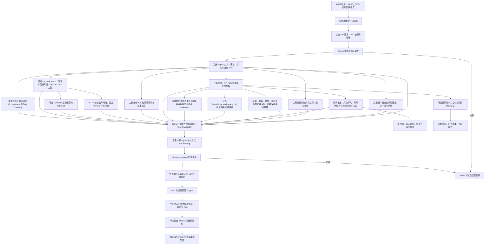

# Cordis 功能插件运行时

使用 DeepSeek Harness 所采用的 Cordis 装配功能插件，校验版本和依赖，并按插件生命周期注册、回滚和释放运行时贡献。

## 功能定位

插件拥有能力定义与装配逻辑；Host 提供受治理的 Agent、Tool、Skill 和持久化执行服务。当前七个内置 Agent 均由独立插件注册，应用默认组合放在 `agents/plugins/builtins.ts`，Host 不导入具体业务 Agent。

当前阶段覆盖 Agent、Tool、Skill、消息路由、群业务调度、运行后续动作和新闻机器人配置装配。默认组合为九个功能插件、七个 Agent；会议纪要和外部 AI Hot 调度插件没有独立 Agent，会议纪要保留 dormant 开关，外部 AI Hot 能力仍需单独安装。全局维护/成员同步、业务 API、页面和基础服务还未全部改为插件贡献；不能把本阶段描述为“整个产品已完全插件化”。

## 实现流程图

## 能力边界

### 目标

- 同一标准支持内置和受信任的第三方 TypeScript 功能插件。
- 空插件列表不隐式注册业务 Agent、Tool、Skill 或消息路由。
- 插件启动、配置恢复失败及停止时清理注册和自有资源。

### 非目标

- 原生插件属于宿主代码，本接口不提供 JavaScript 沙箱。
- 本阶段不自动下载或执行远程仓库，也未承诺 DeepSeek Harness 插件的服务接口兼容。
- 页面、业务 API、全局维护/成员同步和基础服务的完整插件化见路线图后续节点。

## HTTP 工作台组合

团队 SDK 默认仍为九个插件、七个 Agent；HTTP 入口默认另加示例 Markdown 来源、RAG 回答、引用复核与独立知识界面，加上网页收集、文档导入、资料库与结果验收，共 17 个插件、14 个 Agent。页面可保存个人 Markdown/公开网页来源，重启后选择一组来源/回答/复核插件；显式 AGENT_PLUGINS_FILE 优先并完全管理组合。插件页面展示真实已装配 Manifest、版本与依赖，尚未提供在线任意仓库安装。工作台不是额外的业务 Agent。

## 核心规则

1. `manifest.apiVersion` 必须为 `1.0`；ID 唯一，版本采用 SemVer 形式，名称与说明不能为空。配置可使用 Cordis Standard Schema 接口，如 Zod。
2. `requires` 声明插件依赖；缺失、重复或循环在调用任何 `apply` 前拒绝。Cordis 注入对应的就绪服务。
3. Agent ID、安装 ID、Capability、默认 Binding ID 和领域行为在迁移中保留；团队 SDK 默认组合继续提供七个 Agent。
4. `ctx.delivery.tools`、`nativeAgents`、`modelAgents`、`skills`、`messageRoutes`、`schedules` 和 `runActions` 的注册返回 disposer，并自动归属当前插件的 Cordis effect。连接、定时器等自有资源显式使用 `ctx.effect`。
5. 插件声明的 Skill 包必须存在。路径限定为 Skill 根目录的直接子包名，指令引用继续执行原有目录边界校验。
6. `delivery/restored` 在外部 Agent 和持久化 Bot 配置恢复后触发。新闻机器人配置由新闻插件维护，Host 不包含新闻业务规则。
7. 移除插件后，它的 Agent/Tool/Skill/消息路由/群业务调度不装配；历史引用、免 @ 回复和帮助也不会恢复该功能。引用缺失安装的持久化 Binding 保留在数据库、暂不投影。缺少可用入口 Capability 的 Bot 在本次内存投影中停用，不删除用户配置。
8. `AgentHost.stop` 拒绝新的消息和调度请求，等待在途动作状态读取、确定性消息、调度轮次、Agent 执行和投递，再释放插件；停止后的 Host、消息和调度注册表不能重新启动，应创建新实例。运行、Artifact、Session 与用户绑定数据保留。
9. `messageRoutes` 可声明静态贡献或通过受作用域管理的注册函数按配置添加。上下文阶段只选择首个匹配者，普通消息按唯一优先级执行；业务判断留在插件与 Handler，Router 不导入内置功能。
10. `orchestrator` 与 `toolGateway.execute` 供受信任 Native 插件组合模型和 Tool；调用者必须传同一 Run 的身份、Manifest 工具列表、预算和取消信号。它们不是原生恶意代码的权限沙箱。知识回答插件实际使用这条链路并在发布前验收引用。

插件 Adapter 在父信号中止后返回成功不能绕过 Runtime：预中止不调用处理者，执行中止停止等待并记录 PARENT_ABORTED；自身超时继续为 TIMEOUT。Run/Step 失败、迟到返回不交付成功产物，原生代码及已经发出的副作用不能据此认为已终止或回滚。验证：backend/test/agentDelegation.test.ts、agentRuntime.test.ts。

## 运行后续动作

插件通过 ctx.delivery.runActions.register 声明唯一动作 ID、标签、Capability、appliesTo、固定目标输入函数和只读 readState。仅匹配成功 Run；Host 校验本地 Scope 与可派发能力后通过既有 Runtime 执行。状态与结果使用 StatusPanel 1.0 文本协议，不加载远程 UI 代码。注册随 Cordis effect 回滚和释放；Host 停止先等待在途状态读取。knowledge.impact 注册 knowledge.review，是实际使用者；详见作者规范。

## 本地 MCP 插件

connector.mcp 1.1.0 通过现有 FeaturePlugin/Config/effect 接入，无需修改 Host 或默认组合。它启动已审查的本地服务或连接固定公开 HTTPS，发现工具后只注册显式选中项，失败回滚并关闭连接。HTTP 每次校验全量 DNS、固定 IP 并保留 Host/TLS，拒绝重定向，凭据只用可选 Bearer 引用；JSON/SSE 受流预算和超时约束。工具名称与读取授权由安装者声明，不采用上游注解作为权限证明；当前不支持写工具、OAuth 或私网 HTTP。停止先等待 Run，再尝试终止远端会话并关闭本地流。旧 stdio 配置保持兼容；完整规范、官方 Context7 HTTP 例子和测试边界见 [MCP 使用说明](../../../../docs/MCP_TOOLS.md)。

## Web 贡献

ctx.delivery.web.register 注册唯一贡献 ID、页面元数据、API 前缀/路由/Fetch handler 和可手动执行的原有任务名称。注册随 Cordis 回滚与释放。页面路径、任务名和 API 前缀不能重复或覆盖保留入口；前端只支持已打包视图或跳到指定 Agent 的入口，不执行远端 UI 包。

站会、项目看板和人力甘特图已把页面与 API 从全局组合移入各自所有者；builtin.dashboard 使用两个 Web 贡献分别声明文件与甘特命名空间，卸载时一起释放。旧根查询与 HTML 链接也不能绕过插件检查。任务、日报、看板插件各自声明原有手动任务；缺少所有者时旧 /api/jobs 不执行，默认仍为九个原有任务。MCP 读取示例通过元数据增加页面入口，不修改前端业务表。周报与隐藏纪要页/API 同样归属插件；navigation=false 仅隐藏菜单，不绕过安装检查。知识工作台页面与只读来源描述已归属 knowledge.workspace；核心通用输入/结果中的部分知识适配、连接/成员同步、全局维护和基础服务生命周期仍需继续解耦，当前不宣称全产品已经插件化。

## 资料收集插件

knowledge.capture 复用受限公开网页读取，community.markitdown 通过私有上传 ID 和固定 Python 流式转换接入真实开源项目。两者独立贡献 Agent、Tool 与页面，使用既有 JSON/Markdown Artifact；文档原始暂存有容量/过期/Scope/指纹边界。已打包页面可选声明 view.capability，Agent 卡片与首页选择按元数据进入表单，不为每种输入在核心解析器加分支。验证覆盖真实格式、取消、预算、生命周期与页面入口。

## 发布工作流装配

发布插件拥有 /release 页面贡献，不在核心路由直接开放；移除插件释放入口。HTTP 默认组合仅在明确配置仓库后添加 connector.github 和匹配当前知识来源的 release.prepare；SDK 默认与显式插件文件语义不变。发布结果使用既有 StatusPanel 1.0 和 Markdown 展示，未增加业务专用前端执行器或平台协议。验证见工作台与发布专项。

## 社区 Skill 与 Context7 验证

标准 SKILL.md 可经 readAgentSkill 显式导入现有 Prompt Skill Runtime；元数据不能自动取得工具或 Agent 授权，不执行目录脚本。community.context7 是真实使用者：接入上游 MCP 两个读取工具，提供无模型查询和需模型的研究助手；页面按插件贡献，未知能力标签使用作者声明的 Agent 名称。默认组合不自动安装它。来源、许可、运行命令和验收边界见 [社区接入说明](../../../../docs/COMMUNITY_PLUGINS.md)。

验证：backend/test/context7Plugin.test.ts 覆盖格式/边界、权限不继承、受控 Prompt Skill 执行及插件装配；本地实际 MCP 与工作台验收覆盖公开文档检索。真实付费模型未调用。

knowledge.library 独立拥有资料库 Agent、两个 Tool、页面/API 与 knowledge.collect 动作；无必需采集插件依赖，可以收录历史成功结果。停止释放贡献但保留私有 Markdown。默认个人组合添加此插件，明确文件组合仍完全覆盖。验证涵盖真实采集、MarkItDown、存储边界、恢复和已有 RAG 管线。

FeaturePlugin.checks 新增静态结果规则，由 Host 的 RunCheckRegistry 校验归属、Schema 与预算，再随 Cordis effect 注册/回滚/释放。提供者不依赖验收界面；quality.checks 可单独移除，历史报告保留。规则只检查保存的状态、产物和步骤，不执行规则脚本。首批为网页收集和 MarkItDown；作者规范与 backend/test/pluginChecks.test.ts 覆盖实际用法。

## 用户能力

开发者可以组合插件、声明和验证配置，接入自定义 Agent 与 Tool，并清理插件拥有的资源。应用启动默认使用 `createDeliveryOpsHost`；直接构造 `AgentHost` 默认无业务插件。

## 入口与触发

| 入口 | 输入 | 输出 |
| --- | --- | --- |
| PluginRuntime | 插件列表、宿主服务与按插件 ID 的配置 | 完成装配或明确失败 |
| FeaturePlugin.apply | Cordis Context 与验证后的配置 | Agent/Tool/Skill/消息等贡献 |
| delivery/restored | 持久化控制面恢复完成 | 插件拥有的配置协调 |
| AgentHost.stop | 宿主停止请求 | 在途执行收敛、资源释放 |

## 运行逻辑

1. 应用组合层选择插件，创建 Host。
2. Host 恢复遗留运行状态，建立共享执行服务。
3. PluginRuntime 先验证全部插件，再由 Cordis 依赖装配并管理贡献。
4. 控制面恢复持久化安装与绑定，再串行触发插件配置恢复事件。
5. 就绪后，Agent 继续通过原 Runtime、Tool Gateway、Session 与 Outbox 执行。
6. 失败时回滚内存贡献；停止时先完成在途运行，再释放资源。

## Agent、Tool 与服务边界

| 对象 | 职责 | 禁止承担 |
| --- | --- | --- |
| PluginRuntime | 协议校验、依赖装配、贡献生命周期 | 任务、站会或新闻业务规则 |
| FeaturePlugin | 声明能力并注册实现 | 绕过 Tool Gateway 扩大模型权限 |
| Domain Service | 业务事实与状态一致性 | 插件安装与资源生命周期 |
| 持久化 Catalog | 保存用户安装、绑定和机器人配置 | 删除暂未装配插件的历史事实 |

## 数据与状态

插件清理只删除内存定义、安装、绑定、Skill、消息路由、群调度和 Adapter 注册。持久化运行与业务记录继续归原 Store 所有。本地原生插件使用受信任代码模型；外部 HTTP Agent 仍受已有 Secret、网络与输出约束。

## 失败、安全与降级

- 错误的 API 版本、配置、依赖和 Skill 包使启动失败，不进入就绪状态。
- 资源必须通过 effect 或受作用域管理的注册入口获得，防止泄漏连接或定时器。
- 新插件使用 FeaturePlugin；旧 AgentHostExtension 暂时保留兼容，其原始注册 API 不具备新插件的 effect 管理保证。
- 全产品插件禁用仍需后续迁移全局维护/成员同步、API 和页面；当前空插件列表约束运行时注册与消息路由，不关闭这些其他入口；群业务计划和站会到期轮询已经随插件选择。
- 私聊成员识别按组合保留：有要求项目成员的私聊路由时仍先校验身份；纯个人插件组合可以不依赖项目成员。这不构成逐路由访问控制。

## 代码地图

### 主要实现

- `backend/src/platform/plugins/web.ts`：页面、声明路由和原有手动任务的注册、冲突检查与清理。
- `backend/src/platform/workspace/api.ts`、`jobsApi.ts`：请求体保留、OpenAPI 路由与 Host 授权/在途跟踪。

- `backend/src/connectors/mcp/plugin.ts`、`backend/examples/plugins/mcp-reader.ts`：可选外部 MCP 工具与示例 Agent。

- `backend/src/platform/plugins/runActions.ts`：动作注册、校验、匹配与文本面板协议。
- `backend/src/knowledge/impact/plugin.ts`、`presentation.ts`：知识复核动作与报告呈现。

- `backend/src/platform/scheduling/registry.ts`、`calendar.ts`：群调度协议、唯一优先级、通用日历与在途跟踪。
- `backend/src/knowledge/answer/plugin.ts`：复用宿主模型与受治理 Tool 的实际插件示例。
- `backend/src/core/scheduler.ts`：执行插件贡献，统一重试、幂等和记录；保留全局维护/成员同步。
- `backend/src/agents/plugins/aiHotSchedule.ts`：独立的外部 AI Hot 调度贡献。

- `backend/src/platform/plugins/configuration.ts`、`backend/profiles/agents/`：可信配置加载与 Agent 组合示例。

- `backend/src/platform/plugins/contracts.ts`、`runtime.ts`：插件协议、依赖检查与 Cordis 生命周期。
- `backend/src/agents/plugins/`：七个业务 Agent 插件、无 Agent 的会议纪要插件及默认组合。
- `backend/src/services/messageHandler/routes.ts`：消息贡献协议、唯一优先级和在途消息等待。
- `backend/src/agents/host.ts`：保持原应用能力的组合工厂。
- `backend/src/platform/bootstrap/agentHost.ts`：通用 Host 与在途执行收敛。
- `backend/src/platform/agents/registry.ts`、`nativeAdapter.ts`、`modelLoopAdapter.ts`：可释放的 Agent 注册。
- `backend/src/platform/tools/registry.ts`、`backend/src/platform/skills/registry.ts`、`packageLoader.ts`：Tool/Skill 贡献与包清理。
- `backend/src/platform/bots/catalog.ts`：暂不投影缺失插件安装的持久化绑定。

### 主要测试

- `backend/test/pluginWeb.test.ts`、`backend/test/standupApi.test.ts`：第三方贡献、移除后拒绝、回滚、Scope 与停止等待。

- `backend/test/mcpConnector.test.ts`：可信配置组合、真实子进程、装配失败回滚、在途停止和 Secret 隔离。

- `backend/test/runActions.test.ts`、`backend/test/workspaceActions.test.ts`：第三方动作、校验、Scope、幂等与在途清理。

- `backend/test/knowledgeAnswer.test.ts`：原生插件模型/Tool 组合、依赖、步骤记录、引用拒绝与本地 HTTP 模型集成。
- `backend/test/schedulePlugins.test.ts`：群调度贡献、空组合、插件禁用、错误隔离与在途停止。

- `backend/test/pluginConfiguration.test.ts`：配置 Schema、依赖顺序、真实模板、禁用模块不导入与远程 URL 拒绝。

- `backend/test/pluginRuntime.test.ts`：依赖、版本、配置、Skill、失败回滚、恢复事件与资源释放。
- `backend/test/agentHost.test.ts`：默认兼容、空插件、第三方执行、在途停止、绑定保留与新闻 Bot。
- `backend/test/messagePlugins.test.ts`：关闭功能后的历史上下文与帮助、第三方私聊、确定性消息在途停止。
- `backend/test/agentControlPlane.test.ts`：持久化控制面兼容。
- 现有 Agent、Tool、Skill、调度和业务测试：迁移行为回归。

本批验证：`backend/test/projectVisibilityApi.test.ts` 覆盖插件关闭后的读写拒绝、文件边界、计划校验和审计；`frontend/src/pages/workspace/pages.test.mjs` 覆盖旧看板链接的所有权。配合后端全量回归、前端门禁和桌面/移动端浏览器验收。

## 变更记录

| 日期 | 变更 | 验证 |
| --- | --- | --- |
| 2026-11-05 | 增加 Web 贡献协议；迁移站会页面/API 与原有业务手动任务授权 | 插件 Web/站会 API 专项、后端回归、前端检查及默认/空配置/MCP 浏览器验收 |
| 2026-11-05 | 新增独立 MCP 连接插件与配置样例，不改变默认团队和工作台组合 | MCP/Schema 专项、后端全量回归与官方文件服务实际读取/越界拒绝 |
| 2026-11-05 | 新增随插件生命周期释放的运行后续动作，通用文本面板与知识引用检查实例 | 插件动作/API 专项、后端回归、前端检查与桌面/375px 浏览器验收 |
| 2026-11-05 | 区分团队 SDK 与 HTTP 个人知识默认组合 | 工作台专项、后端回归、前端检查与本地浏览器验收 |
| 2026-11-05 | 向原生插件提供宿主 Orchestrator 和 Tool Gateway；独立 RAG 插件验证同 Run 检索、生成与验收 | RAG/插件专项、类型与后端全量回归；默认业务不变 |
| 2026-11-05 | 群业务调度改为可释放插件贡献，新增外部 AI Hot 调度插件；空组合不隐式执行群任务；停机等待本轮结束 | 调度/日历/插件回归、后端 428 通过 / 1 TAPD 跳过、类型检查 |
| 2026-11-05 | 将确定性消息、引用上下文、免 @ 回复和帮助归属功能插件；默认新增无 Agent 的会议纪要插件；停机等待在途消息 | 消息插件与现有路由回归、后端 422 通过 / 1 TAPD 跳过、类型检查 |
| 2026-11-05 | 增加可信 YAML Agent 插件选择与本地/已安装包加载；未启用模块不导入，消息 AI/新闻分流检查实际 Capability | 配置加载、插件/Host 测试与后端全量回归 |
| 2026-11-05 | 引入 Cordis 4.1.0 与版本化插件协议，拆出七个 Agent 插件，提供贡献回滚、释放和在途停止 | 插件与 Host 测试、后端类型及全量回归 |
