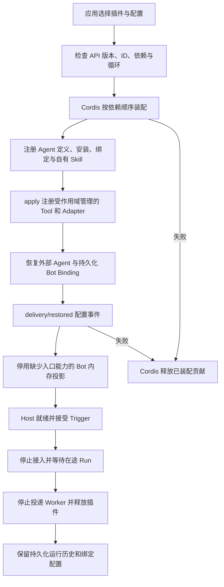

# Cordis 功能插件运行时

使用 DeepSeek Harness 所采用的 Cordis 装配功能插件，校验版本和依赖，并按插件生命周期注册、回滚和释放运行时贡献。

## 功能定位

插件拥有能力定义与装配逻辑；Host 提供受治理的 Agent、Tool、Skill 和持久化执行服务。当前七个内置 Agent 均由独立插件注册，应用默认组合放在 `agents/plugins/builtins.ts`，Host 不导入具体业务 Agent。

当前阶段覆盖 Agent、Tool、Skill 和新闻机器人配置装配。确定性消息 Handler、Scheduler、业务 API、页面和基础服务还未全部改为插件贡献；不能把本阶段描述为“整个产品已完全插件化”。

## 实现流程图

## 能力边界

### 目标

- 同一标准支持内置和受信任的第三方 TypeScript 功能插件。
- 空插件列表不隐式注册业务 Agent、Tool 或 Skill。
- 插件启动、配置恢复失败及停止时清理注册和自有资源。

### 非目标

- 原生插件属于宿主代码，本接口不提供 JavaScript 沙箱。
- 本阶段不自动下载或执行远程仓库，也未承诺 DeepSeek Harness 插件的服务接口兼容。
- 业务 Handler、页面与 Scheduler 的完整插件化见路线图后续节点。

## 核心规则

1. `manifest.apiVersion` 必须为 `1.0`；ID 唯一，版本采用 SemVer 形式，名称与说明不能为空。配置可使用 Cordis Standard Schema 接口，如 Zod。
2. `requires` 声明插件依赖；缺失、重复或循环在调用任何 `apply` 前拒绝。Cordis 注入对应的就绪服务。
3. Agent ID、安装 ID、Capability、默认 Binding ID 和领域行为在迁移中保留；默认应用组合继续提供七个 Agent。
4. `ctx.delivery.tools`、`nativeAgents`、`modelAgents` 和 `skills` 的注册返回 disposer，并自动归属当前插件的 Cordis effect。连接、定时器等自有资源显式使用 `ctx.effect`。
5. 插件声明的 Skill 包必须存在。路径限定为 Skill 根目录的直接子包名，指令引用继续执行原有目录边界校验。
6. `delivery/restored` 在外部 Agent 和持久化 Bot 配置恢复后触发。新闻机器人配置由新闻插件维护，Host 不包含新闻业务规则。
7. 移除插件后，它的 Agent/Tool/Skill 不装配；引用缺失安装的持久化 Binding 保留在数据库、暂不投影。缺少可用入口 Capability 的 Bot 在本次内存投影中停用，不删除用户配置。
8. `AgentHost.stop` 停止接入、等待在途执行和投递、释放插件；停止后的对象不能重新启动，应创建新 Host。运行、Artifact、Session 与用户绑定数据保留。

## 用户能力

开发者可以组合插件、声明和验证配置，接入自定义 Agent 与 Tool，并清理插件拥有的资源。应用启动默认使用 `createDeliveryOpsHost`；直接构造 `AgentHost` 默认无业务插件。

## 入口与触发

| 入口 | 输入 | 输出 |
| --- | --- | --- |
| PluginRuntime | 插件列表、宿主服务与按插件 ID 的配置 | 完成装配或明确失败 |
| FeaturePlugin.apply | Cordis Context 与验证后的配置 | Agent/Tool/Skill 等贡献 |
| delivery/restored | 持久化控制面恢复完成 | 插件拥有的配置协调 |
| AgentHost.stop | 宿主停止请求 | 在途执行收敛、资源释放 |

## 运行逻辑

1. 应用组合层选择插件，创建 Host。
2. Host 恢复遗留运行状态，建立共享执行服务。
3. PluginRuntime 先验证全部插件，再由 Cordis 依赖装配并管理贡献。
4. 控制面恢复持久化安装与绑定，再串行触发插件配置恢复事件。
5. 就绪后，Agent 继续通过原 Runtime、Tool Gateway、Session 与 Outbox 执行。
6. 失败时回滚内存贡献；停止时先完成在途运行，再释放资源。

## Agent、Tool 与服务边界

| 对象 | 职责 | 禁止承担 |
| --- | --- | --- |
| PluginRuntime | 协议校验、依赖装配、贡献生命周期 | 任务、站会或新闻业务规则 |
| FeaturePlugin | 声明能力并注册实现 | 绕过 Tool Gateway 扩大模型权限 |
| Domain Service | 业务事实与状态一致性 | 插件安装与资源生命周期 |
| 持久化 Catalog | 保存用户安装、绑定和机器人配置 | 删除暂未装配插件的历史事实 |

## 数据与状态

插件清理只删除内存定义、安装、绑定、Skill 和 Adapter 注册。持久化运行与业务记录继续归原 Store 所有。本地原生插件使用受信任代码模型；外部 HTTP Agent 仍受已有 Secret、网络与输出约束。

## 失败、安全与降级

- 错误的 API 版本、配置、依赖和 Skill 包使启动失败，不进入就绪状态。
- 资源必须通过 effect 或受作用域管理的注册入口获得，防止泄漏连接或定时器。
- 新插件使用 FeaturePlugin；旧 AgentHostExtension 暂时保留兼容，其原始注册 API 不具备新插件的 effect 管理保证。
- 全产品插件禁用仍需后续迁移 Handler、Scheduler、API 和页面；当前空 Agent 插件列表仅约束运行时注册。

## 代码地图

### 主要实现

- `backend/src/platform/plugins/contracts.ts`、`runtime.ts`：插件协议、依赖检查与 Cordis 生命周期。
- `backend/src/agents/plugins/`：七个业务 Agent 插件及默认组合。
- `backend/src/agents/host.ts`：保持原应用能力的组合工厂。
- `backend/src/platform/bootstrap/agentHost.ts`：通用 Host 与在途执行收敛。
- `backend/src/platform/agents/registry.ts`、`nativeAdapter.ts`、`modelLoopAdapter.ts`：可释放的 Agent 注册。
- `backend/src/platform/tools/registry.ts`、`backend/src/platform/skills/registry.ts`、`packageLoader.ts`：Tool/Skill 贡献与包清理。
- `backend/src/platform/bots/catalog.ts`：暂不投影缺失插件安装的持久化绑定。

### 主要测试

- `backend/test/pluginRuntime.test.ts`：依赖、版本、配置、Skill、失败回滚、恢复事件与资源释放。
- `backend/test/agentHost.test.ts`：默认兼容、空插件、第三方执行、在途停止、绑定保留与新闻 Bot。
- `backend/test/agentControlPlane.test.ts`：持久化控制面兼容。
- 现有 Agent、Tool、Skill、调度和业务测试：迁移行为回归。

## 变更记录

| 日期 | 变更 | 验证 |
| --- | --- | --- |
| 2026-11-05 | 引入 Cordis 4.1.0 与版本化插件协议，拆出七个 Agent 插件，提供贡献回滚、释放和在途停止 | 插件与 Host 测试、后端类型及全量回归 |
