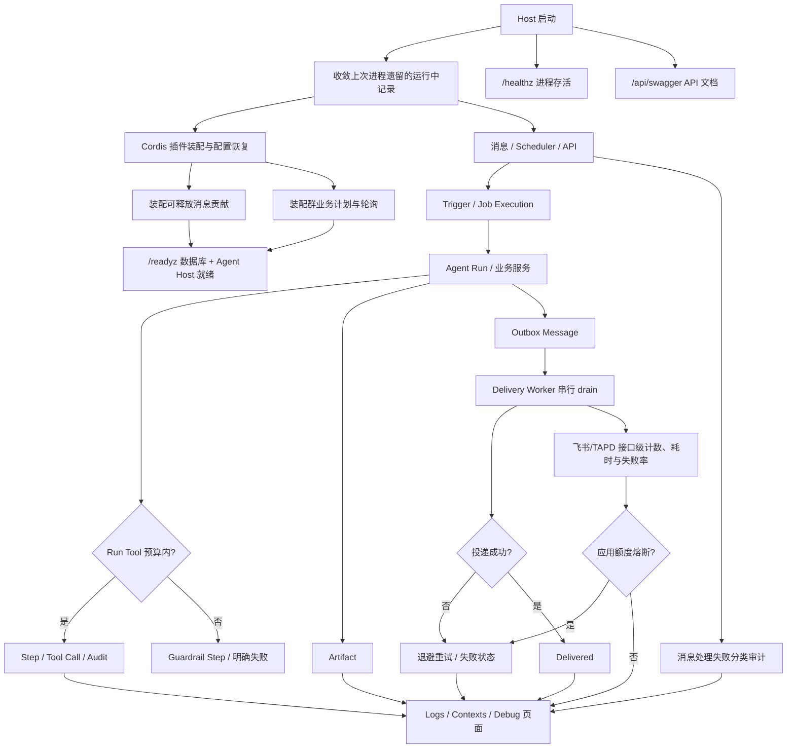

# 运行控制与可观测性

统一记录审计日志、消息上下文、Job/Trigger/Agent Run、Artifact 和 Outbox 投递，并提供后台查询与手动验证入口。

## 功能定位

运行控制与可观测性把一次业务动作拆成可追溯的事实链：谁触发、系统怎样路由、Agent 或服务执行了哪些步骤、生成了什么产物、消息是否真正送达。它解决的是定位和恢复问题，而不是业务展示问题。

系统刻意分开 Trigger、Run、Artifact 和 Outbox 状态。这样可以准确区分“未开始”“执行失败”“执行成功但投递失败”和“已经送达”，避免管理员只看到一个模糊的成功布尔值。

## 实现流程图

## 能力边界

### 目标

- 回答“谁在何时、以什么输入、调用了什么、产生了什么结果、是否投递成功”。
- 允许管理员查询上下文、日志和运行状态，并安全地触发诊断动作。

### 非目标

- 日志和页面不拥有业务状态，不用于修补任务或站会真相源。
- 可观测性不是独立 Agent；它是所有 Agent 和确定性流程共享的平台能力。

## 核心规则

Host 关闭时先停止消息注册表接受新执行，等待在途确定性消息、调度轮次与 Agent Run、投递收敛后再释放插件。停用功能删除其内存消息贡献，不删除历史来源消息、引用、运行和业务数据；历史引用本身不会重新启用功能。

1. **记录事实并执行有界保留。** Run、Step、Tool Call 采用追加式记录；Audit Event 默认保留 90 天，过期记录由每日维护任务分批删除，修复动作仍产生新事件而不覆盖原始证据。
2. **不同状态机分别保存。** Job Execution 表示调度尝试，Agent Run 表示执行，Artifact 表示产物，Outbox 表示外部投递；它们用关联 ID 串联。
3. **每条链路携带相关标识。** root Run、parent Run、trigger、group、bot 和 correlation ID 支持从用户消息追踪到最终投递。
4. **Outbox 使用持久化领取、真实时间租约和进程内串行 drain。** 同一进程的后台轮询与主动 flush 共用一个进行中 Promise，不能并发领取；租约从实际领取时间计算，不能复用较早的业务触发时间。同一条消息只允许一个 Worker 在租约期内处理；Worker 崩溃后其他实例可以重新领取。
5. **重试不重新执行业务。** 临时投递错误只重试 Outbox；永久错误进入失败或死信状态，不能重新运行 Agent 来碰运气。
6. **查询严格按 Scope 过滤。** 日志、上下文和 Run Detail 不能因为是后台接口就跨 workspace、group 或 bot 暴露。
7. **日志默认脱敏。** Token、Secret、邮箱凭据、完整附件和不必要的 Prompt 内容不得写入审计或错误信息。
8. **Debug 是受控新执行。** 手动触发必须指定已注册的 Job/Agent 与参数，并产生新的执行记录；它不能运行任意命令或直接篡改历史状态。手动 Job 的 `sendToGroup` 默认关闭，只有明确打开时才创建群消息投递，关闭时仍保留业务生成/更新和审计事实。
9. **监控失败需要显式暴露。** 非关键审计写入失败可避免阻塞主业务，但系统必须记录或告警；关键合规动作应使用事务或 Outbox 保证证据落盘。
10. **飞书令牌按有效期复用。** Adapter 在提前量内缓存 tenant access token，并合并并发刷新请求；发送失败仍按消息投递结果处理，不能通过每次重新申请令牌规避权限或接收人错误。
11. **部分完成不是成功别名。** Job 完成业务扫描但存在跳过、临时投递失败或永久拒绝时记录 `job_completed_with_warnings`，查询页面显示“任务部分完成”；同步等前置条件失败仍记录 `job_failed`。
12. **查询参数必须有边界。** 日志和上下文分页每页最多 200 条，非法页码回落到安全默认值；日期筛选按 `Asia/Shanghai` 自然日转换成 UTC 左闭右开区间，非法或反向日期返回 400。
13. **日志清理不能阻塞业务调度。** 每日维护按配置时区领取一次执行，单批和单次总批数均有上限；失败只写维护失败事实，不中断站会、日报、周报或提醒任务。
14. **Tool 调用预算覆盖完整 Run。** `AgentManifest.limits.maxToolCalls` 同时约束模型直接调用和 Skill 内部调用；暂停恢复或同一 Run 再进入时从已持久化 Tool Step 恢复用量，幂等命中旧结果不重复扣减，超限写 `guardrail` Step 并返回不可重试错误。
15. **进程重启必须收敛非终态。** 单实例 Host 接收新触发前，将上次进程遗留的 `queued/running` Run、运行中 Step、Tool Call 和 Trigger 原子标记为 `PROCESS_RESTARTED`；`waiting_human`、成功记录和 Outbox 租约保持原语义，不自动重放可能已产生副作用的操作。
16. **存活与就绪必须分离。** `/healthz` 只证明 HTTP 进程可响应，供 liveness 使用；`/readyz` 必须同时验证 SQLite 可查询且 Agent Host 已初始化并启动，失败返回 503，供 startup/readiness 在依赖异常时停止接收流量。探针响应不暴露数据库路径或底层错误。
17. **发布必须通过质量门禁并可追溯。** CI 在镜像构建前运行后端依赖锁定安装、Prisma 校验、类型检查和全量测试，以及前端锁定安装、lint、类型检查、测试和生产构建；镜像以提交 SHA 作为部署标签，同时保留 `latest` 兼容标签，部署不再依靠强制重启拉取可变镜像。
18. **Host 仅在扩展装配完整后就绪。** 本地 `AgentHostExtension` 在 Runtime 创建前串行注册且每个唯一 ID 只执行一次；任何扩展校验或注册失败都会阻止 `initialized=true`，从而使 `/readyz` 保持失败。
19. **入站和投递幂等必须包含 BotInstance。** 飞书事件的进程内缓存键使用 `botInstanceId:messageId`，持久化 Trigger Claim 使用 workspace、bot、trigger type、message ID；两个应用即使产生相同 message ID 也不能互相吞消息。
20. **私聊目标必须显式保存 channel。** `ReplyPolicy` 的配置目标可声明 `private` 或 `group`；新闻机器人使用发送者在该应用下的 OpenID 作为 private 目标，不能根据存在 `chatId` 就推断为群聊。
21. **结构化文章产物由 Adapter 生成最终提示。** AI 新闻 Artifact 保存文章、来源与是否还有下一页等结构化事实；飞书 Delivery Adapter 统一渲染安全链接、多源信号和固定操作引导，外部 Provider 不能注入卡片尾部指令。
22. **AI 异常必须留下可查询根因和降级结果。** 消息处理的兜底回复前写入 `message_processing_failed`，保留消息和群标识、脱敏后的错误摘要及分类；AI 429 不能混同为网络超时。任务命令、日报、站会自然语言解析、站会主/补充汇总和周报分别记录对应 AI 失败事件，统一使用 `rate_limited`、`timeout`、`invalid_response`、`unavailable` 分类和明确的 fallback 字段，形成“AI 失败—规则继续执行或拒绝保存”的证据链。
23. **日志状态必须区分失败与成功降级。** AI 调用失败但 `fallback` 已生成日报、站会或周报时，日志页使用橙色“已降级”标签；只有规则也未完成、解析被拒绝或 Job 最终失败时使用红色失败标签，不能用底层事件名误导管理员。
24. **外部 API 必须按接口和应用统计。** 飞书与 TAPD Adapter 统一记录调用次数、计费调用估算、成功/失败、平均/最大耗时和最近失败时间；动态资源 ID 在聚合前归一化。飞书按 App ID 分开统计并以 100 万次/月作为基础版风险参考，运行不足一小时不输出误导性的月度投影。
25. **飞书限流和额度耗尽必须分流。** HTTP 429 保留 `Retry-After` 供 Outbox/调度退避；业务码 `99991403` 视为当前应用月额度耗尽，熔断至下一个上海时区月初并标记不可重试，不能让一个应用的熔断阻断其他 BotInstance。
26. **投递超时必须取消底层请求。** Delivery Worker 的 AbortSignal 必须传到飞书文本、卡片、图片上传和图片发送请求；超时后不能保留后台请求并同时创建重试，从而造成幽灵双发。
27. **入站事件使用跨实例原子去重。** 收到飞书 message ID 后，以 workspace、BotInstance 和 message ID 组成 `feishu:event:` 幂等键并由数据库原子领取；进程内有界缓存只作为同实例快速路径，不能作为生产集群唯一去重机制。
28. **重复触发不等于再次完成。** Agent Trigger Store 返回 `duplicate` 时，Scheduler 只记录 `job_duplicate_skipped`，不能追加第二条 `job_completed`；日志页明确显示“重复触发已跳过”，避免把幂等命中误读成业务再次执行。
29. **API 文档必须经过生产代理可达。** Swagger UI 使用 `/api/swagger`，OpenAPI JSON 使用 `/api/swagger/json`；两者统一放在生产环境已转发到后端的 `/api` 前缀下，不能使用会被前端 SPA 接管的根路径 `/swagger`。

## 用户能力

- 查看审计日志、消息上下文、Agent Run、Step、Artifact 和投递状态。
- 在 Debug 页面按明确参数手动运行 Job 或 Agent。
- 识别生成成功但投递失败、模型失败但业务已写入等部分成功状态。

## 入口与触发

| 入口 | 输入 | 输出 |
| --- | --- | --- |
| 业务服务/Agent Runtime | Run、Step、Artifact、Audit Event | 持久化运行事实 |
| Delivery Worker | Outbox 状态、错误、重试次数 | 投递结果 |
| 后台 API/页面 | 时间、类型、群、Run ID 筛选 | 日志、上下文和运行详情 |
| Debug API | 明确 Job/Agent 与参数 | 新执行记录 |
| Kubernetes 探针 | `/healthz`、`/readyz` | 进程存活、数据库与 Agent Host 就绪状态 |
| 外部 API 健康接口 | `/api/health/external-api-usage` | 当前进程按供应商、应用、接口聚合的调用量、失败率、耗时、月度投影与熔断状态 |
| API 文档 | `/api/swagger`、`/api/swagger/json` | 可交互 Swagger UI 与机器可读 OpenAPI 文档 |

## 运行逻辑

1. 消息、Scheduler 或 API 建立 Trigger/Job Execution。
2. Runtime 和业务服务追加结构化 Run、Step、Tool Call、Audit 与 Artifact；消息处理异常在回复用户前追加带分类的 `message_processing_failed` 审计。
3. 外部消息先写 Outbox；后台轮询和主动 flush 通过同一个 Worker 串行 drain，以实际领取时刻建立租约，再执行投递、失败退避并保存结果。
4. 后端只返回当前 Scope 有权查看的记录。
5. Logs、Contexts 和 Debug 页面用于查询、关联和受控重放。
6. Host 重启时先收敛遗留非终态记录并追加恢复审计，再对外接受新的 Agent 调度。
7. Kubernetes 以 `/readyz` 控制启动和接流量，以 `/healthz` 判断是否需要重启进程。
8. 飞书/TAPD Adapter 在每次外部请求边界记录统一指标；飞书额度码按 App ID 打开熔断，投递重试读取供应商建议等待时间。

## Agent、Tool 与服务边界

| 对象 | 职责 | 禁止承担 |
| --- | --- | --- |
| Run/Trigger Store | 保存执行事实和状态转换 | 保存业务实体真相 |
| Audit/Context | 记录输入、路由和动作证据 | 保存 Secret 或完整敏感载荷 |
| Outbox/Worker | 至少一次尝试、退避和投递状态 | 无幂等地重新执行业务 |
| Debug API/Page | 受控触发和查询 | 接受任意代码、路径或命令 |
| 周报查看 API | 按持久化报告 ID 解析不可变 HTML | 接受客户端文件路径或目录遍历 |

## 数据与状态

- Job Execution、Agent Run、Artifact 和 Outbox Message 具有独立状态机和关联 ID。
- Agent Tool 预算以持久化 `kind=tool` Step 为已用事实；Skill 只能使用共享预算，不能建立独立额度绕开 Agent 限制。
- 重启恢复只改变 Agent 平台运行记录，不修改任务、站会、消息、Checkpoint 或 Artifact；等待人工输入的 Run 保持 `waiting_human`。
- Outbox 至少一次投递要求目标端或消息键具备幂等语义；单进程内所有 drain 入口共用运行锁，租约时间不得早于实际领取时刻。
- 日志应使用结构化事件、相关 ID 和统一时间；保留期与清理策略需可配置。
- 默认保留最近 90 天审计日志；每批删除 500 条、每次最多 20 批，并清理过期 `scheduled:`、`maintenance:`、`feishu:event:` 与 `history-sync:` 临时幂等记录，业务消息和 Agent 历史不在本轮清理范围。
- 生产 SQLite 在应用启动前执行完整性检查和一致性备份，再运行非破坏性的 Prisma Schema 同步；全新数据目录先初始化有效空 SQLite 文件，避免 Schema Engine 无法创建首库；升级失败时应用不得带着未知数据库状态启动。

## 失败、安全与降级

- 日志必须脱敏 Token、Secret、邮箱凭据、完整 Prompt 和附件内容。
- 后台查询与 Debug 入口即使在内网也需限制来源/身份，并隔离 tenant/group/bot scope。
- 监控持久化失败不能阻塞关键业务写入，但必须有明确告警；审计要求高的动作应采用同事务或 Outbox 模式。
- 重放只重放安全、声明幂等的动作，不能简单重复整个 Run。

## 代码地图

### 主要实现

- `backend/src/platform/agents/runStore.ts`、`persistentRunStore.ts`：Agent 运行记录。
- `backend/src/platform/agents/modelLoopAdapter.ts`、`backend/src/platform/tools/budget.ts`、`gateway.ts`：Run 级 Tool 预算恢复、共享扣减与超限 Guardrail。
- `backend/src/platform/agents/persistentRunStore.ts`、`backend/src/platform/tools/callStore.ts`、`backend/src/platform/runtime/persistentTriggerStore.ts`、`interruption.ts`：进程重启后的原子状态收敛。
- `backend/src/platform/bootstrap/agentHost.ts`：恢复完成后再初始化 Runtime 与 Trigger 接入。
- `backend/src/platform/runtime/triggerRuntime.ts`、`persistentTriggerStore.ts`：触发记录。
- `backend/src/platform/bots/feishuBotConnectionManager.ts`、`feishuBotMessageIngress.ts`：bot-scoped 飞书入站、数据库原子去重、进程内快速去重和审计。
- `backend/src/platform/aiDegradation.ts`：AI 限流、超时、非法响应和不可用的统一分类与用户可见降级文案。
- `backend/src/platform/delivery/outbox.ts`、`persistentOutbox.ts`、`worker.ts`：可靠投递、可取消超时和供应商退避时间。
- `backend/src/platform/observability/externalApiHealth.ts`：飞书/TAPD 接口指标、应用维度月度投影与额度熔断状态。
- `backend/src/platform/observability/apiDocumentation.ts`：生产代理可达的 Swagger UI 与 OpenAPI 文档配置。
- `backend/src/adapters/feishu.ts`、`backend/src/adapters/tapd.ts`：统一外部 API 观测；飞书令牌缓存、限流/额度分类和可取消发送。
- `backend/src/services/jobExecution.ts`：Job 执行记录。
- `backend/src/core/logQuery.ts`：日志/上下文分页与北京时间日期范围规范化。
- `backend/src/core/dataRetention.ts`、`auditPayload.ts`：日志保留、临时幂等记录清理和敏感字段遮盖。
- `backend/src/core/sqliteDeployment.ts`、`backend/src/scripts/dbPush.ts`：SQLite 完整性检查、升级前备份和安全 Schema 同步。
- `backend/src/core/health.ts`、`backend/src/index.ts`：无敏感信息的存活/就绪探针，以及日志、上下文、运行与 Debug API。
- `deploy/k8s/30-deployment-backend.yaml`：startup/readiness 使用就绪探针，liveness 使用存活探针。
- `.github/workflows/ci.yml`：公共质量门禁与 Docker 构建验证；不推送镜像或部署集群。
- `frontend/src/pages/LogsPage.tsx`、`components/logs/LogsTable.tsx`、`constants.ts`：后台日志入口、AI 异常/规则降级的中文事件与摘要。
- `frontend/src/pages/ContextsPage.tsx`、`DebugPage.tsx`：后台入口。

### 主要测试

- `backend/test/schedulePlugins.test.ts`：调度计划失败隔离、原子领取与停机等待；原 Scheduler 测试覆盖重试和警告语义。

- `backend/test/messagePlugins.test.ts`：在途确定性消息收敛、停机拒绝新执行与历史上下文禁用。

- `backend/test/deliveryOutbox.test.ts`、`routedFeishuDelivery.test.ts`：投递、供应商退避、底层取消和 Bot 路由。
- `backend/test/externalApiHealth.test.ts`：接口归一化、应用隔离、指标和熔断分类。
- `backend/test/persistentAgentKernel.test.ts`、`triggerRuntime.test.ts`：运行持久化。
- `backend/test/modelLoopAgent.test.ts`、`toolSkillRuntime.test.ts`：跨恢复 Tool 预算、Skill 共享额度和幂等去重。
- `backend/test/persistentAgentKernel.test.ts`、`agentHost.test.ts`：遗留状态恢复、终态保护、人工等待保护和 Host 启动顺序。
- `backend/test/jobExecution.test.ts`、`storage.test.ts`、`logQuery.test.ts`：执行记录、存储与查询边界。
- `backend/test/dataRetention.test.ts`、`maintenanceScheduler.test.ts`：保留边界、批量上限、每日幂等和失败隔离。
- `backend/test/sqliteDeployment.test.ts`：升级前备份、保留数量和损坏数据库拒绝。
- `backend/test/health.test.ts`：存活、数据库异常和 Agent Host 未启动时的就绪判定。
- `backend/test/apiDocumentation.test.ts`：Swagger UI、OpenAPI JSON 与已注册 API 路由生成。
- `backend/test/multiBotIngress.test.ts`、`triggerRuntime.test.ts`：跨 Bot 幂等和显式 private 投递目标。

## 变更记录

| 日期 | 变更 | 验证 |
| --- | --- | --- |
| 2026-11-05 | Host 等待在途群调度后释放插件，应用退出先等待 Scheduler；计划/轮询失败单独审计，旧幂等键保留 | 调度与插件回归、后端 428 通过 / 1 TAPD 跳过、类型检查 |
| 2026-11-05 | 消息贡献随插件回滚与释放；停机等待在途确定性消息并保留持久化事实 | 消息插件/Host 回归、后端 422 通过 / 1 TAPD 跳过、类型检查 |
| 2026-11-05 | 增加可信 YAML Agent 插件选择与本地/已安装包加载；未启用模块不导入，消息 AI/新闻分流检查实际 Capability | 配置加载、插件/Host 测试与后端全量回归 |
| 2026-11-05 | Host 改为选择插件组合后接入 Runtime；启动失败释放贡献，停止先等待在途 Run 与 Worker，再释放插件，持久化历史保留 | 插件/Host 测试、后端全量回归 |
| 2026-11-05 | 修复通用 `logs/` 忽略规则误排除前端日志组件的问题；将筛选与表格源码纳入公开仓库，确保干净检出能构建 | 干净 Git 归档的前端类型检查、测试与构建；GitHub CI |
| 2026-07-29 | 公司部署流水线替换为公共 GitHub Actions 质量门禁，不再自动推送镜像或修改集群 | Workflow YAML、Docker 构建验证 |
| 2026-08-04 | 将 Swagger UI 和 OpenAPI JSON 从被前端 SPA 接管的 `/swagger` 移到生产代理可达的 `/api/swagger` 与 `/api/swagger/json` | `apiDocumentation.test.ts`、后端类型检查 |
| 2026-08-04 | 修复定时报告生成超过 Outbox 租约后，后台 Worker 与主动 flush 并发重领造成的重复发送；所有 drain 串行化并以真实刷新时间领取，重复 Agent Trigger 改记“重复触发已跳过” | `deliveryOutbox.test.ts`、`scheduler.test.ts`、后端类型检查 |
| 2026-08-03 | 数据保留任务纳入日报历史补齐完成键，避免持久化增量缓存无限增长 | `dataRetention.test.ts` |
| 2026-08-03 | 增加飞书/TAPD 接口级健康统计；飞书按应用识别 429 与月额度耗尽并熔断，投递超时下传取消信号，入站事件改为数据库跨实例去重 | `externalApiHealth.test.ts`、`deliveryOutbox.test.ts`、`multiBotIngress.test.ts`、`scheduler.test.ts`、后端类型检查 |
| 2026-07-31 | 日志页将已生成确定性结果的日报、站会主/补充汇总和周报改为橙色“已降级”，保留自然语言解析与最终 Job 失败为红色 | 前端 `typecheck` / `lint` / `build` |
| 2026-07-31 | AI 降级分类扩展到日报、站会解析/汇总和周报；日志页增加对应中文事件与规则兜底摘要，业务消息同时公开降级状态 | `summaries.test.ts`、`jobs.test.ts`、`standupHandler.test.ts`、`weeklyReport.test.ts`、前端检查 |
| 2026-07-31 | 消息入口在兜底回复前记录 `message_processing_failed`；AI 429 显式归类为 `ai_rate_limited`，日志页以中文展示 AI 失败、规则降级和真实根因 | `messageHandler.test.ts`、前端 `typecheck` / `lint` / `build` |
| 2026-07-29 | `article_list` 投递增加多源信号展示和固定尾部操作提示，保留原 Outbox、同 Bot 路由和链接安全校验 | `routedFeishuDelivery.test.ts`、AI News Agent 回归 |
| 2026-07-29 | 飞书入站去重加入 BotInstance，ReplyPolicy 支持显式 private 目标，AI 新闻产物经持久化 Outbox 使用同一机器人回传 | `multiBotIngress.test.ts`、`triggerRuntime.test.ts`、`routedFeishuDelivery.test.ts` |
| 2026-07-29 | 将本地二开扩展纳入 Host 启动边界，扩展失败时不对 readiness 报告就绪 | `agentHost.test.ts`、`health.test.ts` |
| 2026-07-29 | 发布流水线增加后端与前端完整质量门禁，Kubernetes 改为部署提交 SHA 镜像并移除冗余强制重启 | 本地复现全部门禁、Workflow YAML 离线解析 |
| 2026-07-29 | 拆分 `/healthz` 存活探针与 `/readyz` 就绪探针；Kubernetes 仅在 SQLite 可查询且 Agent Host 已启动时接入流量 | `health.test.ts`、后端类型检查、Kubernetes 清单校验 |
| 2026-07-29 | Host 启动前原子收敛上次进程遗留的 Run、Step、Tool Call 和 Trigger；不自动重放写操作，不关闭 `waiting_human` | `persistentAgentKernel.test.ts`、`agentHost.test.ts`、后端类型检查 |
| 2026-07-29 | 将 Agent `maxToolCalls` 落为 Run 级共享硬上限，覆盖直接 Tool 与 Skill 内 Tool；恢复时依据持久化 Step 延续计数，超限记录 Guardrail | `modelLoopAgent.test.ts`、`toolSkillRuntime.test.ts`、后端类型检查 |
| 2026-07-29 | 增加 90 天审计日志保留、500 条分批清理、每日维护幂等和秘密字段遮盖；维护失败不再影响业务 Scheduler | `dataRetention.test.ts`、`maintenanceScheduler.test.ts`、Scheduler 回归 |
| 2026-07-29 | 容器启动改为先校验并备份 SQLite，再执行不接受数据丢失的 Prisma Schema 同步；全新 PVC 先初始化有效空库，损坏或同步失败时拒绝启动 | `sqliteDeployment.test.ts`（含真实 Prisma 首次及二次同步）、后端类型检查 |
| 2026-07-27 | 日志与上下文查询限制单页最大数量，并按北京时间自然日生成 UTC 左闭右开筛选区间；非法日期返回 400 | `logQuery.test.ts`、类型检查 |
| 2026-07-27 | 超期扫描暴露投递统计和部分完成状态；永久接收人错误与临时错误分开审计，日志页增加对应中文标签 | `scheduler.test.ts`、`jobs.test.ts`、前端类型检查 |
| 2026-07-27 | 恢复 tenant access token 有效期缓存，并合并并发刷新，避免定时任务密集发送时重复申请令牌触发限流 | `adapters.test.ts` |
| 2026-07-27 | 周报 Agent 接入 Trigger/Run/Artifact/Outbox；查看 API 通过数据库记录与目录边界校验解析 HTML | `weeklyReport.test.ts`、Agent Runtime 回归 |
| 2026-07-22 | 补充执行事实链、状态分离、租约和重试规则，精简文档结构 | CodeGraph 与持久化投递测试 |
| 2026-07-22 | 建立运行控制与可观测性功能卡 | CodeGraph 架构审查 |
