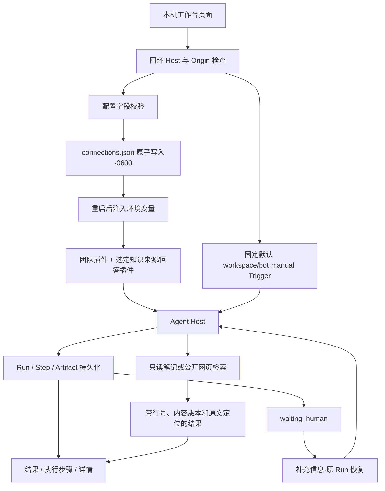

# 本地 Agent 工作台

让个人用户在本机配置模型和连接、选择 Agent、发起任务，并查看真实执行过程与知识证据。

## 功能定位

工作台是确定性控制面，复用 Cordis、Agent Host、Trigger、Run、Step 和 Artifact；自身不是 Agent。首页围绕任务发起与运行历史组织，Agent、插件、个人知识和连接各有独立入口，团队业务保留原能力入口。

## 实现流程图

## 能力边界

### 目标

- 提供真实的本地 Agent 发起、最近运行、产物、步骤和人工继续入口。
- 飞书、模型、TAPD 与个人知识来源可在界面填写并保存在本机。
- 无凭据时可检索仓库内的虚构示例笔记。

### 非目标

- 不提供多人认证、远端管理、在线任意仓库代码安装或可视化工作流画布。
- 插件列表展示已装配插件；安装组合仍使用可信文件配置并重启生效。
- 回复策略为 none 只关闭最终结果投递；Agent 的业务 Tool 仍可能按任务执行写操作。
- 仅显示最近 50 个根 Run；目前底层 KV 仍遍历 Run 前缀，数据规模增加时需改为分页索引。

## 核心规则

1. HTTP 默认绑定 `127.0.0.1`。管理 API 拒绝非回环 Host、非本机 Origin 和浏览器 cross-site 请求；这是本机信任边界，不是用户认证。
2. 运行入口固定默认 workspace/bot，不接受客户端扩大 Scope；Run 列表和详情先验证该 Scope，再读取 Artifact。最多返回最近 50 个根 Run，子 Run 在详情展示。
3. 新任务使用 UUID triggerId；重复提交同一 ID 复用 Trigger 领取结果。结果状态来自 Runtime，不能用 HTTP 请求完成冒充 Agent 成功。
4. 人工继续保留原 Run、Session 和执行预算；终态 Run 与外部 Scope 不可继续。
5. 本地连接字段采用 allowlist；密钥只返回已配置布尔值。省略字段保留当前值，null 仅用于明确清除密钥；空凭据的飞书可保持未连接，部分凭据拒绝保存。
6. 配置写入独占创建的临时文件、flush、原子 rename，文件权限 0600；读取拒绝符号链接、硬链接和共享权限文件。配置为本机明文，不声称加密。连接更新串行合并，失败保留原文件。
7. 保存不改变在途任务的配置。重启时本地文件覆盖同名环境值；模型供应商/地址/名称和 TAPD 项目/地址/工作项环境值优先于旧 config.json。页面持续提示待重启状态。
8. HTTP 入口默认在原九个团队插件上增加示例 Markdown 来源与回答插件，合计 11 个插件、9 个 Agent。选择公开网页时替换来源组合。SDK 团队工厂仍为九个插件、七个 Agent。显式 AGENT_PLUGINS_FILE 完全管理组合，不自动叠加页面知识配置。
9. 知识请求保留无 chat/conversation 的个人手动 Scope。检索不调用模型，生成回答使用当前宿主模型并发送所选片段；证据沿用来源和引用核验协议。
10. 结果 Markdown 不执行 HTML，不自动加载远端图片；原文链接仅允许 HTTP/HTTPS 和 Obsidian open。原始 JSON 放在详情，不作为主要操作入口。
11. 首页新工作台保留 `?groupId` / `?dashboardId` 的既有看板入口，以及旧 HTML 长链接兜底；项目看板新增 `/dashboard` 导航。

## 用户能力

- 在工作台选择能力、发起任务，在运行记录中查看结果、步骤和错误。
- 查看已装配 Agent、功能插件及版本与依赖。
- 检索示例/个人笔记或公开网页，并按需生成引用回答。
- 填写自己的飞书、模型、TAPD 与知识来源；配置重启后使用。

## 入口与触发

| 入口 | 输入 | 输出 |
| --- | --- | --- |
| `/`、`/runs` | 能力、任务或高级结构化参数 | 真实 Run 与详情 |
| `/agents`、`/plugins` | 搜索词 | 当前 Agent/插件清单 |
| `/knowledge` | 来源配置、关键词或问题 | 来源设置、检索或回答 |
| `/connections` | 外部服务配置与密钥 | 脱敏配置与待重启状态 |
| `/api/workspace/state` | 本机请求 | Agent、插件、最近运行、Host 状态 |
| `/api/workspace/connections` | GET / PUT 字段 Patch | 脱敏配置快照 |
| `/api/workspace/runs` | POST 能力、input、triggerId | Run ID 与实际状态 |
| `/api/workspace/runs/:runId` | GET 本地 Run ID | 结果、步骤、Checkpoint、子 Run |
| `/api/workspace/runs/:runId/resume` | POST input、triggerId | 原 Run 恢复结果 |

## 运行逻辑

1. 启动读取私有连接设置，注入环境变量，再构造 Adapter 和 Host。
2. 装配团队与选定知识插件，配置飞书连接并启动 HTTP。
3. 页面通过 SWR 共享运行快照；列表轮询，终态详情停止轮询。
4. 发起或继续任务进入 Host 和 Trigger Runtime，执行事实进入既有持久化 Store。
5. 页面分开展示结果、步骤和原始详情；部分知识来源失败会显式提示。

## Agent、Tool 与服务边界

| 对象 | 职责 | 禁止承担 |
| --- | --- | --- |
| Workspace API | 本地入口校验、固定 Scope、结果查询 | 任意客户端 Scope 或任意执行器 |
| LocalConnections | 校验与私有配置持久化 | 启动网络连接或热替换在途 Agent |
| Agent Host | 已注册能力执行、运行记录与恢复 | 复制知识解析或业务规则 |
| 前端 | 任务输入、状态和证据呈现 | 伪造成功状态、保存密钥到浏览器存储 |

## 数据与状态

- 连接设置由 LocalConnections 唯一写入 `${DATA_DIR}/connections.json`；重启前 active 快照保持不变。
- Run/Step/Artifact 使用宿主 Prisma KV 持久化，与 CLI 可选独立 SQLite 状态文件分开。
- 知识索引仍由来源插件重建，不持久化整座 Vault 的内容快照。
- 工作台控制面没有新增业务实体或独立 Agent。

## 失败、安全与降级

- 错误配置、无效来源、非本机请求和跨 Scope 查询在服务端拒绝。
- 缺模型时界面提示配置；原文检索可独立运行。模型或来源执行失败保留真实 Run 状态。
- 页面无响应或关闭不代表后台 Run 取消；失败重试应先查看原运行记录。
- 连接文件与数据库没有加密；本地文件访问和可信插件仍由运行机器的账户控制。当前入口不用于公开共享。

## 代码地图

### 主要实现

- `backend/src/platform/workspace/connections.ts`、`knowledge.ts`、`api.ts`：连接、知识组合与本地 API。
- `backend/src/index.ts`：启动顺序、管理 API 本机限制。
- `backend/src/platform/bootstrap/agentHost.ts`：本地根 Run 列表、详情、发起与继续。
- `frontend/src/layouts/MainLayout.tsx`、`frontend/src/App.tsx`、`frontend/src/index.css`：浅色响应式应用壳与路由。
- `frontend/src/pages/workspace/WorkspacePage.tsx`、`RunDrawer.tsx`：任务、历史和执行结果。
- `frontend/src/pages/workspace/CatalogPage.tsx`、`ConnectionsPage.tsx`、`KnowledgePage.tsx`：能力、连接与知识。
- `frontend/src/pages/workspace/state.ts`、`input.ts`、`frontend/src/api.ts`：共享请求、输入和链接边界。

### 主要测试

- `backend/test/workspace.test.ts`：私有配置、重启生效、串行保存、坏配置拒绝、本机 Origin、真实插件 API、Scope、幂等、示例知识与人工继续。
- `frontend/src/pages/workspace/input.test.mjs`：知识请求契约、旧看板链接与原文协议限制。
- 浏览器验收：本地检索到真实引文、保存飞书设置反馈、桌面和 375px 导航/表单；后端全量回归与前端类型/lint/构建。

## 变更记录

| 日期 | 变更 | 验证 |
| --- | --- | --- |
| 2026-11-05 | 本地 Agent 工作台、真实运行与知识入口、可填写连接设置、响应式浅色应用壳 | 工作台专项、后端回归、前端检查和本地浏览器验收 |
