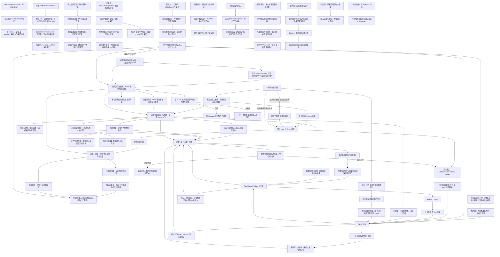
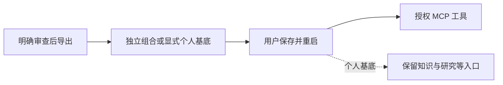
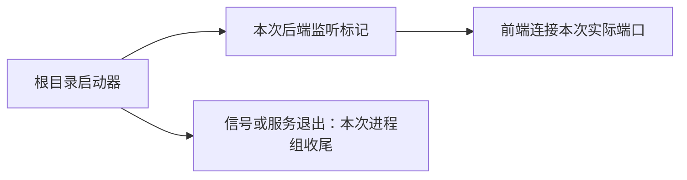
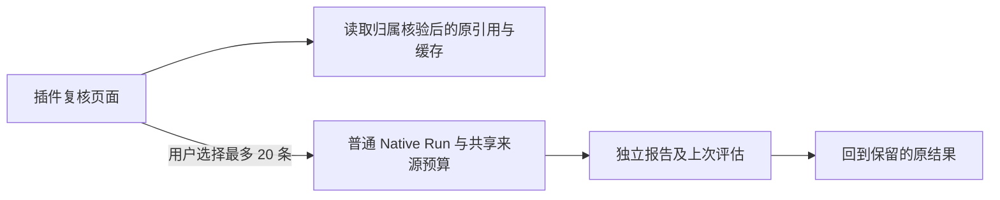
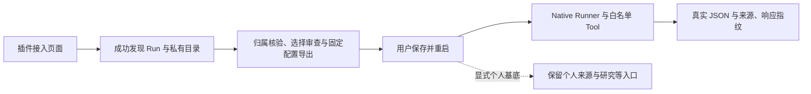
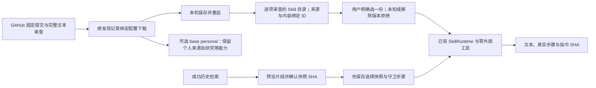
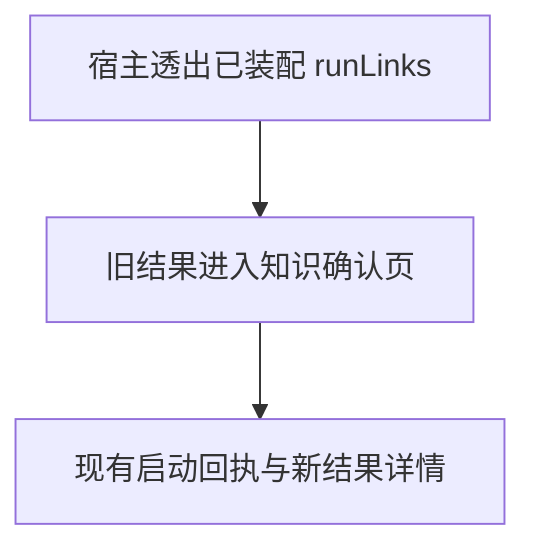
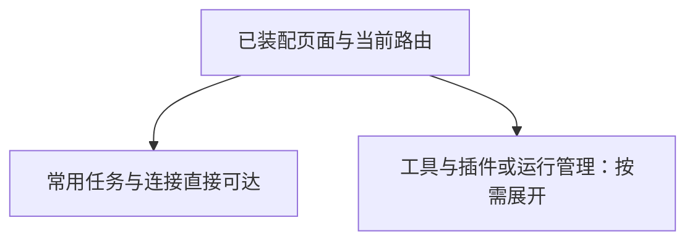
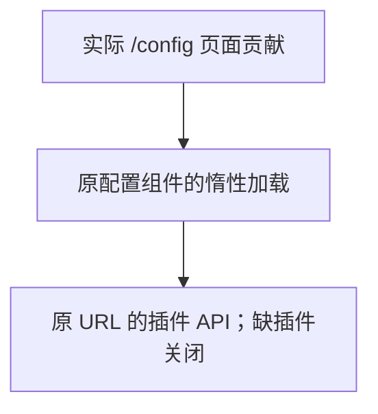

# 本地 Agent 工作台

让个人用户在本机配置模型和连接、选择 Agent、发起任务，并查看真实执行过程与知识证据。

## 功能定位

工作台是确定性控制面，复用 Cordis、Agent Host、Trigger、Run、Step 和 Artifact；自身不是 Agent。首页围绕任务发起与运行历史组织，Agent、插件、个人知识和连接各有独立入口，团队业务保留原能力入口。

## 实现流程图

## 能力边界

### 目标

- 提供真实的本地 Agent 发起、最近运行、产物、步骤和人工继续入口。
- 飞书、模型、TAPD、GitHub 与个人知识来源可在界面填写并保存在本机。
- 无凭据时可检索仓库内的虚构示例笔记。

### 非目标

- 不提供多人认证、远端管理、在线任意仓库代码安装或可视化工作流画布。
- 插件列表展示已装配插件；已审查导出可在页面保存并重载应用，可信原生插件仍通过显式文件配置。
- 回复策略为 none 只关闭最终结果投递；Agent 的业务 Tool 仍可能按任务执行写操作。
- 仅显示最近 50 个根 Run；目前底层 KV 仍遍历 Run 前缀，数据规模增加时需改为分页索引。

## 核心规则

1. HTTP 默认绑定 `127.0.0.1`。管理 API 拒绝非回环 Host、非本机 Origin 和浏览器 cross-site 请求；这是本机信任边界，不是用户认证。
2. 运行入口固定默认 workspace/bot，不接受客户端扩大 Scope；Run 列表和详情先验证该 Scope，再读取 Artifact。最多返回最近 50 个根 Run，子 Run 在详情展示。
3. 新任务使用 UUID triggerId；重复提交同一 ID 复用 Trigger 领取结果。结果状态来自 Runtime，不能用 HTTP 请求完成冒充 Agent 成功。
4. 人工继续保留原 Run、Session 和执行预算；终态 Run 与外部 Scope 不可继续。
5. 本地连接字段采用 allowlist；密钥只返回已配置布尔值。省略字段保留当前值，null 仅用于明确清除密钥；空凭据的飞书可保持未连接，部分凭据拒绝保存。
6. 配置写入独占创建的临时文件、flush、原子 rename，文件权限 0600；读取拒绝符号链接、硬链接和共享权限文件。配置为本机明文，不声称加密。连接更新串行合并，失败保留原文件。
7. 保存不改变在途任务的配置。重启时本地文件覆盖同名环境值；模型供应商/地址/名称和 TAPD 项目/地址/工作项环境值优先于旧 config.json。页面持续提示待重启状态。
8. HTTP 入口通过 loadWorkspacePlugins 默认只选择示例 Markdown 来源、回答、复核、知识界面、网页收集、文档导入、资料库、结果验收、MCP 接入助手、个人研究及任务配方，合计十六个插件、九个 Agent。选择公开网页时替换来源组合。明确保存 GitHub 仓库后再增装 GitHub/发布两个插件，合计 18 个插件、10 个 Agent；清空仓库并重启停用。SDK 团队工厂仍为十五个插件、七个 Agent，HTTP 可用 profiles/agents/team.yaml 显式选择该组合。未声明 base: personal 的显式 AGENT_PLUGINS_FILE 完全管理组合，不自动叠加页面知识配置。
9. 知识请求保留无 chat/conversation 的个人手动 Scope。检索不调用模型，生成回答使用当前宿主模型并发送所选片段；证据沿用来源和引用核验协议。
10. 结果 Markdown 不执行 HTML，不自动加载远端图片；原文链接仅允许 HTTP/HTTPS 和 Obsidian open。原始 JSON 放在详情，不作为主要操作入口。
11. 首页新工作台保留 `?groupId` / `?dashboardId` 的既有看板入口，以及旧根目录 HTML 长链接；这些入口都核对看板插件是否装配，项目看板使用 `/dashboard` 导航。

## 插件后续动作

成功 Run 的动作由插件通过 RunActionRegistry 贡献。工作台只负责通用文本状态面板和执行按钮，不导入知识业务逻辑。状态 GET 只读取最近评估，显示检查时间；显式 POST 才执行插件指定的 Capability。请求仅接受可选 UUID，目标与输入由服务端插件固定，幂等键包含动作、目标 Run 和 UUID。

知识复核是首个使用者：检查原回答或发布草稿实际引用的文档版本，产生独立检查记录，不重新生成答案，不改变原 Run 的成功状态或原 Artifact。移除插件后不显示动作，历史产物保留。面板协议为 StatusPanel 1.0；无效或未知 Artifact 展示协议回退原有结果，状态读取失败显示错误，不沿用绿色状态。

## 插件贡献的页面与业务任务

HTTP 装配先核对现有 API 命名空间，插件声明冲突时拒绝启动，防止覆盖尚未迁移的接口。

工作台 state 增加 pages 和 manualJobs，由真实 Cordis 注册表提供。前端按页面元数据生成导航，支持已打包站会、看板、甘特、周报、隐藏纪要视图或指定 Agent 的入口；不执行第三方 HTML/JS。入口失效显示恢复链接，连接失败提供重试，Agent 入口跳转后保留导航选中状态。旧根查询参数与根目录 .html 看板链接共享插件检查，只有看板插件启用时才可打开；导航保持对应页面选中。

站会页面和统计 API 随 builtin.standup 装配；移除后旧地址不能访问数据。Debug 页面只显示已声明的任务，后端 /api/jobs 同样校验所有者，不能靠手写请求绕过。显式团队组合保留九项任务，默认个人组合与空组合没有这些任务。原有站会、看板、甘特、周报及隐藏纪要页面/API 已迁移，读写都经插件所有权检查。navigation=false 的页面保留直达入口，不在导航展示。周报使用统一历史抽屉与精确版本选择，纪要使用服务端分页、附件链接和展示收件人的发送确认；生成仍关闭。知识库导航、页面和来源描述 API 已归属 knowledge.workspace，可单独移除界面并保留来源能力。核心通用输入/结果中的部分知识适配、连接与基础服务生命周期仍按路线图迁移。

## 新资料收集插件

默认个人组合增加 knowledge.capture 与 community.markitdown；分别拥有 /capture 与 /documents，不需要模型。网页结果保留 URL、时间与版本，文档上传只返回私有 ID，实际转换经同一 Run 的 Tool Gateway 使用 MarkItDown 0.1.9。结果抽屉可复制/下载 Markdown，不自动写入笔记。页面可声明对应 Capability，Agent 卡片和能力选择自动进入结构化表单；未安装的页面仍拒绝访问。安装、边界和验证见 docs/DOCUMENT_IMPORT.md 及对应功能卡。

## 知识工作台插件

/knowledge 不再是核心固定路由，由 knowledge.workspace 贡献。页面从其只读描述 API 获取明确来源与检索 Capability，不按 Agent 顺序推断；回答仅在依赖同一来源且对应 Agent 活跃时开放。默认组合装配界面，来源本身与 CLI/SDK 不隐式加载 UI；显式插件文件需按需添加。描述读取失败显示重试并禁用检索。配置文件管理来源时页面禁用来源编辑入口。代码、样例和验证见 [知识工作台功能卡](../../knowledge/workspace/FEATURE.md)。

## 发布准备入口

发布插件贡献 /release 已打包视图，表单提交合并时间段和个人规则关键词，复用同一 Run API 与结果抽屉。无模型时仅收集证据；生成使用当前宿主模型并提示事实及片段的数据去向。结果优先展示状态面板，再展示正文。JSON 通过通用 StatusPanel 展示实际状态，Markdown 呈现草稿或可读的证据、来源版本与覆盖提示，不在通用结果组件加入发布专用分支。原始 JSON 保留在详情。移除插件时导航、页面和 Capability 同时不可用，历史数据保留。自定义插件文件管理来源时页面明确提示，以免把保存的设置当成实际装配。

验证：backend/test/workspace.test.ts 覆盖来源匹配、脱敏、重启生效/停用和真实 HTTP collect；发布专项检查状态面板与可读证据；frontend/src/pages/workspace/releaseInput.test.mjs 检查日期和关键词边界。

## 社区 Skill 与 Context7 验证

标准 SKILL.md 可经 readAgentSkill 显式导入现有 Prompt Skill Runtime；元数据不能自动取得工具或 Agent 授权，不执行目录脚本。community.context7 是真实使用者：接入上游 MCP 两个读取工具，提供无模型查询和需模型的研究助手；页面按插件贡献，未知能力标签使用作者声明的 Agent 名称。默认组合不自动安装它。来源、许可、运行命令和验收边界见 [社区接入说明](../../../../docs/COMMUNITY_PLUGINS.md)。

验证：backend/test/context7Plugin.test.ts 覆盖格式/边界、权限不继承、受控 Prompt Skill 执行及插件装配；本地实际 MCP 与工作台验收覆盖公开文档检索。真实付费模型未调用。

资料库独立贡献 /library、来源列表、显式收录动作与检索 Agent。默认组合现在包含 十四个插件、九个 Agent；GitHub 组合为 16 个插件、10 个 Agent。KNOWLEDGE_KIND=library 使用宿主实际 data_path 下的固定范围目录，重启后复用既有来源/回答/复核；旧 Vault 设置不影响它。资料库本身立即可检索，设置保存不冒充已经切换。验证：backend/test/knowledgeLibrary.test.ts。

结果验收由 quality.checks 独立贡献 /checks 与规则描述 API。页面选择已装配规则、最近 50 次根运行中的已结束受检记录及可选基准，生成普通 Native Run；结果以通用面板显示 passed/failed/unverifiable 和原始运行跳转。两次记录使用同一份当前规则，输入差异和旧凭证缺失明确展示，不声称升级因果或语义质量。默认 HTTP 现为 十四个插件/九个 Agent，GitHub 组合为 16 个插件/10 个 Agent。

## MCP 接入与通用运行

HTTP 默认加入独立 mcp.setup 接入助手，公开 HTTPS 匿名发现、审查勾选与 local.yaml 导出；不调用目录内工具或读取 Secret。保存并重启明确组合后，mcp.runner 按可信 allowedTools 转调已注册读取工具，实时 Schema 校验、同一 Scope/信号与共享两次 Tool 预算，记录 Agent/路由/上游三步。ctx.delivery.tools.list 只返回契约副本，ToolExecutionContext.budget 沿用既有预算，不给旧调用新增额度。移除插件释放页面/API/Agent/Tool，历史保留；无在线安装或 OS 沙箱。实现与测试见 [接入功能卡](../../connectors/mcp-workbench/FEATURE.md)。

mcp.setup / openapi.setup 1.1.0 的配置导出接受可选 includePersonalWorkspace 布尔值。页面默认勾选保留个人工作台，切换选择会清除已生成配置，需重新生成；缺省或 false 的旧 API 请求仍导出原独立组合。true 声明 base: personal，按重启时本机设置保留知识、研究、资料库、配方与模型提供者。MCP 只追加 connector.mcp / mcp.runner（基底已有 mcp.setup），标准基底下十六插件十 Agent；OpenAPI 追加 connector.openapi / openapi.setup，为十六插件十一 Agent。文件仍保存于 backend/examples，个人文件名含 .personal.local.yaml。不会合并其他自定义附加插件或团队组合；重复 ID 拒绝，授权/输入/预算/历史语义保持，不为研究 Agent 自动授予新工具。

验证补充：backend/test/mcpWorkbench.test.ts 与 openApiConnector.test.ts 将实际导出 YAML 经 loadWorkspacePlugins 装配，同 Host 成功运行知识检索和授权工具，检查入口、数量、MCP setup 唯一、历史保留与旧参数兼容。代码：mcp-workbench/catalog.ts / plugin.ts、openapi/setup.ts、McpSetupPage.tsx、OpenApiSetupPage.tsx、frontend/src/api.ts。

## 个人默认与按需团队

默认选择不再叠加 deliveryTeamPlugins。loadWorkspacePlugins 是 HTTP 装配入口，显式文件优先于个人来源/GitHub 自动组合，即使未选个人配置不完整也不影响独立团队/空组合加载。默认首页先显示实际贡献的可见 workspace 页面中已知的资料、研究、复核及发布任务；使用插件真实路径，不为隐藏、团队或未知视图制造入口。通用任务表单默认折叠。显式 capability/query 链接及没有已知任务页的组合保留原路由/表单行为；能力仍从实际 active Agent 选择，团队协调能力只在已装配时优先，明确的失效链接不静默换成另一能力。没有可用 Agent 时禁止执行并显示插件入口。个人资料的快捷入口只在 sample 来源填入虚构查询，不覆盖用户笔记场景的输入。

导航只有存在可见团队页面或插件拥有的手动任务时才显示团队分区与配置入口；业务任务还须 manualJobs 非空。隐藏纪要页不单独使团队分区出现。该展示规则不是 API 授权，实际业务 API 仍按插件所有权判断。飞书/TAPD 保持可填写并说明独立启用团队组合的方法；保存凭据不安装 Agent。切换同一数据目录保留已完成历史，缺失旧插件不会被历史记录重新启用。

## 个人研究入口

personal.research 插件贡献 /research 的已打包表单，明确当前资料能力、模型数据流与四次委派限制。未配置模型禁用发起，并保留知识检索/连接入口；发起使用普通本机 Run API 和 RunDrawer。成功结果先显示真实子任务索引及 partial 警告，再展示待复核模型稿和原始资料，相关运行可跳转。人工继续后旧问题只保留在原始详情，多份资料引用锚点按 Artifact ID 隔离。

实现：frontend/src/pages/workspace/ResearchPage.tsx、PluginPage.tsx、RunDrawer.tsx；后端契约与验证：backend/src/agents/personal-research/FEATURE.md、backend/test/personalResearch.test.ts。未提供远端插件前端执行或自动安装；真实模型研究效果需独立验证。

## 用户能力

- 在工作台选择能力、发起任务，在运行记录中查看结果、步骤和错误。
- 查看已装配 Agent、功能插件及版本与依赖。
- 检索示例/个人笔记或公开网页，并按需生成引用回答。
- 填写自己的飞书、模型、TAPD 与知识来源；配置重启后使用。

## 入口与触发

| 入口 | 输入 | 输出 |
| --- | --- | --- |
| `/`、`/runs` | 能力、任务或高级结构化参数 | 真实 Run 与详情 |
| `/agents`、`/plugins` | 搜索词 | 当前 Agent/插件清单 |
| `/knowledge` | 来源配置、关键词或问题 | 来源设置、检索或回答 |
| `/connections` | 外部服务配置与密钥 | 脱敏配置与待重启状态 |
| `/api/workspace/state` | 本机请求 | Agent、插件、最近运行、Host 状态 |
| `/api/workspace/connections` | GET / PUT 字段 Patch | 脱敏配置快照 |
| `/api/workspace/runs` | POST 能力、input、triggerId | Run ID 与实际状态 |
| `/api/workspace/runs/:runId` | GET 本地 Run ID | 结果、步骤、Checkpoint、子 Run |
| `/api/workspace/runs/:runId/actions` | GET 本地成功 Run | 插件动作及缓存状态，不创建 Run |
| `/api/workspace/runs/:runId/actions/:actionId` | POST 可选 triggerId | 固定目标的新执行，复用 Runtime 与幂等 |
| `/api/workspace/runs/:runId/resume` | POST input、triggerId | 原 Run 恢复结果 |

## 运行逻辑

1. 启动读取私有连接设置，注入环境变量，再构造 Adapter 和 Host。
2. 装配团队与选定知识插件，配置飞书连接并启动 HTTP。
3. 页面通过 SWR 共享运行快照；列表轮询，终态详情停止轮询。
4. 发起或继续任务进入 Host 和 Trigger Runtime，执行事实进入既有持久化 Store。
5. 页面分开展示结果、步骤和原始详情；部分知识来源失败会显式提示。

## Agent、Tool 与服务边界

| 对象 | 职责 | 禁止承担 |
| --- | --- | --- |
| Workspace API | 本地入口校验、固定 Scope、结果查询 | 任意客户端 Scope 或任意执行器 |
| LocalConnections | 校验与私有配置持久化 | 启动网络连接或热替换在途 Agent |
| Agent Host | 已注册能力执行、运行记录与恢复 | 复制知识解析或业务规则 |
| 前端 | 任务输入、状态和证据呈现 | 伪造成功状态、保存密钥到浏览器存储 |

## 数据与状态

- 连接设置由 LocalConnections 唯一写入 `${DATA_DIR}/connections.json`；重启前 active 快照保持不变。
- Run/Step/Artifact 使用宿主 Prisma KV 持久化，与 CLI 可选独立 SQLite 状态文件分开。
- 知识索引仍由来源插件重建，不持久化整座 Vault 的内容快照。
- 工作台控制面没有新增业务实体或独立 Agent。

## 失败、安全与降级

- 错误配置、无效来源、非本机请求和跨 Scope 查询在服务端拒绝。
- 缺模型时界面提示配置；原文检索可独立运行。模型或来源执行失败保留真实 Run 状态。
- 页面无响应或关闭不代表后台 Run 取消；失败重试应先查看原运行记录。
- 连接文件与数据库没有加密；本地文件访问和可信插件仍由运行机器的账户控制。当前入口不用于公开共享。

## 代码地图

### 主要实现

- `backend/src/platform/workspace/composition.ts`：HTTP 个人默认/显式配置优先级；团队工厂保持 SDK 兼容。

- `backend/src/platform/plugins/web.ts`、`backend/src/platform/workspace/jobsApi.ts`：Web 声明与手动任务入口。
- `frontend/src/pages/workspace/PluginPage.tsx`、`pages.ts`：动态页面、空状态与安全内部跳转。

- `backend/src/platform/workspace/connections.ts`、`knowledge.ts`、`api.ts`：连接、知识组合与本地 API。
- `backend/src/index.ts`：启动顺序、管理 API 本机限制。
- `backend/src/platform/bootstrap/agentHost.ts`：本地根 Run 列表、详情、发起与继续。
- `frontend/src/layouts/MainLayout.tsx`、`frontend/src/App.tsx`、`frontend/src/index.css`：浅色响应式应用壳与路由。
- `frontend/src/pages/workspace/WorkspacePage.tsx`、`RunDrawer.tsx`：任务、历史和执行结果。
- `frontend/src/pages/workspace/ReleasePage.tsx`、`releaseInput.ts`：发布准备表单、真实运行历史、日期与关键词校验。
- `frontend/src/pages/workspace/RunActions.tsx`、`panels.ts`：插件动作、版本化文本面板与内部 Run 导航。
- `backend/src/platform/plugins/runActions.ts`：动作注册与面板 Schema。
- `frontend/src/pages/workspace/CatalogPage.tsx`、`ConnectionsPage.tsx`、`KnowledgePage.tsx`：能力、连接与知识。
- `frontend/src/pages/workspace/state.ts`、`input.ts`、`frontend/src/api.ts`：共享请求、输入和链接边界。

### 主要测试

- `backend/test/workspaceComposition.test.ts`：真实个人检索、团队/空组合、默认接口和任务缺失、显式配置优先、切换保留历史；每例使用独立私有临时目录，并验证初始化未借用环境中的应用数据目录。
- `frontend/src/pages/workspace/pages.ts`、`pages.test.mjs`：实际能力默认、失效链接、隐藏团队页及空任务导航；首页四类已知任务按固定顺序使用实际路径，未知/隐藏/团队/Agent 视图不混入任务卡。

- `docs/PROJECT_EVIDENCE.md`、`CONTRIBUTING.md`：公开演示、结果边界和完整测试环境；2026-11-05 独立目录实际安装、Python 3.14.7/MarkItDown 0.1.9、602 后端/17 前端测试与无凭据页面检索通过。截图使用内置虚构资料，图片不包含私有运行配置。
- `backend/test/featureIndex.test.ts`：首页默认、GitHub 与 SDK 数量对照实际插件/Agent 声明，防止上手文档沿用旧装配数。
- `README.md`、`backend/README.md`、`frontend/README.md`、`docs/LOCAL_DEVELOPMENT.md`：无凭据首次运行与可选外部连接的统一入口；文档转换环境单独安装。

- `backend/test/pluginWeb.test.ts`、`backend/test/standupApi.test.ts`：第三方页面/API、未启用拒绝、请求体与查询边界。
- `frontend/src/pages/workspace/pages.test.mjs`：页面装配、卸载后的解析、URL 编码和当前导航。
- 浏览器验收：默认站会可用，空组合站会不可访问且手动任务为空，MCP 动态入口读取虚构文件成功；375px 导航正确选中。

- `backend/test/workspaceActions.test.ts`、`backend/test/runActions.test.ts`：第三方贡献、目标/作用域、幂等、缓存不刷新、独立评估和停机等待。
- `frontend/src/pages/workspace/panels.test.mjs`：面板版本、大小与非法格式降级。

- `backend/test/workspace.test.ts`：私有配置、重启生效、串行保存、坏配置拒绝、本机 Origin、真实插件 API、Scope、幂等、示例知识与人工继续。
- `frontend/src/pages/workspace/input.test.mjs`：知识请求契约、旧看板链接与原文协议限制。
- 浏览器验收：本地检索到真实引文、保存飞书设置反馈、桌面和 375px 导航/表单；后端全量回归与前端类型/lint/构建。

本批验证：`backend/test/projectVisibilityApi.test.ts` 覆盖插件关闭后的读写拒绝、文件边界、计划校验和审计；`frontend/src/pages/workspace/pages.test.mjs` 覆盖旧看板链接的所有权。配合后端全量回归、前端门禁和桌面/移动端浏览器验收。

## 变更记录

| 日期 | 变更 | 验证 |
| --- | --- | --- |
| 2026-11-05 | 统一首页、前后端与本地指南：无凭据启动、真实插件数量、转换环境和新能力入口 | 全新 git archive 独立安装、建库与前端构建；空凭据就绪、14 Agent/17 插件、浏览器示例原文检索及未安装转换器提示；文档数量回归与类型检查 |
| 2026-11-05 | 工作台展示插件贡献页面和手动任务；移除站会插件后页面与接口同时关闭 | 插件 Web/站会 API 专项、后端回归、前端检查及默认/空配置/MCP 浏览器验收 |
| 2026-11-05 | 增加插件拥有的后续动作、知识引用检查与独立报告；HTTP 默认加载复核插件 | 插件动作/API 专项、后端回归、前端检查与桌面/375px 浏览器验收 |
| 2026-11-05 | 本地 Agent 工作台、真实运行与知识入口、可填写连接设置、响应式浅色应用壳 | 工作台专项、后端回归、前端检查和本地浏览器验收 |

## 任务配方与本机执行服务

personal.recipes 独立拥有任务配方页面/API 与私有 KV，默认个人组合增加一个插件但不增加 Agent。保存时先核对成功根 Run 的 Scope、单次 execution 1.0、原参数指纹及当前安装/Manifest；多轮人工补充或旧凭证不补造。使用前审查本次参数，经可选 PluginHostServices.runLocal 进入固定默认 workspace/bot、manual Trigger 和 none 回复策略，继续受实际 Agent Schema、Scope、预算和运行记录约束。该服务在 Host 未就绪/停止时拒绝，不可在 apply 阶段等待调用；原生插件仍是可信宿主代码。

运行参数可修改，原配方不覆盖；请求 UUID 持久绑定配方/参数/契约。Runtime 在真正解析根执行后核对可信 expectedExecution 的安装及 Manifest 指纹，拒绝预检查后契约变化，不接受客户端 input 扩权。子委派及人工继续保持既有协议；指纹不冻结模型、知识、Tool 实现或全部环境。旧调用不带该上下文，语义保持。

前端仅在装配配方时于页面内存保留有界候选输入，刷新/移除清空；明确保存才写本机完整参数。来源回执在插件 KV，避免向其他 Agent 注入越出 Manifest 的 Artifact；写回执失败返回真实 Run ID 与警告。RunDrawer 展示配方来源和参数变化，可回到原始结果；移除插件关闭入口但保留记录。

实现/规则见 [任务配方功能卡](../../recipes/FEATURE.md)，验证：backend/test/runRecipes.test.ts、frontend/src/runInputs.test.mjs、既有 Runtime/插件回归和桌面/375px 浏览器验收；本批不验证真实模型质量。

## 本机模型连接

连接表单新增 Ollama，选择时默认本机 /v1 地址并隐藏密钥输入；不删除旧云密钥，本机请求不转发该密钥。显示已保存参数与当前已装配提供者，不把保存当作连接成功。保存后重启，API 只接受标准别名或已装配自定义 ID；Ollama 仅允许无凭据的 HTTP 回环地址。workspace.state.modelProviders 仅公开 ID/名称，modelConfigured 由实际 Host 网关判断。 完整协议、实现与验证边界见[模型提供者功能卡](../models/FEATURE.md)。验证：backend/test/modelProviders.test.ts、knowledgeAnswer.test.ts、personalResearch.test.ts 及既有回归。

## 笔记与网页混合来源

KNOWLEDGE_KIND=mixed 原子验证目录与公开 URL，装配两个来源及混合路由；主普通默认仍为 14/9，选择混合为 16/11，配置 GitHub 后为 18/12。知识输入与首页默认能力采用明确混合入口，来源详情保留两源状态和类型；已有运行不删除。 实现、配置与验证边界见[混合知识功能卡](../../knowledge/mixed/FEATURE.md)；验证：backend/test/knowledgeMixed.test.ts 及既有功能回归。

## 根目录本地启动

`bun run setup:local` 安装锁定依赖、生成客户端并调用既有安全 SQLite 同步，再启动前后端；`bun run local` 直接启动。后端在监听后仅向携带 LOCAL_DEV_SESSION 的本次启动输出 session/loopback/实际端口标记。启动器只接受匹配标记，注入前端 VITE_API_BASE；不读取秘密或靠端口判断归属。两端绑定回环地址，退出保留最多 10 秒收尾，持续接收重复中断；前置命令和服务统一只发送一次正常停止信号，仅清理本次进程组。后端直接执行入口，避免包脚本多次转发停止信号；无 watch，修改配置或代码需重新运行。运行事实、连接保存和就绪检查保持既有协议；首次安装仍不代表外部服务可用。

代码与测试：scripts/local/launcher.ts、backend/src/index.ts、backend/test/localLauncher.test.ts。完整边界见[本地启动功能卡](../../../../scripts/local/FEATURE.md)。

## 知识复核集中入口

knowledge.impact 贡献 /knowledge-reviews 和 /api/knowledge-impact/reviews；前端按实际页面贡献挂载，移除插件后无法访问。列表复用既有最近 50 次根运行，显示成功回答/草稿的实际引用路径与带时间的上次检查状态。GET 按最多 50 个 ID 查询，先核对全部 workspace/bot 再读 Artifact，只返回摘要，不创建 Run、改写状态或读取来源。

用户按路径/状态筛选并明确选择最多 20 条后，通过普通 Run API 调用 knowledge.impact.check，生成独立报告、共用版本 Tool 预算与 CAS 评估；原 Artifact 不变。界面刷新所选原动作缓存，分别链接原结果与检查记录。current 只标记上次版本未变化，损坏/未完成/未知记录不显示绿色；版本一致不证明语义正确。无历史全量扫描、后台监控或自动重生成。

实现：backend/src/knowledge/impact/plugin.ts、service.ts，frontend/src/pages/workspace/KnowledgeReviewsPage.tsx、knowledgeReviews.ts。验证：backend/test/knowledgeReviews.test.ts、既有知识复核/动作回归，frontend/src/pages/workspace/knowledgeReviews.test.mjs，类型/lint/build 与桌面/375px 浏览器验收；真实模型效果未验证。

## 显式 OpenAPI 接入与运行

openapi.setup 与 connector.openapi 通过既有 Cordis 注册独立 Agent、Tool、页面/API，不改变默认十四插件九 Agent。发现不调用接口；导出先核对成功根 Run 的默认 workspace/bot 和带角色目录，仅接受该次可用接口及服务器选择，固定输入契约后重启生效。运行沿用 Scope、共享两次预算、取消与 Run/Step/Artifact；卸载释放入口而保留历史。workspace/request.ts 提供 MCP/OpenAPI 共用的 16 KiB/5 秒取消感知正文读取，原 MCP 导出语义保持。

边界与代码地图见[OpenAPI 功能卡](../../connectors/openapi/FEATURE.md)。验证：backend/test/openApiConnector.test.ts、mcpWorkbench.test.ts、knowledgeWeb.test.ts；前端类型/lint/build 与桌面/375px 验收。不提供认证、私网、写入或完整输出 Schema 验证。

## 显式审查后的新笔记回写

knowledge.writeback 贡献独立 manual Native Agent、提案/新建 Tool、页面/API；默认装配数量不变。先按原运行归属提取实际引用并核验版本，生成不落笔记文件的固定提案；人工审查后通过另一普通 Run 绑定内容 SHA 确认，重验来源与目录身份，再 0600 暂存、排他发布新文件并读回验证。draft/approved/saved 与回执由插件私有 KV 拥有；已确认文件可恢复缺失回执，重复确认不重复写入，已有笔记和原 Artifact 保留。

实现、边界与代码地图见[知识回写功能卡](../../knowledge/writeback/FEATURE.md)。验证：backend/test/knowledgeWriteback.test.ts、既有知识/Runtime 回归、前端类型/lint/build 与桌面/375px 本地验收。仅新建，不支持已有笔记替换或自动批准；真实模型效果未验证。

## 固定题集知识问答评测

可选 /evaluations 通过普通 Run API 运行六道虚构题，区分离线脚本与明确确认的当前模型，展示逐题检查、实际引文与内部轨迹，下载 JSON 并比较同模式记录。最近 50 次根运行中选取成功保存的评测；模型未配置时前后端均拒绝实时模式。复用现有浅色界面，不读取用户 Vault。

实现与限制见[评测功能卡](../../evaluations/FEATURE.md)。代码：backend/src/evaluations/、backend/src/scripts/evaluate.ts、frontend/src/pages/workspace/EvaluationsPage.tsx。验证：backend/test/evaluations.test.ts、既有模型/插件/RAG/工作台回归、前端类型/lint/build 与桌面/375px 浏览器验收。固定样例和本机 HTTP 协议服务不代表真实模型质量；无语义裁判、个人资料评测或历史业务环境回放。

## GitHub Skill 审查与文本运行

显式 skills.setup 的 /skills 支持公开文件链接、原文/许可审查、内容绑定确认和本地配置下载，保存/重启后由 skills.prompt 提供 /skill-runner。文本运行复用普通 Run/Drawer；未配置模型时表单与通用能力入口禁用，后端再次检查。默认导航和十四插件九 Agent 保持。

多份 Skill 在 skills.prompt 1.2.0 内共用一个 Native Runner，最多八份、内容配置 JSON 512 KiB；每份原成功发现记录及双确认在导出时复验，同名/不同来源或版本不覆盖。目录 ID 按固定来源与原文指纹生成，顺序变化不影响选择；模型只收到所选指令，未知/移除 ID 在调用前拒绝。旧单份配置和省略 ID 的单项运行保持，多份不能省略。结果保留实际 ID/来源/步骤；目录 GET 不调用模型，停用释放全部注册。代码与验证补充 catalog.ts、service.ts、promptPlugin.ts、SkillSetupPage.tsx、SkillRunnerPage.tsx、backend/test/skillWorkbench.test.ts。

显式配置只有声明 base: personal 才继承当前本机个人预设；未声明的旧文件仍完整替换。基底在重启时按本机来源与 GitHub 设置生成，不是冻结环境；追加插件重复 ID 拒绝，不覆盖基底，不递归继承其他文件或合并团队/自定义组合。 Skill 导出勾选保留个人工作台时生成 plugins.skills-personal.local.yaml，只追加 setup/prompt；默认个人基底加 Skill 为十六插件十一 Agent。sourceSettingsManagedByPluginFile 区分来源所有权，base personal 的来源仍可在页面保存并重启。

skills.prompt 1.2.0 可在手动任务中绑定已预览并确认的成功知识检索根运行。先验 workspace/bot/根运行/Capability/成功状态，再读取唯一私有 JSON，复用 retrievalEvidence / selectEvidence 的十条、12000 字符预算；请求仅含原 Run ID、快照 SHA 和 confirmed=true，不接受客户端片段。模型只收到历史标记、partial 与片段 ID/标题/小标题/原文，不额外提供路径、URI 或版本字段；文字自身可能含这些信息。模型调用前保存私有 skill.knowledge.context Artifact 和 guardrail Step，失败/取消也保留“选入”记录，不能视作接收/采用/引文核验或当前来源证明。成功文本与来源产物关联源 Run/Artifact、快照 SHA 和选择产物；纯文本旧任务保持两个产物。

代码/验证补充：connectors/skill-workbench/knowledgeContext.ts、platform/plugins/configuration.ts、workspace/composition.ts / api.ts；backend/test/skillKnowledgeContext.test.ts、pluginConfiguration.test.ts、workspaceComposition.test.ts。

实现与限制见[Skill 工作台功能卡](../../connectors/skill-workbench/FEATURE.md)。代码：backend/src/connectors/skill-workbench/、platform/skills/packageLoader.ts、runtime.ts；前端 SkillSetupPage.tsx / SkillRunnerPage.tsx。验证：backend/test/skillWorkbench.test.ts、toolSkillRuntime.test.ts、context7Plugin.test.ts 与既有 Host/Plugin/模型回归，前端检查及桌面/375px 验收。仅支持指令文本，无脚本/引用资源自动执行或完整上游能力兼容；模型协议样例不证明真实质量。

## 本机长任务启动与停止

首页、知识检索/回答、个人研究、发布准备和导入 Skill 文本页改用 POST /api/workspace/runs/start。请求必须带 UUID triggerId，Capability 与序列化输入的 SHA 绑定该领取记录；先持久关联 Run，才允许 Adapter 执行。返回 202 和真实 runId/status 后打开详情轮询；相同 UUID/参数复用同一运行，不同参数返回 409。前端仅对无服务端响应重试一次同一 UUID，仍未确认时引导检查运行记录。后端每 workspace/bot 最多四个活跃手动根任务，新启动超额返回 429，没有等待队列；暂停任务不占活跃槽位。旧 POST /runs、插件 runLocal、动作和配方仍等待完成，内联检查/导出流程保持原契约。

详情返回 controls.canCancel/cancellationRequested；只有带明确 manual 来源、本机默认 Scope 的根运行可控制。POST /runs/:runId/cancel 仅接受空对象，先验归属；子任务、旧记录缺少来源、其他 Scope 返回 404。活跃任务请求协作取消，暂停任务直接进入 cancelled；遍历同根且同 Scope 的子任务，传播 RUN_CANCELLED。单运行状态提交与取消串行，完成先落盘则返回 requested=false，取消先发生则拒绝迟到成功。请求记录为 guardrail Step run.cancel，原产物和 Checkpoint 保留；已取消根任务及其子任务不能独立继续，子任务补充信息回到父任务。

取消不是副作用回滚或操作系统进程强杀；忽略信号的原生插件可能继续操作。运行记录中的取消状态表示宿主停止等待与接受成功结果。取消后的任务不创建新的结果投递；此前完成的写入或投递不会撤销。关闭页面不会停止任务，返回“运行记录”可找回最近根任务；服务重启仍按既有 PROCESS_RESTARTED 收敛未结束任务，不自动重放。

Host 跟踪回执准备及其后台 completion。关闭时持续排空在途集合，覆盖回执持久化中才加入的后台任务，再释放插件。控制层不新增业务 Agent/插件，默认仍为十四插件九 Agent。

代码：backend/src/platform/agents/runtime.ts、contracts.ts；backend/src/platform/runtime/triggerRuntime.ts、triggerStore.ts、persistentTriggerStore.ts；backend/src/platform/bootstrap/agentHost.ts、workspace/api.ts；frontend/src/api.ts、pages/workspace/RunDrawer.tsx 及上述五类发起页面。验证：backend/test/runControl.test.ts、localRunApi.test.ts、既有 Runtime/Host/工作台回归；frontend/src/api.test.mjs 验证响应丢失复用 UUID、服务拒绝不重试与未确认提示。操作与限制见 [本机运行控制](../../../../docs/LOCAL_RUN_CONTROL.md)。

2026-11-06 首次体验复验：从公开 main 的 1267801 新克隆，无项目依赖/配置/数据库，实际执行根 setup:local，浏览器无密钥检索成功；正常停止后本次两个监听端口关闭，local 再启动保留同一 Run/Step/Artifact 与原 .env（0600）。使用普通包缓存，未复用工作目录的 node_modules；记录见 docs/PROJECT_EVIDENCE.md 的“公开 main 全新安装复验”。运行行为保持，验证继续由 backend/test/localLauncher.test.ts、workspaceComposition.test.ts、featureIndex.test.ts 覆盖。

## 插件组合配置（2026-11-06）

默认个人组合新增可独立移除的 plugins.compose 控制面插件，当前十五插件、九 Agent；GitHub 配置后十七插件、十 Agent。插件页按实际页面贡献展示入口，页面不增加侧栏项目。只转换已审查的 Skill、匿名 HTTPS MCP 和固定 GET OpenAPI 导出文件，各一份；输出 base personal 与 backend 根目录相对模块路径。原 Skill 形态/ID、内容/许可及工具授权保留，不读取当前自定义配置、不导入输入指定模块、不联网、不持久化或创建 Run。下载后由用户保存并重启；历史运行数据保留。组合校验不替代来源/许可/用途审查。

共享 JSON 读取器仅新增宿主指定的字节上限：默认仍 16 KiB，组合入口为 3 MiB 请求、1 MiB YAML 内容，保留五秒、取消和流清理。功能流程、代码与边界见[组合功能卡](../../connectors/profile-workbench/FEATURE.md)。实现：backend/src/connectors/profile-workbench/compose.ts、plugin.ts，frontend/src/pages/workspace/ProfileComposerPage.tsx / CatalogPage.tsx / PluginPage.tsx，platform/workspace/knowledge.ts / request.ts；验证：backend/test/profileComposer.test.ts、workspaceComposition.test.ts、featureIndex.test.ts，既有 Skill/MCP/OpenAPI 回归及前端门禁。

## 研究任务固定请求协作（2026-11-06）

personal.research 1.1.0 可按本次人工确认的固定参数委派已装配 MCP HTTP/OpenAPI GET；空选择保持原研究能力，不暴露这两项可选委派。先留私有确认记录再联系模型，实际完成仍由成功子 Run/Artifact 证明；确认记录不是资料证据，原结果规则按 artifactRole 继续只检查研究稿与资料索引。新可选 delegationSchema 回调只能过滤/约束 Manifest 已声明能力，Schema 与原契约组合，并在执行前独立校验，拒绝留下 guardrail、不调用子任务。默认未提供回调的模型插件行为保持。

ToolDefinition 可带连接器生成的 binding（公开地址与配置/契约 SHA，无 Secret 值）；MCP/OpenAPI 路由输入 Schema 明确枚举本地授权工具，原调用前白名单与共享预算保留。研究目录绑定 Tool、路由授权、Agent Manifest 和安装 ID；继续读取原确认，拒绝端点/契约变化与新授权。没有增加 Agent 或默认插件数量。

实现与边界见[研究功能卡](../../agents/personal-research/FEATURE.md)。代码：agents/personal-research/externalRequests.ts、plugin.ts，platform/agents/modelLoopAdapter.ts、platform/tools/contracts.ts，connectors/mcp/plugin.ts、mcp-workbench/runner.ts、openapi/plugin.ts；前端 ResearchRequests.tsx / ResearchPage.tsx、api.ts、index.css。测试：backend/test/researchRequests.test.ts、modelLoopAgent.test.ts、personalResearch.test.ts，原 MCP/OpenAPI、结果验收、Host/生命周期/取消回归，以及前端检查和本地界面验证。

## 默认界面启用接入助手（2026-11-06）

plugins.compose 1.1.0 提供独立 POST /api/plugin-profiles/setup：严格接受 skills/openapi 非空唯一选择，只输出已打包的固定模块与个人基底，不接受路径/凭据/自定义配置。16 KiB、五秒、本机 Host/Origin 和 Cordis 卸载边界沿用现有平台。默认十六插件九 Agent 不变；同时选择两助手后在标准示例预设为十七插件十一 Agent，只有发现能力，尚不启用实际 Skill/API Runner。下载后用户保存并重启；既有能力组合接口、三份/1 MiB 文件限制与历史保留不变。

插件页进入“接入与组合”，两种流程使用有活动状态的页签；切换页签或输入会清除旧预览，处理中禁止改变，助手已启用标签来自真实页面贡献。当前自定义附加插件不自动合并，助手文件仅供首次启用，不作为审查能力文件上传。完整流程见[接入与组合功能卡](../../connectors/profile-workbench/FEATURE.md)。代码：connectors/profile-workbench/compose.ts、plugin.ts，frontend/src/pages/workspace/ProfileComposerPage.tsx / CatalogPage.tsx、frontend/src/api.ts；验证：backend/test/profileComposer.test.ts（固定配置边界、真实加载、原检索历史与未审查运行器拒绝）、原导出/组合回归、前端门禁及浏览器接入。

知识页首次体验（2026-11-06）：匹配的回答能力已装配但模型未配置时，解释禁用原因并链接到“连接与模型”；原文检索保持可用，保存模型后仍需重启。仅调整 frontend/src/pages/workspace/KnowledgePage.tsx 展示，模型/来源/运行协议不变；验证为现有前端回归、类型/lint/build 与全新公开克隆浏览器验收，详见[知识工作台功能卡](../../knowledge/workspace/FEATURE.md)。

## 可选知识定期复核（2026-11-06）

knowledge.watch 依赖 knowledge.impact，在 Cordis effect 中拥有三十秒计时器；每范围一份、最多二十个明确目标，先 CAS 预订下一周期再调用固定 Native 复核。复用正式本机 schedule 通道和 expectedExecution，独立凭证关联计划来源；没有新增 Agent 或默认插件。卸载清除计时器并等待当前检查，暂停/替换的 revision 防止迟到覆盖。知识复核页按实际插件装配显示控件，GET 只读缓存，详情可读取同范围来源凭证；本机 Host/Origin、16 KiB/五秒边界保持。完整流程与风险见[定期复核功能卡](../../knowledge/watch/FEATURE.md)。代码：knowledge/watch/service.ts、plugin.ts；frontend/src/pages/workspace/KnowledgeWatchControls.tsx、KnowledgeReviewsPage.tsx、RunDrawer.tsx 和 frontend/src/api.ts。验证：backend/test/knowledgeWatch.test.ts、原知识复核/生命周期回归、前端门禁和实际本机计时器验收。

## 正式本机 schedule 入口（2026-11-06）

AgentHost.runScheduledLocal 与可选 PluginHostServices.runScheduledLocal 创建固定 workspace-default/bot-default、无 chat/conversation、replyPolicy none 的 schedule 触发，复用原 Trigger/Agent Runtime。插件端口在 Host 完成 initialize 且未停止时可用；Manifest 未声明 schedule 会在 Adapter 前拒绝，expectedExecution 仍校验实际版本，幂等键按触发类型区分。既有 runLocal 和工作台 HTTP 入口仍为 manual，HTTP 不能通过正文选择 schedule。Host 继续跟踪并收尾执行；本机手动停止入口仍只管理 manual 根任务，自动计划通过暂停控制后续检查。

knowledge.watch 1.1.0 调用该端口；knowledge.impact 插件 1.2.0 / Native Agent 1.1.0 声明 schedule。仅来源 versions 的独立 Scope helper 允许该无群聊类型，检索/生成/写入等原限制保持。绑定变化自动暂停，旧历史和旧 manual 记录不迁移；用户重新启用后绑定新契约。界面详情标记“定时触发”，原计划可在零勾选或空筛选下调整/恢复。代码：platform/bootstrap/agentHost.ts、platform/plugins/contracts.ts、knowledge/scope.ts、knowledge/watch、knowledge/impact 与来源 plugin.ts；前端 KnowledgeWatchControls.tsx、RunDrawer.tsx、state.ts。验证：backend/test/localSchedules.test.ts、knowledgeWatch.test.ts、原运行/来源回归及前端和实际升级验收。

## 本机保存并应用配置（2026-11-06）

根目录 bun run local/setup:local 管理的后端在连接快照中返回 reloadAvailable 和本次 instanceId；保存格式、0600 原子文件、字段白名单、来源归属和脱敏保持。POST /api/workspace/reload 只接受本机页面及空对象，Host 必须已初始化、未停止且没有进行中的受管操作。独立后端返回 409 并提示手动重启；忙碌时保留已保存设置并返回 409，不打断任务。

成功返回 202 后通过 Elysia afterResponse 才请求正常收尾；此后拒绝新的工作台写入。index.ts 所有停止请求等待同一份收尾 Promise，成功以专用码 75 退出，错误退出 1。启动器只重启本次后端，重新验证会话与实际端口，保持原 API 端口及前端进程；普通崩溃不会自动恢复。旧 Run/Step/Artifact 和连接文件保持，插件按原组合规则重建，没有新增 Agent 或自动授权外部模块。

连接与知识页提供“保存并应用”；新后端 instanceId 变化且 restartRequired=false 才显示已应用，最长等待约一分钟，丢失 HTTP 回执时只观察状态，不重复提交。忙碌或未确认时保留明确提示和“应用已保存配置”入口；保存/加载并不证明外部模型、飞书或 TAPD 可达。手写插件配置文件仍按原文档重启。

代码：scripts/local/launcher.ts、backend/src/index.ts、platform/bootstrap/agentHost.ts 的 isIdle、platform/workspace/api.ts、frontend/src/api.ts 和 ConnectionsPage.tsx/KnowledgePage.tsx/state.ts。验证：backend/test/localLauncher.test.ts、workspace.test.ts、frontend/src/api.test.mjs，既有完整回归、前后端类型和前端构建，以及隔离实例浏览器验收。生命周期依据：[Elysia After Response](https://elysiajs.com/essential/life-cycle#after-response)。完整边界见[本地启动功能卡](../../../../scripts/local/FEATURE.md)。

应用中的前端状态由同一 SWR 标记共享：主内容 inert/aria-busy，顶部显示正在应用；插件页在这个已知重载窗口保留已加载界面，避免短暂断线卸载表单。先读取新工作区状态再解除标记，其他普通断线仍显示错误；该 UI 缓存不改变后端插件授权。代码追加 MainLayout.tsx、PluginPage.tsx、state.ts；浏览器复测完成提示保留及恢复后检索。

## 默认个人组合的助手开关（2026-11-06）

plugins.compose 1.2.0 的默认个人页不再要求下载助手 YAML。页面使用既有连接保存和本机应用接口；新增字段 PLUGIN_SETUP_ASSISTANTS，只接受 skills/openapi 的唯一子集（每行一项，最多两项；空值停用）。来源、模型和其他连接字段保持原值。重载沿用空闲检查、稳定 API、共享应用标记与实例确认，不创建业务 Run 或调用模型。

workspaceKnowledge 只静态追加 skills.setup / openapi.setup；未选择时仍为十六插件九 Agent，两项时为十七插件十一 Agent（示例来源且无额外 GitHub）。不会追加实际第三方 Skill、API 或 MCP Runner。显式 AGENT_PLUGINS_FILE 保持完整控制权，包含 base personal 时也忽略本机助手偏好；API 拒绝改写此字段，防止静默叠加和重复模块。高级助手导出及已审查能力组合仍可用，不能把发现入口称为已安装第三方能力。

代码：connectors/profile-workbench/compose.ts / plugin.ts、platform/workspace/knowledge.ts / composition.ts / connections.ts 和 frontend/src/pages/workspace/ProfileComposerPage.tsx。验证：workspaceComposition.test.ts 的设置前后实际 Host、清空、历史及文件优先专项，profileComposer.test.ts、workspace.test.ts、featureIndex.test.ts 和本机页面启用/停用/实际入口/API 释放。完整规则见[配置组合功能卡](../../connectors/profile-workbench/FEATURE.md)。

用户入口说明：docs/USER_GUIDE.md 汇总实际能力、无模型快速体验、个人资料/模型接入、助手开关、运行/配方/复核与当前限制；不新增运行逻辑，沿用本功能既有验证。

## 首页任务入口（2026-11-06）

默认个人首页保留任务概览与最近运行；只有实际贡献的可见已知任务页才显示入口。显式能力链接继续走原路由，其他组合保留原表单。仅调整前端入口，Agent、输入契约、Run/Step/Artifact 与历史不变。代码：frontend/src/pages/workspace/WorkspacePage.tsx、pages.ts；验证：pages.test.mjs、前端类型/lint/测试/构建，以及桌面和 375px 浏览器任务导航、折叠表单、历史详情与显式链接。

## 插件 API 声明分发边界（2026-11-06）

PluginWebRegistry 注册时为每项 API 建立现有 Elysia 路由；前缀只标识所有者，方法与路径必须匹配声明才进入原 Fetch handler。未知路径、未声明方法和已释放贡献返回 404；本机来源检查与 Host 停机等待保持。代理不预先解析正文，参数路径、通配与 ALL 沿用应用路由规则。可信原生插件仍需自行校验参数、数据范围与写入授权。

代码：backend/src/platform/plugins/web.ts。验证：backend/test/pluginWeb.test.ts 先复现前缀内未声明请求返回 200，再覆盖直接/HTTP 两个入口、声明匹配、原始 POST 正文、不读取错误正文、处理器未调用、卸载、初始化回滚与在途等待；现有业务 API 回归检查声明完整性。

## 通讯录独立插件（2026-11-06）

builtin.directory 拥有原五项 /api/feishu API 与 directory.members-sync 全局轮询，不新增 Agent。团队 SDK/显式 team.yaml 为十三插件七 Agent，个人默认和空组合不安装；停用不读取飞书、不改写既有成员或历史。Scheduler 不再导入成员服务，global-poll 在逐群任务前执行，HTTP 保留六小时低频与尝试时间记录；第三个构造参数位置保持，SDK 默认一小时、非正值禁用。同步继续调用原 GroupMemberSyncService / CompanyMemberService，保留分页预算、空/失败快照保护、离职停用与审计。

Host 可选 reloadConfiguration 只供可信原生插件重载应用配置；HTTP 注入原 reloadConfig。手动写入在缺少回调时返回 503，不先读取或写入；变化后重载并脱敏返回配置。读取、全局同步、生命周期清理与停机等待复用现有平台。同步写入后重载失败仍返回错误，不能声称回滚。

代码：agents/plugins/directory.ts、core/configuration-scheduling/api.ts / publicConfig.ts、platform/scheduling/registry.ts、core/scheduler.ts、platform/plugins/contracts.ts、platform/bootstrap/agentHost.ts、index.ts、agents/plugins/builtins.ts、profiles/agents/team.yaml（均在 backend）。验证：backend/test/directoryPlugin.test.ts（五接口、脱敏、禁用零调用、重载条件、逐群前同步、六小时间隔、失败保留与停机等待），schedulePlugins.test.ts（无群全局轮询、频率、错误隔离）及原群同步、配置、调度和插件回归。

配置页同步：frontend/src/pages/ConfigPage.tsx 根据实际 builtin.directory 装配状态使用 SWR 请求群列表；缺少插件时不挂载通讯录树，GroupConfigList 停用远端刷新、保留成员配置并允许直接输入群 ID。配置保存与业务表单保持。验证包含前端类型/lint/测试/构建与本地禁用状态浏览器检查。

## 已审查组合的本地保存与应用（2026-11-06）

plugins.compose 1.3.0 在预览后接收 expectedRevision 与 confirmed:true，将原始导出文件私有保存到 data_path/plugin-profile.json；串行写入、原子替换和文件 SHA 防止同一 Host 中旧页面覆盖新配置。每次读取及启动重新执行固定模块/授权/来源校验，拒绝链接、非普通文件、共享权限及超量内容。预览/保存不联网、不创建业务 Run；新 Host 装配时才连接所选 MCP。只在新实例、目标保存版本和 pending=false 均确认后报告应用成功。

装配优先级是显式 AGENT_PLUGINS_FILE、启用的保存组合、个人预设。显式文件不读取保存文件且拒绝页面改写。保存组合随自身配置选择接入助手，忽略旧助手偏好；恢复个人预设后恢复原偏好。base personal 的知识来源/模型/GitHub 配置仍沿用本机设置，原 Run/Step/Artifact 不改写。保存、启停和恢复不删除原配置。独立后端保留手动重启提示；服务启动失败不会自动回滚，可停止服务后用根命令 bun run plugins:reset 再启动 local 恢复个人预设，损坏文件只报错。

代码：backend/src/connectors/profile-workbench/saved.ts / plugin.ts、backend/src/platform/workspace/composition.ts / api.ts / connections.ts、backend/src/platform/plugins/configuration.ts、backend/src/index.ts、backend/src/scripts/resetPluginProfile.ts、frontend/src/api.ts / pages/workspace/ProfileComposerPage.tsx / state.ts。验证：backend/test/savedPluginProfiles.test.ts、profileComposer.test.ts（复用 helpers/profileExports.ts）、featureIndex.test.ts，以及既有组合/重载回归；浏览器实际应用与恢复，核对六条旧 Run 的完整步骤与产物不变，桌面及 375px 确认操作。模型 SDK 端到端用本地协议样例，不代表真实模型质量。完整边界见 docs/PLUGIN_PROFILES.md。

## 文档版本与逐字引文复核（2026-11-06）

原回答和独立检查报告继续使用 StatusPanel 1.0 文本面板。面板新增找到/未找到引文数量及首条未找到的短预览，未提供检查结果时明确未检查引文；时间和返回原结果入口保持，不修改前端路由或表单。实现：knowledge/impact/presentation.ts；验证：后端回归及桌面/375px HTTP 浏览器验收，六条旧 Run/Step/Artifact 保持。

完整协议、边界与测试地图由 backend/src/knowledge/impact/FEATURE.md 统一维护；使用说明见 docs/KNOWLEDGE_IMPACT.md。

## 插件贡献的运行链接与重新回答（2026-11-06）

GET /api/workspace/state 新增 runLinks。RunDrawer 在成功根运行匹配 appliesTo，进入已贡献的目标页面并传递 runId；核心不绑定业务链接。KnowledgePage 按该参数显示 ReanswerPanel，核对原问题、当前来源和模型后通过现有异步启动入口生成；新结果可返回旧回答。需要当次审查的结果不显示保存配方链接，RecipesPage 也按 reusableInput=false 禁止创建。实现为 web.ts、workspace/api.ts、frontend/src/api.ts 与上述页面/state.ts；pluginWeb.test.ts、knowledgeAnswer.test.ts、runRecipes.test.ts 及本机/375px 浏览器覆盖，完整协议见 [知识回答](../../knowledge/answer/FEATURE.md)。

## 常用任务与扩展导航（2026-11-06）

MainLayout 按 homeTasks 的首页任务顺序把对应可见个人页面留在主导航；其他个人插件页面、Agent 与插件列表归入「工具与插件」，日志/上下文和按需团队配置归入「运行管理」。两个分组默认折叠，navigationSection 根据 activePluginPage 与当前路由推导所属分组，深链接和 Agent 重定向后自动展开。原插件显隐、团队授权、API 和执行行为保持，没有新增配置、持久化或依赖。实现为 frontend/src/layouts/MainLayout.tsx 与 pages/workspace/pages.ts；pages.test.mjs 增加任务/自定义/重定向/团队/管理/移除来源分组回归。桌面与375px浏览器覆盖键盘展开、移动选择关闭及 Escape 焦点返回。

## 团队配置入口归属（2026-11-06）

原 /config 固定 React 路由改由实际插件页面解析为 team-configuration，只有 builtin.configuration 装配时提供。MainLayout 按实际管理页面贡献显示一次配置项，配置单独装配不产生空的团队菜单；团队业务页面继续保留。index 不再挂载 /api/config，个人/空组合请求返回 404。共享 requestBody.ts 提供有界 JSON 读取，配方保持 40 KiB、配置 1 MiB，均十秒并响应中断；异常不进入 Store。实现和测试统一见 [配置功能卡](../../core/configuration-scheduling/FEATURE.md)，前端 pages.test.mjs 覆盖管理分组优先于团队分组。

## 审计维护插件（2026-11-06）

原维护任务现由 platform.maintenance 拥有，注册 maintenance.cleanup / global-tick，不新增 Agent。个人默认十六插件/九 Agent、GitHub 组合十八插件/十 Agent、团队 SDK/profile 十五插件/七 Agent；显式空组合或未包含该插件的独立文件不再隐式清理。base: personal 继承维护插件；可用 MAINTENANCE_ENABLED=false 关闭执行。安装插件不改变原九十天保留、03:30 Asia/Shanghai、每批五百条/最多二十批的默认策略。

Scheduler 先执行到期 global-poll，再执行每 tick 的 global-tick，随后处理既有 Outbox 和逐群任务；同一阶段按 priority 排序。global-tick 无 group、不受低频轮询间隔或群日历限制，插件自己判断时刻、领取每日键和记录结果。维护失败保留失败凭证并继续其他任务；全局贡献抛出错误仍走 scheduler_poll_failed。停止先拒绝并等待在途 tick，再释放贡献，不删除历史。

DataRetentionService 策略未改：只删除严格早于保留边界的审计和 scheduled:/maintenance:/feishu:event:/history-sync: 四类有效过期键；不扩展到 Agent Run、Step、Artifact、业务消息或未知/无有效时间键。审计与临时键共用单次批数预算，可能分多日消化积压；每日失败不在同日自动重试。

代码地图：backend/src/agents/plugins/maintenance.ts、builtins.ts；platform/scheduling/registry.ts；core/scheduler.ts / dataRetention.ts；platform/workspace/knowledge.ts；profiles/agents/team.yaml。验证：maintenancePlugin.test.ts（空组合零清理、时刻/批量/跨 Host 每日去重、关闭、失败隔离、在途停止与阶段顺序），maintenanceScheduler.test.ts 显式安装维护贡献，dataRetention.test.ts 保留策略不变；workspaceComposition.test.ts / pluginConfiguration.test.ts 及导出组合测试同步数量。另在全新临时 SQLite 中生成真实 Echo Run，验证分批清理、四类临时键、历史三条 Run/Step/Artifact 字节不变与卸载释放；不使用模型或个人库。

## 专用外部 Agent 入口归属（2026-11-06）

builtin.ai-hot-schedule 同时拥有原 POST /api/agents/ai-hot/install 和原定时贡献；个人/空组合不装配。旧 URL、安装/绑定 ID 与成功响应保持。移除插件关闭快捷 API 和定时调度，保留已安装外部 Agent 的 Catalog/Binding；通用手动运行和通用安装接口仍可管理它，不承诺删除插件会卸载持久化外部包。插件通过可选 installExternal 端口调用原 Host 安装服务，不自行操作 Catalog。未提供端口先返回 503、不读取正文；输入限制 16 KiB/十秒，严格字段、HTTPS 和 env:// 引用检查后才安装，跨工作区或持久化失败返回错误。

Web 注册仍保留核心命名空间；/api/agents 改为保留 list/install/run 三个实际控制入口，允许不相交的插件子前缀。装配时按实际路径段检查核心路由冲突，静态、参数、通配符和尾斜杠冲突均拒绝，不只比较首层目录；插件间前缀仍禁止重叠。团队特定调度快捷方法移到 agents/dispatcher.ts；旧 platform/bootstrap/scheduledAgentDispatcher.ts 仅兼容转出，HTTP 组合层使用应用路径，通用 Host 没有导入 AI Hot 工厂。

代码：agents/external/aiHotApi.ts、aiHotAgent.ts；agents/plugins/aiHotSchedule.ts；agents/dispatcher.ts；platform/plugins/contracts.ts / web.ts；platform/bootstrap/agentHost.ts；platform/workspace/api.ts；index.ts 移除专用路由。验证：aiHotPlugin.test.ts（安装/移除/恢复、零写入拒绝、缺端口与在途停止）；pluginWeb.test.ts（实际路径冲突和并存）；原 SDK 调度/安装与 Web 回归。此批只验证安装协议与保存，不请求真实外部 Agent 服务。
