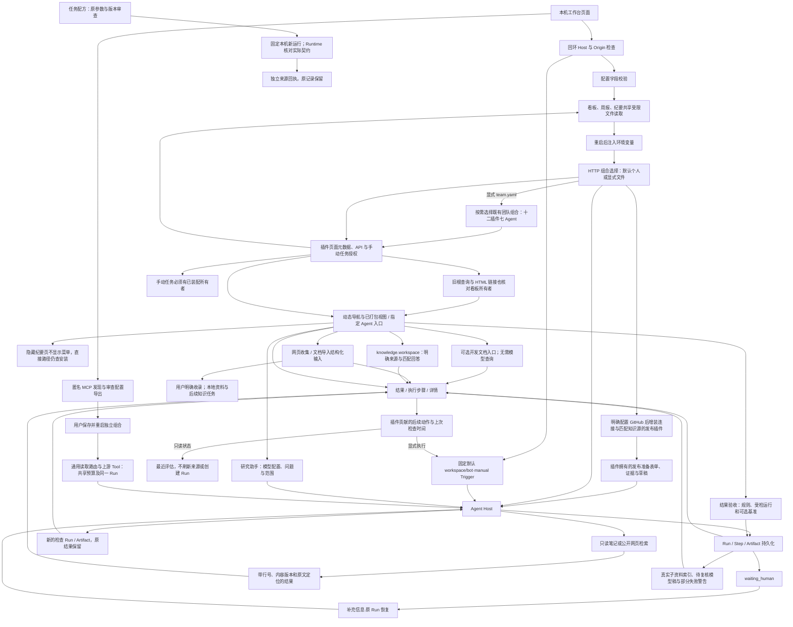
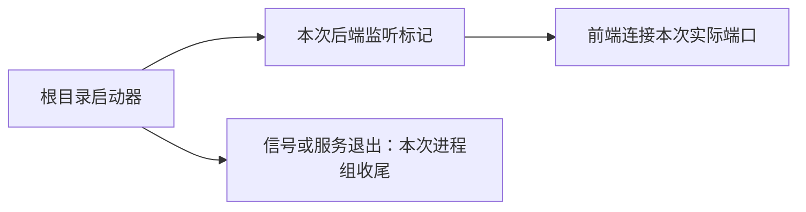

# 本地 Agent 工作台

让个人用户在本机配置模型和连接、选择 Agent、发起任务，并查看真实执行过程与知识证据。

## 功能定位

工作台是确定性控制面，复用 Cordis、Agent Host、Trigger、Run、Step 和 Artifact；自身不是 Agent。首页围绕任务发起与运行历史组织，Agent、插件、个人知识和连接各有独立入口，团队业务保留原能力入口。

## 实现流程图

## 能力边界

### 目标

- 提供真实的本地 Agent 发起、最近运行、产物、步骤和人工继续入口。
- 飞书、模型、TAPD、GitHub 与个人知识来源可在界面填写并保存在本机。
- 无凭据时可检索仓库内的虚构示例笔记。

### 非目标

- 不提供多人认证、远端管理、在线任意仓库代码安装或可视化工作流画布。
- 插件列表展示已装配插件；安装组合仍使用可信文件配置并重启生效。
- 回复策略为 none 只关闭最终结果投递；Agent 的业务 Tool 仍可能按任务执行写操作。
- 仅显示最近 50 个根 Run；目前底层 KV 仍遍历 Run 前缀，数据规模增加时需改为分页索引。

## 核心规则

1. HTTP 默认绑定 `127.0.0.1`。管理 API 拒绝非回环 Host、非本机 Origin 和浏览器 cross-site 请求；这是本机信任边界，不是用户认证。
2. 运行入口固定默认 workspace/bot，不接受客户端扩大 Scope；Run 列表和详情先验证该 Scope，再读取 Artifact。最多返回最近 50 个根 Run，子 Run 在详情展示。
3. 新任务使用 UUID triggerId；重复提交同一 ID 复用 Trigger 领取结果。结果状态来自 Runtime，不能用 HTTP 请求完成冒充 Agent 成功。
4. 人工继续保留原 Run、Session 和执行预算；终态 Run 与外部 Scope 不可继续。
5. 本地连接字段采用 allowlist；密钥只返回已配置布尔值。省略字段保留当前值，null 仅用于明确清除密钥；空凭据的飞书可保持未连接，部分凭据拒绝保存。
6. 配置写入独占创建的临时文件、flush、原子 rename，文件权限 0600；读取拒绝符号链接、硬链接和共享权限文件。配置为本机明文，不声称加密。连接更新串行合并，失败保留原文件。
7. 保存不改变在途任务的配置。重启时本地文件覆盖同名环境值；模型供应商/地址/名称和 TAPD 项目/地址/工作项环境值优先于旧 config.json。页面持续提示待重启状态。
8. HTTP 入口通过 loadWorkspacePlugins 默认只选择示例 Markdown 来源、回答、复核、知识界面、网页收集、文档导入、资料库、结果验收、MCP 接入助手、个人研究及任务配方，合计十四个插件、九个 Agent。选择公开网页时替换来源组合。明确保存 GitHub 仓库后再增装 GitHub/发布两个插件，合计 16 个插件、10 个 Agent；清空仓库并重启停用。SDK 团队工厂仍为十二个插件、七个 Agent，HTTP 可用 profiles/agents/team.yaml 显式选择该组合。显式 AGENT_PLUGINS_FILE 完全管理组合，不自动叠加页面知识配置。
9. 知识请求保留无 chat/conversation 的个人手动 Scope。检索不调用模型，生成回答使用当前宿主模型并发送所选片段；证据沿用来源和引用核验协议。
10. 结果 Markdown 不执行 HTML，不自动加载远端图片；原文链接仅允许 HTTP/HTTPS 和 Obsidian open。原始 JSON 放在详情，不作为主要操作入口。
11. 首页新工作台保留 `?groupId` / `?dashboardId` 的既有看板入口，以及旧根目录 HTML 长链接；这些入口都核对看板插件是否装配，项目看板使用 `/dashboard` 导航。

## 插件后续动作

成功 Run 的动作由插件通过 RunActionRegistry 贡献。工作台只负责通用文本状态面板和执行按钮，不导入知识业务逻辑。状态 GET 只读取最近评估，显示检查时间；显式 POST 才执行插件指定的 Capability。请求仅接受可选 UUID，目标与输入由服务端插件固定，幂等键包含动作、目标 Run 和 UUID。

知识复核是首个使用者：检查原回答或发布草稿实际引用的文档版本，产生独立检查记录，不重新生成答案，不改变原 Run 的成功状态或原 Artifact。移除插件后不显示动作，历史产物保留。面板协议为 StatusPanel 1.0；无效或未知 Artifact 展示协议回退原有结果，状态读取失败显示错误，不沿用绿色状态。

## 插件贡献的页面与业务任务

HTTP 装配先核对现有 API 命名空间，插件声明冲突时拒绝启动，防止覆盖尚未迁移的接口。

工作台 state 增加 pages 和 manualJobs，由真实 Cordis 注册表提供。前端按页面元数据生成导航，支持已打包站会、看板、甘特、周报、隐藏纪要视图或指定 Agent 的入口；不执行第三方 HTML/JS。入口失效显示恢复链接，连接失败提供重试，Agent 入口跳转后保留导航选中状态。旧根查询参数与根目录 .html 看板链接共享插件检查，只有看板插件启用时才可打开；导航保持对应页面选中。

站会页面和统计 API 随 builtin.standup 装配；移除后旧地址不能访问数据。Debug 页面只显示已声明的任务，后端 /api/jobs 同样校验所有者，不能靠手写请求绕过。显式团队组合保留九项任务，默认个人组合与空组合没有这些任务。原有站会、看板、甘特、周报及隐藏纪要页面/API 已迁移，读写都经插件所有权检查。navigation=false 的页面保留直达入口，不在导航展示。周报使用统一历史抽屉与精确版本选择，纪要使用服务端分页、附件链接和展示收件人的发送确认；生成仍关闭。知识库导航、页面和来源描述 API 已归属 knowledge.workspace，可单独移除界面并保留来源能力。核心通用输入/结果中的部分知识适配、连接与基础服务生命周期仍按路线图迁移。

## 新资料收集插件

默认个人组合增加 knowledge.capture 与 community.markitdown；分别拥有 /capture 与 /documents，不需要模型。网页结果保留 URL、时间与版本，文档上传只返回私有 ID，实际转换经同一 Run 的 Tool Gateway 使用 MarkItDown 0.1.9。结果抽屉可复制/下载 Markdown，不自动写入笔记。页面可声明对应 Capability，Agent 卡片和能力选择自动进入结构化表单；未安装的页面仍拒绝访问。安装、边界和验证见 docs/DOCUMENT_IMPORT.md 及对应功能卡。

## 知识工作台插件

/knowledge 不再是核心固定路由，由 knowledge.workspace 贡献。页面从其只读描述 API 获取明确来源与检索 Capability，不按 Agent 顺序推断；回答仅在依赖同一来源且对应 Agent 活跃时开放。默认组合装配界面，来源本身与 CLI/SDK 不隐式加载 UI；显式插件文件需按需添加。描述读取失败显示重试并禁用检索。配置文件管理来源时页面禁用来源编辑入口。代码、样例和验证见 [知识工作台功能卡](../../knowledge/workspace/FEATURE.md)。

## 发布准备入口

发布插件贡献 /release 已打包视图，表单提交合并时间段和个人规则关键词，复用同一 Run API 与结果抽屉。无模型时仅收集证据；生成使用当前宿主模型并提示事实及片段的数据去向。结果优先展示状态面板，再展示正文。JSON 通过通用 StatusPanel 展示实际状态，Markdown 呈现草稿或可读的证据、来源版本与覆盖提示，不在通用结果组件加入发布专用分支。原始 JSON 保留在详情。移除插件时导航、页面和 Capability 同时不可用，历史数据保留。自定义插件文件管理来源时页面明确提示，以免把保存的设置当成实际装配。

验证：backend/test/workspace.test.ts 覆盖来源匹配、脱敏、重启生效/停用和真实 HTTP collect；发布专项检查状态面板与可读证据；frontend/src/pages/workspace/releaseInput.test.mjs 检查日期和关键词边界。

## 社区 Skill 与 Context7 验证

标准 SKILL.md 可经 readAgentSkill 显式导入现有 Prompt Skill Runtime；元数据不能自动取得工具或 Agent 授权，不执行目录脚本。community.context7 是真实使用者：接入上游 MCP 两个读取工具，提供无模型查询和需模型的研究助手；页面按插件贡献，未知能力标签使用作者声明的 Agent 名称。默认组合不自动安装它。来源、许可、运行命令和验收边界见 [社区接入说明](../../../../docs/COMMUNITY_PLUGINS.md)。

验证：backend/test/context7Plugin.test.ts 覆盖格式/边界、权限不继承、受控 Prompt Skill 执行及插件装配；本地实际 MCP 与工作台验收覆盖公开文档检索。真实付费模型未调用。

资料库独立贡献 /library、来源列表、显式收录动作与检索 Agent。默认组合现在包含 十四个插件、九个 Agent；GitHub 组合为 16 个插件、10 个 Agent。KNOWLEDGE_KIND=library 使用宿主实际 data_path 下的固定范围目录，重启后复用既有来源/回答/复核；旧 Vault 设置不影响它。资料库本身立即可检索，设置保存不冒充已经切换。验证：backend/test/knowledgeLibrary.test.ts。

结果验收由 quality.checks 独立贡献 /checks 与规则描述 API。页面选择已装配规则、最近 50 次根运行中的已结束受检记录及可选基准，生成普通 Native Run；结果以通用面板显示 passed/failed/unverifiable 和原始运行跳转。两次记录使用同一份当前规则，输入差异和旧凭证缺失明确展示，不声称升级因果或语义质量。默认 HTTP 现为 十四个插件/九个 Agent，GitHub 组合为 16 个插件/10 个 Agent。

## MCP 接入与通用运行

HTTP 默认加入独立 mcp.setup 接入助手，公开 HTTPS 匿名发现、审查勾选与 local.yaml 导出；不调用目录内工具或读取 Secret。保存并重启明确组合后，mcp.runner 按可信 allowedTools 转调已注册读取工具，实时 Schema 校验、同一 Scope/信号与共享两次 Tool 预算，记录 Agent/路由/上游三步。ctx.delivery.tools.list 只返回契约副本，ToolExecutionContext.budget 沿用既有预算，不给旧调用新增额度。移除插件释放页面/API/Agent/Tool，历史保留；无在线安装或 OS 沙箱。实现与测试见 [接入功能卡](../../connectors/mcp-workbench/FEATURE.md)。

## 个人默认与按需团队

默认选择不再叠加 deliveryTeamPlugins。loadWorkspacePlugins 是 HTTP 装配入口，显式文件优先于个人来源/GitHub 自动组合，即使未选个人配置不完整也不影响独立团队/空组合加载。默认首页从实际 active Agent 选择能力；团队协调能力只在已装配时优先，明确的失效链接不静默换成另一能力。没有可用 Agent 时禁止执行并显示插件入口。个人资料的快捷入口只在 sample 来源填入虚构查询，不覆盖用户笔记场景的输入。

导航只有存在可见团队页面或插件拥有的手动任务时才显示团队分区与配置入口；业务任务还须 manualJobs 非空。隐藏纪要页不单独使团队分区出现。该展示规则不是 API 授权，实际业务 API 仍按插件所有权判断。飞书/TAPD 保持可填写并说明独立启用团队组合的方法；保存凭据不安装 Agent。切换同一数据目录保留已完成历史，缺失旧插件不会被历史记录重新启用。

## 个人研究入口

personal.research 插件贡献 /research 的已打包表单，明确当前资料能力、模型数据流与四次委派限制。未配置模型禁用发起，并保留知识检索/连接入口；发起使用普通本机 Run API 和 RunDrawer。成功结果先显示真实子任务索引及 partial 警告，再展示待复核模型稿和原始资料，相关运行可跳转。人工继续后旧问题只保留在原始详情，多份资料引用锚点按 Artifact ID 隔离。

实现：frontend/src/pages/workspace/ResearchPage.tsx、PluginPage.tsx、RunDrawer.tsx；后端契约与验证：backend/src/agents/personal-research/FEATURE.md、backend/test/personalResearch.test.ts。未提供远端插件前端执行或自动安装；真实模型研究效果需独立验证。

## 用户能力

- 在工作台选择能力、发起任务，在运行记录中查看结果、步骤和错误。
- 查看已装配 Agent、功能插件及版本与依赖。
- 检索示例/个人笔记或公开网页，并按需生成引用回答。
- 填写自己的飞书、模型、TAPD 与知识来源；配置重启后使用。

## 入口与触发

| 入口 | 输入 | 输出 |
| --- | --- | --- |
| `/`、`/runs` | 能力、任务或高级结构化参数 | 真实 Run 与详情 |
| `/agents`、`/plugins` | 搜索词 | 当前 Agent/插件清单 |
| `/knowledge` | 来源配置、关键词或问题 | 来源设置、检索或回答 |
| `/connections` | 外部服务配置与密钥 | 脱敏配置与待重启状态 |
| `/api/workspace/state` | 本机请求 | Agent、插件、最近运行、Host 状态 |
| `/api/workspace/connections` | GET / PUT 字段 Patch | 脱敏配置快照 |
| `/api/workspace/runs` | POST 能力、input、triggerId | Run ID 与实际状态 |
| `/api/workspace/runs/:runId` | GET 本地 Run ID | 结果、步骤、Checkpoint、子 Run |
| `/api/workspace/runs/:runId/actions` | GET 本地成功 Run | 插件动作及缓存状态，不创建 Run |
| `/api/workspace/runs/:runId/actions/:actionId` | POST 可选 triggerId | 固定目标的新执行，复用 Runtime 与幂等 |
| `/api/workspace/runs/:runId/resume` | POST input、triggerId | 原 Run 恢复结果 |

## 运行逻辑

1. 启动读取私有连接设置，注入环境变量，再构造 Adapter 和 Host。
2. 装配团队与选定知识插件，配置飞书连接并启动 HTTP。
3. 页面通过 SWR 共享运行快照；列表轮询，终态详情停止轮询。
4. 发起或继续任务进入 Host 和 Trigger Runtime，执行事实进入既有持久化 Store。
5. 页面分开展示结果、步骤和原始详情；部分知识来源失败会显式提示。

## Agent、Tool 与服务边界

| 对象 | 职责 | 禁止承担 |
| --- | --- | --- |
| Workspace API | 本地入口校验、固定 Scope、结果查询 | 任意客户端 Scope 或任意执行器 |
| LocalConnections | 校验与私有配置持久化 | 启动网络连接或热替换在途 Agent |
| Agent Host | 已注册能力执行、运行记录与恢复 | 复制知识解析或业务规则 |
| 前端 | 任务输入、状态和证据呈现 | 伪造成功状态、保存密钥到浏览器存储 |

## 数据与状态

- 连接设置由 LocalConnections 唯一写入 `${DATA_DIR}/connections.json`；重启前 active 快照保持不变。
- Run/Step/Artifact 使用宿主 Prisma KV 持久化，与 CLI 可选独立 SQLite 状态文件分开。
- 知识索引仍由来源插件重建，不持久化整座 Vault 的内容快照。
- 工作台控制面没有新增业务实体或独立 Agent。

## 失败、安全与降级

- 错误配置、无效来源、非本机请求和跨 Scope 查询在服务端拒绝。
- 缺模型时界面提示配置；原文检索可独立运行。模型或来源执行失败保留真实 Run 状态。
- 页面无响应或关闭不代表后台 Run 取消；失败重试应先查看原运行记录。
- 连接文件与数据库没有加密；本地文件访问和可信插件仍由运行机器的账户控制。当前入口不用于公开共享。

## 代码地图

### 主要实现

- `backend/src/platform/workspace/composition.ts`：HTTP 个人默认/显式配置优先级；团队工厂保持 SDK 兼容。

- `backend/src/platform/plugins/web.ts`、`backend/src/platform/workspace/jobsApi.ts`：Web 声明与手动任务入口。
- `frontend/src/pages/workspace/PluginPage.tsx`、`pages.ts`：动态页面、空状态与安全内部跳转。

- `backend/src/platform/workspace/connections.ts`、`knowledge.ts`、`api.ts`：连接、知识组合与本地 API。
- `backend/src/index.ts`：启动顺序、管理 API 本机限制。
- `backend/src/platform/bootstrap/agentHost.ts`：本地根 Run 列表、详情、发起与继续。
- `frontend/src/layouts/MainLayout.tsx`、`frontend/src/App.tsx`、`frontend/src/index.css`：浅色响应式应用壳与路由。
- `frontend/src/pages/workspace/WorkspacePage.tsx`、`RunDrawer.tsx`：任务、历史和执行结果。
- `frontend/src/pages/workspace/ReleasePage.tsx`、`releaseInput.ts`：发布准备表单、真实运行历史、日期与关键词校验。
- `frontend/src/pages/workspace/RunActions.tsx`、`panels.ts`：插件动作、版本化文本面板与内部 Run 导航。
- `backend/src/platform/plugins/runActions.ts`：动作注册与面板 Schema。
- `frontend/src/pages/workspace/CatalogPage.tsx`、`ConnectionsPage.tsx`、`KnowledgePage.tsx`：能力、连接与知识。
- `frontend/src/pages/workspace/state.ts`、`input.ts`、`frontend/src/api.ts`：共享请求、输入和链接边界。

### 主要测试

- `backend/test/workspaceComposition.test.ts`：真实个人检索、团队/空组合、默认接口和任务缺失、显式配置优先、切换保留历史；每例使用独立私有临时目录，并验证初始化未借用环境中的应用数据目录。
- `frontend/src/pages/workspace/pages.test.mjs`：实际能力默认、失效链接、隐藏团队页及空任务导航。

- `docs/PROJECT_EVIDENCE.md`、`CONTRIBUTING.md`：公开演示、结果边界和完整测试环境；2026-11-05 独立目录实际安装、Python 3.14.7/MarkItDown 0.1.9、602 后端/17 前端测试与无凭据页面检索通过。截图使用内置虚构资料，图片不包含私有运行配置。
- `backend/test/featureIndex.test.ts`：首页默认、GitHub 与 SDK 数量对照实际插件/Agent 声明，防止上手文档沿用旧装配数。
- `README.md`、`backend/README.md`、`frontend/README.md`、`docs/LOCAL_DEVELOPMENT.md`：无凭据首次运行与可选外部连接的统一入口；文档转换环境单独安装。

- `backend/test/pluginWeb.test.ts`、`backend/test/standupApi.test.ts`：第三方页面/API、未启用拒绝、请求体与查询边界。
- `frontend/src/pages/workspace/pages.test.mjs`：页面装配、卸载后的解析、URL 编码和当前导航。
- 浏览器验收：默认站会可用，空组合站会不可访问且手动任务为空，MCP 动态入口读取虚构文件成功；375px 导航正确选中。

- `backend/test/workspaceActions.test.ts`、`backend/test/runActions.test.ts`：第三方贡献、目标/作用域、幂等、缓存不刷新、独立评估和停机等待。
- `frontend/src/pages/workspace/panels.test.mjs`：面板版本、大小与非法格式降级。

- `backend/test/workspace.test.ts`：私有配置、重启生效、串行保存、坏配置拒绝、本机 Origin、真实插件 API、Scope、幂等、示例知识与人工继续。
- `frontend/src/pages/workspace/input.test.mjs`：知识请求契约、旧看板链接与原文协议限制。
- 浏览器验收：本地检索到真实引文、保存飞书设置反馈、桌面和 375px 导航/表单；后端全量回归与前端类型/lint/构建。

本批验证：`backend/test/projectVisibilityApi.test.ts` 覆盖插件关闭后的读写拒绝、文件边界、计划校验和审计；`frontend/src/pages/workspace/pages.test.mjs` 覆盖旧看板链接的所有权。配合后端全量回归、前端门禁和桌面/移动端浏览器验收。

## 变更记录

| 日期 | 变更 | 验证 |
| --- | --- | --- |
| 2026-11-05 | 统一首页、前后端与本地指南：无凭据启动、真实插件数量、转换环境和新能力入口 | 全新 git archive 独立安装、建库与前端构建；空凭据就绪、14 Agent/17 插件、浏览器示例原文检索及未安装转换器提示；文档数量回归与类型检查 |
| 2026-11-05 | 工作台展示插件贡献页面和手动任务；移除站会插件后页面与接口同时关闭 | 插件 Web/站会 API 专项、后端回归、前端检查及默认/空配置/MCP 浏览器验收 |
| 2026-11-05 | 增加插件拥有的后续动作、知识引用检查与独立报告；HTTP 默认加载复核插件 | 插件动作/API 专项、后端回归、前端检查与桌面/375px 浏览器验收 |
| 2026-11-05 | 本地 Agent 工作台、真实运行与知识入口、可填写连接设置、响应式浅色应用壳 | 工作台专项、后端回归、前端检查和本地浏览器验收 |

## 任务配方与本机执行服务

personal.recipes 独立拥有任务配方页面/API 与私有 KV，默认个人组合增加一个插件但不增加 Agent。保存时先核对成功根 Run 的 Scope、单次 execution 1.0、原参数指纹及当前安装/Manifest；多轮人工补充或旧凭证不补造。使用前审查本次参数，经可选 PluginHostServices.runLocal 进入固定默认 workspace/bot、manual Trigger 和 none 回复策略，继续受实际 Agent Schema、Scope、预算和运行记录约束。该服务在 Host 未就绪/停止时拒绝，不可在 apply 阶段等待调用；原生插件仍是可信宿主代码。

运行参数可修改，原配方不覆盖；请求 UUID 持久绑定配方/参数/契约。Runtime 在真正解析根执行后核对可信 expectedExecution 的安装及 Manifest 指纹，拒绝预检查后契约变化，不接受客户端 input 扩权。子委派及人工继续保持既有协议；指纹不冻结模型、知识、Tool 实现或全部环境。旧调用不带该上下文，语义保持。

前端仅在装配配方时于页面内存保留有界候选输入，刷新/移除清空；明确保存才写本机完整参数。来源回执在插件 KV，避免向其他 Agent 注入越出 Manifest 的 Artifact；写回执失败返回真实 Run ID 与警告。RunDrawer 展示配方来源和参数变化，可回到原始结果；移除插件关闭入口但保留记录。

实现/规则见 [任务配方功能卡](../../recipes/FEATURE.md)，验证：backend/test/runRecipes.test.ts、frontend/src/runInputs.test.mjs、既有 Runtime/插件回归和桌面/375px 浏览器验收；本批不验证真实模型质量。

## 本机模型连接

连接表单新增 Ollama，选择时默认本机 /v1 地址并隐藏密钥输入；不删除旧云密钥，本机请求不转发该密钥。显示已保存参数与当前已装配提供者，不把保存当作连接成功。保存后重启，API 只接受标准别名或已装配自定义 ID；Ollama 仅允许无凭据的 HTTP 回环地址。workspace.state.modelProviders 仅公开 ID/名称，modelConfigured 由实际 Host 网关判断。 完整协议、实现与验证边界见[模型提供者功能卡](../models/FEATURE.md)。验证：backend/test/modelProviders.test.ts、knowledgeAnswer.test.ts、personalResearch.test.ts 及既有回归。

## 笔记与网页混合来源

KNOWLEDGE_KIND=mixed 原子验证目录与公开 URL，装配两个来源及混合路由；主普通默认仍为 14/9，选择混合为 16/11，配置 GitHub 后为 18/12。知识输入与首页默认能力采用明确混合入口，来源详情保留两源状态和类型；已有运行不删除。 实现、配置与验证边界见[混合知识功能卡](../../knowledge/mixed/FEATURE.md)；验证：backend/test/knowledgeMixed.test.ts 及既有功能回归。

## 根目录本地启动

`bun run setup:local` 安装锁定依赖、生成客户端并调用既有安全 SQLite 同步，再启动前后端；`bun run local` 直接启动。后端在监听后仅向携带 LOCAL_DEV_SESSION 的本次启动输出 session/loopback/实际端口标记。启动器只接受匹配标记，注入前端 VITE_API_BASE；不读取秘密或靠端口判断归属。两端绑定回环地址，退出保留最多 10 秒收尾，持续接收重复中断；前置命令和服务统一只发送一次正常停止信号，仅清理本次进程组。后端直接执行入口，避免包脚本多次转发停止信号；无 watch，修改配置或代码需重新运行。运行事实、连接保存和就绪检查保持既有协议；首次安装仍不代表外部服务可用。

代码与测试：scripts/local/launcher.ts、backend/src/index.ts、backend/test/localLauncher.test.ts。完整边界见[本地启动功能卡](../../../../scripts/local/FEATURE.md)。
