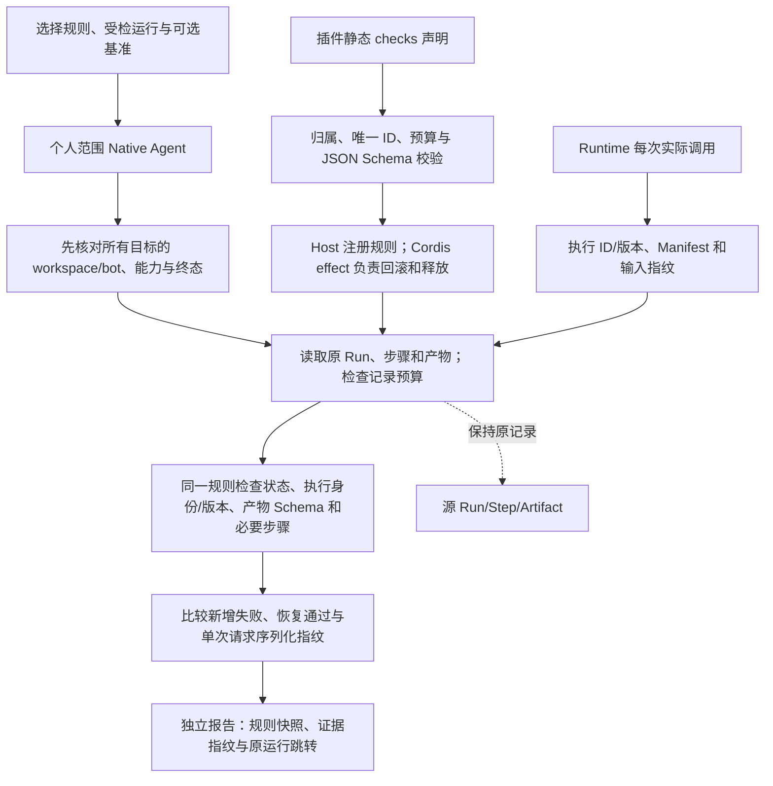

# 插件结果验收

按插件声明的结构规则检查已保存的产物、执行步骤和版本凭证，比较两次运行的新增失败项，保留原始结果。

## 功能定位

quality.checks 是独立 Native 插件，拥有 /checks 页面、规则列表 API 和验收 Agent。规则通过 FeaturePlugin.checks 声明，由 Cordis 管理装配和释放。验收读取现有 Run/Step/Artifact，不重执行任务，也不调用模型或外部工具。

## 实现流程图

## 能力边界

### 目标

- 插件为自身 Agent 声明可复用的验收条件，先接入网页采集和 MarkItDown。
- 发现“Run 成功但必填产物字段缺失”等可观测回归。
- 记录当时执行身份，区分历史版本与当前规则提供者版本。

### 非目标

- 不执行验收脚本，不自动重试原任务，不调用外部工具，不安装或升级插件。
- 不证明语义质量、业务事实正确、代码安全或插件升级的因果影响。
- 不提供历史环境重建、模型回放、性能基准或多用户授权。

## 核心规则

1. FeaturePlugin.checks 为静态 JSON 声明；规则 ID 必须位于插件 ID 命名空间，Agent/Capability 必须属于该插件。规则版本、唯一子项 ID、最多 8 项产物断言/16 项步骤断言与 64 KiB 大小在注册时检查。最多 100 份已装配规则。
2. 每份规则要求一个对应类型的产物，按标准 JSON Schema 检查完整 Artifact（含 mediaType、metadata 和 content）；缺少或多个同类型产物均失败。步骤按 kind/name/status 检查真实记录。JSON Schema 编译失败使装配回滚，不下载未解析的远程引用。
3. 用户只能选择已装配规则 ID 和现有 Run UUID，可选另一个基准 UUID；不接收客户端提供的新 Schema、正文、Scope、脚本或路径。
4. 仅个人 manual/agent 范围；先核对全部目标的 workspace/bot、匹配 Capability 与终态，再读取任一目标的 Artifact/Step。每目标最多 256 步骤、20 产物及 4 MiB 记录。
5. Runtime 为每次实际 invoke 的 Agent Step 新增 execution 1.0：Agent ID、声明版本、Manifest 序列化哈希、可用时的输入序列化哈希。开始、成功与失败均保留；暂停恢复产生新快照，不覆盖旧步骤。原有 metrics 字段保持。
6. 新增 execution 字段不保存原始输入；不可序列化的 SDK 输入不使原执行失败，指纹可缺失。指纹不是语义等价、脱敏或完整环境的证明。
7. 规则失败项存在时 failed；结构项目通过但执行快照缺失或不完整时 unverifiable；只有项目与版本凭证完整通过才 passed。旧记录不会根据当前安装版本补造历史凭证。
8. 比较在同一份当前规则下重新检查两个保存的记录；报告保留该规则完整快照、哈希及提供者版本。原执行版本从历史步骤取得。新增失败不直接归因于升级；仅对单次执行且指纹可用的目标比较序列化请求，其他情况明确无法直接比较。
9. 验收执行完成的 Run 可以 succeeded，而受检报告为 failed/unverifiable；界面用明确的结果面板区分。独立 Artifact 保留检查时间、原记录指纹、执行快照、断言和源 Artifact ID，不重写原记录。
10. /api/checks/contracts 只返回规则描述与检查数量，省略完整 Schema。移除验收插件关闭页面/API/Agent；移除提供者释放其规则，历史报告仍保留。原生插件依然是受信任宿主代码，规则注册不是代码沙箱。

## 用户能力

- 对网页/文档成功或失败记录执行结构验收，查看具体未通过项。
- 对比两个版本的记录，核对输入指纹及执行版本，并打开原始运行。

## 入口与触发

| 入口 | 输入 | 输出 |
| --- | --- | --- |
| /checks | 规则、受检记录、可选基准 | 独立验收 Run 与报告 |
| GET /api/checks/contracts | 本机请求 | 当前已装配规则描述 |
| quality.runs.check | contractId、runId、可选 baselineRunId | passed/failed/unverifiable、断言与对比 |
| examples/plugins.checks.yaml | 采集与验收插件 | 无模型的最小工作台组合 |

## 运行逻辑

1. 插件装配时注册规则；运行时记录每次执行快照。
2. 读取已完成记录，在固定范围和预算内按规则验收。
3. 保存新报告，展示判断边界及原结果跳转。

## Agent、Tool 与服务边界

| 对象 | 职责 | 禁止承担 |
| --- | --- | --- |
| RunCheckRegistry | 规范、归属、快照与可释放注册 | 执行插件脚本或授予新权限 |
| RunCheckService | 原记录读取、确定性断言与差异 | 重执行来源或归因升级 |
| Native Agent / 页面 | 发起、追踪与报告呈现 | 把结构通过当作语义正确 |

## 数据与状态

规则在内存中由插件拥有，报告沿用私有 Run/Artifact 持久化；无新数据库表、后台计划或源记录写入。execution 快照和原始规则提供独立证据，仍依赖可信宿主和本地数据完整性。

## 失败、安全与降级

错误规则、范围、能力、不完整运行、超限和取消明确失败；旧版本凭证缺失显示无法完整核验。报告不复制整份源正文，错误说明有界；报告仍可能包含个人资料的字段和引用身份，按私有产物留存。当前本机接口不构成共享服务认证。

## 代码地图

### 主要实现

- `backend/src/quality/service.ts`、`plugin.ts`：验收、比较、报告与插件入口。
- `backend/src/platform/plugins/checks.ts`、`contracts.ts`、`runtime.ts`：规则规范与生命周期。
- `backend/src/platform/agents/runtime.ts`：每次实际执行的版本与序列化指纹。
- `backend/src/platform/bootstrap/agentHost.ts`：共享规则注册表。
- `backend/src/knowledge/capture/plugin.ts`、`backend/src/connectors/markitdown/plugin.ts`：首批规则。
- `frontend/src/pages/workspace/ChecksPage.tsx`：选择规则和最近运行。

### 主要测试

- `backend/test/pluginChecks.test.ts`：规范/Schema/归属/回滚、真实采集与 MarkItDown、不同版本回归、旧证据、跨范围先验证、取消、产物隐私标志/媒体类型丢失与原记录保留。
- `backend/test/agentRuntime.test.ts`：开始/失败快照、人工继续、原 metrics 保留、无原始输入和不可序列化兼容。
- `backend/test/pluginRuntime.test.ts`：既有 Cordis 回归。

## 变更记录

| 日期 | 变更 | 验证 |
| --- | --- | --- |
| 2026-11-05 | 独立结果验收插件、随插件的规则规范和每次执行快照 | 七项专项与 Runtime 回归，后端/前端门禁和本地界面；无真实模型调用 |
