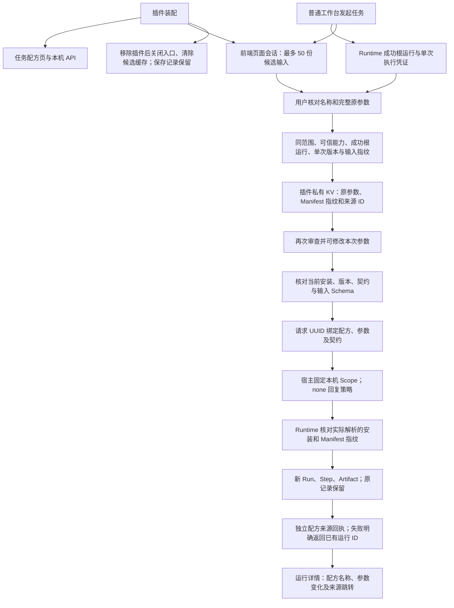

# 任务配方

把已完成任务的原参数与执行凭证保存为本机配方，用户再次审查参数后创建新运行，并保留配方和来源关联。

## 功能定位

personal.recipes 是独立 Cordis 功能插件，拥有页面、API 和配方记录。确定性状态由 RunRecipeService 保存，无新 Agent、模型或执行引擎。实际任务经过宿主 runLocal、Trigger 和 Agent Runtime，不把复制旧产物当作再次完成。

## 实现流程图

## 能力边界

### 目标

- 从成功且具有单次执行凭证的根运行保存原始参数，核对作者版本、安装和输入指纹。
- 使用配方时明确审查参数，允许本次修改，经过当前 Runtime 创建新记录。
- 缺插件、版本/绑定变化、错误输入、重复/冲突请求和保存失败均给出实际结果。

### 非目标

- 不复制模型决策、历史工具顺序、会话或完整环境，不证明重复结果相同或语义正确。
- 不自动保存全部输入到磁盘，不根据模型输出猜测原请求，不自动写 Vault 或远端系统。
- 不回放多轮人工补充的隐藏上下文。此类任务须先用完整参数重新运行。
- 不提供运行中热装配、共享市场、归档管理或历史环境重建。

## 核心规则

1. 默认仅允许审查过的个人读取能力：Markdown/Web 检索、知识回答、个人研究、网页收集、引用复核、Context7 查询/研究、发布准备及显式授权的 MCP 读取路由。自定义 capabilities 是可信配置，能力名不证明只读，作者必须审查其实际行为。团队写入、一次性文档暂存 ID 与资料收录默认不开放。
2. API 固定默认 workspace/bot；先核对来源归属再读取步骤，不读取源正文。来源必须是成功根运行，且只有一个成功的非 delegate Agent Step，execution 1.0 的身份、版本、Manifest/输入指纹完整并匹配当前安装。旧记录不补造凭证。
3. 保存的原参数须为 JSON 对象、紧凑编码最多 32 KiB，并与原输入序列化指纹相同；字段顺序不同也可能不匹配。修改参数应在使用配方时进行。名称最多 80 字符，ID 必须 UUID。
4. 配方集合使用 KV 原子 Claim/CAS，单范围最多 50 份；并发相同 ID/内容复用原记录，不同内容冲突。无需数据库迁移，配方保存不创建业务 Run 或改写原产物。
5. 新运行前核对当前 Capability 绑定的安装、Agent ID/版本、Manifest 指纹、manual Trigger 及输入 Schema。runLocal 将预期安装/指纹放入可信 expectedExecution 上下文；Runtime 在实际解析后、创建 Run 和进入 Adapter 之前再次核对，拒绝检查与执行之间的契约变化。没有该上下文的旧调用保持原语义，客户端 input 不能设置它。
6. expectedExecution 约束新根执行，子委派和后续人工继续仍按既有 Runtime 协议执行。它不是 Tool 实现、配置、模型或知识源的完整环境锁；恢复后也不声称冻结全部版本。
7. 每次显式运行提供请求 UUID，并持久绑定配方、参数指纹和 Manifest 指纹。改变配方/参数后复用该 UUID 拒绝；同内容重复请求进入同一个命名空间 Trigger，不创建第二条执行。处理中暂无 Run ID 时明确提示，不宣称成功。
8. 来源回执位于配方插件独立 KV，不向其他 Agent 产物注入超出 Manifest 类型的 Artifact。回执记录新 Run、配方、原运行、版本、参数指纹与是否变化。回执写入失败返回真实已创建 Run ID 和警告，不能把已执行误报为未执行；旧记录保持。
9. 列表不返回完整参数，选择配方后才读取详情。保存会将用户审查的完整参数留在本机明文应用存储，可能包含个人正文；不宣称自动脱敏、加密或 Secret 托管。
10. 前端仅在插件实际装配时，在页面内存保留最多 50 份、每份 32 KiB 的候选输入；无 localStorage、URL 正文或后台上传。刷新即丢失，失去插件清空缓存。无候选时可人工粘贴原 JSON，服务端仍核对指纹。人工继续不覆盖初始候选。
11. 页面提交有加载/成功/失败反馈；运行前展示参数，修改不覆盖配方基线。所有调用受本机 Host/Origin、插件请求在途跟踪和原 Scope/预算限制。请求体最多 40 KiB，流式超限取消读取，读取最多十秒。
12. PluginHostServices.runLocal 是可选可信宿主服务；Host 未就绪或停止时拒绝，apply 阶段不能调用并等待，以免循环初始化。原生代码仍不构成沙箱，插件生命周期释放页面/API，持久记录保留。

## 用户能力

- 从完成结果进入配方审查，命名并保存原参数。
- 在任务配方页查看可运行状态、原执行版本及来源结果。
- 核对或修改本次参数后运行，并从新结果回到原始来源。

## 入口与触发

| 入口 | 输入 | 输出 |
| --- | --- | --- |
| /recipes、运行详情保存链接 | 可选来源 Run UUID | 审查表单与私有配方列表 |
| GET /api/recipes、GET /api/recipes/:id | 本机请求、配方 UUID | 元数据/当前可用性或完整参数 |
| POST /api/recipes | UUID、名称、来源 UUID、原参数 | 原子保存或明确拒绝 |
| POST /api/recipes/:id/run | 请求 UUID、本次参数 | 实际新运行/幂等已有运行 ID 与来源回执状态 |
| GET /api/recipes/launches/:runId | 同范围运行 UUID | 独立配方来源回执或 null |
| examples/plugins.recipes.yaml | 示例 Markdown 与配方插件 | 无模型的最小可复用任务组合 |

## 运行逻辑

1. 插件注册页面和 API，候选参数只在当前前端页面会话保留。
2. 用户从完成运行审查原参数，服务验证来源、输入和版本后原子保存。
3. 用户选配方并核对本次参数；服务校验并绑定请求 ID。
4. 宿主创建普通本机运行，Runtime 再核对预期契约。
5. 保存独立来源回执，详情展示新结果并可跳转旧来源。

## Agent、Tool 与服务边界

| 对象 | 职责 | 禁止承担 |
| --- | --- | --- |
| RunRecipeService | 来源核验、配方唯一写入、请求绑定和来源回执 | 假造原输入、自动扩大能力或复制成功产物 |
| Host / Runtime | 固定本机入口、幂等、实际契约校验与正常执行 | 把配置预检查当完整环境快照 |
| 前端会话/表单 | 暂存候选、明确审查与真实结果呈现 | 自动持久化全部请求、自动发起重复任务 |

## 数据与状态

插件拥有 personal:recipes 命名空间中的集合、请求绑定和运行来源回执。原 Run/Step/Artifact 继续由 Runtime 拥有；没有新数据库表，也不改变原执行快照的隐私语义。配方含完整用户确认的输入，按本机私有数据处理。

## 失败、安全与降级

默认范围和能力配置均在服务端固定。缺失/跨范围来源在读取步骤前拒绝，旧凭证、版本变化、空输入和超限不静默降级。使用当前知识、模型和 Tool，输出仍可能变化。回执失败与任务失败区分；无实际成功 Run 不显示绿色完成。应用本机边界不是共享服务认证。

## 代码地图

### 主要实现

- backend/src/recipes/service.ts、plugin.ts：配方、来源回执和插件 API。
- backend/src/platform/plugins/contracts.ts、backend/src/platform/bootstrap/agentHost.ts：可选固定本机运行服务与就绪检查。
- backend/src/platform/agents/runtime.ts：可信预期安装/Manifest 的实际解析守卫。
- backend/src/platform/workspace/knowledge.ts：个人默认装配，Agent 数不增加。
- frontend/src/runInputs.mjs、runInputs.d.mts、frontend/src/api.ts：有界页面内存候选与请求。
- frontend/src/pages/workspace/RecipesPage.tsx、PluginPage.tsx、RunDrawer.tsx、frontend/src/index.css：审查、使用、来源导航与响应式列表。
- backend/examples/plugins.recipes.yaml：最小组合。

### 主要测试

- backend/test/runRecipes.test.ts：真实 Native 执行、输入与版本、CAS/幂等、参数变化、范围、插件移除/恢复、流限制、来源写失败、就绪拒绝。
- frontend/src/runInputs.test.mjs：插件关闭、深复制、UTF-8 大小、循环对象、淘汰及缓存清空。
- backend/test/agentRuntime.test.ts、pluginRuntime.test.ts、workspaceComposition.test.ts、featureIndex.test.ts：旧执行、生命周期、组合和文档回归。

## 变更记录

| 日期 | 变更 | 验证 |
| --- | --- | --- |
| 2026-11-06 | 新增独立任务配方；核对来源/输入，运行时检查实际契约并保存来源关联 | 专项、类型、完整回归与本地浏览器验收；真实模型效果不在本批范围 |
