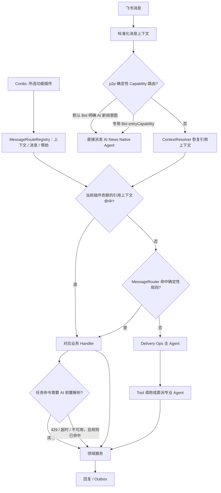

# 消息路由与上下文理解

把飞书消息、引用消息和群上下文稳定地分发到确定性功能；无法确定时交给 Delivery Ops 主 Agent 编排。

## 功能定位

消息路由是整个系统的“入口仲裁层”。它不负责完成具体业务，而是根据消息来源、引用关系和文本意图，选择唯一的处理链路。路由一旦选错，后面的 Agent 和领域服务即使执行正确，也会得到错误结果。

当前设计同时保留确定性 Handler 和 AI Agent。确定性规则处理高频、明确、涉及状态写入的操作；主 Agent 处理表达方式多、需要组合能力的请求。两条链路不是互相替代，而是用确定性保证底线，用 Agent 扩大理解范围。

## 实现流程图

## 能力边界

### 目标

- 明确表达“引用上下文优先、确定性规则优先、AI 兜底”的路由顺序。
- 让同一消息只命中一个业务入口，并保留可审计的处理结果。

### 非目标

- 不在 Router 内实现任务、站会、日报或看板业务规则。
- 不允许模型直接绕过 Tool 和领域服务写业务状态。

## 宿主连接配置

本地工作台可填写飞书、模型与 TAPD 连接，重启后生效。模型供应商/地址/名称及 TAPD 项目/地址/工作项环境值优先于旧 config.json；工作台保存值在启动时覆盖同名环境设置。既有领域规则与消息/定时执行链路保持，详情见 docs/LOCAL_DEVELOPMENT.md。

## 核心规则

运行时消息入口由各功能插件贡献，主编排 Agent 及其兜底/恢复路由归 `builtin.orchestrator`。`MessageRouter`、`ContextRouter` 不再导入内置业务 Handler。页面、业务 API、调度与基础服务尚未全部迁为插件贡献。

1. **引用上下文优先。** 用户回复任务卡片、机器人追问或历史消息时，系统先恢复引用链，再判断当前文字；不能只看当前一句话。
2. **一次消息只选择一条主链路。** `ContextRouter` 或某个 Handler 返回结果后，后续 Handler 不再执行，防止一条消息同时创建任务又触发日报。
3. **优先级是显式契约。** `MessageRouteRegistry` 校验全局唯一路由 ID、同阶段唯一数值优先级和适用来源；上下文与普通消息分别排序，不能依赖插件数组的偶然位置。
4. **确定性规则先于 Agent。** 默认组合中群消息依次尝试上下文、站会（含任务型站会）、周报、日报、看板、会议纪要、状态更新和任务命令；私聊只开放上下文、站会、会议纪要、状态更新和任务命令。全部未命中后才进入主 Agent。上下文阶段只执行首个匹配者，返回空结果后进入普通阶段，不能再尝试其他上下文处理者。
5. **显式对象优先于推断对象。** 用户给出任务 ID、引用对象或明确日期时，系统使用显式信息；只有信息缺失时才从上下文推断。
6. **否定表达不触发副作用。** “不要生成日报”“不是要创建任务”等句子必须在 Handler 或意图策略中被拦截。
7. **Router 不拥有业务状态。** Router 只选择处理者；任务、站会和其他数据写入必须交给对应领域服务。
8. **AI 不可用时保留基本能力。** 任务命令仍先交给 AI 补全或拆分；AI 返回 429、超时或调用异常时，已命中的确定性规则必须立刻继续执行，并向用户说明 AI 异常与规则降级。未识别请求返回能力提示，不把模型故障伪装成业务成功。
9. **周报命令受群站会资格约束。** `WeeklyReportHandler` 命中命令后先复用 `StandupService.isGroupEnabled`；未开启日报站会的群只回复配置提示，不创建 Agent Run。
10. **确定性新闻意图在业务 Router 之前分流。** 默认交付机器人仅在明确 AI 新闻私聊，或同会话 30 分钟内的“查看更多”、关键词、来源和分类追问时，直接调用 `knowledge.ai.news.fetch`；其他模糊追问、否定、配置咨询或开发任务继续 Context/Handler/主 Agent 链路。配置独立应用后，带 `entryCapability` 的新闻机器人也只接受私聊文本，不进入任务、站会、成员识别或 TAPD。
11. **任务型站会先于普通任务创建但不吞明确 TAPD 指令。** 启用群中，带交付动作和具体时间的 @机器人消息由 `StandupHandler` 登记；出现“创建/新建/同步 TAPD 任务或需求”时返回未命中，让 `TaskCommandHandler` 继续处理。引用 `task_standup_template` 或 `standup_commitment_prompt` 时，即使当前回复没有再次 @机器人，也由上下文路由直接回到站会域。
12. **任务型站会回复校验身份一致。** 到点提醒的引用回复必须由任务负责人发送；如果回复消息中的非机器人 @ 人与实际回复人不同，机器人只提醒被 @ 的负责人本人回复，不更新任务状态。
13. **插件关闭同时关闭消息贡献。** 指令、历史引用、免 @ 回复与能力提示均由已装配插件决定；没有注册表或空组合时没有隐式业务路由。任务追问文本恢复也由任务插件执行一次，只改变本次消息副本。
14. **私聊身份门槛按组合保留。** 存在 `requiresProjectMember` 私聊贡献时，整个私聊链路先做原有成员识别；纯个人插件组合不必配置项目成员。此标记不代替逐路由授权。
15. **停机先完成在途消息。** Host 拒绝新路由请求，并等待正在处理的确定性消息完成后释放贡献；停止后的注册表不再接受执行。

## 用户能力

- 在飞书群中用自然语言或命令创建任务、更新进度、提交站会、生成日报、周报和看板。
- 引用机器人历史消息继续操作对应上下文。
- 未命中确定性规则时由主 Agent 识别意图并委派专业 Agent。
- 在现有系统机器人私聊中直接查询 AI 新闻，不要求用户先绑定项目成员；也可由可选的独立新闻机器人查询。

## 入口与触发

| 入口 | 输入 | 输出 |
| --- | --- | --- |
| 飞书消息事件 | 文本、发送人、群、引用消息、附件 | 回复文本或卡片 |
| 后端消息处理入口 | 标准化消息上下文 | Handler 或 Agent 执行结果 |

## 运行逻辑

1. 多 Bot 连接管理器接收事件并固定 BotInstance；默认 Bot 的明确 AI 新闻私聊和专用 Bot 的 `entryCapability` 在入口直接派发，其他默认 Bot 消息继续以下流程。
2. `ContextResolver` 恢复引用消息和历史上下文，`ContextRouter` 判断上下文动作。
3. `MessageRouter` 读取当前来源的插件路由，对消息副本执行准备步骤，再进行上下文和普通消息仲裁；任务命令先尝试 AI 意图解析，AI 不可用时记录 `ai_intent_failed` 并降级到已解析的规则命令。
4. 未命中时，`AgentFallbackHandler` 调用 `built-in.delivery-ops-agent`。
5. 主 Agent 通过 Tool 或委派调用专业 Agent，结果经统一回复或 Outbox 投递。

## Agent、Tool 与服务边界

| 对象 | 职责 | 禁止承担 |
| --- | --- | --- |
| `MessageRouter` / `ContextRouter` | 确定性路由和优先级 | 业务状态写入 |
| Delivery Ops Agent | 意图理解、选择 Tool、委派专业 Agent | 直接修改底层 Store |
| 业务 Handler | 参数解析、调用领域服务、组织响应 | 复制其他业务域规则 |

## 数据与状态

- 消息上下文以群、用户、引用消息标识隔离。
- Agent Run、会话、Tool Call 与回复结果由平台持久化，业务状态仍由对应领域服务拥有。
- 重复飞书事件在消息路由前以 workspace、BotInstance、message ID 组成数据库原子 Claim；进程内缓存只是快速路径，不能靠模型或单进程内存判断重复。

## 失败、安全与降级

- 上下文无法恢复时回退到当前消息，不能猜测跨群上下文。
- Agent 超时或模型不可用时返回可解释错误；确定性 Handler 仍可工作。
- 内网部署不等于可信输入：消息内容仍可能包含 Prompt Injection，Tool 参数必须通过 Schema 和作用域校验。

## 代码地图

### 主要实现

- `backend/src/services/messageHandler/routes.ts`：消息贡献协议、校验、排序、注册清理与在途等待。
- `backend/src/services/messageHandler/types.ts`：应用共享上下文；消息和群调度注册表由组合层传入，配置重载复用实例。
- `backend/src/agents/plugins/`：各功能拥有的路由、引用与帮助贡献。
- `backend/src/services/messageHandler/MessageRouter.ts`：插件路由的统一仲裁入口与动态帮助。
- `backend/src/services/messageHandler/ContextRouter.ts`：引用上下文路由。
- `backend/src/services/messageHandler/ContextResolver.ts`：上下文恢复。
- `backend/src/services/messageHandler/handlers/AgentFallbackHandler.ts`：主 Agent 兜底。
- `backend/src/services/messageHandler/handlers/WeeklyReportHandler.ts`：本周/上周周报确定性入口。
- `backend/src/platform/bots/feishuBotMessageIngress.ts`：默认机器人意图与专用机器人的 p2p 前置分流。
- `backend/src/agents/native/ai-news-radar/intent.ts`：AI 新闻确定性意图准入。
- `backend/src/platform/bootstrap/agentHost.ts`：Agent、Tool 与平台装配。

### 主要测试

- `backend/test/messageHandler.test.ts`：群聊/私聊路由策略顺序、唯一优先级和业务入口。
- `backend/test/messagePlugins.test.ts`：关闭插件、历史引用、动态帮助、私聊成员边界、准备步骤与在途停止。
- `backend/test/agentFallbackHandler.test.ts`：AI 兜底。
- `backend/test/agentDelegation.test.ts`：主 Agent 委派。
- `backend/test/weeklyReport.test.ts`：周报命令识别、否定与元问题拦截、Agent 派发。
- `backend/test/multiBotIngress.test.ts`：默认 Bot 新闻分流、非新闻回归及专用机器人隔离。

## 变更记录

| 日期 | 变更 | 验证 |
| --- | --- | --- |
| 2026-11-05 | 同步本地连接表单与宿主环境配置优先级 | 工作台专项、后端回归、前端检查与本地浏览器验收 |
| 2026-11-05 | 共享上下文增加插件群调度注册表，消息仲裁行为保持不变 | 消息插件/Handler 与后端全量回归、类型检查 |
| 2026-11-05 | 内置路由改为功能插件贡献，删除硬编码策略表；保持默认仲裁与成员识别，关闭插件同步关闭引用与帮助；停机等待确定性消息 | 消息插件与原 Handler 回归、后端 422 通过 / 1 TAPD 跳过、类型检查 |
| 2026-11-05 | 增加可信 YAML Agent 插件选择与本地/已安装包加载；未启用模块不导入，消息 AI/新闻分流检查实际 Capability | 配置加载、插件/Host 测试与后端全量回归 |
| 2026-11-05 | 将主编排 Agent装配移入 `builtin.orchestrator`，保留业务与持久化契约 | 插件/Host 测试、后端全量回归 |
| 2026-07-29 | 日报忽略规则移除公司品牌特判，改为识别公开机器人名称与通用“机器人”称呼 | `summaries.test.ts`、`messageHandler.test.ts` |
| 2026-08-13 | 站会路由支持引用任务模板时不重复 @机器人，并在任务提醒回复中校验 @ 人与回复人一致 | `standupHandler.test.ts`、`messageHandler.test.ts` |
| 2026-08-12 | 站会路由新增任务型站会登记及提醒引用上下文；显式 TAPD 创建语句保持原任务链路，能力提示同步更新 | `standupHandler.test.ts`、`messageHandler.test.ts` |
| 2026-08-03 | 飞书消息进入 Router 前增加持久化跨实例 Claim，同一事件只允许一个副本进入业务处理 | `multiBotIngress.test.ts` |
| 2026-07-31 | 任务命令保留 AI 前置解析；Gemini 429、超时或其他解析异常时降级到已命中的规则创建路径，避免模型限流阻断确定性业务 | `messageHandler.test.ts` |
| 2026-07-29 | 默认 Bot 在最近 AI 新闻会话内识别“查看更多”、搜索、来源和分类追问，其他会话的模糊“查看更多”不被新闻路由截获 | `aiNewsRadar.test.ts`、`multiBotIngress.test.ts` |
| 2026-07-29 | 默认 Bot 增加严格的 AI 新闻私聊前置分流，非新闻消息保持原 Context/Handler/主 Agent 链路 | `aiNewsRadar.test.ts`、`multiBotIngress.test.ts` |
| 2026-07-29 | 增加专用 Bot `entryCapability` 前置分流；AI 新闻私聊不进入项目成员识别、任务、站会或主 Agent | `multiBotIngress.test.ts` |
| 2026-07-29 | 将群聊与私聊 Handler 顺序收敛为带唯一优先级和来源范围的 `MESSAGE_ROUTE_POLICY`，统一执行循环并保持原业务顺序 | `messageHandler.test.ts`、AI 兜底与周报回归、后端类型检查 |
| 2026-07-27 | 周报命令增加群站会开关校验，未开启日报站会时不派发 Weekly Report Agent | `weeklyReport.test.ts` |
| 2026-07-27 | 在日报前新增周报确定性 Handler，支持“生成本周/上周周报”，并将执行交给 Native Agent | `weeklyReport.test.ts`、`messageHandler.test.ts` |
| 2026-07-22 | 补充入口仲裁原则、Handler 优先级与 AI 兜底规则，精简文档结构 | CodeGraph 调用链审查 |
| 2026-07-22 | 建立消息路由功能卡并核对主 Agent 兜底链路 | CodeGraph 调用链审查 |

## Agent 模型供应商边界

Delivery Ops 的 Model Loop 使用 Host 已装配的模型提供者，团队组合显式包含三个标准模型插件；移除对应提供者后不隐式回退云端。确定性 Handler、领域状态和原 LLMAdapter 兼容入口不变，后者未迁移为本机模型端口。规则与验证见[模型功能卡](../../platform/models/FEATURE.md)；既有业务及模型回归保持通过。

