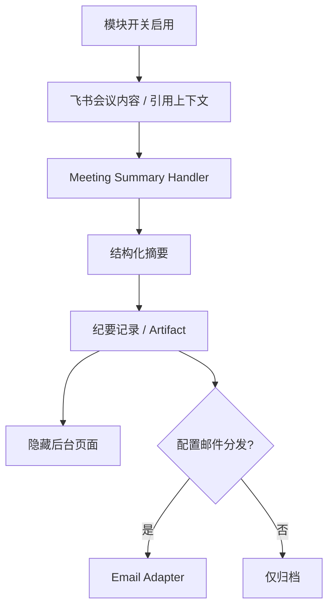

# 会议纪要

从群消息入口生成会议纪要并支持归档、后台查看和邮件分发；当前代码保留，但默认业务入口和导航未启用。

## 功能定位

会议纪要功能计划把一段会议内容转换为摘要、决策和待办，并支持归档与邮件分发。当前代码保留了 Handler、页面和邮件 Adapter，但产品入口默认关闭，因此它属于“待重新启用的能力”，不是已经稳定开放的功能。

重新启用前应先确认输入来源、数据保留和外发权限，再决定是否需要独立 Meeting Agent。单次结构化摘要可以继续使用 Handler 与服务；只有出现长会话、多阶段追问或独立部署需求时，Agent 化才有价值。

## 实现流程图

## 能力边界

### 目标

- 保留会议内容到结构化纪要、存储和分发的可恢复链路。
- 在重新启用前明确配置、入口、权限和回归测试要求。

### 非目标

- 当前不宣称该能力已经稳定开放。
- 暂不定义 Meeting Agent；现有 Handler/Service 足以承载确定性入口。

## 核心规则

1. **功能开关是第一道入口。** 关闭时 `MeetingSummaryHandler` 不生成内容，隐藏页面也不能被描述为正式产品能力。
2. **否定和讨论语句不触发生成。** “不要整理会议纪要”或“讨论纪要模板”不属于执行请求。
3. **原文、生成、归档和外发分别记录。** 摘要生成成功不代表归档成功，更不代表邮件已经送达。
4. **待办转换必须进入任务域。** 如果纪要包含行动项，系统应由用户确认后调用 `TaskService`，不能直接在会议模块写任务。
5. **邮件收件人来自配置或明确确认。** 模型生成的邮箱和会议原文中的指令不能直接触发外发。
6. **摘要保留事实边界。** 模型可以压缩表达，但不能虚构决策人、截止日期或结论；缺失信息应标为待确认。
7. **敏感内容限制访问范围。** 重新启用前必须明确群、用户和管理员的查询权限，以及会议原文与纪要的保留期限。
8. **重新启用需要端到端验证。** 功能开关、消息路由、后台导航、存储、邮件和失败恢复必须同时完成，不能只打开一个入口。

## 用户能力

- 设计能力：提交会议内容，生成摘要、决策和待办。
- 设计能力：在后台查看历史纪要并通过配置邮箱分发。
- 当前状态：页面路由存在但导航隐藏，功能开关默认不开放。

## 入口与触发

| 入口 | 输入 | 输出 |
| --- | --- | --- |
| 飞书消息（启用后） | 会议文本或引用上下文 | 结构化会议纪要 |
| 管理后台隐藏路由 | 查询条件 | 历史纪要列表 |
| 邮件 Adapter | 纪要和收件人 | 邮件投递结果 |

## 运行逻辑

1. 模块开关启用后，Message Router 才允许 Meeting Summary Handler 命中。
2. Handler 校验消息上下文并调用摘要能力生成结构化纪要。
3. 纪要保存为可查询记录或 Artifact。
4. 后台页面展示历史内容；配置邮件时可执行受控分发。
5. 任一阶段失败应保留此前成功状态，不能把生成、保存和邮件发送视为一个布尔值。

## Agent、Tool 与服务边界

| 对象 | 职责 | 禁止承担 |
| --- | --- | --- |
| Meeting Summary Handler | 入口判断、参数规范化、响应 | 隐式绕过功能开关 |
| LLM/摘要服务 | 结构化摘要 | 直接发送邮件或改任务 |
| Email Adapter | 发送已确认内容 | 选择未经配置的收件人 |

## 数据与状态

- 原始会议内容、生成结果、归档状态和邮件投递状态应分离记录。
- 若把待办转换为任务，应通过 `TaskService`，不能在会议功能内直接写任务。
- 重新启用前需确认数据保留期限和敏感会议内容访问范围。

## 失败、安全与降级

- 当前为 dormant，升级或部署不得误把隐藏路由当作已启用功能。
- 邮件收件人必须来自配置或明确用户确认，避免模型内容触发外发。
- Prompt Injection 可能进入会议原文；摘要输出不得自动执行其中的指令。

## 代码地图

### 主要实现

- `backend/src/services/messageHandler/handlers/MeetingSummaryHandler.ts`：消息入口。
- `backend/src/adapters/email.ts`：邮件发送 Adapter。
- `frontend/src/pages/MeetingSummariesPage.tsx`：隐藏后台页面。
- `frontend/src/App.tsx`：页面路由与导航状态。

### 主要测试

- `backend/test/messageHandler.test.ts`：会议纪要开关、否定意图与路由行为。
- `backend/test/adapters.test.ts`：外部 Adapter 基础行为。

## 变更记录

| 日期 | 变更 | 验证 |
| --- | --- | --- |
| 2026-11-05 | 同步公开版外部 API 预算、幂等投递和报告降级基础设施，业务开关与能力入口保持原语义 | 后端全量回归、类型检查 |
| 2026-07-22 | 补充 dormant 状态、摘要事实和邮件外发规则，精简文档结构 | CodeGraph 与消息路由测试 |
| 2026-07-22 | 建立 dormant 功能卡并记录重新启用边界 | CodeGraph 架构审查 |
