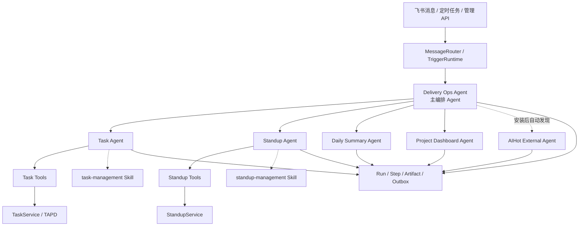
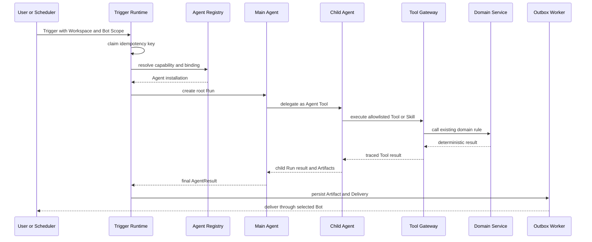

# Agent 架构升级与系统评估（2026-07）

本文记录 2026 年 7 月 Agent 化重构的最终状态、验收证据、当前评分和剩余边界。内容以代码和测试为准，不把预留接口计为已实现能力。

## 1. 最终结论

当前系统综合评分为 **8.5/10**，已经具备真正的 Agent 系统要素：模型循环、受治理 Tool、可发现 Skill、主从 Agent 委派、会话记忆、人工补充信息检查点、持久化 Run/Step/Artifact、可靠投递、外部 Agent 安装和多机器人绑定。

系统采用“确定性业务内核 + Agent 编排层”，而不是让大模型直接改写所有业务状态：

- `TaskService` 和 `StandupService` 继续拥有状态机、校验、存储及 TAPD 同步规则。
- Task Agent、Standup Agent 通过受治理 Tool 调用这些既有规则，不复制业务逻辑。
- Delivery Ops Agent 负责理解开放式请求并委派专业 Agent。
- 日报和看板保留确定性 Native Agent，避免模型参与固定计算链路。
- 旧消息 Handler 继续优先处理已有指令；只有规则未命中且模型可用时，才进入主 Agent。

因此，原有功能路径没有被一次性替换，新增能力则可以按 Agent、Tool 或 Skill 独立接入。

## 2. 评分方法

评估先从系统不可缺少的事实出发，再用失败场景反向攻击设计。

- **第一性原理**：状态必须有唯一所有者；副作用必须受控；每次执行必须可识别；失败必须可恢复；扩展必须通过稳定契约。
- **对抗性检查**：验证重复事件、并发抢占、进程中断、超时、越权委派、伪造身份、跨机器人投递、外部响应过大、恶意跳转和 Secret 泄漏。
- **证据优先**：只按当前代码、自动化测试、类型检查、构建和运行结果评分。

| 维度 | 权重 | 得分 | 当前判断 |
| --- | ---: | ---: | --- |
| 逻辑一致性 | 15% | 8.8 | 领域服务仍是状态唯一入口；旧路由优先，Agent 只做兜底与编排 |
| 模块边界与维护性 | 15% | 8.3 | Platform、Task、Standup、Message 边界形成；部分旧 Service 仍偏大 |
| Agent 完整性与可插拔性 | 15% | 9.1 | Model Loop、Tools、Skills、Agent-as-Tool、Manifest/Installation/Binding 均已落地 |
| 稳定性与可恢复性 | 15% | 8.8 | Run/Step/Artifact、检查点、Trigger Claim、Outbox 租约与重试可持久恢复 |
| 安全边界 | 10% | 8.1 | Tool 白名单、可信上下文、委派上限、HTTPS/Host/Secret/响应限制已实现；内网控制面未鉴权 |
| 测试与交付质量 | 10% | 9.0 | 后端 228 项通过、1 项跳过；类型检查通过；分阶段提交 |
| 可观测与运维 | 8% | 8.1 | 可查询 Run、Step、Artifact、Checkpoint、Child Run；尚缺指标和告警 |
| 多机器人准备度 | 5% | 8.2 | Bot 注册、持久绑定、独立出站凭证和运行 Scope 已落地；次机器人入站连接未自动启动 |
| 数据演进能力 | 4% | 7.5 | 当前单实例 SQLite 合适；Agent 状态仍复用 KV 表 |
| 前端与性能 | 3% | 7.2 | 原管理端不受影响；尚无 Agent 控制台，主包仍可拆分 |

加权结果为 **8.5/10**。

## 3. 本次升级落地内容

本次重构分七个独立节点完成，每个节点都在测试通过后提交。

| 阶段 | 落地内容 | 提交 |
| --- | --- | --- |
| 1 | AgentHost 生命周期、持久运行记录与可靠投递 | `d9e561b` |
| 2 | 受治理 Tool Gateway 和 Skill Runtime | `397f779` |
| 3 | 模型循环、会话记忆、检查点和同 Run 恢复 | `33fec8b` |
| 4 | Task Agent、Standup Agent 及领域 Tool | `358b7e3` |
| 5 | Delivery Ops 主 Agent、父子 Run 委派和兼容消息路由 | `005c427` |
| 6 | AIHot 插拔接入、多机器人控制面和按 Bot 投递 | `b22be4d` |
| 6.1 | 通用外部 Agent 默认安装 ID 按 Bot 隔离 | `e5a2d1f` |
| 7 | 文档、评分和全仓验收 | 本文所在提交 |

## 4. 当前 Agent 拓扑

### 4.1 默认内置 Agent

| Agent ID | 类型 | 能力 | 职责 |
| --- | --- | --- | --- |
| `built-in.delivery-ops-agent` | Model Loop | `delivery.ops.orchestrate` | 主入口，委派专业 Agent，不直接写领域状态 |
| `built-in.task-agent` | Model Loop | `task.manage` | 任务查询、创建、跟踪、更新和项目同步 |
| `built-in.standup-agent` | Model Loop | `standup.manage` | 站会查询、提交、重交和缺交检查 |
| `native.daily-summary` | Native | `report.daily.generate` | 复用确定性日报生成逻辑 |
| `native.project-dashboard` | Native | `dashboard.project.generate` | 复用确定性看板生成逻辑 |

### 4.2 外部 Agent

`external.ai-hot` 是已支持的外部 HTTP Agent 示例，但默认不安装。安装并绑定后，主 Agent 会把 `knowledge.ai.hot.fetch` 作为可选 Agent Tool 自动发现；未安装时不会影响主 Agent 启动。

同一个外部 Agent 可以建立多份 Installation，并分别绑定到不同 Bot。默认 Bot 继续使用旧安装 ID，新增 Bot 使用独立 ID，避免覆盖已有配置。

## 5. 一次 Agent 请求如何运行

当关键字段缺失时，Model Loop 保存 Checkpoint 并返回 `needs_human`。用户回复后，系统恢复同一个 Root Run；若等待的是子 Agent，则恢复同一个 Child Run，不创建重复执行。

## 6. Tool、Skill 与 Agent 的边界

| 形态 | 判断标准 | 当前例子 |
| --- | --- | --- |
| Tool | 原子操作，有明确输入输出和副作用级别，不独立规划 | `task.query`、`task.handle_message`、`standup.query` |
| Skill | 可复用操作方法或提示包，依赖有限 Tool，不拥有长期业务状态 | `task-management`、`standup-management` |
| Agent | 拥有目标、模型循环、记忆、资源上限，可调用 Tool/Skill/子 Agent | Task Agent、Standup Agent、Delivery Ops Agent |
| Domain Service | 拥有强一致规则、状态机、事务和外部系统同步口径 | `TaskService`、`StandupService` |

不要为了“Agent 数量”把单个函数包装成 Agent。一个能力只有在需要独立目标、独立策略、独立生命周期或独立部署时，才应升级为 Agent。

## 7. 稳定性设计

- Trigger Claim 使用 Workspace、Bot、触发类型和触发 ID 组成幂等键。
- Agent Runtime 保存 Root/Parent Run、Step、Artifact 和错误分类。
- Model Loop 限制步骤数、Tool 调用数、Agent 调用数、委派深度、超时和输出字节。
- Session 按 Workspace、Bot、会话和用户隔离，超长历史会压缩并按 TTL 过期。
- Checkpoint 支持人工补充信息，并恢复原 Run。
- Outbox 把“业务执行成功”和“消息发送成功”分开；失败投递可重试，过期租约可重新领取。
- Agent 不能决定最终机器人和会话，Host 使用 Trigger 中的可信 Scope 投递。

这些措施提高恢复能力，但不承诺“绝不失败”。稳定性仍依赖 SQLite 持久卷、单写实例、模型服务、飞书和 TAPD 的可用性。

## 8. 安全与对抗性结果

### 已落地

- 高风险写 Tool 只接受 Runtime 注入的原始消息身份和文本，忽略模型伪造的可信字段。
- Agent 只能调用 Manifest 声明的 Tool、Skill 和 Delegate。
- 父子委派受 `maxAgentCalls`、`maxDepth` 和 Deadline 约束。
- 外部 HTTP Agent 必须使用无凭证 HTTPS URL，Host 校验显式网络主机白名单并禁止重定向。
- Secret 只保存 `env://NAME` 引用；查询接口只返回 Secret 名称或是否存在，不返回引用和值。
- Host 在解析前限制外部响应大小，并校验 Artifact 类型。
- Delivery 目标必须属于触发时的 Workspace 和 Bot。

### 当前安全边界

当前版本没有登录、RBAC 或细粒度控制面权限。`/api/bots`、`/api/agents/*` 和 `/api/agent-bindings` 只能在可信网络中开放，或由带身份验证、TLS、限流和访问审计的反向代理保护。直接暴露公网不属于支持范围。

### 仍需关注

- Prompt Injection 不能只靠提示词消除；当前通过 Tool 白名单和可信上下文降低影响，新增 Tool 时必须继续做最小授权。
- 外部 Agent 当前是远程 HTTP 服务，不是本地沙箱。未来执行第三方代码时必须使用进程或容器隔离。
- Bot Secret 的 `env://` 引用依赖部署环境正确注入，错误配置会在投递时失败。

## 9. 多机器人现状

已实现：

- 持久注册多个 `BotInstance`。
- 为每个 Bot 独立绑定 Agent Installation、Capability 和优先级。
- 手动运行、恢复、Run Scope 和 Outbox 均携带 Workspace/Bot 维度。
- 出站投递按 Bot 选择 App ID 和 `env://` Secret，并缓存对应 Adapter。
- Bot 和 Binding 在重启后恢复，API 不回传 Secret 引用。

未实现：

- 进程启动时只自动建立默认飞书机器人的 WS 入站连接。
- 次机器人目前适用于控制面注册、手动/定时执行和独立出站；要接收各自飞书事件，还需增加多连接 Ingress Supervisor。
- 当前没有 Workspace 管理页面和 Bot/Agent 可视化控制台。

因此，准确表述是“多机器人控制面与出站链路已落地，次机器人自动入站连接仍待实现”。

## 10. 外部 Agent 接入契约

当前启用的是项目自定义 HTTP Runtime，不是 A2A 或 MCP。外部服务接收版本化 `AgentRequest`，返回 `AgentResult` 和 Artifact；Host 负责身份范围、Deadline、Secret Header、响应限制和最终投递。

控制面提供：

| 方法 | 路径 | 用途 |
| --- | --- | --- |
| GET/POST | `/api/bots` | 查询或注册 Bot Instance |
| GET/POST | `/api/agent-bindings` | 查询或创建 Bot-Agent Binding |
| GET | `/api/agents` | 查询内置和外部 Agent |
| POST | `/api/agents/ai-hot/install` | 安装 AIHot HTTP Agent |
| POST | `/api/agents/install` | 安装通用 HTTP Agent |
| POST | `/api/agents/run` | 按 Capability 和 Bot 运行 |
| GET | `/api/agent-runs/:runId` | 查看 Run、Step、Artifact、Checkpoint 和 Child Run |
| POST | `/api/agent-runs/:runId/resume` | 恢复等待人工输入的 Run |

若以后要兼容不同团队或开源 Agent，优先新增 A2A Adapter，不要把 A2A 字段硬塞进现有 HTTP 契约。

## 11. 与成熟开源架构的对应关系

本次设计参考了以下公开架构原则，但没有直接绑定某个框架：

- [LangGraph](https://docs.langchain.com/oss/javascript/langgraph/use-subgraphs)：父子 Agent 使用独立状态和 Checkpoint，避免不同执行覆盖会话。
- [OpenAI Agents SDK](https://developers.openai.com/api/docs/guides/agents)：采用模型循环、Agent-as-Tool、会话、可恢复人工输入和执行追踪等概念。
- [Model Context Protocol](https://modelcontextprotocol.io/specification/2025-06-18/architecture)：Host 掌握编排与安全边界，能力提供方只暴露最小 Tool/Resource/Prompt；当前项目只实现了内部 Skill/Tool 运行时，尚未实现 MCP Client。
- [A2A Protocol](https://a2a-protocol.org/latest/specification/)：外部 Agent 应支持能力发现、状态任务和 Artifact；当前项目只预留 `a2a` Runtime 类型，尚未启用 A2A Adapter。

## 12. 验收结果

截至本次最终审计前，代码阶段的证据为：

- 后端：**228 个测试通过，1 个跳过，0 个失败**。
- TypeScript：`bunx tsc --noEmit` 通过。
- 多机器人：独立注册、绑定、重启恢复、Secret 脱敏和按 Bot 出站均有回归测试。
- Agent：模型循环、Tool/Skill、父子委派、人工恢复、外部 HTTP 和持久执行均有回归测试。
- Git：七阶段分别提交，从未执行 push。

文档提交前会再次执行后端全测、类型检查、前端 lint/build、Mermaid 校验和 `git diff --check`，最终数字以提交记录和命令输出为准。

## 13. 下一步优先级

### P1：投入更多机器人或更多 Agent 前

1. 实现多 Bot Ingress Supervisor，为每个启用机器人维护独立飞书 WS 连接、重连和健康状态。
2. 为 Run、Step、Artifact、Checkpoint、Outbox 和 Catalog 建正式数据库表与索引，增加保留和归档策略。
3. 增加 Agent 控制台：安装、禁用、绑定、运行、恢复、Run 树和 Dead Letter 查询。
4. 增加指标和告警：成功率、P95 时延、等待人工数、重试率、Dead Letter 数和外部 Agent 可用率。

### P2：跨团队或开放网络前

1. 增加身份认证、RBAC、审计主体、CSRF/速率限制和 Secret 管理服务。
2. 增加 A2A Adapter 与 Agent Card 发现；按需要增加 MCP Client，让 Agent 使用标准 MCP Tools。
3. 若需运行第三方本地代码，增加 Process/Container Sandbox 及 CPU、内存、文件和网络限制。
4. 当单写实例成为瓶颈时，再规划 PostgreSQL 和队列迁移。

## 14. 维护原则

- 强一致状态由领域服务拥有，Agent 负责理解、规划和编排。
- Handler 负责接入和显式路由，不拥有领域规则。
- Tool 保持原子、最小权限、可验证；Skill 保持可复用且不拥有业务状态。
- Agent 只生成结果和 Artifact，不控制最终接收人，不直接发送消息。
- 所有副作用都要有幂等键、执行轨迹、超时和失败分类。
- “已支持”必须由代码和覆盖该路径的测试证明；类型预留只能写成“尚未启用”。
