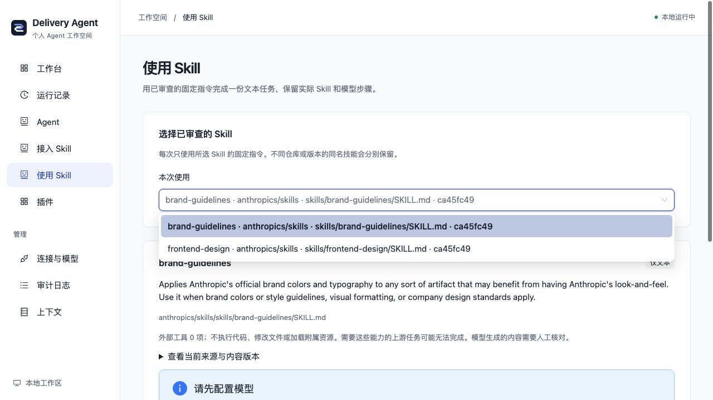
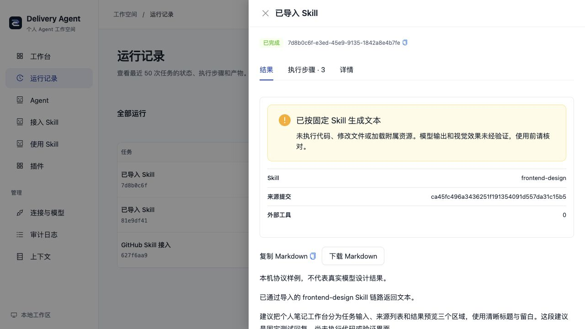

# 从 GitHub 接入与选择文本 Skill

用公开 GitHub 的 SKILL.md 文件链接，查看完整内容、固定版本和可用许可；审查后导出本地配置，再通过已有 Prompt Skill Runtime 运行。适合可用文字完成的写作、规划、设计建议和代码文本任务。

这里只导入指令文本，外部工具权限为 0。不会克隆或安装仓库、执行脚本、读取工作区文件、浏览网页或加载 references/assets。需要这些资源的 Skill 不能完整运行，可继续用[原生插件规范](PLUGIN_AUTHORING.md)或[MCP 工具](MCP_TOOLS.md)适配。

## 本地使用

推荐从默认工作台的「插件 → 接入与组合 → 启用接入助手」选择 GitHub Skill，生成配置、下载保存并按页面命令重启，再打开「接入 Skill」。完整步骤见[首次启用](PLUGIN_PROFILES.md#首次启用接入助手)。

也可在仓库根目录直接启动独立的发现组合：

```bash
AGENT_PLUGINS_FILE=examples/plugins.skills.yaml bun run local
```

该组合包含三个模型提供者和 skills.setup，共四插件、一个 Agent；读取来源无需模型。它完整替换本次默认组合，不叠加团队或个人知识插件。数据库和原历史保留；切回原配置即可恢复原组合。

1. 打开「接入 Skill」，填写 GitHub 文件链接。可以点击填入 Anthropic 前端设计示例，再明确读取。
2. 查看完整 SKILL.md、固定提交、SHA-256、上游环境/工具声明与许可。声明的工具不会被自动授予；许可文件未取得时请自行核对。
3. 核对文本范围与使用权限。页面默认勾选“保留本机个人工作台”，可继续使用自己的知识、研究、资料库和配方；也可取消选择独立 Skill 组合。
4. 下载审查配置。服务绑定原成功发现记录和指纹，不接受客户端指令正文，不自动启用。保留个人工作台时，将 `plugins.skills-personal.local.yaml` 保存到 `backend`，停止当前进程，再从根目录启动：

```bash
AGENT_PLUGINS_FILE=plugins.skills-personal.local.yaml bun run local
```

保留个人工作台的配置声明 `base: personal`，在重启时按「连接与模型」里的来源和仓库设置组合个人能力，再追加 skills.setup / skills.prompt；在个人基底上追加两个插件、两个 Agent（实际总数见[首页组合表](../README.md#能力与插件)），导航出现「使用 Skill」且保留「知识库」。它不合并其他自定义插件或团队组合，也不冻结整个环境。重复基底插件 ID 会拒绝启动，不会覆盖。

取消保留时，单份仍导出 plugins.skill-reviewed.local.yaml（多份为 plugins.skills-reviewed.local.yaml），保持旧的五插件、两 Agent 独立组合，启动时使用下载的实际文件名。

配置包含完整的固定指令、来源和已取得的许可正文，不含模型密钥；`*.local.yaml` 默认被 Git 忽略。请保留来源和许可，不把包含个人配置的文件提交到仓库。

在「连接与模型」填写自己的标准提供者设置，保存后重启。进入「使用 Skill」填写目标、材料和约束，结果以文本返回；实际经过 SkillRuntime、Prompt Executor 与模型网关，详情中可以查看 Skill/Model Step。SDK 可能重试，不能把一次任务等同于一次计费请求。无需真实模型即可完成读取/审查/导出；没有配置时生成按钮禁用，后端也会拒绝。

## 把多份 Skill 放进同一工作台

逐份读取并查看完整指令、固定提交和许可，勾选两项审查后点“加入待导出列表”。再读取另一份，重复审查加入；列表只在本页内存保存，刷新后可从成功发现记录重新加入。最多八份，同一固定来源和内容不重复添加。

点“下载所选 Skill 的配置”，服务会重新核验每项原运行的归属、成功状态和内容指纹。任意项失效则整份不导出。勾选保留个人工作台时，把 plugins.skills-personal.local.yaml 保存到 backend 后，选择并重启：

```bash
AGENT_PLUGINS_FILE=plugins.skills-personal.local.yaml bun run local
```

保留选项与单份一致；取消时仍是五插件、两个 Agent，只包含所选 Skill、接入助手及三个模型提供者。在“使用 Skill”的“本次使用”列表明确选一份，再填写任务；只有一份时可直接使用。每次只发送所选指令，其他 Skill 正文不会进入该模型请求。不同仓库/路径/提交的同名 Skill 分别显示，不按名称隐式覆盖。

新集合的 skillId 由仓库 owner/repo 小写归一后的固定来源 URL 和原文 SHA 共同生成，与配置顺序无关。旧版本移除后，旧任务参数不会自动改跑另一份；重新选择并核对来源后再发起。结果保留实际 ID、仓库、路径、提交和指令指纹。旧单份配置继续可用；多份配置下旧单份描述 API 返回 409，目录接口为 GET /api/skill-runner/skills。

Skill 配置 JSON 的 UTF-8 总量最多 512 KiB，原文每份最多 128 KiB、许可最多 64 KiB；导出 YAML 大小可能不同。指令、工具权限和运行上限不因集合增多而扩大。这里没有自动选 Skill、多技能串联、附属资源加载或在线热安装。

设计参考 [Agent Skills 官方接入指南](https://agentskills.io/client-implementation/adding-skills-support)的显式激活和按需提供指令思路。本项目在本机已审查目录中使用内容来源 ID 区分同名技能，属于自身运行选择规则，不声称实现所有官方集成路径。

## 让 Skill 使用自己的知识资料

1. 使用保留个人工作台的配置，在「知识库 → 配置来源」选择 Markdown/Obsidian 目录、公开链接或应用资料库，保存后重启。首次可用明确标记的虚构示例。
2. 先检索原文，完成一次命中资料的检索；资料不足时调整关键词。检索无需模型。
3. 在「使用 Skill」明确选一份方法，勾选“为本次任务选择知识检索资料”，从最近 50 次根运行中选择成功检索。
4. 展开查看将发送的片段、行号和文档版本；可打开原检索。确认发送给当前模型后，再填写目标并生成。
5. 运行详情保留文本、Skill 来源和“本次选择的知识快照”，可返回原检索。关闭页面后可从运行记录找回。

这份资料是**历史快照**，不会在 Skill 执行时重新读取笔记或网页。需要最新资料时先重新检索。每次任务只接受原 Run ID、快照 SHA 和人工确认，不能从客户端注入或替换片段；服务复验归属、成功状态和内容。普通 Skill 文本任务可不选择资料，行为保持。

最多十条、12000 个标题/小标题/原文字符；不完整来源与上下文截断会提示。模型收到任务、所选 Skill 指令及片段 ID/标题/小标题/原文、历史与 partial 标记；不额外发送路径、打开 URI 或版本字段，文字本身仍可能包含这些信息。未选资料及其他 Skill 正文不进入本次请求。

模型调用前先保存选择快照和守卫步骤，失败或取消时也能看到选入了什么。它不证明模型已收到或实际采用片段，不核验自由文本中的事实、引用或当前来源；这些状态明确为未验证/未检查。RAG 的结构化精确引文核验是另一条既有管线，不会自动应用到任意 Skill 输出。

## 已实际验证的公开来源

本地浏览器实际读取 [Anthropic frontend-design](https://github.com/anthropics/skills/blob/ca45fc496a3436251f191354091d557da31c15b5/skills/frontend-design/SKILL.md)：

- 提交：`ca45fc496a3436251f191354091d557da31c15b5`。
- 原始文件：9,390 字节，SHA-256 `d91970639e9f5c37682ac7ab60094d35f1c7c1f38d731bd56396563aee10c1d3`。
- 取得同一提交的[许可文件](https://github.com/anthropics/skills/blob/ca45fc496a3436251f191354091d557da31c15b5/skills/frontend-design/LICENSE.txt)，10,174 字节，Apache 2.0；许可原文随下载配置保存。其他 Skill 的许可需要逐一核对，系统不作许可判断。

本次多份集合还实际读取了 [Anthropic brand-guidelines](https://github.com/anthropics/skills/blob/ca45fc496a3436251f191354091d557da31c15b5/skills/brand-guidelines/SKILL.md)：同一固定提交，原文 2,235 字节，SHA-256 `1120b3769e2985cefb3d25be981b1f914abeba57ae079b83c20c666c164fa9fe`。取得同提交的 [LICENSE.txt](https://github.com/anthropics/skills/blob/ca45fc496a3436251f191354091d557da31c15b5/skills/brand-guidelines/LICENSE.txt)，11,345 字节，含 Apache 2.0 文本及上游版权。两份已通过页面逐项加入、下载为同一配置并原样重启装配；这里只使用其文字指令，没有执行其中提及的 python-pptx、安装字体或制作品牌文件。



下载的配置已实际保存并重启装配。使用本机受控 OpenAI 协议服务，确认模型请求包含原 Skill 正文，并生成有 Agent/Skill/Model 三个步骤的运行。下图的回答明确标记为固定协议样例，**不代表真实模型质量、前端设计效果或代码执行**。



清空演示模型并重启后，来源、三条历史根运行和结果仍可读取；375px 下的审查、长指纹、完整指令与历史结果没有页面横向溢出。实际使用时换成自己的模型，结果仍需核对。

## 支持范围与版本凭证

- 链接需为公开 github.com 的 blob 文件地址，分支名不含斜杠，路径暂限 ASCII；只使用默认 HTTPS 端口。私有仓库、Enterprise、认证和任意仓库代码执行不在当前范围。
- 分支先解析为完整提交，再读取固定原文；运行使用配置中的快照，不在每次任务开始时拉取 GitHub。上游更新后需重新发现、审查与导出。
- 可装配一至八份审查后的文本 Skill，单次只运行明确选择的一份；旧单份仍使用 community.imported-prompt。上下游元数据不会授予 Bash、Read 或任意其他外部 Tool。
- 原始文件 SHA 对应完整 SKILL.md；执行步骤另存已注册指令 SHA（正文加宿主边界），成功产物也保留。它不代表完整模型请求、权重或语义质量，也不是来源签名。
- Skill 最长 45 秒，输出最多 256 KiB。模型内容与代码文本不等于实际执行、文件修改或渲染验证；附属资源缺失会限制能力。
- Skill 内部不支持持久化人工追问。既有模型执行器的内部追问函数可能使该次 Skill 失败；应补全任务后重新运行。Agent 层已有的暂停/恢复能力保持。
- 读取 GitHub 会把公开仓库路径发给 GitHub；运行时把固定指令、任务及明确确认的知识片段发给所选模型。应用仍是本机管理界面，不是公开的多用户服务或进程沙箱。

实现/测试地图见[功能卡](../backend/src/connectors/skill-workbench/FEATURE.md)、[专项测试](../backend/test/skillWorkbench.test.ts)、[知识快照测试](../backend/test/skillKnowledgeContext.test.ts)与[取消/超时回归](../backend/test/toolSkillRuntime.test.ts)。标准文件格式参考 [Agent Skills 官方规范](https://agentskills.io/specification)；现有本地导入和 Context7 工具适配见[社区接入指南](COMMUNITY_PLUGINS.md)。
