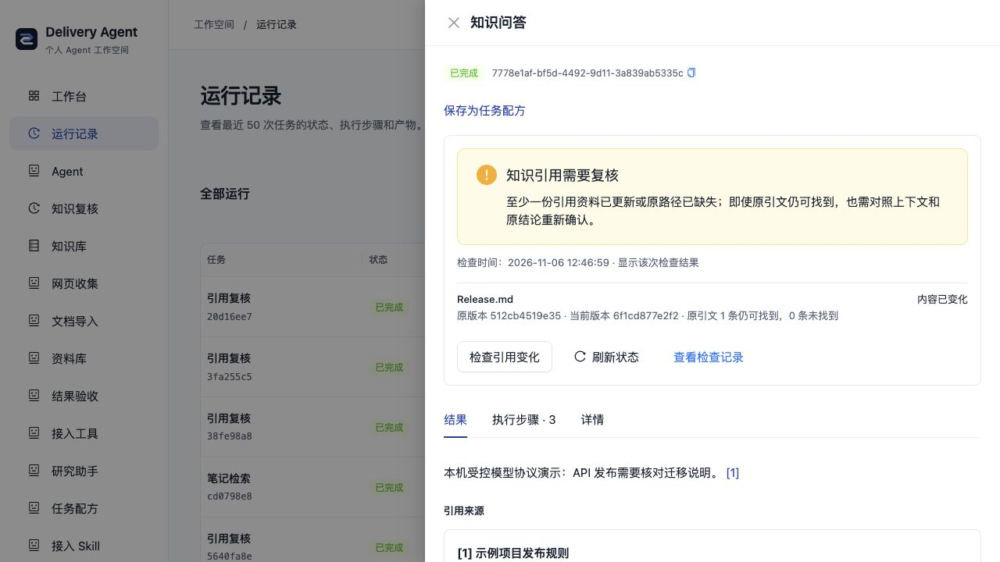

# 检查知识更新影响了哪些旧结果

当前可在本机保存回答和发布草稿，之后显式检查它们实际引用的知识版本。只检查指定 Run 的直接引用，原回答、草稿、引文和来源版本保持不变。可选定期复核插件可检查明确选定的结果；未提供全库通知或语义影响判断。

## 在本机工作台使用

在「知识库」生成带引用回答后，详情里点击「检查引用变化」。来源未变会显示版本未变化；修改被引用资料后再次检查，会提示需要复核。每次检查创建独立 Run 与报告，可在原结果和检查记录间切换；原回答、引文与版本不改写。检查不调用模型，网页检查仍请求选定网站。

「刷新状态」仅显示最近一次评估及检查时间，不刷新来源，也不表示持续监控。HTTP 默认知识组合装配复核插件；通过 AGENT_PLUGINS_FILE 自选组合时，需要显式选择对应来源的 knowledge.impact 插件。发布草稿还需显式装配发布与 GitHub 插件。

## 检查之后，按当前资料重新回答

回到原知识回答，点击「按最新资料重新回答」，核对原问题、当前来源与模型后明确确认。系统沿用问题重新检索并生成独立新结果，结果可返回原回答；原回答和原复核记录保持。生成会向你当前配置的模型发送选中片段，需要模型可用。操作详见[使用说明](USER_GUIDE.md#用最新资料重新回答旧问题)。

它不是语义修订建议：不会比较哪条新旧结论更可信，也不替换旧方案或自动写笔记。当前按钮适用于成功根知识回答；发布草稿继续使用原发布准备入口。

## 看懂版本变化与引文结果

检查报告会分别显示文档版本和原引文检查结果：

| 显示 | 含义 |
| --- | --- |
| 文档变化，引文仍可找到 | 原文字串仍在当前正文中，仍需核对周围上下文和原结论 |
| 文档变化，引文未找到 | 该文字串没有在当前正文找到，报告展示首条未找到引文的短预览 |
| 未检查引文 | 旧评估、来源未提供该能力或超出检查预算；文档版本结果仍可用 |



引文匹配不是语义判断：即使一句话被移动、引用或放进否定句，原文字串仍可能存在。文档版本有变化时始终提示复核，不自动把旧答案变成可信结论。相同文档版本却无法找到原引文时，显示无法核验，避免历史证据异常被标绿。未找到也不自动证明原结论错误。

每份文档最多检查 32 条不同引文，每批最多 200 条、合计 64 KiB。超过预算的文档继续比较版本，明确不检查引文；可缩小批量后重试。检查复用原来源读取，不为每条引文额外发起请求，也不调用模型。

## 保存一次回答

从 `backend` 执行，先按[知识使用指南](PERSONAL_KNOWLEDGE.md)配置可信的 KNOWLEDGE_API_BASE/MODEL/API_KEY。复制虚构资料到临时目录，避免修改自己的笔记：

```bash
demo_vault=$(mktemp -d)
cp examples/knowledge-vault/*.md "$demo_vault/"
bun run src/scripts/knowledge.ts \
  --root "$demo_vault" \
  --state ../data/personal-runtime.sqlite \
  --ask 'API 变更发布前需要哪些迁移说明？'
```

记录输出的 runId。state 文件保存原 Run、Tool 结果、问题、选中片段和 Artifact，包含个人资料；它不是加密存储。默认文件权限为 0600，新建父目录为 0700。项目 data 目录被 Git 忽略，仍需自行管理备份与设备权限。不传 state 时保持原内存模式，退出后不能检查那次运行。

## 修改知识后复核

在同一 shell 中修改虚构发布规则：

```bash
printf '\nAPI 变更发布前还需要人工确认。\n' >> "$demo_vault/Release.md"
bun run src/scripts/knowledge.ts \
  --root "$demo_vault" \
  --state ../data/personal-runtime.sqlite \
  --check-run '<上一步的 runId>'
```

check-run 可重复，最多二十个不同 Run。检查不需要模型配置，不调用模型；网页来源仍会请求用户明确配置的网站。它按实际保存的引用读取当前文档版本，不能把更换后的同名 Vault 当成原来源。源文件改名按旧路径缺失处理。

返回 assessments，每项包含原 runId、artifactIds、checkedAt、references 和 state：

| state | 含义 |
| --- | --- |
| current | 实际被引用文档仍是同一来源与同一内容版本；不表示原结论语义正确 |
| needs_review | 至少一个被引用文档变化或在成功扫描范围内缺失，原产物需复核 |
| unverifiable | 来源不可读、选择了其他范围、旧记录缺少来源身份、格式不受支持或检查失败 |
| not_applicable | 该受支持结果没有实际知识引用，例如仅取证的发布运行或未引用规则的草稿 |

文档级版本变化会触发复核；同一文档的其他段落变化也可能触发。未被引用的其他笔记变化不会误报。网页请求失败不证明页面删除，所以标为 unavailable/unverifiable。旧格式没有 sourceKey 时明确标为 legacy_unverifiable，不按当前目录猜测来源。

## 查看上次评估

```bash
bun run src/scripts/knowledge.ts \
  --root "$demo_vault" \
  --state ../data/personal-runtime.sqlite \
  --check-run '<原 runId>' \
  --impact-status
```

这条命令不刷新知识，只返回最近一次评估和时间。没有检查为 not_checked；上次检查中断为 check_incomplete，不能当成 current。需要实时结果时去掉 impact-status。

## 检查发布草稿或网页知识

发布命令也可加 `--state ../data/personal-runtime.sqlite`，见[发布准备指南](RELEASE_PREPARATION.md)。之后用相同状态文件和知识目录执行 check-run。规则同时被供给模型但没有被实际引用时，不会当作已记录依赖。

网页模式使用与生成时对应的公开 URL：

```bash
bun run src/scripts/knowledge.ts \
  --url https://example.com/policy \
  --state ../data/personal-runtime.sqlite \
  --check-run '<网页回答或发布草稿的 runId>'
```

URL 是占位示例。混合来源按原组合中的对应版本工具核验；来源不同则标记范围不匹配，不切换来源去匹配旧引用。不能拿普通 query/sync 的 Run 当成生成答案；检查当前支持 knowledge.answer 和 release.prepare 的成功记录。

## 本地状态的边界

同一文件只允许一个活跃 CLI 会话，避免第二个 Host 把第一个仍运行的任务误认为进程重启遗留。锁由单独 .lock SQLite 事务持有；进程退出后自动释放，不要手工删除正在使用的锁文件。强制退出后的已提交记录可恢复，未完成运行与检查明确保留失败/未知状态。

备份时先结束使用该文件的 CLI，完整关闭后再复制状态文件。运行时 WAL/SHM 文件可能包含已提交数据，不能只复制主文件冒充一致备份。不要指向已有业务数据库：带其他应用数据或不支持版本的文件会拒绝，不覆盖它们。

当前面向 macOS/Linux 等具有 POSIX 文件权限的可信本地文件系统，不用于网络共享、多主机协作或公共网站认证。来源索引仍是可重建内存数据，state 并不把整座 Vault 复制成永久知识库。

实现与验证见[功能卡](../backend/src/knowledge/impact/FEATURE.md)。验证使用本地模拟模型及真实 CLI 子进程，包含只改未引用笔记、改名、失效、同名不同 Vault、旧格式、作用域、并发评估和进程强制退出恢复。

## 在工作台集中复核

打开「知识复核」，可搜索引用路径或运行 ID，并按上次状态筛选。页面列出最近 50 次根运行中的成功知识回答和发布草稿；没有实际引用的结果无需检查，历史格式无法识别时会明确标记。勾选需要的记录或选择筛选结果前 20 条，再点击「检查所选引用」，即可生成一次独立批量报告。

“刷新列表”只读原引用和已有评估，状态可能早于当前文件变更。“上次版本未变化”仅说明显示时间那次的内容版本一致；需要读取当前笔记/网页时明确执行检查。网页检查可能产生网络请求，不调用模型。搜索或状态切换会清空选择，最多一次检查 20 条；完成后可查看原结果和检查记录，原回答与引文保留。

该入口随 knowledge.impact 安装，不增加独立 Agent；移除插件会移除页面/API。它没有提供全历史索引、实时监听、自动重生成或语义判断。


## 定期复核

在仓库根目录选择可选插件并重启本地服务：

```sh
AGENT_PLUGINS_FILE=examples/plugins.knowledge-watch-personal.yaml bun run local
```

它保留当前个人基底和来源设置，追加一个控制面插件；标准示例为十六插件九 Agent。
此示例不自动合并其他自定义附加插件，组合自己已有 YAML 时只追加 knowledge/watch/plugin.ts 一次。

1. 打开「知识复核」，选择 1–20 条带完整引用的成功回答或发布草稿。
2. 在「定期复核」选择每分钟、15 分钟、小时或 24 小时，点击「为所选结果开启计划」。
3. 保存后等待一个周期，服务约每三十秒查看到期计划；页内状态会读取新评估和检查时间。
4. 可查看计划内的结果、上次检查和来源凭证，或暂停、恢复、用新的选择替换计划。

每个工作区只有一份计划，更新会替换原目标和频率。暂停后已开始的检查仍会收尾并保留报告；
关闭本地服务期间不执行，恢复后最多补一次到期检查，下一周期按实际发起时间计算。
复核不调用模型或重写原结果；公开网页仍按原来源规则发起读取。

knowledge.watch 1.1.0 通过正式本机 schedule 通道执行，详情显示“定时触发”与独立计划来源凭证。
旧 1.0 计划绑定旧执行契约，升级后到期会自动暂停；核对后点击「按此频率启用原计划」继续。
没有重新勾选结果时，可直接更新原计划频率或重新启用，即使原结果不在当前筛选或最近五十条中。
执行版本或安装绑定再次改变也会自动暂停；失败和未知状态不会补成通过。这里只比较实际引用文档的版本，仍需人工判断结论是否受影响。
实现、存储和测试边界见[定期复核功能卡](../backend/src/knowledge/watch/FEATURE.md)。


## 来源插件的兼容协议

versions Tool 可通过输入 JSON Schema 的 documents.items.properties.quotes 声明可选逐字检查，字段为唯一的非空字符串数组，每条最多 2000 字符。版本请求与结果仍保留 path/sourceKey/documentVersion；可读且范围匹配时可返回 quoteChecks:[{quote,status:"found"|"not_found"}]，只回显请求中的引文，不返回当前完整正文。结果须完整对应本次提交的引文；缺失该能力仍保留原文档级检查。旧来源不声明该输入字段时不会收到 quotes。当前内置协议为 versions Tool 1.2.0，预算和校验由 backend/src/knowledge/versions.ts 统一定义。

本次复核 Agent 升至 1.2.0。旧定期计划若提示执行契约变化，请核对所选结果与能力后重新保存计划；原计划与运行历史保留。
